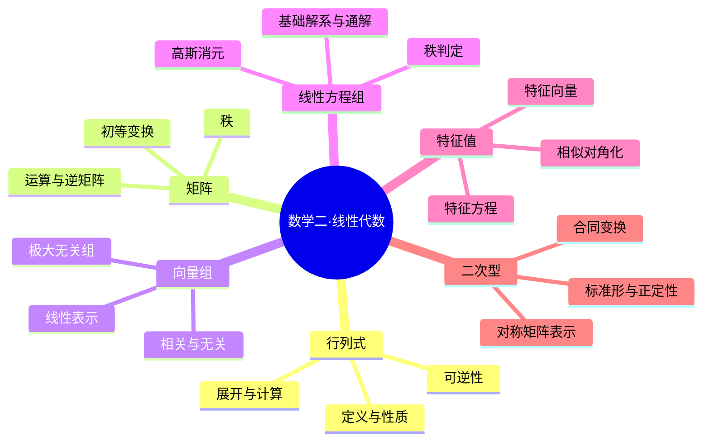

# 线性代数｜核心概念卡

> 数学二 · 2028 考研基础阶段。围绕“行列式—矩阵—向量组—方程组—特征值—二次型”建立可回忆、可推导、可做题的卡片体系。

## 我的笔记记录

> 本页严格按章节笔记模板组织：先概念卡，再知识卡与思维导图，再建立原子化知识卡的父级、延伸和关联，最后分别执行五大经典学习法。原有 6 张 LA 卡片作为章节主线的原子化知识节点。

### 一、概念卡｜双栏概念辨析

<table width="100%">
<tr>
<td width="50%" valign="top">
<h3>🔢 行列式与矩阵</h3>
<ul>
<li><b>行列式：</b>方阵对应的数值，刻画线性变换对有向体积的缩放。</li>
<li><b>矩阵：</b>按行列排列的数表，可表示线性映射与线性方程组。</li>
<li><b>矩阵秩：</b>行/列向量组的最大线性无关个数。</li>
<li><b>可逆矩阵：</b>存在逆矩阵，等价于行列式非零、满秩。</li>
</ul>

<b>易混边界：</b>矩阵行变换不改变秩，但行列式会按规则变化；矩阵乘法一般不可交换。

</td>
<td width="50%" valign="top">
<h3>🧮 向量、方程组与二次型</h3>
<ul>
<li><b>线性表示：</b>目标向量是已知向量的线性组合。</li>
<li><b>线性相关：</b>存在不全为零的系数使线性组合为零。</li>
<li><b>解空间：</b>齐次方程组解构成的线性空间。</li>
<li><b>特征向量：</b>在线性变换下方向不变的非零向量。</li>
<li><b>二次型：</b>可写为 $x^TAx$ 的二次齐次表达式。</li>
</ul>

<b>易混边界：</b>相似、等价、合同保持的性质不同；特征值重复不意味着一定不能对角化。

</td>
</tr>
</table>

### 二、知识卡｜章节思维导图与方法总览

**章节解题总流程：** 识别矩阵/向量/方程对象 → 检查维数与前提 → 选择行列式、秩、消元或特征值工具 → 写出等价变形 → 检查秩、自由变量、独立性或正定条件。

### 三、原子化知识卡｜父级、延伸与关联

| 卡片 ID | 原子概念 | 父级主线 | 延伸卡 / 章节 | 关键关联 |
|---|---|---|---|---|
| LA-01 | 行列式与可逆性 | 行列式 | [第01章](../第01章-行列式.md) | LA-02：行列式非零与满秩等价 |
| LA-02 | 矩阵运算、初等变换与秩 | 矩阵 | [第02章](../第02章-矩阵.md) | LA-03、LA-04：秩连接向量组和方程组 |
| LA-03 | 线性表示与线性相关 | 向量组 | [第03章](../第03章-向量组.md) | LA-04：线性表示转化为非齐次方程组 |
| LA-04 | 线性方程组与解空间 | 线性方程组 | [第04章](../第04章-线性方程组.md) | LA-03：解的存在性由秩判定 |
| LA-05 | 特征值与相似对角化 | 特征值理论 | [第05章](../第05章-特征值与特征向量.md) | LA-01、LA-02：迹、行列式、秩可作校验 |
| LA-06 | 二次型与正定性 | 二次型 | [第06章](../第06章-二次型.md) | LA-05：实对称矩阵正交对角化 |

**原子化原则：** 每张卡只记录一个可独立解释的知识点，写清定义、条件、推导、例题、易错点、自测；通过父级、延伸和关联回到章节体系，避免孤立记忆。

### 四、五大经典学习法｜分别执行，不互相替代

#### 4.1 费曼学习法：把抽象结构讲明白

**任务：**
1. 用面积缩放解释行列式绝对值的几何意义。
2. 解释矩阵秩为何是“独立信息的数量”，并举一个秩小于行数的例子。
3. 用“能否拼出来”解释线性表示，用“不全为零的系数解”解释线性相关。
4. 解释为什么齐次方程组总有零解，以及何时存在非零解。
5. 用几何语言解释特征向量与特征值。
6. 解释二次型为什么可以用对称矩阵表示，以及合同变换的含义。

**输出要求：** 每个概念按“定义—直观解释—矩阵表达—例子—易错边界”讲解；不得只背结论。

#### 4.2 西蒙学习法：按依赖关系拆分知识块

| 模块 | 学习内容 | 前置依赖 | 达标任务 |
|---|---|---|---|
| A 行列式 | 性质、展开、特殊行列式、可逆判定 | 无 | 计算 6 题，解释行变换影响 |
| B 矩阵与秩 | 运算、逆矩阵、初等变换、秩 | A | 秩计算 5 题、矩阵性质 4 题 |
| C 向量组 | 线性表示、相关性、极大无关组 | B | 线性表示 3 题、相关性 4 题 |
| D 方程组 | 秩判定、消元、基础解系、通解 | B、C | 齐次/非齐次各 3 题，含参数 1 题 |
| E 特征值 | 特征方程、特征子空间、相似对角化 | A、B、C | 求特征值 4 题、对角化 2 题 |
| F 二次型 | 对称矩阵、合同变换、标准形、正定 | A、B、E | 矩阵表示 3 题、正定性 4 题 |

**刻意练习闭环：** 先独立计算，再写理由；错题归类为性质误用、维数错误、行列式因子遗漏、秩判定错误、自由变量遗漏、特征向量不独立或合同变换方向错误。次日用同类变式验证。

#### 4.3 SQ3R 阅读法：围绕条件和等价关系阅读

| 阶段 | 具体动作 | 必须留下的成果 |
|---|---|---|
| Survey 浏览 | 先看“行列式—矩阵—向量组—方程组—特征值—二次型”地图 | 一张章节结构图 |
| Question 提问 | 先问：行列式非零为什么等价于可逆？秩如何决定解空间维数？重复特征值何时可对角化？ | 至少 8 个问题 |
| Read 精读 | 对每个定理标注充分必要条件；对矩阵变换写明维数与可逆要求 | 条件清单与推导 |
| Recite 复述 | 合上资料，复述秩判定、消元步骤、特征值求法和正定判据 | 无提示复述记录 |
| Review 复习 | 1、3、7、14 天重做错题，重点检查等价条件和参数分类 | 错题回访记录 |

**阅读自问：** 行列式为零是否意味着零矩阵？行初等变换保持哪些量？线性相关定义中的系数为何“不全为零”？非齐次通解为什么要加特解？特征值重根时要检查什么？正定顺序主子式判据的适用条件是什么？

#### 4.4 番茄工作法：四个专注番茄 + 一个纠错番茄

| 番茄 | 任务 | 验收产出 |
|---|---|---|
| 1 概念 | 复述定义、性质与适用条件 | 不看资料写出关键判据 |
| 2 计算 | 独立完成行列式、秩或消元计算 | 每步变换标注理由 |
| 3 综合 | 完成向量组/方程组/特征值综合题 | 写出完整逻辑链 |
| 4 变式 | 对参数、矩阵阶数或特征值重数作变化 | 写出分类讨论依据 |
| 5 纠错 | 重做错误题并整理错因 | 错因标签 + 同类题 |

每个番茄 25 分钟专注、5 分钟休息。连续两个番茄仍卡住时，拆分成“条件识别、等价变形、计算执行、结论核验”四个更小步骤。

#### 4.5 康奈尔笔记法：线索、主体、总结三栏

| 左侧线索 / 自测问题 | 右侧主体笔记 |
|---|---|
| 行列式非零意味着什么？ | 方阵可逆、满秩；可用逆矩阵、秩或行列式相互校验。 |
| 三种初等行变换对行列式影响？ | 交换变号；某行乘 k，行列式乘 k；某行加另一行倍数，行列式不变。 |
| 矩阵秩是什么？ | 最大线性无关行/列数；初等行变换不改变秩。 |
| 向量组线性相关？ | 存在不全为零的系数使线性组合为零；列秩小于列数。 |
| 线性方程组有解条件？ | $r(A)=r(A|b)$；自由变量数为 $n-r(A)$。 |
| 何时可相似对角化？ | 有 n 个线性无关特征向量；互异特征值足够，但重根需进一步检查。 |
| 二次型如何判正定？ | 对实对称矩阵，可检查定义、特征值或所有顺序主子式。 |

**页底总结：** 线性代数的核心是线性相关性与秩。行列式判断方阵可逆性，矩阵秩统一连接向量组与方程组，特征值揭示线性变换的特殊方向，二次型通过对称矩阵和合同变换研究结构。解题时必须写清维数、条件、变换规则和自由变量。

#### 4.6 五法融合自测与通关标准

1. 说明行列式非零、矩阵可逆、满秩三者的等价关系及适用对象。
2. 给定矩阵，写出初等行变换过程并求秩。
3. 将向量线性表示问题转化为矩阵方程，并用秩判断有解性。
4. 判断齐次方程组是否存在非零解，并写出解空间维数。
5. 求矩阵特征值和特征向量，判断是否可对角化。
6. 将二次型写成对称矩阵并用顺序主子式判断正定性。

**参考答案检查点：** 等价关系针对 n 阶方阵；行变换保秩但行列式需跟踪变化；线性表示检查 $r(A)=r(A|b)$；齐次非零解条件为 $r(A)<n$；对角化要求 n 个线性无关特征向量；Sylvester 判据要求实对称矩阵且所有顺序主子式为正。

**通关标准：**
- [ ] 能解释行列式、矩阵秩、线性相关、解空间、特征值和二次型
- [ ] 能正确使用初等变换并追踪行列式变化
- [ ] 能根据秩判断方程组解的存在性和结构
- [ ] 能判断重特征值情形下是否可对角化
- [ ] 能正确区分相似变换与合同变换
- [ ] 六道融合自测至少正确五道，并能说明每个结论的前提

---

## 卡片导航

| 卡片 | 核心问题 | 对应章节 |
|---|---|---|
| [LA-01 行列式与可逆性](#la-01-行列式与可逆性) | 行列式如何计算，何时判断可逆？ | 第 01 章 |
| [LA-02 矩阵运算、初等变换与秩](#la-02-矩阵运算初等变换与秩) | 矩阵运算与秩如何关联？ | 第 02 章 |
| [LA-03 线性表示与线性相关](#la-03-线性表示与线性相关) | 如何判断向量能否表示、向量组是否相关？ | 第 03 章 |
| [LA-04 线性方程组与解空间](#la-04-线性方程组与解空间) | 如何判断解的存在性、个数与结构？ | 第 04 章 |
| [LA-05 特征值与相似对角化](#la-05-特征值与相似对角化) | 特征值、特征向量与对角化如何联系？ | 第 05 章 |
| [LA-06 二次型与正定性](#la-06-二次型与正定性) | 如何写矩阵、化标准形并判定正定？ | 第 06 章 |

---

## LA-01 行列式与可逆性

**正面问题：** 行列式表示什么？怎样计算？行列式与矩阵可逆有什么关系？

**背面答案：** 行列式是方阵对应的一个数值，反映线性变换对有向体积的缩放。行列式非零等价于方阵可逆、满秩。

$$
|A|\ne0\iff A^{-1}\text{ 存在}\iff r(A)=n.
$$

### 计算策略

1. 三角化：通过行变换化为上/下三角矩阵，行列式等于对角线元素乘积，再还原变换影响。
2. 按行/列展开：选择零多、结构简单的行或列。
3. 提公因子、拆行列、利用比例行/列和相同行/列判零。
4. 识别特殊结构，如范德蒙德型。

### 三种初等行变换对行列式的影响

| 变换 | 行列式变化 |
|---|---|
| 交换两行 | 变号 |
| 某行乘 $k$（$k\ne0$ 的初等变换） | 行列式乘 $k$ |
| 某行加上另一行的 $k$ 倍 | 不变 |

注意：矩阵的初等行变换与行列式数值变化规则不能混淆；倍加变换不改变行列式，交换变号，倍乘改变倍数。

### 易错点

- 行列式只对方阵定义。
- 行列式按行/列展开时，代数余子式符号为 $(-1)^{i+j}$。
- 交换两行变号；不能把“倍加不变”推广到交换或倍乘。
- $|A|=0$ 说明不可逆，不代表矩阵每个元素为零。

### 五法学习任务

- **费曼：** 用二维面积缩放解释行列式绝对值的几何意义。
- **西蒙：** 按“结构观察—初等变换—展开/特殊公式—结果复核”组织计算。
- **SQ3R：** 先浏览性质表，提出每种变换对行列式的影响，再阅读例题。
- **番茄：** 25 分钟做 8 道行列式题，至少 2 道需要还原变换因子。
- **康奈尔：** 左栏写变换名称，右栏记录变化规则，底部写“交换变号、倍乘变倍、倍加不变”。

**主动回忆：** 为什么 $|A|\ne0$ 能推出 $A$ 可逆？矩阵行变换和行列式变换规则有何不同？

---

## LA-02 矩阵运算、初等变换与秩

**正面问题：** 矩阵乘法、逆矩阵、初等变换和矩阵秩分别解决什么问题？

### 核心运算

若 $A$ 为 $m\times n$，$B$ 为 $n\times p$，则 $AB$ 为 $m\times p$。矩阵乘法一般不交换：

$$
AB\ne BA.
$$

转置与逆矩阵：

$$
(AB)^T=B^TA^T,\qquad
(AB)^{-1}=B^{-1}A^{-1}.
$$

第二式要求 $A,B$ 均可逆且乘法维数匹配。逆矩阵存在当且仅当方阵满秩。

### 矩阵秩

矩阵的秩是最大线性无关行（列）向量个数，也等于非零子式的最高阶数、行阶梯形中的非零行数。

$$
r(A)=r(A^T),\quad
0\le r(A)\le\min(m,n).
$$

初等行变换不改变矩阵秩；行等价矩阵秩相同。行列式的数值规则不能直接套用到矩阵秩上。

### 常用秩结论

- $r(A)=n$（$n$ 阶方阵）当且仅当 $A$ 可逆。
- $r(AB)\le\min(r(A),r(B))$。
- $r(A+B)\le r(A)+r(B)$。
- 若 $P,Q$ 可逆，则 $r(PAQ)=r(A)$。

### 易错点

- 矩阵乘法维数不匹配。
- 把 $AB$ 与 $BA$ 当作可交换。
- 逆矩阵乘积次序写反。
- 把行变换后矩阵的主元列位置直接当作原矩阵主元列，选列向量组时应回到原矩阵。
- 把“秩不变”误解成“行列式不变”。

### 五法学习任务

- **费曼：** 解释矩阵秩为何可以理解为独立信息的数量。
- **西蒙：** 运算题先检查维数，再判断是否可逆，最后应用性质或消元。
- **SQ3R：** 阅读秩的三种等价定义，尝试用同一矩阵分别说明。
- **番茄：** 25 分钟完成 6 道秩与矩阵运算题。
- **康奈尔：** 左栏写性质名称，右栏写条件和反例，底部总结乘积逆序规则。

**主动回忆：** 为什么 $(AB)^{-1}$ 的顺序要反过来？行初等变换为什么不改变矩阵秩？

---

## LA-03 线性表示与线性相关

**正面问题：** 如何判断一个向量能否由一组向量线性表示？如何判断向量组相关？

### 线性表示

若存在系数 $k_1,\ldots,k_m$ 使：

$$
\beta=k_1\alpha_1+\cdots+k_m\alpha_m,
$$

则称 $\beta$ 可由向量组线性表示。将向量作为列组成 $A$，则等价于：

$$
Ax=\beta.
$$

有解当且仅当：

$$
r(A)=r(A|\beta).
$$

### 线性相关

若齐次方程：

$$
k_1\alpha_1+\cdots+k_m\alpha_m=0
$$

存在不全为零的解，则向量组线性相关；只有零解则线性无关。

若 $A$ 的列向量为该向量组：

$$
\text{列向量组线性无关}\iff r(A)=m.
$$

### 高频结论

- 含零向量的向量组必相关。
- $m$ 个 $n$ 维向量，若 $m>n$，必相关。
- 向量组秩等于对应列矩阵的秩。
- 极大线性无关组所含向量个数唯一，但具体选出的向量不一定唯一。
- 选取极大无关组时，行化简后应回到原矩阵取对应主元列。

### 典型例题

若 $\alpha_3=\alpha_1+2\alpha_2$，则：

$$
\alpha_1+2\alpha_2-\alpha_3=0,
$$

系数不全为零，所以三向量组线性相关。

### 易错点

- 相关要求存在“不全为零”的系数解，不是所有系数都非零。
- 向量个数大于维数必相关，反向不成立。
- 行列式判定相关性只适用于方阵列向量组。
- 极大线性无关组的具体选法可能不唯一。

### 五法学习任务

- **费曼：** 用“能否由其他向量拼出来”解释线性相关。
- **西蒙：** 把题目转化为 $Ax=\beta$ 或 $Ax=0$，统一用秩和消元解决。
- **SQ3R：** 先读定义，再用典型例题检查“非零解”的含义。
- **番茄：** 25 分钟完成 5 道线性表示/相关性判断题。
- **康奈尔：** 左栏记录判定条件，右栏写矩阵构造和消元，底部写“列数与秩比较”。

**主动回忆：** 为什么 $m>n$ 个 $n$ 维向量必相关？极大无关组为什么“个数唯一、成员不唯一”？

---

## LA-04 线性方程组与解空间

**正面问题：** 如何判断 $Ax=b$ 是否有解、解有几个，以及如何写通解？

### 非齐次方程组

$$
Ax=b.
$$

有解的充要条件：

$$
r(A)=r(A|b).
$$

设未知数个数为 $n$，有解时：
- $r(A)=n$：唯一解；
- $r(A)<n$：无穷多解。

若两秩不相等则无解。

### 齐次方程组

$$
Ax=0
$$

始终有零解；存在非零解当且仅当：

$$
r(A)<n.
$$

解空间维数为：

$$
\dim\ker(A)=n-r(A).
$$

### 非齐次通解结构

若 $x_p$ 是一个特解，$x_h$ 是对应齐次方程组的任意解，则：

$$
x=x_p+x_h.
$$

也就是“一个特解 + 齐次通解”。

### 高斯消元模板

1. 写增广矩阵 $(A|b)$。
2. 初等行变换化为阶梯形。
3. 检查是否出现 $[0\ \cdots\ 0|c]$ 且 $c\ne0$ 的矛盾行。
4. 比较 $r(A)$ 和 $r(A|b)$。
5. 识别主元变量、自由变量并回代。
6. 用自由变量个数 $n-r(A)$ 检查结果。

### 易错点

- 非齐次有解判断必须比较系数矩阵与增广矩阵的秩。
- 齐次方程组永远有零解，不代表一定有非零解。
- 自由变量个数不是矩阵行数，而是 $n-r(A)$。
- 非齐次通解不能漏掉特解。
- 参数导致主元为零时，必须回到原矩阵重新分类。

### 五法学习任务

- **费曼：** 解释齐次解空间与非齐次仿射解集的区别。
- **西蒙：** 统一按“消元—判秩—数自由变量—写通解”执行。
- **SQ3R：** 先读秩判定表，再遮住结论对不同秩关系作判断。
- **番茄：** 25 分钟完成 4 道消元题，其中至少 1 道含参数。
- **康奈尔：** 左栏写秩条件，右栏写增广矩阵变换，底部写通解结构。

**主动回忆：** $r(A)=r(A|b)<n$ 时解有几个自由变量？为什么非齐次通解必须加一个特解？

---

## LA-05 特征值与相似对角化

**正面问题：** 特征值表示什么？如何求特征向量并判断能否对角化？

### 定义与求法

若存在非零向量 $x$ 和数 $\lambda$，使：

$$
Ax=\lambda x,
$$

则 $\lambda$ 是特征值，$x$ 是对应特征向量。求解：

$$
|\lambda I-A|=0,
$$

再对每个特征值解：

$$
(A-\lambda I)x=0,
$$

并确保特征向量非零。

### 特征值性质

按代数重数计：

$$
\sum_{i=1}^n\lambda_i=\operatorname{tr}(A),\qquad
\prod_{i=1}^n\lambda_i=|A|.
$$

- $A$ 可逆当且仅当 0 不是特征值。
- 三角矩阵的特征值为主对角线元素。
- 不同特征值对应的特征向量线性无关。
- 实对称矩阵特征值全为实数，不同特征值对应的特征向量正交。

### 相似对角化

若存在可逆 $P$：

$$
P^{-1}AP=\Lambda,
$$

则 $A$ 可相似对角化。$P$ 的列向量取一组线性无关特征向量，$\Lambda$ 对角元素按相同顺序放置对应特征值。

$n$ 阶矩阵有 $n$ 个互不相同的特征值，则一定可对角化；特征值重复时需要检查特征向量是否足够。

实对称矩阵可正交对角化：

$$
Q^TAQ=\Lambda,\qquad Q^TQ=I.
$$

### 易错点

- 求特征向量时忘记非零条件。
- 特征值代数重数不一定等于几何重数。
- 特征值重复不等于一定不可对角化。
- 相似与行等价不是同一概念。
- 正交对角化的特征向量还需单位化并正交。

### 五法学习任务

- **费曼：** 用“变换后方向不变，只发生倍数伸缩”解释特征向量。
- **西蒙：** 固定流程“特征方程—特征子空间—独立性—组装 $P,\Lambda$”。
- **SQ3R：** 阅读定义后，先预测迹、行列式能提供哪些校验信息。
- **番茄：** 25 分钟完成 3 道特征值题和 1 道对角化判断题。
- **康奈尔：** 左栏写定义与性质，右栏记录求解矩阵，底部总结对角化的独立特征向量条件。

**主动回忆：** 为什么不同特征值对应的特征向量必线性无关？有重特征值时如何判断可对角化？

---

## LA-06 二次型与正定性

**正面问题：** 如何把二次齐次多项式写成矩阵形式？合同变换与正定性如何判断？

### 矩阵表示

$n$ 元二次型：

$$
f(x)=x^TAx,
$$

其中 $A$ 可取对称矩阵。若交叉项为 $c_{ij}x_ix_j$，则：

$$
a_{ij}=a_{ji}=\frac{c_{ij}}2.
$$

### 合同变换与相似变换

作可逆替换 $x=Cy$：

$$
f(x)=y^T(C^TAC)y.
$$

因此二次型矩阵按合同变换 $C^TAC$ 改变。相似变换则是 $P^{-1}AP$，二者不能混淆。

### 标准形与规范形

实对称矩阵可正交对角化，二次型化为：

$$
f=\lambda_1y_1^2+\cdots+\lambda_ny_n^2.
$$

进一步经可逆线性替换可化为规范形：

$$
y_1^2+\cdots+y_p^2
-y_{p+1}^2-\cdots-y_{p+q}^2.
$$

惯性定理保证正项数、负项数、零项数不随可逆合同变换改变，且 $r(A)=p+q$。

### 正定判别

实对称矩阵 $A$ 正定的等价条件：
1. 对任意非零 $x$，$x^TAx>0$；
2. 所有特征值为正；
3. 所有顺序主子式均为正（Sylvester 判据）。

负定的顺序主子式符号交替；半正定、半负定不能直接照搬正定判据。

### 典型例题

$$
f(x,y)=x^2+4xy+5y^2,
\quad
A=\begin{pmatrix}1&2\\2&5\end{pmatrix}.
$$

顺序主子式 $\Delta_1=1>0$，$\Delta_2=5-4=1>0$，所以该二次型正定。

### 易错点

- 交叉项系数没有平分。
- 把合同变换写成 $C^{-1}AC$。
- 把标准形与规范形混为一谈。
- 正定判据使用前未确认矩阵为实对称矩阵。
- $\Delta_1,\Delta_2,\ldots$ 是顺序主子式，不是任意主子式。

### 五法学习任务

- **费曼：** 解释为什么交叉项系数要平分到矩阵两个对称位置。
- **西蒙：** 先写对称矩阵，再选正交对角化或配方法，最后判断正定。
- **SQ3R：** 阅读合同变换、惯性定理、正定判据，分别提出“保持什么”。
- **番茄：** 25 分钟完成 3 道矩阵表示题、2 道正定性题。
- **康奈尔：** 左栏写判据及条件，右栏写变换步骤，底部总结“合同看二次型、相似看线性变换”。

**主动回忆：** 为什么二次型矩阵可以取对称矩阵？正定矩阵的顺序主子式判据适用于什么条件？

---

## 本轮补充｜6 张卡逐卡例题精讲与五法训练

> 使用方式：先独立完成，再对照解题过程。矩阵题必须标注矩阵阶数、行变换规则、秩与自由变量，不能只写最后结果。

### LA-01｜行列式与可逆性：计算后解释结构

**例题：** 计算
$A=\begin{pmatrix}1&2&0\\0&1&1\\2&0&1\end{pmatrix}$ 的行列式，并判断 $A$ 是否可逆。

**解题过程：**

1. 按第一行展开：
   $|A|=1\begin{vmatrix}1&1\\0&1\end{vmatrix}
   -2\begin{vmatrix}0&1\\2&1\end{vmatrix}$。
2. 两个二阶行列式分别为 $1$ 和 $-2$。
3. 所以 $|A|=1-2(-2)=5$。
4. $|A|=5\ne0$，故 $A$ 可逆，且齐次方程组 $Ax=0$ 只有零解。

**变式练习：** 将矩阵第一行改为 $(1,2,k)$，求行列式并讨论哪些 $k$ 使矩阵不可逆。

**五法训练：**
- 费曼：解释行列式为零为何意味着方阵不可逆。
- 西蒙：先选零多的行/列展开，再用行列式非零判断可逆。
- SQ3R：阅读行列式性质时区分交换、倍乘、倍加对行列式的影响。
- 番茄：完成按行展开、化三角、参数行列式各 1 题。
- 康奈尔：左栏记性质，右栏逐步记录代数余子式符号，底部写可逆性结论。

### LA-02｜矩阵运算、初等变换与秩：用阶梯形读出独立信息

**例题：** 求矩阵
$A=\begin{pmatrix}1&2&3\\2&4&6\\1&1&1\end{pmatrix}$ 的秩。

**解题过程：**

1. 对矩阵作初等行变换：$R_2\leftarrow R_2-2R_1$，$R_3\leftarrow R_3-R_1$。
2. 得
   $\begin{pmatrix}1&2&3\\0&0&0\\0&-1&-2\end{pmatrix}$。
3. 交换第二、三行，得到两个非零行，且两行不成比例。
4. 因此阶梯形有两个主元，$r(A)=2$。

**结论：** 行初等变换保持矩阵秩，但一般不保持行列式数值。

**变式练习：** 在原矩阵第三行改为 $(1,1,k)$，讨论秩随 $k$ 如何变化。

**五法训练：**
- 费曼：用“独立信息的数量”解释矩阵秩。
- 西蒙：把计算拆成消元、找主元、数非零行、核对行列关系。
- SQ3R：读秩的定义时同时比较行秩、列秩和主元个数。
- 番茄：完成 3 道不同阶数矩阵的秩计算，写出每一步行变换。
- 康奈尔：左栏记录行变换，右栏记录阶梯形，底部写秩与主元数关系。

### LA-03｜线性表示与线性相关：把向量组合写成方程组

**例题：** 判断 $b=(2,3,5)^T$ 是否可由
$a_1=(1,0,1)^T$、$a_2=(0,1,1)^T$ 线性表示，并求表示系数。

**解题过程：**

1. 设 $b=c_1a_1+c_2a_2$。
2. 比较分量得到 $c_1=2$、$c_2=3$，第三个分量要求 $c_1+c_2=5$。
3. 条件成立，因此 $b=2a_1+3a_2$。
4. 两个向量线性无关：若 $c_1a_1+c_2a_2=0$，由前两个分量直接得 $c_1=c_2=0$。

**变式练习：** 判断 $c=(1,1,2)^T$ 是否能由 $a_1,a_2$ 表示，并说明表示是否唯一。

**五法训练：**
- 费曼：用“能否拼出来”解释线性表示，用“非零系数解”解释线性相关。
- 西蒙：先列系数方程，再判断相容性，最后判断系数是否唯一。
- SQ3R：阅读线性相关定义时，特别标记“系数不全为零”。
- 番茄：完成线性表示 3 题、相关性判定 3 题。
- 康奈尔：左栏写方程组，右栏写系数比较，底部总结存在性与唯一性条件。

### LA-04｜线性方程组与解空间：秩决定自由变量数量

**例题：** 求方程组
$x+y+z=1$，
$2x+2y+2z=2$ 的通解。

**解题过程：**

1. 第二个方程是第一个方程的 2 倍，故只有一个独立方程，系数矩阵秩 $r(A)=1$。
2. 未知数个数 $n=3$，且增广矩阵秩也为 1，所以方程组有解。
3. 自由变量数为 $n-r(A)=2$。
4. 令 $y=s,z=t$，则 $x=1-s-t$。
5. 通解为 $(x,y,z)=(1-s-t,s,t)$，其中 $s,t$ 为任意实数。

**变式练习：** 将第二个方程改为 $2x+2y+2z=3$，判断方程组是否有解，并用秩解释。

**五法训练：**
- 费曼：解释为什么齐次方程组一定有零解，以及自由变量代表什么。
- 西蒙：按增广矩阵消元、比较秩、数自由变量、写通解拆解。
- SQ3R：阅读解的判定定理时区分齐次与非齐次。
- 番茄：完成齐次、非齐次和含参数方程组各 1 题。
- 康奈尔：左栏写秩条件，右栏写主元变量与自由变量，底部记录解的结构。

### LA-05｜特征值与相似对角化：重根必须检查特征向量个数

**例题：** 判断 $A=\begin{pmatrix}2&1\\0&2\end{pmatrix}$ 是否可相似对角化。

**解题过程：**

1. 特征多项式 $\det(\lambda I-A)=(\lambda-2)^2$，唯一特征值为 $\lambda=2$，代数重数为 2。
2. 求特征向量：$(A-2I)x=0$，即
   $\begin{pmatrix}0&1\\0&0\end{pmatrix}\begin{pmatrix}x_1\\x_2\end{pmatrix}=0$。
3. 得 $x_2=0$，特征向量为 $(x_1,0)^T$，对应特征子空间维数为 1。
4. 二阶矩阵需要 2 个线性无关特征向量才能对角化；本矩阵只有 1 个。
5. 因此 $A$ 不可相似对角化。

**易错诊断：** 特征值有重根不等于一定不可对角化；必须比较每个特征值的几何重数并检查线性无关特征向量总数。

**变式练习：** 判断对角矩阵 $\operatorname{diag}(2,2)$ 是否可对角化，并解释同样有二重特征值为何结论不同。

**五法训练：**
- 费曼：解释代数重数与几何重数的区别。
- 西蒙：拆成特征多项式、特征子空间、线性无关向量数、构造 $P$ 四步。
- SQ3R：阅读相似对角化定理时标记“充分条件”和“必要条件”。
- 番茄：完成 2 道不同特征值题、2 道重根题。
- 康奈尔：左栏记特征值，右栏记特征向量组，底部写是否有 $n$ 个线性无关向量。

### LA-06｜二次型与正定性：矩阵表示、配方和判据互相校验

**例题：** 将 $f(x,y)=x^2+4xy+5y^2$ 写成矩阵形式，并判断正定性。

**解题过程：**

1. 对称矩阵写作 $A=\begin{pmatrix}1&2\\2&5\end{pmatrix}$，因为交叉项系数 $4$ 平分到两个非对角元。
2. 因此 $f(x,y)=X^TAX$，其中 $X=(x,y)^T$。
3. 顺序主子式：$\Delta_1=1>0$，$\Delta_2=1\cdot5-2\cdot2=1>0$。
4. $A$ 为实对称矩阵且所有顺序主子式为正，由 Sylvester 判据知正定。
5. 配方校验：$f=(x+2y)^2+y^2$，对任意非零 $(x,y)$ 均大于 0。

**变式练习：** 判断 $g(x,y)=x^2+2xy+y^2$ 是否正定，并分别用配方和顺序主子式说明。

**五法训练：**
- 费曼：解释交叉项为什么要平分到对称矩阵的两个位置。
- 西蒙：按“矩阵表示—选判据—验证条件—得结论”拆分。
- SQ3R：阅读正定判据时比较定义、特征值判据和顺序主子式判据。
- 番茄：完成矩阵表示 2 题、正定性判断 3 题。
- 康奈尔：左栏写判据及适用条件，右栏记录主子式，底部用配方复核。

## 复习调度与错题回链

建议按 1、3、7、14 天间隔复习。每次先遮住答案，口述定义、判定条件、求解流程和一个易错点，再做一道变式题。

| 状态 | 标准 |
|---|---|
| 未学习 | 不能复述定义 |
| 学习中 | 看提示能复述，独立解题不稳定 |
| 已掌握 | 不看提示能讲清条件并完成基础题 |
| 待复习 | 间隔后出现遗忘 |
| 易错 | 同类错误重复出现 |

错题记录必须标注卡片编号（如 LA-04），并注明错因：概念、条件、计算、方法选择、审题或时间。
