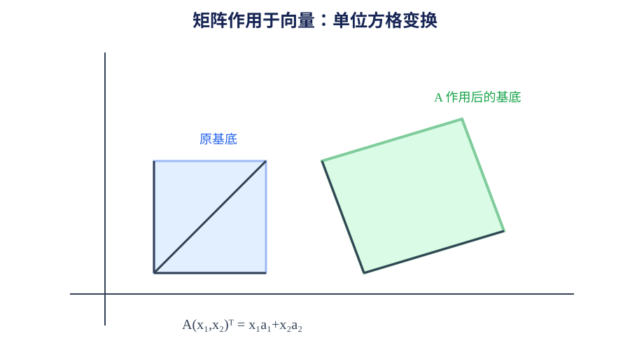

# 第 02 章｜矩阵

> 数学二 · 线性代数。矩阵章节贯穿行列式、向量组、线性方程组和特征值。重点掌握矩阵运算、逆矩阵、秩、初等变换与分块矩阵。

## 01. 知识地图

~~~mermaid
flowchart TD
 A[矩阵] --> B[基本运算]
 A --> C[特殊矩阵]
 A --> D[逆矩阵与伴随矩阵]
 A --> E[初等变换]
 A --> F[矩阵的秩]
 A --> G[分块矩阵]
 E --> E1[初等矩阵]
 E --> E2[行最简形]
 F --> F1[秩的性质]
 F --> F2[方程组联系]
~~~

## 02. 矩阵基本概念与运算

$m\times n$ 矩阵是由 $m$ 行 $n$ 列元素组成的数表。只有行数与列数相等的矩阵才是方阵。

- 相等：同型矩阵对应元素分别相等。
- 加法：同型矩阵对应元素相加。
- 数乘：矩阵每个元素乘以同一数。
- 乘法：若 $A$ 为 $m\times n$、$B$ 为 $n\times p$，则 $AB$ 为 $m\times p$。
- 转置：交换行与列，记为 $A^T$。

矩阵乘法通常不满足交换律，即 $AB\ne BA$；但满足结合律和分配律：

$$
(AB)C=A(BC),\qquad A(B+C)=AB+AC
$$

$$
(AB)^T=B^TA^T
$$

方阵的幂满足 $A^mA^n=A^{m+n}$。一般矩阵不能随意交换因子顺序。

## 03. 常见特殊矩阵

- 零矩阵：所有元素为 0。
- 单位矩阵 $I$：主对角线为 1，其余为 0，满足 $AI=IA=A$。
- 对角矩阵：主对角线以外元素为 0。
- 数量矩阵：$kI$。
- 对称矩阵：$A^T=A$。
- 反对称矩阵：$A^T=-A$，实数域上主对角线元素全为 0。
- 上/下三角矩阵：主对角线一侧元素全为 0。

对称矩阵的特征值为实数，且不同特征值对应的特征向量正交（实对称矩阵情形）。

## 04. 逆矩阵

若方阵 $A$ 存在矩阵 $B$ 满足：

$$
AB=BA=I
$$

则称 $B$ 为 $A$ 的逆矩阵，记为 $A^{-1}$。逆矩阵存在当且仅当 $|A|\ne0$。

常用性质：

$$
(AB)^{-1}=B^{-1}A^{-1}
$$

$$
(A^T)^{-1}=(A^{-1})^T,\qquad
(A^{-1})^{-1}=A
$$

若 $A$ 可逆，则 $A$ 的行列式非零，且 $A$ 满秩。矩阵乘积求逆时顺序必须反转。

## 05. 伴随矩阵

$A^*$ 表示 $A$ 的伴随矩阵，其元素由代数余子式组成并转置。核心关系：

$$
AA^*=A^*A=|A|I
$$

当 $|A|\ne0$ 时：

$$
A^{-1}=\frac{1}{|A|}A^*
$$

$n$ 阶方阵满足：

$$
|A^*|=|A|^{n-1}
$$

该公式对奇异矩阵也成立（按伴随矩阵定义理解），但用伴随矩阵求逆必须先确认 $|A|\ne0$。

## 06. 初等变换与初等矩阵

三类初等行变换：
1. 交换两行；
2. 某行乘以非零常数；
3. 某行加上另一行的倍数。

对矩阵左乘初等矩阵，相当于对矩阵进行相应初等行变换；右乘初等矩阵对应初等列变换。

初等矩阵均可逆，其逆矩阵仍为同类型初等矩阵。矩阵经过初等行变换化为行阶梯形或行最简形，可用于求秩和解线性方程组。

注意：初等行变换保持矩阵的行等价与秩，但一般不保持行列式数值。

## 07. 矩阵的秩

矩阵 $A$ 的秩 $r(A)$ 是其列向量组（等价地，行向量组）的最大线性无关个数，也等于非零子式的最高阶数。

重要性质：

$$
0\le r(A)\le\min(m,n)
$$

$$
r(A)=r(A^T)
$$

$$
r(AB)\le\min(r(A),r(B))
$$

若 $P,Q$ 可逆，则：

$$
r(PAQ)=r(A)
$$

通过初等行变换化为阶梯形，非零行数即为矩阵的秩。

## 08. 分块矩阵

将矩阵按行、列分成若干子矩阵，称为分块矩阵。分块运算必须满足块尺寸相容条件。

若分块矩阵为块上三角或块下三角，且对角块为方阵，则：

$$
\left|\begin{matrix}A&B\\0&D\end{matrix}\right|=|A||D|
$$

分块乘法与普通矩阵乘法类似，但要注意块的顺序通常不能交换。

## 09. 典型例题

### 例 1：矩阵乘法尺寸

若 $A$ 为 $2\times3$，$B$ 为 $3\times4$，则 $AB$ 存在且为 $2\times4$；$BA$ 不存在，因为内维度不相等。

### 例 2：利用逆矩阵性质

若 $A,B$ 均可逆，求 $(AB)^{-1}$：

$$
(AB)^{-1}=B^{-1}A^{-1}
$$

### 例 3：矩阵秩

若矩阵经初等行变换化为阶梯形后有 3 个非零行，则原矩阵的秩为 3。

## 10. 常见失分点

1. 把矩阵乘法当作元素对应相乘，或忽略内维度相等条件。
2. 错写 $(AB)^{-1}=A^{-1}B^{-1}$，正确顺序应反转。
3. 误以为初等行变换保持行列式不变；只有行倍加不改变行列式。
4. 把矩阵等价与相似混为一谈。
5. 求秩时将非零行数与非零元素个数混淆。
6. 分块矩阵乘法忽略块尺寸与乘法顺序。

## 11. 章节自测

1. $A$ 为 $3\times2$、$B$ 为 $2\times5$，求 $AB$ 的尺寸。
2. 矩阵乘法是否满足交换律？
3. 写出 $(AB)^T$ 与 $(AB)^{-1}$ 的公式。
4. 方阵可逆的行列式条件是什么？
5. 初等行变换是否改变矩阵的秩？
6. 一个矩阵化为阶梯形后有 4 个非零行，其秩是多少？
7. 若 $A$ 为 3 阶方阵，求 $|A^*|$ 与 $|A|$ 的关系。

## 12. 自测参考答案

1. $3\times5$。
2. 一般不满足，通常 $AB\ne BA$。
3. $(AB)^T=B^TA^T$；$(AB)^{-1}=B^{-1}A^{-1}$（要求 $A,B$ 可逆且为同阶方阵）。
4. $|A|\ne0$。
5. 不改变。
6. 秩为 4。
7. $|A^*|=|A|^2$。

## 13. 复习清单

- [ ] 能判断矩阵加法、乘法是否有定义
- [ ] 能熟练使用转置、逆矩阵与伴随矩阵性质
- [ ] 能区分三类初等变换对矩阵和行列式的影响
- [ ] 能通过行阶梯形求矩阵秩
- [ ] 能进行分块矩阵基本运算

## 补充专题｜公式定理速查与图像理解

$(AB)^T=B^TA^T$，$(AB)^{-1}=B^{-1}A^{-1}$。$A^{-1}=A^*/|A|$（$|A|\ne0$）。秩等于最大非零子式阶数，也等于阶梯形非零行数；$r(A)=r(A^T)$。矩阵 $y=Ax$ 是线性变换；可逆矩阵不压缩维数，奇异矩阵将空间压缩到低维子空间。矩阵乘法一般不交换。

### 图像/几何示意

