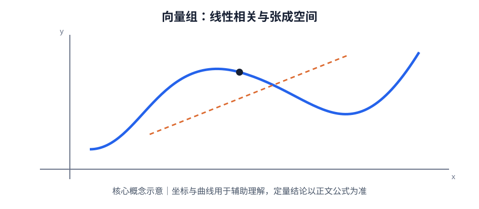

# 第 03 章｜向量组与线性相关性

> 数学二 · 线性代数。向量组是矩阵秩与线性方程组的桥梁。核心任务是判断线性表示、相关性、极大无关组和向量组的秩。

## 01. 知识地图

~~~mermaid
flowchart TD
 A[向量组] --> B[线性组合与表示]
 A --> C[线性相关性]
 A --> D[向量组等价]
 A --> E[极大线性无关组]
 A --> F[向量组的秩]
 C --> C1[齐次方程组判定]
 F --> F1[矩阵秩]
 F --> F2[线性方程组]
~~~

## 02. 线性组合与线性表示

设向量组 $\alpha_1,\ldots,\alpha_m$，若存在数 $k_1,\ldots,k_m$ 使：

$$
\beta=k_1\alpha_1+\cdots+k_m\alpha_m
$$

则称 $\beta$ 可由该向量组线性表示。求线性表示的系数等价于求解相应线性方程组。

将向量按列组成矩阵 $A=(\alpha_1,\ldots,\alpha_m)$，则线性表示问题可写成：

$$
Ax=\beta
$$

因此，$\beta$ 可由列向量组线性表示，当且仅当 $r(A)=r(A|\beta)$。

## 03. 线性相关与线性无关

若齐次方程：

$$
k_1\alpha_1+\cdots+k_m\alpha_m=0
$$

存在不全为 0 的解，则向量组线性相关；只有零解时线性无关。

重要结论：
- 含零向量的向量组必相关。
- 两个向量相关，当且仅当其中一个是另一个的数倍（含零向量情形）。
- 向量个数大于向量维数时必相关。
- 向量组的部分组线性无关，不代表整个向量组线性无关。
- 线性无关向量组的任意子组仍线性无关。

## 04. 线性相关性的矩阵判定

将 $m$ 个 $n$ 维列向量组成 $n\times m$ 矩阵 $A$。则：

$$
\text{列向量组线性无关}\iff r(A)=m
$$

$$
\text{列向量组线性相关}\iff r(A)<m
$$

若 $m=n$，则：

$$
r(A)=n\iff |A|\ne0
$$

因此行列式判定只适用于方阵向量组，非方阵通常使用矩阵秩。

## 05. 极大线性无关组与向量组的秩

向量组中一个线性无关部分组，若再加入原向量组中任何一个不属于该部分组的向量都会线性相关，则称其为极大线性无关组。

- 极大线性无关组所含向量个数唯一，向量本身不一定唯一。
- 向量组的秩等于其极大线性无关组所含向量个数。
- 向量组的秩等于以这些向量为列构成矩阵的秩。
- 两个向量组等价，意味着它们可以相互线性表示；等价向量组的秩相同。

## 06. 常用证明思路

### 证明线性无关

从：

$$
k_1\alpha_1+\cdots+k_m\alpha_m=0
$$

出发，通过分量比较、矩阵秩或已知关系证明所有系数只能为 0。

### 证明线性相关

给出一组不全为零的系数，使线性组合等于零；或证明向量个数超过维数；或证明矩阵秩小于列数。

### 证明线性表示

建立 $Ax=\beta$，使用高斯消元求解；有解即可表示，无解则不能表示。

## 07. 典型例题

设：

$$
\alpha_1=\begin{pmatrix}1\\0\\1\end{pmatrix},\quad
\alpha_2=\begin{pmatrix}0\\1\\1\end{pmatrix},\quad
\alpha_3=\begin{pmatrix}1\\1\\2\end{pmatrix}
$$

因为 $\alpha_3=\alpha_1+\alpha_2$，所以该向量组线性相关；$\alpha_1,\alpha_2$ 线性无关，因此原向量组的秩为 2，$\{\alpha_1,\alpha_2\}$ 是一个极大线性无关组。

## 08. 常见失分点

1. 把“存在非零线性组合为零”误写为“所有系数都非零”。
2. 将向量个数大于维数必相关的结论反向使用。
3. 用行列式判断非方阵列向量组的线性相关性。
4. 认为极大线性无关组唯一；其向量选择可能不唯一。
5. 判断线性表示时只比较向量个数，没有真正求解 $Ax=\beta$。

## 09. 章节自测

1. 含零向量的向量组是否线性相关？
2. 5 个三维向量组成的向量组是否一定线性相关？
3. $n$ 个 $n$ 维列向量线性无关的行列式条件是什么？
4. 极大线性无关组的向量个数是否唯一？
5. 向量组的秩与对应列矩阵的秩有何关系？
6. 若 $\alpha_3=\alpha_1+2\alpha_2$，三向量组是否线性相关？

## 10. 自测参考答案

1. 必相关，令零向量对应系数为 1、其余为 0 即可得到非零系数解。
2. 一定相关，因为向量个数 5 大于维数 3。
3. $|A|\ne0$。
4. 个数唯一，但具体向量组成不一定唯一。
5. 二者相等。
6. 相关，因为存在不全为零的系数满足 $\alpha_1+2\alpha_2-\alpha_3=0$。

## 11. 复习清单

- [ ] 能把线性表示转化为矩阵方程
- [ ] 能用齐次方程组判断线性相关性
- [ ] 能使用矩阵秩判定列向量组的相关性
- [ ] 能求极大线性无关组与向量组的秩
- [ ] 能用规范的系数论证写出相关/无关证明

## 补充专题｜公式定理速查与图像理解

线性表示 $\beta=k_1\alpha_1+\cdots+k_m\alpha_m$ 等价于 $Ax=\beta$。列向量组无关当且仅当 $r(A)=m$；$m>n$ 个 $n$ 维向量必相关。极大无关组所含向量数等于向量组秩。二维两个非零向量共线即相关；三维三个向量共面即相关。主元列应回到原矩阵中选取。

### 图像/几何示意

