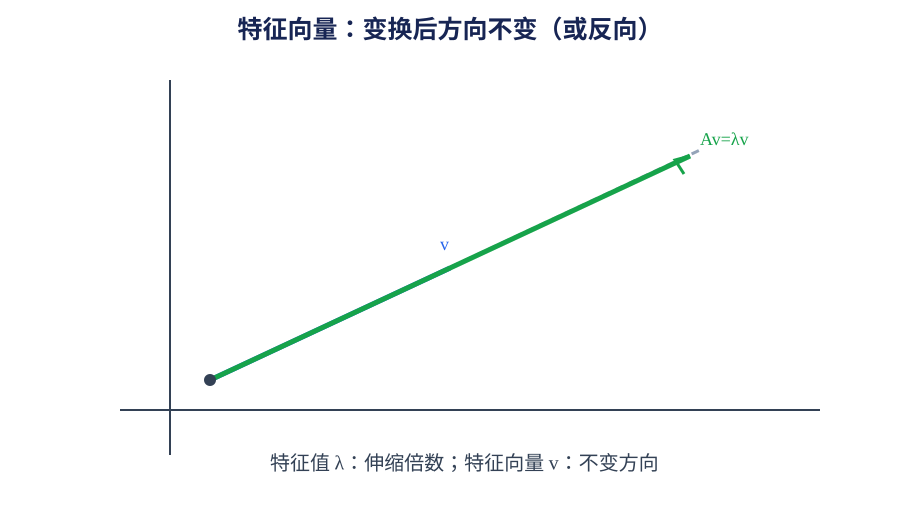

# 第 05 章｜特征值与特征向量

> 数学二 · 线性代数。特征值把矩阵作用转化为特定方向上的数乘，是相似对角化与二次型的核心工具。

## 01. 知识地图

~~~mermaid
flowchart TD
 A[特征值与特征向量] --> B[特征方程]
 A --> C[性质]
 A --> D[相似矩阵]
 A --> E[对角化]
 A --> F[实对称矩阵]
 D --> D1[迹与行列式]
 E --> E1[特征向量组]
 F --> F1[正交对角化]
~~~

## 02. 特征值与特征向量定义

若存在非零向量 $x$ 和数 $\lambda$，使：

$$
Ax=\lambda x
$$

则 $\lambda$ 是矩阵 $A$ 的特征值，$x$ 是对应特征向量。移项得：

$$
(\lambda I-A)x=0
$$

存在非零解的充要条件：

$$
|\lambda I-A|=0
$$

该方程称为特征方程，左侧行列式对应特征多项式。

## 03. 特征值的性质

对 $n$ 阶方阵（特征值按代数重数计）：

$$
\sum_{i=1}^{n}\lambda_i=\operatorname{tr}(A)
$$

$$
\prod_{i=1}^{n}\lambda_i=|A|
$$

因此：
- $A$ 可逆当且仅当 0 不是特征值；
- 若 $A$ 为三角矩阵，特征值为主对角线元素；
- $A$ 与 $A^T$ 具有相同特征多项式；
- 若 $\lambda$ 是 $A$ 的特征值，则 $A^k$ 对应特征值为 $\lambda^k$（$k$ 为正整数）。

不同特征值对应的特征向量线性无关。实对称矩阵的不同特征值对应的特征向量正交。

## 04. 特征向量的求法

1. 求特征方程 $|\lambda I-A|=0$。
2. 解出特征值。
3. 对每个特征值求齐次方程 $(A-\lambda I)x=0$。
4. 求对应特征子空间的基础解系。
5. 特征向量不能取零向量。

特征值的代数重数与对应特征子空间维数（几何重数）不一定相等；几何重数不超过代数重数。

## 05. 相似矩阵

若存在可逆矩阵 $P$ 使：

$$
B=P^{-1}AP
$$

则称 $A$ 与 $B$ 相似。相似矩阵具有相同的特征多项式、特征值、行列式、迹和秩。

相似不等同于行等价。行等价主要通过初等行变换定义，不能据此认为特征值不变。

## 06. 相似对角化

若存在可逆矩阵 $P$ 与对角矩阵 $\Lambda$，使：

$$
P^{-1}AP=\Lambda
$$

则 $A$ 可相似对角化。$P$ 的列向量由一组线性无关的特征向量组成，$\Lambda$ 的对角元素为对应特征值。

$n$ 阶矩阵有 $n$ 个线性无关特征向量时可对角化。若有 $n$ 个互不相同的特征值，则一定可对角化；反之不一定。

## 07. 实对称矩阵正交对角化

实对称矩阵满足 $A^T=A$，其特征值全为实数，并存在正交矩阵 $Q$ 使：

$$
Q^TAQ=\Lambda
$$

$Q$ 的列向量可取为单位正交特征向量。不同特征值对应的特征向量天然正交；同一特征值的特征子空间内可通过正交化构造标准正交基。

## 08. 典型例题

设：

$$
A=\begin{pmatrix}2&0\\0&3\end{pmatrix}
$$

特征值为 2 和 3。对应特征向量分别可取：

$$
\lambda=2:\begin{pmatrix}1\\0\end{pmatrix},
\qquad
\lambda=3:\begin{pmatrix}0\\1\end{pmatrix}
$$

矩阵已为对角矩阵，且两特征向量线性无关，因此可对角化。

## 09. 常见失分点

1. 特征向量求解忘记要求非零解。
2. 特征方程中 $\lambda I-A$ 与 $A-\lambda I$ 的行列式符号关系处理错误。
3. 把代数重数与几何重数当作总是相等。
4. 误认为所有矩阵都可对角化。
5. 将相似与行等价混淆。
6. 实对称矩阵正交对角化时没有将特征向量单位化。

## 10. 章节自测

1. 写出矩阵 $A$ 的特征方程。
2. 特征值之和与特征值之积分别等于什么？
3. 若矩阵有 $n$ 个互不相同的特征值，是否一定可对角化？
4. 相似矩阵的特征值是否相同？
5. 实对称矩阵的特征值有什么特点？
6. 不同特征值对应的特征向量是否线性无关？

## 11. 自测参考答案

1. $|\lambda I-A|=0$。
2. 分别等于 $\operatorname{tr}(A)$ 与 $|A|$。
3. 是，一定可对角化。
4. 相同。
5. 全为实数。
6. 是，线性无关。

## 12. 复习清单

- [ ] 能计算特征值与特征向量
- [ ] 能利用迹、行列式与特殊矩阵性质简化计算
- [ ] 能区分代数重数与几何重数
- [ ] 能判断矩阵是否可相似对角化
- [ ] 能对实对称矩阵进行正交对角化

## 补充专题｜公式定理速查与几何理解

$Ax=\lambda x$，特征方程 $|\lambda I-A|=0$。特征值之和为 $tr(A)$，之积为 $|A|$。相似 $B=P^{-1}AP$ 保持特征多项式、迹、行列式与秩。实对称矩阵可正交对角化 $Q^TAQ=\Lambda$。特征向量方向在变换后保持不变，特征值是伸缩倍数；重特征值不保证足够特征向量。

### 图像/几何示意

