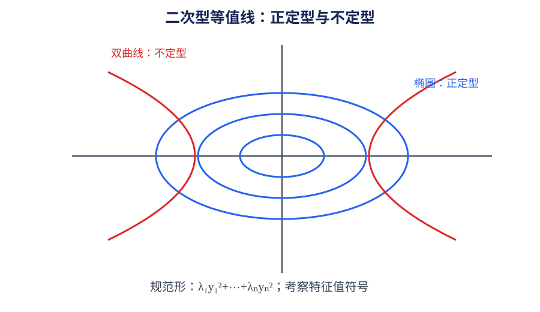

# 第 06 章｜二次型

> 数学二 · 线性代数。二次型把二次齐次多项式与对称矩阵联系起来。重点掌握矩阵表示、正交变换、配方法、规范形、惯性指数和正定性判别。

## 01. 知识地图

~~~mermaid
flowchart TD
 A[二次型] --> B[矩阵表示]
 A --> C[合同变换]
 A --> D[标准形与规范形]
 A --> E[惯性定理]
 A --> F[正定性]
 C --> C1[正交变换]
 C --> C2[配方法]
 F --> F1[定义法]
 F --> F2[顺序主子式]
~~~

## 02. 二次型与对称矩阵

$n$ 元二次型：

$$
f(x)=\sum_{i=1}^{n}a_{ii}x_i^2+
2\sum_{i<j}a_{ij}x_ix_j
$$

可写为：

$$
f(x)=x^TAx
$$

其中 $A$ 可取对称矩阵。若原式交叉项系数为 $c_{ij}x_ix_j$，则对称矩阵对应位置元素为 $c_{ij}/2$。

二次型与其对称矩阵一一对应。

## 03. 合同变换

作可逆线性替换 $x=Cy$，则：

$$
f(x)=x^TAx=y^T(C^TAC)y
$$

矩阵 $A$ 与 $C^TAC$ 称为合同矩阵。合同变换用于化二次型为标准形。

合同与相似不同：相似变换为 $P^{-1}AP$，合同变换为 $C^TAC$，保持的不变量和应用目的不同。

## 04. 正交变换与标准形

若 $A$ 为实对称矩阵，可取正交矩阵 $Q$，满足 $Q^TQ=I$，并使：

$$
Q^TAQ=\operatorname{diag}(\lambda_1,\ldots,\lambda_n)
$$

通过正交变换可将二次型化为：

$$
f=\lambda_1y_1^2+\cdots+\lambda_ny_n^2
$$

其系数为矩阵特征值。标准形中的系数可为正、负或零。

## 05. 配方法与规范形

配方法通过配平方逐步消去交叉项。进行变量替换时必须保证替换矩阵可逆。

在实数域内，二次型经可逆线性替换可化为规范形：

$$
y_1^2+\cdots+y_p^2
-y_{p+1}^2-\cdots-y_{p+q}^2
$$

其余变量平方项系数为 0。正项个数 $p$、负项个数 $q$ 称为正惯性指数与负惯性指数。

## 06. 惯性定理

实对称矩阵经可逆合同变换化为规范形时，正平方项个数、负平方项个数与零项个数不变。这是惯性定理。

矩阵的秩为：

$$
r=p+q
$$

符号差 $p-q$ 称为符号差（按常见定义）。

## 07. 正定二次型与正定矩阵

若对任意非零向量 $x$，都有：

$$
f(x)=x^TAx>0
$$

则称二次型正定，对应对称矩阵称为正定矩阵。

实对称矩阵正定的等价判定：
- 所有特征值均为正；
- 所有顺序主子式均为正；
- 定义法对任意非零向量取值为正。

负定要求所有特征值为负；顺序主子式符号按阶数交替，首个为负。半正定/半负定的判定需更谨慎，不能直接照搬正定的顺序主子式条件。

## 08. 典型例题

设：

$$
f(x,y)=x^2+4xy+5y^2
$$

对应对称矩阵：

$$
A=\begin{pmatrix}1&2\\2&5\end{pmatrix}
$$

顺序主子式为 $\Delta_1=1>0$、$\Delta_2=5-4=1>0$，因此 $A$ 正定，二次型正定。

## 09. 常见失分点

1. 交叉项系数没有平分到对称矩阵的两个位置。
2. 将合同变换与相似变换混淆。
3. 正交矩阵只满足可逆，没有验证 $Q^TQ=I$。
4. 将标准形与规范形混为一谈；规范形系数归一为 $1,-1,0$。
5. 用顺序主子式条件判定一般非对称矩阵正定。
6. 把正定的判据直接套用到半正定。

## 10. 章节自测

1. 将 $3x^2+4xy+2y^2$ 写成 $x^TAx$ 的矩阵形式。
2. 二次型变量替换 $x=Cy$ 后，对应矩阵如何变化？
3. 实对称矩阵能否正交对角化？
4. 规范形中正、负平方项个数是否依赖具体可逆变换？
5. 实对称矩阵正定的特征值条件是什么？
6. 正定判别中的顺序主子式条件是什么？

## 11. 自测参考答案

1. $A=\begin{pmatrix}3&2\\2&2\end{pmatrix}$。
2. 变为 $C^TAC$。
3. 能，存在正交矩阵 $Q$ 使 $Q^TAQ$ 为对角矩阵。
4. 不依赖，依据惯性定理保持不变。
5. 所有特征值均为正。
6. 所有顺序主子式均为正（实对称矩阵情形）。

## 12. 复习清单

- [ ] 能把二次齐次多项式写成对称矩阵形式
- [ ] 能区分合同与相似
- [ ] 能使用正交变换和配方法化标准形
- [ ] 能说明规范形与惯性定理
- [ ] 能用特征值或顺序主子式判定正定

## 补充专题｜公式定理速查与几何理解

$f(x)=x^TAx$，$A$ 取对称矩阵；交叉项系数平分到两个对称位置。可逆变换 $x=Cy$ 后矩阵变为 $C^TAC$。惯性定理：规范形正项数、负项数、零项数不变。实对称矩阵正定等价于全部特征值为正，或所有顺序主子式为正。正定意味着除原点外函数值为正；合同变换不同于相似变换。

### 图像/几何示意

