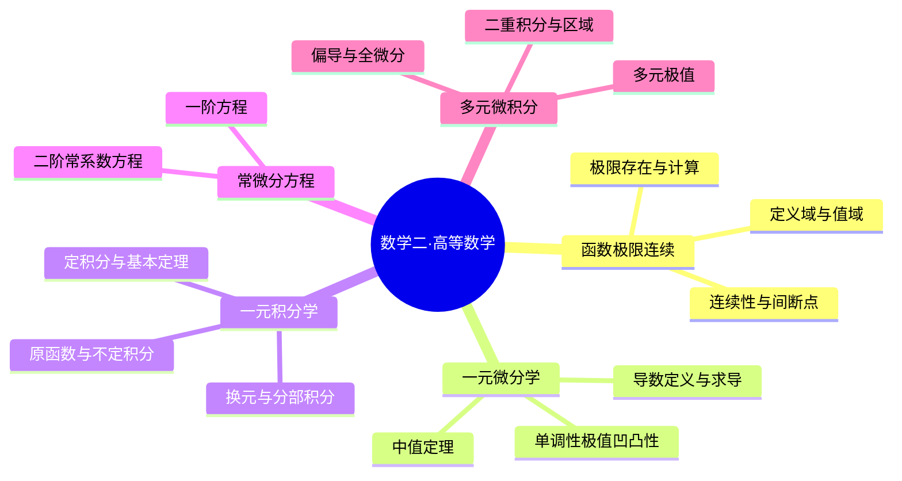

# 高等数学｜核心概念卡

> 数学二 · 2028 考研基础阶段。卡片用于主动回忆与间隔复习，不替代章节主线。每张卡均包含定义、关键结论、方法选择、易错点、自测与五大经典学习法。

## 我的笔记记录

> 本页严格按章节笔记模板组织：先概念卡，再知识卡与思维导图，再建立原子化知识卡的父级、延伸和关联，最后分别执行五大经典学习法。原有 8 张 CAL 卡片作为本章主线的原子化知识节点，不替代完整章节推导。

### 一、概念卡｜双栏概念辨析

<table width="100%">
<tr>
<td width="50%" valign="top">
<h3>📘 函数与极限基础</h3>
<ul>
<li><b>函数：</b>定义域内每个自变量对应唯一函数值。</li>
<li><b>定义域 / 值域：</b>合法输入集合 / 实际输出集合。</li>
<li><b>极限：</b>自变量趋近某点时函数值的变化趋势。</li>
<li><b>连续：</b>函数值存在、极限存在且二者相等。</li>
<li><b>间断点：</b>连续三条件至少一项不满足。</li>
</ul>

<b>易混边界：</b>函数值不等于极限不代表极限不存在；连续不代表可导；零点定理不保证零点唯一。

</td>
<td width="50%" valign="top">
<h3>📐 微分与积分基础</h3>
<ul>
<li><b>导数：</b>瞬时变化率，也是切线斜率。</li>
<li><b>微分：</b>函数增量的线性主部。</li>
<li><b>中值定理：</b>将区间整体变化与区间内某点导数联系。</li>
<li><b>不定积分：</b>原函数全体构成的函数族。</li>
<li><b>定积分：</b>区间上的有向累积量。</li>
<li><b>二重积分：</b>在平面区域上累积函数值。</li>
</ul>

<b>易混边界：</b>可导必连续但连续不必可导；定积分不总等于几何面积；偏导存在不必然可微。

</td>
</tr>
</table>

### 二、知识卡｜章节思维导图与方法总览

**章节解题总流程：** 识别对象与条件 → 选择定义/定理/公式 → 写出推导过程 → 检查定义域、端点、适用条件 → 用代入、量纲、单调性或特殊值复核。

### 三、原子化知识卡｜父级、延伸与关联

| 卡片 ID | 原子概念 | 父级主线 | 延伸卡 / 章节 | 关键关联 |
|---|---|---|---|---|
| CAL-01 | 函数定义域与值域 | 函数概念 | [第01章](../第01章-函数极限与连续.md) | CAL-02：定义域决定极限讨论范围 |
| CAL-02 | 极限与极限计算 | 函数极限 | [第01章](../第01章-函数极限与连续.md) | CAL-03：连续以极限存在为前提 |
| CAL-03 | 连续性与间断点 | 函数连续 | [第01章](../第01章-函数极限与连续.md) | CAL-05：闭区间连续支撑最值与介值定理 |
| CAL-04 | 导数定义与求导 | 一元微分学 | [第02章](../第02章-导数与微分.md) | CAL-05：导数用于中值定理与函数性态 |
| CAL-05 | 中值定理与函数性态 | 导数应用 | [第03章](../第03章-中值定理与导数应用.md) | CAL-02：极限证明常用中值定理 |
| CAL-06 | 积分与微积分基本定理 | 一元积分学 | [第04章](../第04章-不定积分与定积分.md) | CAL-04：微分与积分互为基本运算联系 |
| CAL-07 | 常微分方程 | 微分方程 | [第05章](../第05章-常微分方程.md) | CAL-04：导数阶数决定方程类型 |
| CAL-08 | 多元微分与二重积分 | 多元微积分 | [第06章](../第06章-多元函数微分学.md) / [第07章](../第07章-二重积分.md) | CAL-04、CAL-06：链式法则与积分累积 |

**原子化原则：** 每张卡只回答一个核心问题；定义、条件、推导、例题、易错点和自测必须齐全。卡片可独立复习，同时通过父级与关联链接回到章节主线。

### 四、五大经典学习法｜分别执行，不互相替代

#### 4.1 费曼学习法：用自己的话讲清概念

**任务：**
1. 不看笔记解释定义域和值域，并用一个反例说明二者不能混淆。
2. 用图像或数轴解释极限、连续、可导之间的关系。
3. 讲清楚导数为何是瞬时变化率，以及链式法则为什么要乘内层导数。
4. 用一个例子说明中值定理如何把区间变化转化为某点导数。
5. 区分原函数、定积分与二重积分各自描述的对象。

**输出要求：** 每个概念用“定义—直观解释—数学表达—例子—易错边界”五步讲解；每段不超过 150 字。无法解释的地方回到对应 CAL 卡补充。

#### 4.2 西蒙学习法：拆分知识块并逐块掌握

| 模块 | 学习内容 | 前置依赖 | 达标任务 |
|---|---|---|---|
| A 函数与极限 | 定义域、值域、极限存在、极限计算 | 无 | 复合定义域 5 题、极限 5 题 |
| B 连续性 | 连续三条件、间断点、闭区间性质 | A | 间断点分类 4 题、参数连续 3 题 |
| C 一元微分 | 导数定义、求导法则、隐函数与参数方程 | A、B | 求导 10 题，写出链式过程 |
| D 导数应用 | 中值定理、单调性、极值、凹凸性 | C | 定理证明 2 题、函数性态 4 题 |
| E 一元积分 | 原函数、定积分、换元、分部、变上限 | C | 方法识别 5 题、积分计算 6 题 |
| F 微分方程 | 类型识别、通解、初值条件 | C、E | 类型判断 5 题、求解 4 题 |
| G 多元微积分 | 偏导、全微分、极值、二重积分 | C、E | 多元求导 4 题、二重积分 4 题 |

**刻意练习闭环：** 独立作答 → 标记错因（概念/条件/方法/计算/表达）→ 针对错因做同类变式 → 次日无提示重做。一个模块连续两轮正确率达到 80% 才进入下一模块。

#### 4.3 SQ3R 阅读法：带着问题读教材与章节笔记

| 阶段 | 具体动作 | 必须留下的成果 |
|---|---|---|
| Survey 浏览 | 先看章节标题、概念卡、公式表、例题和思维导图 | 一张章节框架图 |
| Question 提问 | 每节先写“定义是什么、条件是什么、为什么这样做、何时不能用” | 每章至少 8 个问题 |
| Read 精读 | 对定义逐项检查量词和条件；对公式追踪推导；对例题标注选法依据 | 条件标注与推导笔记 |
| Recite 复述 | 合上资料，复述定义、定理条件、公式来源和解题流程 | 无提示复述记录 |
| Review 复习 | 1、3、7、14 天回看错题并做变式 | 复习日期与错因记录 |

**阅读自问：** 等价无穷小为什么不能随意用于加减？连续与可导差在哪里？中值定理的闭区间和开区间条件分别是什么？换元积分为什么要同步处理微分和积分限？极坐标面积元为什么带有 r？

#### 4.4 番茄工作法：四个基础番茄 + 一个纠错番茄

每个番茄 25 分钟专注、5 分钟休息，结束必须留下可检查的产出。

| 番茄 | 任务 | 验收产出 |
|---|---|---|
| 1 概念 | 学习本轮对应的 1–2 张概念卡 | 合上资料写出定义与条件 |
| 2 推导 | 推导关键公式或定理 | 写出完整推导，不跳步 |
| 3 例题 | 独立完成基础题与典型题 | 每题写选法理由和步骤 |
| 4 变式 | 改变参数、区间或函数结构 | 说明原方法是否仍适用 |
| 5 纠错 | 复盘错误并重做 | 错因标签 + 一道同类题 |

**停止规则：** 同一问题连续两个番茄仍无法解决时，将问题拆成更小的条件判断或运算步骤，不通过反复看答案假装掌握。

#### 4.5 康奈尔笔记法：线索、主体、总结三栏

| 左侧线索 / 自测问题 | 右侧主体笔记 |
|---|---|
| 定义域如何求？ | 识别分母、偶次根式、对数、反三角等限制，列不等式并取交集。 |
| 极限存在条件？ | 左极限与右极限都存在且相等；函数值可以不同或无定义。 |
| 连续三条件？ | 函数值存在、极限存在、极限等于函数值。 |
| 复合函数求导？ | 外层求导后乘内层导数，沿每条变量依赖路径求和。 |
| 中值定理怎么选？ | 端点值相等优先考虑罗尔；需要区间增量与导数联系考虑拉格朗日；两个函数增量比考虑柯西。 |
| 积分方法怎么选？ | 识别复合结构用换元；乘积且一因子求导变简单时考虑分部。 |
| 二重积分怎么设限？ | 先画区域、标交点、选切片方向，再决定是否分段或转极坐标。 |

**页底总结：** 高等数学的主线是“函数与极限 → 连续 → 导数及其应用 → 积分 → 微分方程 → 多元微积分”。每道题先识别对象与条件，再选工具并完整推导，最后检查端点、定义域、适用条件和结果合理性。

#### 4.6 五法融合自测与通关标准

1. 求一个含分母、偶次根式和对数的复合函数定义域，并解释每个限制。
2. 判断一个分段函数在分界点是否连续，写出左右极限与函数值。
3. 对复合函数求导，明确写出外层导数与内层导数。
4. 选择一个中值定理完成证明，并逐项验证定理条件。
5. 对一个积分题说明为何选择换元或分部，并写出完整步骤。
6. 求一个二重积分，画出区域并解释积分限与面积元素。

**参考答案检查点：** 定义域取所有限制的交集；连续需三条件同时成立；链式法则不可漏内层导数；中值定理必须先验条件；换元需处理微分与积分限；极坐标必须包含雅可比因子 r。

**通关标准：**
- [ ] 能脱离笔记解释本章核心概念并举例
- [ ] 能准确写出定理条件、公式和适用范围
- [ ] 能独立完成基础计算并写出推导过程
- [ ] 能识别常见陷阱并解释错误原因
- [ ] 六道融合自测至少正确五道，且能复述错题原因

---

## 卡片导航

| 卡片 | 核心问题 | 对应章节 |
|---|---|---|
| [CAL-01 函数定义域与值域](#cal-01-函数定义域与值域) | 输入合法范围与输出范围如何求？ | 第 01 章 |
| [CAL-02 极限与极限计算](#cal-02-极限与极限计算) | 极限存在意味着什么，如何选方法？ | 第 01 章 |
| [CAL-03 连续性与间断点](#cal-03-连续性与间断点) | 连续的三个条件及间断点分类？ | 第 01 章 |
| [CAL-04 导数定义与求导](#cal-04-导数定义与求导) | 导数为何是变化率，复合函数如何求导？ | 第 02 章 |
| [CAL-05 中值定理与函数性态](#cal-05-中值定理与函数性态) | 如何从条件构造证明并研究单调极值？ | 第 03 章 |
| [CAL-06 积分与微积分基本定理](#cal-06-积分与微积分基本定理) | 原函数、定积分、换元与分部积分如何联系？ | 第 04 章 |
| [CAL-07 常微分方程](#cal-07-常微分方程) | 如何识别方程类型并求通解？ | 第 05 章 |
| [CAL-08 多元微分与二重积分](#cal-08-多元微分与二重积分) | 偏导、链式法则、极值和积分区域如何处理？ | 第 06–07 章 |

---

## CAL-01 函数定义域与值域

**正面问题：** 给定一个函数表达式，如何确定所有合法输入以及可能输出？

**背面答案：** 定义域是使表达式有意义的全部实数；值域是定义域内函数值的集合。两者不能混为一谈。

### 核心规则

| 结构 | 定义域约束 |
|---|---|
| 分式 $1/g(x)$ | $g(x)\ne0$ |
| 偶次根式 $\sqrt[2n]{g(x)}$ | $g(x)\ge0$ |
| 偶次根式在分母 | $g(x)>0$ |
| 对数 $\ln g(x)$ | $g(x)>0$ |
| $\arcsin g(x)$、$\arccos g(x)$ | $-1\le g(x)\le1$ |
| 多重限制 | 所有条件取交集 |

### 值域方法选择

1. 基本函数值域直接套用，但先确认内层函数实际取值。
2. 二次式优先配方；有理式可令 $y=f(x)$ 反解。
3. 可导函数先确定区间，再用单调性与端点/极限。
4. 换元后必须保留新变量的真实范围。
5. 基本不等式必须检查正负条件和等号能否取到。

### 典型例题

求 $f(x)=\dfrac{1}{\sqrt{x^2-4}}$ 的定义域。分母不能为零且根号内必须为正：

$$
x^2-4>0\iff x<-2\text{ 或 }x>2.
$$

故 $D_f=(-\infty,-2)\cup(2,+\infty)$。

求 $g(x)=x^2-4x+5$ 的值域：

$$
g(x)=(x-2)^2+1\ge1,
$$

等号在 $x=2$ 取到，故 $W_g=[1,+\infty)$。

### 易错点

- $\sqrt{x^2}=|x|$，不能无条件写成 $x$。
- $\ln(x^2)$ 的定义域是 $x\ne0$，不是仅 $x>0$。
- $1/\sqrt{x}$ 要求 $x>0$。
- 反解值域时，判别式条件之外还要检查原定义域。

### 五法学习任务

- **费曼：** 不看笔记解释“定义域是输入、值域是输出”，并举一个定义域不等于值域的例子。
- **西蒙：** 将求域拆成“识别限制—列不等式—求交集—检验端点”四步。
- **SQ3R：** 先浏览表格，提问每种表达式限制，再阅读例题并复述规则。
- **番茄：** 25 分钟内完成 6 道复合定义域题，最后 5 分钟核对端点。
- **康奈尔：** 右栏记录限制规则，左栏写“分母？根号？对数？反三角？”，底部总结交集原则。

**主动回忆：** 为什么 $\ln(x^2)$ 允许负数，而 $\ln x$ 不允许？为什么 $1/\sqrt{x}$ 的端点不包含 0？

---

## CAL-02 极限与极限计算

**正面问题：** 函数在某点附近趋向什么值？如何判断极限存在并选择计算方法？

**背面答案：** 极限描述自变量趋近某点时函数值的变化趋势，不要求函数在该点有定义，也不要求函数值等于极限。

### 存在判定

$$
\lim_{x\to a}f(x)=L
\iff
\lim_{x\to a^-}f(x)=\lim_{x\to a^+}f(x)=L.
$$

先判定未定式，再选方法，不要一看到分式就使用洛必达。

### 方法决策表

| 结构/信号 | 优先方法 | 检查点 |
|---|---|---|
| 代入后非零/非零 | 直接代入 | 连续性 |
| $0/0$ 多项式 | 因式分解、约分、有理化 | 约去因子不代表原点有定义 |
| 三角函数与 $x\to0$ | 两个重要极限 | 弧度制 |
| 乘除因子趋零 | 等价无穷小 | 不能直接用于加减 |
| $0/0$ 或 $\infty/\infty$ | 洛必达 | 可导条件及导数比极限 |
| 振荡因子乘趋零因子 | 夹逼 | 上下界极限相同 |
| $1^\infty,0^0,\infty^0$ | 取对数转化 | 最后还原指数 |

### 两个重要极限

$$
\lim_{x\to0}\frac{\sin x}{x}=1,\qquad
\lim_{x\to\infty}\left(1+\frac1x\right)^x=e.
$$

常用等价无穷小（$x\to0$）：

$$
\sin x\sim x,\quad \tan x\sim x,\quad
\ln(1+x)\sim x,\quad e^x-1\sim x,
$$
$$
1-\cos x\sim\frac{x^2}{2},\qquad
a^x-1\sim x\ln a\quad(a>0,a\ne1).
$$

### 典型例题

$$
\lim_{x\to0}\frac{\sin3x\ln(1+2x)}{x^2}
=\lim_{x\to0}\frac{3x\cdot2x}{x^2}=6.
$$

注意：若表达式为 $\sin x-x$，不能把两项都替换成 $x$ 后得出 0；主项抵消，需要更高阶展开。

### 易错点

- 不检查左右极限就断言极限存在。
- 将等价无穷小机械用于加减。
- 洛必达法则不适用于任意未定式，必须先化成 $0/0$ 或 $\infty/\infty$。
- 三角函数极限默认弧度制。
- 约分后得到的表达式可用于求极限，但不能据此改变原函数在该点的定义。

### 五法学习任务

- **费曼：** 用“靠近但不必到达”解释极限，并区分 $f(a)$ 与极限。
- **西蒙：** 把极限题分类为代数型、三角型、等价无穷小型、洛必达型、夹逼型。
- **SQ3R：** 阅读方法表前先预测每种结构的首选方法，再带着问题读例题。
- **番茄：** 25 分钟限时完成 5 道不同结构极限题，逐题写出选法理由。
- **康奈尔：** 左栏写未定式类型，右栏写变形步骤，底部归纳“先识别结构，再选择工具”。

**主动回忆：** 为什么等价无穷小可以替换乘积因子，却不能随意替换差？何时必须比较左右极限？

---

## CAL-03 连续性与间断点

**正面问题：** 函数在 $x=a$ 连续需要哪些条件？间断点如何分类？

**背面答案：** 连续要求函数值存在、极限存在、函数值等于极限，三项缺一不可。

$$
f(a)\text{ 有定义},\quad
\lim_{x\to a}f(x)\text{ 存在},\quad
\lim_{x\to a}f(x)=f(a).
$$

### 间断点分类

| 类型 | 左右极限表现 | 识别 |
|---|---|---|
| 可去间断 | 左右极限存在且相等 | 函数值缺失或不等于极限 |
| 跳跃间断 | 左右极限存在但不相等 | 两侧有限值不同 |
| 无穷间断 | 至少一侧趋于无穷 | 常伴随垂直渐近线 |
| 振荡间断 | 极限因振荡不存在 | 无法趋向单一值 |

### 闭区间连续性质

若 $f$ 在 $[a,b]$ 连续，则：
- 有界且能取得最大值、最小值；
- 具有介值性；
- 若 $f(a)f(b)<0$，至少存在 $c\in(a,b)$ 使 $f(c)=0$。

零点定理保证至少一个零点，不保证唯一；唯一性常需单调性等额外条件。

### 参数连续题模板

分段点 $x=a$ 处连续：分别计算左极限、右极限和函数值，令三者相等，最后检查求出的参数是否满足原式条件。

### 易错点

- 连续不等于处处可导；可导必连续，但连续不一定可导。
- 端点连续使用相应单侧极限。
- 零点定理的前提是闭区间连续且端点异号。
- “极限存在”不能替代“函数值有定义”。

### 五法学习任务

- **费曼：** 画出可去、跳跃、无穷、振荡四类间断的草图并解释差异。
- **西蒙：** 连续判断拆为“值—极限—相等”三项检查。
- **SQ3R：** 先读分类表，再遮住特征只看名称，尝试反向说出定义。
- **番茄：** 25 分钟完成 4 道分段函数连续参数题。
- **康奈尔：** 左栏写三条件与分类名，右栏写判断过程，底部写“零点存在不等于唯一”。

**主动回忆：** 可导与连续的逻辑关系是什么？为什么零点定理不保证唯一根？

---

## CAL-04 导数定义与求导

**正面问题：** 导数的本质是什么？复合、隐函数和参数方程如何求导？

**背面答案：** 导数是函数在一点处的瞬时变化率，也是切线斜率。它由差商极限定义：

$$
f'(x_0)=\lim_{\Delta x\to0}
\frac{f(x_0+\Delta x)-f(x_0)}{\Delta x}.
$$

### 核心规则

$$
(u\pm v)'=u'\pm v',\quad
(uv)'=u'v+uv',\quad
\left(\frac uv\right)'=\frac{u'v-uv'}{v^2}.
$$

复合函数链式法则：

$$
\frac{d}{dx}f(g(x))=f'(g(x))g'(x).
$$

若 $F(x,y)=0$，且局部可将 $y$ 看作 $x$ 的函数，则：

$$
\frac{dy}{dx}=-\frac{F_x}{F_y}\quad(F_y\ne0).
$$

参数方程 $x=x(t),y=y(t)$ 且 $x'(t)\ne0$：

$$
\frac{dy}{dx}=\frac{y'(t)}{x'(t)}.
$$

### 典型例题

若 $y=(3x^2+1)^5$，则：

$$
y'=5(3x^2+1)^4\cdot6x
=30x(3x^2+1)^4.
$$

隐函数 $x^2+xy+y^2=7$ 两边对 $x$ 求导：

$$
2x+y+xy'+2yy'=0,
$$
$$
y'=-\frac{2x+y}{x+2y}\quad(x+2y\ne0).
$$

### 易错点

- 复合函数漏乘内层导数。
- 乘积求导误写为 $u'v'$。
- 商法则分子顺序写反。
- 隐函数中 $y$ 是 $x$ 的函数，$y^2$ 求导为 $2yy'$。
- 参数求导分母为 $x'(t)$，不是 $y'(t)$。

### 五法学习任务

- **费曼：** 用割线斜率趋近切线斜率解释导数定义。
- **西蒙：** 求导先识别结构：和差、乘积、商、复合、隐式、参数。
- **SQ3R：** 先预测每种结构需要的规则，再阅读推导，最后遮住公式复述。
- **番茄：** 25 分钟完成 12 道分层求导题，至少包含 2 道隐函数题。
- **康奈尔：** 左栏列结构关键词，右栏写公式和例题，底部总结“先外后内”。

**主动回忆：** 可导为什么必连续？复合函数求导中“内层导数”体现在哪里？

---

## CAL-05 中值定理与函数性态

**正面问题：** 如何从区间条件推出某点导数结论，并进一步证明单调性、不等式或根的个数？

### 三个中值定理

- **罗尔定理：** $f$ 在 $[a,b]$ 连续、在 $(a,b)$ 可导且 $f(a)=f(b)$，则存在 $\xi\in(a,b)$，使 $f'(\xi)=0$。
- **拉格朗日中值定理：** $f$ 在 $[a,b]$ 连续、在 $(a,b)$ 可导，则存在 $\xi$：

$$
f'(\xi)=\frac{f(b)-f(a)}{b-a}.
$$

- **柯西中值定理：** 若 $f,g$ 在 $[a,b]$ 连续、在 $(a,b)$ 可导，且 $g'(x)\ne0$，则存在 $\xi\in(a,b)$：

$$
\frac{f'(\xi)}{g'(\xi)}=\frac{f(b)-f(a)}{g(b)-g(a)}.
$$

其中需保证右侧分母 $g(b)-g(a)\ne0$；也可用交叉相乘形式表达。

### 证明题方法

1. 先把题目结论改写成函数差、导数或增量形式。
2. 识别定理条件是否满足。
3. 构造辅助函数，使端点相等（罗尔）或让目标差商出现（拉格朗日）。
4. 写出存在点及其区间，最后代回得到目标式。

### 导数与函数性态

- $f'(x)>0$：区间上严格递增；$f'(x)<0$：严格递减。
- 极值点候选：驻点或不可导点；还需检查左右符号变化。
- $f''(x)>0$：图像凹向上；$f''(x)<0$：图像凹向下（按常用教材约定）。
- 拐点要求凹凸性发生改变，不是仅令 $f''(x)=0$。

### Taylor 公式（常用局部展开）

$$
f(x)=f(a)+f'(a)(x-a)+\frac{f''(a)}{2!}(x-a)^2+o((x-a)^2).
$$

使用时明确展开点、阶数和余项阶。

### 易错点

- 忘记中值定理的闭区间连续、开区间可导条件。
- 只写“存在 $\xi$”，不写 $\xi\in(a,b)$。
- $f'(x_0)=0$ 不一定是极值点。
- $f''(x_0)=0$ 不一定是拐点。
- 构造辅助函数后没有验证端点条件。

### 五法学习任务

- **费曼：** 不看书讲清罗尔与拉格朗日的差别及各自前提。
- **西蒙：** 证明题拆成“目标结构—定理条件—辅助函数—结论回代”。
- **SQ3R：** 先浏览三定理条件，提问各自能推出什么，再读证明和例题。
- **番茄：** 25 分钟完成 2 道中值定理证明和 2 道单调性/极值题。
- **康奈尔：** 左栏写定理名称和条件，右栏写构造过程，底部总结常见辅助函数。

**主动回忆：** 为什么驻点不一定是极值点？罗尔定理比拉格朗日定理多了什么条件？

---

## CAL-06 积分与微积分基本定理

**正面问题：** 不定积分和定积分分别表示什么？如何选择换元或分部积分？

### 基本联系

不定积分是求原函数族：

$$
\int f(x)\,dx=F(x)+C,\quad F'(x)=f(x).
$$

定积分是累积量/有向面积。若 $F'=f$，则：

$$
\int_a^b f(x)\,dx=F(b)-F(a).
$$

变上限积分：

$$
\frac{d}{dx}\int_a^{\varphi(x)}f(t)\,dt
=f(\varphi(x))\varphi'(x)
$$

（在相应连续条件下）。

### 两种核心方法

**换元积分：** 识别复合结构，令 $u=g(x)$，则 $du=g'(x)dx$。定积分换元必须同步改变积分限，或换回原变量。

**分部积分：**

$$
\int u\,dv=uv-\int v\,du.
$$

选择 $u$ 时优先考虑求导后更简单的因子；选择 $dv$ 时确保容易积分。

### 定积分性质

$$
\int_a^b f(x)dx=-\int_b^a f(x)dx,\quad
\int_a^b(f+g)dx=\int_a^b fdx+\int_a^b gdx.
$$

若 $f$ 为奇函数且区间关于原点对称，积分为 0；若 $f$ 为偶函数：

$$
\int_{-a}^{a}f(x)dx=2\int_0^a f(x)dx.
$$

### 易错点

- 不定积分漏写常数 $C$。
- 换元后漏换微分或积分限。
- 分部积分符号写错。
- 把定积分值与几何面积混淆：函数在 $x$ 轴下方时定积分为负。
- 变上限积分求导漏乘上限导数。

### 五法学习任务

- **费曼：** 用“求原函数”和“累积总量”区分不定积分与定积分。
- **西蒙：** 先识别被积函数结构，再在直接积分、换元、分部之间决策。
- **SQ3R：** 先浏览公式，提出“谁适合做 $u$”，再阅读例题并复现。
- **番茄：** 25 分钟完成 8 道积分题，覆盖换元、分部、定积分性质。
- **康奈尔：** 左栏记录方法触发信号，右栏写完整推导，底部列出符号与积分限检查项。

**主动回忆：** 定积分为什么可能为负？变上限积分求导为什么要乘 $\varphi'(x)$？

---

## CAL-07 常微分方程

**正面问题：** 如何根据方程形式识别类型，并确定通解中的常数个数？

### 类型识别

| 类型 | 标准形式 | 方法 |
|---|---|---|
| 可分离变量 | $y'=g(x)h(y)$ | 分离变量后两边积分 |
| 一阶线性 | $y'+P(x)y=Q(x)$ | 积分因子法 |
| 可降阶（不显含 $y$） | $y''=f(x,y')$ | 令 $p=y'$ |
| 可降阶（不显含 $x$） | $y''=f(y,y')$ | 令 $p(y)=y'$，则 $y''=p\,dp/dy$ |
| 二阶常系数齐次 | $ay''+by'+cy=0$ | 特征方程 |

### 一阶线性方程

$$
y'+P(x)y=Q(x).
$$

积分因子 $\mu(x)=e^{\int P(x)dx}$，因此：

$$
(\mu y)'=\mu Q,\qquad
y=\frac{\int\mu Q\,dx+C}{\mu}.
$$

### 二阶常系数齐次方程

$$
ay''+by'+cy=0
\quad\Longrightarrow\quad
ar^2+br+c=0.
$$

- 两个不等实根 $r_1,r_2$：$y=C_1e^{r_1x}+C_2e^{r_2x}$。
- 重实根 $r$：$y=(C_1+C_2x)e^{rx}$。
- 共轭复根 $\alpha\pm\beta i$：$y=e^{\alpha x}(C_1\cos\beta x+C_2\sin\beta x)$。

### 易错点

- 分离变量时除以 $h(y)$，需检查常值解是否被遗漏。
- 一阶线性方程先化成 $y'+P(x)y=Q(x)$ 标准形式。
- 二阶方程通解通常有两个独立常数。
- 初值条件用于确定常数，不是求通解前的额外装饰。

### 五法学习任务

- **费曼：** 解释为什么方程类型决定解法，而不是盲目积分。
- **西蒙：** 训练“看最高阶—看是否线性—看系数—看变量是否缺失”的识别流程。
- **SQ3R：** 先读类型表并遮挡方法列，尝试自行匹配。
- **番茄：** 25 分钟做 6 道识别与求解题。
- **康奈尔：** 左栏写方程特征，右栏写标准化和求解步骤，底部核对常数个数。

**主动回忆：** 二阶常系数方程的特征根三种情况分别对应什么通解？

---

## CAL-08 多元微分与二重积分

**正面问题：** 多元函数如何求偏导、全微分和极值？二重积分如何从区域转成累次积分？

### 多元微分核心

对 $z=f(x,y)$，偏导数是在固定另一个变量时求导。若 $z=f(u,v)$，且 $u,v$ 依赖 $x,y$：

$$
\frac{\partial z}{\partial x}
=f_u\,u_x+f_v\,v_x.
$$

全微分：

$$
dz=f_xdx+f_ydy.
$$

可微蕴含偏导存在，但偏导存在不必然可微；在偏导连续等适当条件下可保证可微。

### 多元极值

驻点满足：

$$
f_x(x_0,y_0)=0,\qquad f_y(x_0,y_0)=0.
$$

令 $D=f_{xx}f_{yy}-f_{xy}^2$：
- $D>0,f_{xx}>0$：极小值；
- $D>0,f_{xx}<0$：极大值；
- $D<0$：鞍点；
- $D=0$：判别法失效，需进一步分析。

### 二重积分

$$
\iint_D f(x,y)\,dA.
$$

直角坐标下先画区域，再写边界：
$$
\int_a^b\!\int_{\varphi_1(x)}^{\varphi_2(x)}
f(x,y)\,dy\,dx.
$$

极坐标变换：
$$
x=r\cos\theta,\quad y=r\sin\theta,\quad
dxdy=r\,dr\,d\theta.
$$

### 解题流程

1. 画出区域 $D$，标出边界曲线和交点。
2. 判断沿 $x$ 或 $y$ 切片是否需要分段。
3. 决定积分次序；若区域或被积函数有明显圆对称性，考虑极坐标。
4. 极坐标要同时改写区域、被积函数和面积元素。
5. 用简单点或区域面积检查积分限是否合理。

### 易错点

- 多元链式法则漏掉某条变量依赖路径。
- 偏导数中没有固定另一个变量。
- $D=0$ 不能直接判定极值。
- 二重积分漏写极坐标雅可比因子 $r$。
- 积分限写出后不检查区域是否覆盖且仅覆盖一次。

### 五法学习任务

- **费曼：** 解释偏导与全微分的区别，并画出一个积分区域说明积分限。
- **西蒙：** 将题目拆成“依赖关系图—偏导链式法则”或“画域—定序—换元—积分”。
- **SQ3R：** 先看图和公式，提出变量依赖与区域边界问题，再读解题过程。
- **番茄：** 25 分钟完成 3 道多元求导、2 道极值、2 道二重积分题。
- **康奈尔：** 左栏写公式触发条件，右栏写变量依赖图/区域图，底部记录遗漏路径和雅可比因子。

**主动回忆：** 偏导连续与可微有什么关系？为什么极坐标面积元素必须带 $r$？

---

## 本轮补充｜14 张卡逐卡例题精讲与五法训练

> 使用方式：先遮住“解题过程”，独立完成；再对照步骤检查条件、方法和运算。每张卡的五法任务都围绕同一道例题展开，避免只记方法名称。

### CAL-01｜函数定义域与值域：从输入限制到输出范围

**例题：** 求 $f(x)=\sqrt{\dfrac{x-1}{x+2}}$ 的定义域和值域。

**解题过程：**

1. 根号内必须满足 $(x-1)/(x+2)\ge 0$，同时分母 $x+2\ne0$。
2. 临界点为 $x=-2,1$，作符号表得定义域 $D=(-\infty,-2)\cup[1,+\infty)$。
3. 令 $t=(x-1)/(x+2)=1-3/(x+2)$。当 $x<-2$ 时 $t>1$；当 $x\ge1$ 时 $0\le t<1$。
4. 因 $y=\sqrt t$ 单调递增，值域为 $[0,1)\cup(1,+\infty)$。

**结论核验：** $x=1$ 可取到 $y=0$；$t=1$ 无解，因此 $y=1$ 不在值域。

**变式练习：** 求 $\sqrt{(x+2)/(x-1)}$ 的定义域，并说明 $x=1$ 为什么必须排除。

**五法训练：**
- 费曼：不看答案解释为什么定义域取交集、值域还要研究表达式变化。
- 西蒙：拆成“根式限制—符号表—换元—值域映射”四步。
- SQ3R：阅读前先问临界点有哪些、端点是否能取到。
- 番茄：25 分钟内完成本题及两道分式根式变式。
- 康奈尔：左栏写限制条件，右栏画符号表，底部总结端点取舍。

### CAL-02｜极限：先识别结构，再选择工具

**例题：** 求 $\lim_{x\to0}\dfrac{\sqrt{1+3x}-1}{\sin 2x}$。

**解题过程：**

1. 直接代入得到 $0/0$ 型，不能直接判为 0。
2. 分子有理化：
   $\sqrt{1+3x}-1=\dfrac{3x}{\sqrt{1+3x}+1}$。
3. 原式化为 $\dfrac{3x}{(\sqrt{1+3x}+1)\sin2x}$。
4. 拆出 $\sin2x/(2x)$，利用 $\lim_{u\to0}\sin u/u=1$，得
   $\dfrac{3}{2}\cdot\dfrac{1}{2}=\dfrac34$。

**方法选择理由：** 根式差优先有理化；三角函数部分再使用重要极限，不必一开始就用洛必达。

**变式练习：** 求 $\lim_{x\to0}\dfrac{\ln(1+2x)}{\tan 3x}$，写出所用等价关系及适用条件。

**五法训练：**
- 费曼：解释 $0/0$ 是未定式而不是极限值。
- 西蒙：把表达式拆成根式部分和三角极限部分。
- SQ3R：读题先标出未定式类型，再比较有理化、等价无穷小和洛必达。
- 番茄：限时完成 3 道不同结构的 $0/0$ 极限题。
- 康奈尔：记录“结构特征—首选方法—不能误用的条件”。

### CAL-03｜连续性与间断点：三条件逐项检查

**例题：** 设 $f(x)=\dfrac{x^2-1}{x-1}$（$x\ne1$），$f(1)=a$。求 $a$ 取何值时在 $x=1$ 连续，并讨论其他情形。

**解题过程：**

1. 连续的充要条件是 $f(1)$ 存在、$\lim_{x\to1}f(x)$ 存在且等于 $f(1)$。
2. 对 $x\ne1$，约去因子得 $f(x)=x+1$。
3. $\lim_{x\to1}f(x)=2$，而 $f(1)=a$。
4. 因此 $a=2$ 时连续；$a\ne2$ 时极限存在但不等于函数值，属于可去间断点。

**变式练习：** 若 $f(1)$ 未定义，其余表达式不变，间断点类型是否改变？说明“补定义”如何连续化。

**五法训练：**
- 费曼：用“函数值、极限值、两者相等”解释连续三条件。
- 西蒙：将参数连续题拆成左右极限、函数值、参数方程三步。
- SQ3R：阅读间断点分类时，比较可去、跳跃、无穷间断的判别依据。
- 番茄：完成 3 道分段函数连续性参数题。
- 康奈尔：左栏写连续三条件，右栏记录本题每一项，底部写间断点结论。

### CAL-04｜导数定义与求导：把极限定义转成运算

**例题：** 用导数定义求 $f(x)=x^2$ 在 $x=a$ 处的导数。

**解题过程：**

1. 写定义：$f'(a)=\lim_{h\to0}\dfrac{f(a+h)-f(a)}h$。
2. 代入函数：$=\lim_{h\to0}\dfrac{(a+h)^2-a^2}{h}$。
3. 展开并约去 $h$：$=\lim_{h\to0}(2a+h)$。
4. 得 $f'(a)=2a$。

**意义解释：** 曲线 $y=x^2$ 在 $x=a$ 处切线斜率为 $2a$；当 $a=0$ 时切线水平。

**变式练习：** 用定义求 $f(x)=3x^2-2x$ 在 $x=1$ 处的导数，不得直接套求导公式。

**五法训练：**
- 费曼：解释差商为什么表示平均变化率，极限为什么得到瞬时变化率。
- 西蒙：按“写定义—代入—展开—约分—取极限”拆解。
- SQ3R：对比导数定义与求导法则，指出两者用途不同。
- 番茄：定义法 2 题、链式法则 3 题，逐题标记漏项。
- 康奈尔：左栏写差商，右栏写代数化简，底部记录导数几何意义。

### CAL-05｜中值定理与函数性态：先验证条件

**例题：** 用拉格朗日中值定理证明：对 $x>1$，有 $\ln x< x-1$。

**解题过程：**

1. 令 $f(t)=\ln t$，在区间 $[1,x]$ 上连续，在 $(1,x)$ 内可导。
2. 由拉格朗日中值定理，存在 $\xi\in(1,x)$，使
   $\dfrac{\ln x-\ln1}{x-1}=f'(\xi)=1/\xi$。
3. 因 $\xi>1$，故 $1/\xi<1$。
4. 又 $x-1>0$，所以 $\ln x/(x-1)<1$，即 $\ln x<x-1$。

**关键检查：** 先写连续、可导和区间，再引用定理；不能省略 $\xi$ 的范围。

**变式练习：** 用中值定理证明 $e^x\ge1+x$（$x\ge0$），明确中值点与不等式方向。

**五法训练：**
- 费曼：解释中值点如何把区间平均变化率与某点导数联系起来。
- 西蒙：拆成“构造函数—验证条件—套定理—利用中值点范围”。
- SQ3R：比较罗尔、拉格朗日、柯西三种定理各自需要的条件。
- 番茄：完成 2 道不等式证明和 1 道零点/根个数证明。
- 康奈尔：左栏记定理条件，右栏写证明链，底部记录最容易漏掉的条件。

### CAL-06｜积分：识别结构并验证结果

**例题：** 计算 $\int x e^x\,dx$。

**解题过程：**

1. 被积函数是两个因子的乘积，取 $u=x$、$dv=e^x dx$。
2. 则 $du=dx$，$v=e^x$。
3. 分部积分：$\int u\,dv=uv-\int v\,du$。
4. 得 $\int xe^x dx=xe^x-\int e^x dx=e^x(x-1)+C$。
5. 求导验证：$\dfrac{d}{dx}[e^x(x-1)]=xe^x$，与被积函数一致。

**变式练习：** 计算 $\int x\cos x\,dx$，说明为什么选择 $u=x$。

**五法训练：**
- 费曼：解释不定积分为何是一族相差常数的原函数。
- 西蒙：先识别乘积结构，再决定换元或分部。
- SQ3R：阅读分部积分时标注 $u,dv,du,v$ 的对应关系。
- 番茄：完成换元 3 题、分部 3 题，至少一题用求导验算。
- 康奈尔：左栏写方法触发条件，右栏记录每次代换，底部写常数 $C$ 与积分限注意事项。

### CAL-07｜常微分方程：识别类型后构造积分因子

**例题：** 求微分方程 $y'+2y=e^{-x}$ 的通解。

**解题过程：**

1. 这是 $y'+P(x)y=Q(x)$ 的一阶线性方程，$P(x)=2$。
2. 积分因子 $\mu(x)=e^{\int2dx}=e^{2x}$。
3. 方程两边乘以积分因子：
   $e^{2x}y'+2e^{2x}y=e^x$。
4. 左边合并为 $(e^{2x}y)'=e^x$。
5. 积分得 $e^{2x}y=e^x+C$，所以
   $y=e^{-x}+Ce^{-2x}$。

**验算：** 将 $y$ 与 $y'$ 代回原方程，左边化简为 $e^{-x}$。

**变式练习：** 求 $y'-y=x$ 的通解，写出积分因子并完成回代检验。

**五法训练：**
- 费曼：解释积分因子为何能把左侧凑成一个乘积的导数。
- 西蒙：按“标准型—积分因子—乘方程—合并导数—积分—回代”拆解。
- SQ3R：比较可分离变量方程与一阶线性方程的识别特征。
- 番茄：完成一阶线性方程 3 题，并为每题做回代。
- 康奈尔：左栏记录标准型和积分因子，右栏写变形过程，底部记常见符号错误。

### CAL-08｜多元微分与二重积分：区分局部变化和区域累积

**例题 A（多元极值）：** 判断 $f(x,y)=x^2+xy+y^2$ 在 $(0,0)$ 处的极值。

**解题过程：**

1. $f_x=2x+y$，$f_y=x+2y$，驻点方程组解得 $(0,0)$。
2. 二阶偏导：$f_{xx}=2$，$f_{yy}=2$，$f_{xy}=1$。
3. 判别式 $D=f_{xx}f_{yy}-f_{xy}^2=4-1=3>0$，且 $f_{xx}>0$。
4. 因此 $(0,0)$ 为严格局部极小值点，函数值为 0。

**例题 B（二重积分）：** 计算单位圆域 $D:x^2+y^2\le1$ 上的 $\iint_D(x^2+y^2)\,dA$。

**解题过程：**

1. 区域和被积函数均具有圆对称性，使用极坐标。
2. $x^2+y^2=r^2$，面积元素 $dA=r\,dr\,d\theta$。
3. 积分为 $\int_0^{2\pi}\int_0^1r^3\,dr\,d\theta$。
4. 先对 $r$ 积分得 $1/4$，再对角度积分，结果为 $\pi/2$。

**变式练习：** 将单位圆改为半径 2 的圆，计算相同被积函数的二重积分，并解释结果为何按半径四次方变化。

**五法训练：**
- 费曼：解释偏导数是固定另一个变量的变化率，二重积分是区域累积。
- 西蒙：极值题按“驻点—二阶偏导—判别式”；积分题按“画域—换坐标—面积元—积分”。
- SQ3R：阅读极坐标变换时，追问面积元中 $r$ 的来源。
- 番茄：完成 2 道多元极值和 2 道二重积分题。
- 康奈尔：分别记录 Hessian 判别条件与极坐标面积元，底部总结两类题的检查点。

## 复习调度与卡片状态

建议每张卡采用主动回忆而不是只重读：首次学习后 1 天、3 天、7 天、14 天复习。每次复习先遮住答案，口述定义、条件、方法和易错点，再做一道变式题。

| 状态 | 判定标准 |
|---|---|
| 未学习 | 尚不能复述定义 |
| 学习中 | 看提示能复述，独立解题不稳定 |
| 已掌握 | 不看提示能讲清条件并完成基础题 |
| 待复习 | 曾掌握但间隔后出现遗忘 |
| 易错 | 同一错误在两次练习中重复出现 |

**错题回链：** 记录错题时写上卡片编号（如 CAL-02），并标注错因：概念、条件、方法选择、计算、审题或时间。
