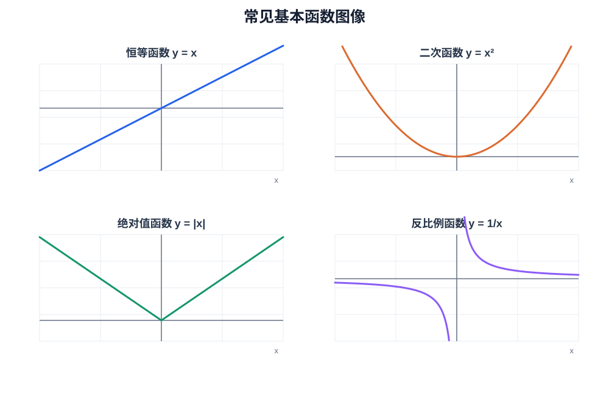
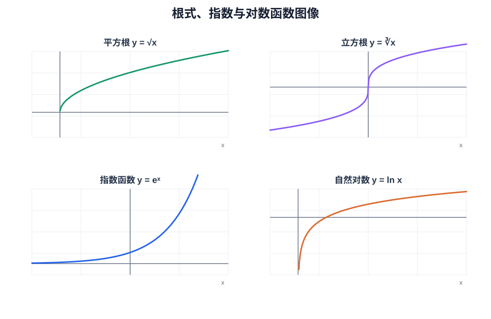
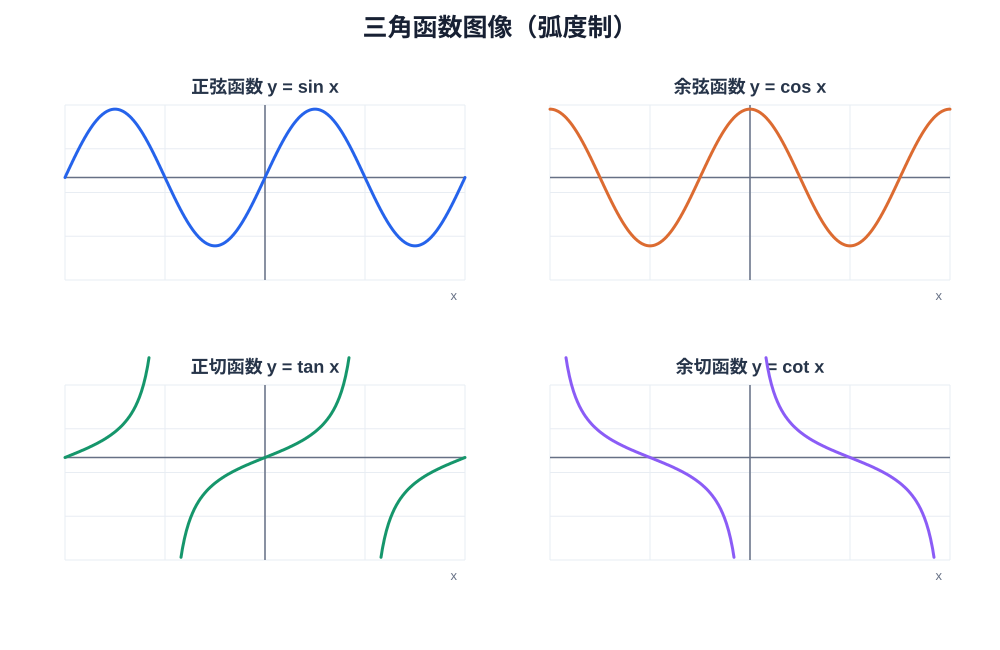
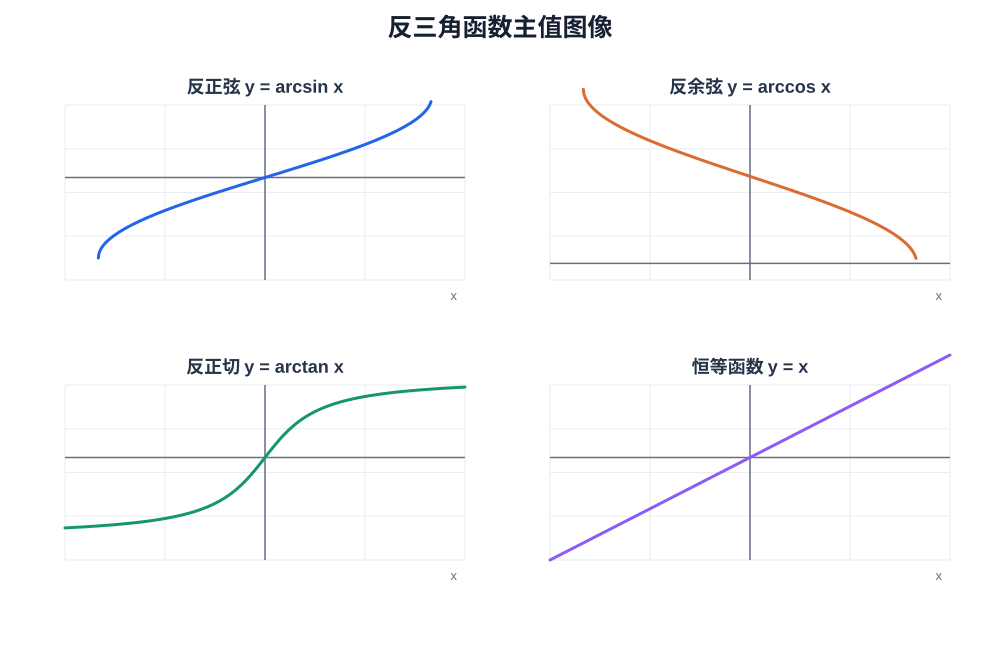

# 第 01 章｜函数、极限与连续

> 数学二·高等数学基础篇。本章建立“函数行为—极限过程—连续性判断”的分析框架，为导数与积分打基础。

## 1. 知识地图

~~~mermaid
flowchart TD
 A["函数与极限"] --> B["函数概念与性质"]
 A --> C["数列 / 函数极限"]
 C --> D["极限运算法则"]
 C --> E["重要极限与等价无穷小"]
 C --> F["洛必达 / 夹逼"]
 B --> G["连续性"]
 D --> G
 E --> G
 F --> G
 G --> H["间断点分类"]
 G --> I["闭区间连续函数性质"]
~~~

## 2. 函数基础

函数由定义域、对应法则和值域共同确定。求定义域时重点检查：分母不为零、偶次根式被开方数非负、对数真数大于零、反三角函数自变量满足定义区间。

| 性质 | 判断方法 | 常见用途 |
|---|---|---|
| 奇偶性 | 定义域关于原点对称，比较 $f(-x)$ 与 $f(x)$ | 对称性、积分化简 |
| 周期性 | 存在 $T>0$，使 $f(x+T)=f(x)$ | 函数图像与极限 |
| 单调性 | 比较函数值，后续可借助导数判断 | 不等式、根的个数 |
| 有界性 | 存在 $M$，使 $|f(x)|\le M$ | 夹逼与极限估计 |

**注意：** 奇偶性判断前必须确认定义域关于原点对称。

## 2.1 常见函数的定义域与值域（高频必记）

求定义域看“输入端是否合法”，求值域看“输出端能取到哪些值”。**定义域由表达式的限制决定；值域通常还要结合单调性、图像、配方或基本不等式判断。** 下表默认变量为实数，参数取常见的实数范围。

### A. 基本初等函数

| 函数类型 | 表达式 | 定义域 \(D\) | 值域 \(W\) | 关键记忆点 |
|---|---|---|---|---|
| 常数函数 | \(y=C\) | \(\mathbb R\) | \(\{C\}\) | 输出固定 |
| 恒等函数 | \(y=x\) | \(\mathbb R\) | \(\mathbb R\) | 定义域和值域相同 |
| 幂函数（正整数次） | \(y=x^n,\ n\) 为正整数 | \(\mathbb R\) | \(n\) 奇数：\(\mathbb R\)；\(n\) 偶数：\([0,+\infty)\) | 奇次保留正负，偶次非负 |
| 反比例函数 | \(y=\dfrac{k}{x},\ k\ne0\) | \(\mathbb R\setminus\{0\}\) | \(\mathbb R\setminus\{0\}\) | 分子非零时函数值不为 0 |
| 二次函数 | \(y=ax^2+bx+c,\ a\ne0\) | \(\mathbb R\) | \(a>0:\ [y_0,+\infty)\)；\(a<0:\ (-\infty,y_0]\) | \(y_0=c-\dfrac{b^2}{4a}\)，顶点纵坐标 |
| 绝对值函数 | \(y=|x|\) | \(\mathbb R\) | \([0,+\infty)\) | 输出非负 |
| 平方根函数 | \(y=\sqrt{x}\) | \([0,+\infty)\) | \([0,+\infty)\) | 根号内非负 |
| 立方根函数 | \(y=\sqrt[3]{x}\) | \(\mathbb R\) | \(\mathbb R\) | 负数也可开立方根 |

**图像对照：基本函数**（注意顶点、对称性及渐近线）

### B. 指数、对数与一般根式

| 函数类型 | 表达式 | 定义域 \(D\) | 值域 \(W\) | 关键记忆点 |
|---|---|---|---|---|
| 指数函数 | \(y=a^x,\ a>0,\ a\ne1\) | \(\mathbb R\) | \((0,+\infty)\) | 指数函数恒正，不取 0 |
| 对数函数 | \(y=\log_a x,\ a>0,\ a\ne1\) | \((0,+\infty)\) | \(\mathbb R\) | 真数必须严格大于 0 |
| 自然指数 | \(y=e^x\) | \(\mathbb R\) | \((0,+\infty)\) | \(e^x>0\) |
| 自然对数 | \(y=\ln x\) | \((0,+\infty)\) | \(\mathbb R\) | \(\ln x\) 要求 \(x>0\) |
| 一般偶次根式 | \(y=\sqrt[2m]{g(x)}\) | \(g(x)\ge0\) | 由 \(g(x)\) 的范围确定，且 \(y\ge0\) | 根号内允许等于 0 |
| 一般奇次根式 | \(y=\sqrt[2m+1]{g(x)}\) | 通常为 \(g(x)\) 的定义域 | 由 \(g(x)\) 的范围确定 | 根号内可正可负 |
| 有理数幂（需谨慎） | \(y=x^{p/q}\)（最简分数） | \(q\) 为奇数时可允许负底数；\(q\) 为偶数时要求 \(x\ge0\) | 还需结合 \(p\) 的奇偶性及是否为负数判断 | 考试中先按根式定义理解，不要机械套用 |

**图像对照：根式、指数与对数函数**

### C. 三角函数与反三角函数

| 函数 | 定义域 \(D\) | 值域 \(W\) |
|---|---|---|
| \(y=\sin x\) | \(\mathbb R\) | \([-1,1]\) |
| \(y=\cos x\) | \(\mathbb R\) | \([-1,1]\) |
| \(y=\tan x\) | \(\mathbb R\setminus\{\dfrac{\pi}{2}+k\pi\mid k\in\mathbb Z\}\) | \(\mathbb R\) |
| \(y=\cot x\) | \(\mathbb R\setminus\{k\pi\mid k\in\mathbb Z\}\) | \(\mathbb R\) |
| \(y=\arcsin x\) | \([-1,1]\) | \([-\dfrac\pi2,\dfrac\pi2]\) |
| \(y=\arccos x\) | \([-1,1]\) | \([0,\pi]\) |
| \(y=\arctan x\) | \(\mathbb R\) | \((-\dfrac\pi2,\dfrac\pi2)\) |
| \(y=\operatorname{arccot}x\)（常用主值约定） | \(\mathbb R\) | \((0,\pi)\) |

其中 \(k\in\mathbb Z\)。注意：反三角函数的值域是其主值区间，不是所有满足三角方程的角。

**图像对照：三角函数**（横轴角度采用弧度制）

**图像对照：反三角函数主值分支**

### D. 常见复合函数的定义域规则

| 表达式结构 | 必须满足的条件 | 例子 |
|---|---|---|
| \(\dfrac{1}{g(x)}\) | \(g(x)\ne0\) | \(\dfrac1{x-2}\)：\(x\ne2\) |
| \(\sqrt{g(x)}\) | \(g(x)\ge0\) | \(\sqrt{x-1}\)：\(x\ge1\) |
| \(\dfrac{1}{\sqrt{g(x)}}\) | \(g(x)>0\) | \(\dfrac1{\sqrt{x-1}}\)：\(x>1\) |
| \(\ln g(x)\) 或 \(\log_a g(x)\) | \(g(x)>0\) | \(\ln(2-x)\)：\(x<2\) |
| \(\arcsin g(x)\)、\(\arccos g(x)\) | \(-1\le g(x)\le1\) | \(\arcsin(2x-1)\)：\(0\le x\le1\) |
| \(\tan g(x)\) | \(g(x)\ne\dfrac\pi2+k\pi\) | 先排除使内层角落在渐近线处的 \(x\) |
| 多个限制同时出现 | 取所有条件的交集 | \(\ln(x-1)+\sqrt{3-x}\)：\(1<x\le3\) |

**定义域求解口诀：** 分母不为零；偶次根号内非负；对数真数为正；反三角函数输入在 \([-1,1]\)；多个条件取交集。

### E. 值域求解的常用方法

1. **直接利用基本函数值域**：如 \(e^x\in(0,+\infty)\)、\(\sin x\in[-1,1]\)。
2. **配方找最值**：\(x^2-4x+5=(x-2)^2+1\)，所以值域为 \([1,+\infty)\)。
3. **换元转化**：令 \(t=g(x)\)，先求 \(t\) 的取值范围，再求外层函数的范围；必须保留 \(t\) 的实际限制。
4. **利用单调性**：先确定定义域，再判断函数在区间上的单调性，通过端点值或极限确定值域。
5. **利用基本不等式**：例如 \(x+\dfrac1x\ge2\) 仅在 \(x>0\) 时成立；若 \(x<0\)，则 \(x+\dfrac1x\le-2\)。
6. **反解法**：令 \(y=f(x)\)，整理为关于 \(x\) 的方程，要求存在满足定义域的实数解；判别式条件只是必要线索，不能漏掉原定义域限制。

### F. 典型例题：定义域与值域

**例 1｜复合限制求定义域**

求 \(f(x)=\ln(x-1)+\sqrt{3-x}\) 的定义域。

由对数条件 \(x-1>0\)，得 \(x>1\)；由根式条件 \(3-x\ge0\)，得 \(x\le3\)。取交集：

\[
\boxed{D_f=(1,3]}
\]

**例 2｜二次函数求值域**

求 \(f(x)=x^2-4x+5\) 的值域。

配方得：

\[
f(x)=(x-2)^2+1\ge1
\]

当 \(x=2\) 时取等号，因此：

\[
\boxed{W_f=[1,+\infty)}
\]

**例 3｜分式函数求值域**

求 \(f(x)=\dfrac{x+1}{x-1}\)（\(x\ne1\)）的值域。

令 \(y=\dfrac{x+1}{x-1}\)，整理：

\[
(y-1)x=y+1
\]

若 \(y=1\)，则方程变为 \(0=2\)，无解；若 \(y\ne1\)，可解得 \(x=\dfrac{y+1}{y-1}\)，且自动满足 \(x\ne1\)。所以：

\[
\boxed{W_f=\mathbb R\setminus\{1\}}
\]

**例 4｜三角函数复合求值域**

求 \(f(x)=2\sin x-1\) 的值域。因为 \(-1\le\sin x\le1\)，所以：

\[
-3\le2\sin x-1\le1
\quad\Longrightarrow\quad
\boxed{W_f=[-3,1]}
\]

**例 5｜分母与根号联合限制**

求 \(f(x)=\dfrac1{\sqrt{x^2-4}}\) 的定义域。

分母不能为 0，且根号内必须严格大于 0：

\[
x^2-4>0
\quad\Longrightarrow\quad
\boxed{D_f=(-\infty,-2)\cup(2,+\infty)}
\]

### G. 易错提醒

- \(\sqrt{x^2}=|x|\)，不是恒等于 \(x\)。
- \(\ln(x^2)\) 要求 \(x\ne0\)，不能误写为 \(x>0\)；但 \(\ln x^2\) 与 \(2\ln x\) 仅在 \(x>0\) 时可直接等同。
- \(\dfrac1{\sqrt{x}}\) 的条件是 \(x>0\)，不是 \(x\ge0\)。
- \(\arcsin(2x)\) 要求 \(-\dfrac12\le x\le\dfrac12\)。
- \(\sin x\) 的值域是 \([-1,1]\)，但 \(\sin(2x+1)\) 在 \(x\in\mathbb R\) 时值域仍是 \([-1,1]\)；若自变量区间受限，则必须重新判断。
- 函数值域不一定等于外层基本函数的完整值域，复合函数必须考虑内层函数实际能取到的值。

## 3. 极限的含义

$$
\lim_{x\to a}f(x)=L
$$
表示当 $x$ 无限接近 $a$（不要求 $x=a$）时，$f(x)$ 无限接近 $L$。极限关注邻域内的变化趋势，不等同于函数在 a 点的函数值。

函数极限存在的充要条件：
$$
\lim_{x\to a^-}f(x)=\lim_{x\to a^+}f(x)=L
$$

分段函数、绝对值函数、含参数函数，优先检查左右极限 $\lim_{x\to a^-}f(x)$ 与 $\lim_{x\to a^+}f(x)$。

## 4. 极限计算方法

### 4.1 代数变形

常用因式分解、通分、有理化、提取最高阶项和三角恒等变换。

例：
$$
\lim_{x\to1}\frac{x^2-1}{x-1}
=\lim_{x\to1}(x+1)=2
$$

### 4.2 两个重要极限

$$
\boxed{\lim_{x\to0}\frac{\sin x}{x}=1}
\qquad
\boxed{\lim_{x\to\infty}\left(1+\frac1x\right)^x=e}
$$

常见推广：
$$
\lim_{x\to0}\frac{\sin ax}{bx}=\frac ab,\quad
\lim_{x\to0}\frac{\tan ax}{\sin bx}=\frac ab
$$
其中 $b\ne0$，三角函数极限使用弧度制。

### 4.3 等价无穷小

当 x 趋近 0 时：

| 表达式 | 等价无穷小 |
|---|---|
| sin x、tan x、arcsin x、arctan x | x |
| ln(1+x) | x |
| e^x-1 | x |
| a^x-1 | x ln a |
| 1-cos x | x²/2 |

等价无穷小通常用于乘除因子。**加减结构不能机械逐项替换**：同阶无穷小相减时主项可能抵消，需要进一步展开或变形。

### 4.4 洛必达法则

适用于满足条件的 0/0 或无穷/无穷型极限。使用前确认未定式类型、分子分母在相应邻域可导，并检查导数之比极限存在。0·无穷、无穷-无穷、1 的无穷次方等形式需先变形，不能直接套用。

### 4.5 夹逼定理

若在某邻域内 $g(x)\le f(x)\le h(x)$，且两端极限都为 $L$，则 $f(x)$ 的极限为 $L$。典型用途是处理振荡因子与趋零振幅的乘积。

## 5. 无穷小与阶

若 $\alpha(x)$ 趋于 $0$，称为无穷小。若
$$
\lim_{x\to a}\frac{\alpha(x)}{\beta(x)}=c,\quad 0<|c|<\infty
$$
则二者同阶；若 $c=1$，则等价。若比值极限为 $0$，则 $\alpha$ 是比 $\beta$ 高阶的无穷小。

例如：
$$
\lim_{x\to0}\frac{x^2}{x}=0
$$
所以 x² 是比 x 高阶的无穷小。

## 6. 连续与间断

函数在 $x=a$ 连续，必须同时满足：
1. $f(a)$ 有定义；
2. $\lim_{x\to a}f(x)$ 存在；
3. 极限等于 $f(a)$。

| 间断类型 | 特征 |
|---|---|
| 可去间断点 | 左右极限存在且相等，但函数值未定义或不等于极限 |
| 跳跃间断点 | 左右极限都存在但不相等 |
| 无穷间断点 | 至少一侧函数值趋于无穷 |
| 振荡间断点 | 邻域内振荡，极限不存在 |

### 闭区间连续函数的重要性质

若 $f$ 在 $[a,b]$ 连续，则函数有界、能取得最大值和最小值，并满足介值性质。若 $f(a)f(b)<0$，则至少存在 $c\in(a,b)$，使 $f(c)=0$。

**零点定理不保证零点唯一。** 唯一性通常还需要单调性等额外条件。

## 7. 典型例题

### 例 1：等价无穷小

$$
\lim_{x\to0}\frac{\sin3x\cdot\ln(1+2x)}{x^2}
$$
因为 sin3x 等价于 3x，ln(1+2x) 等价于 2x，结果为：
$$
\boxed{6}
$$

### 例 2：有理化

$$
\lim_{x\to0}\frac{\sqrt{1+x}-1}{x}
=\lim_{x\to0}\frac1{\sqrt{1+x}+1}
=\boxed{\frac12}
$$

### 例 3：分段函数连续性

设

$$
f(x)=
\begin{cases}
ax+1, & x<1,\\
x^2+b, & x\geq 1.
\end{cases}
$$

在 $x=1$ 连续，必须满足左极限等于函数值：

$$
\lim_{x\to1^-}f(x)=f(1).
$$

因此

$$
a+1=1+b
\quad\Longrightarrow\quad
\boxed{a=b}.
$$

### 例 4：夹逼

$$
-1\le\sin\frac1x\le1
$$
两边乘以 x²：
$$
-x^2\le x^2\sin\frac1x\le x^2
$$
所以 $x\to0$ 时极限为 $0$。

## 8. 高频错误诊断

| 错误 | 正确处理 |
|---|---|
| 把函数值与极限混为一谈 | 分别检查 f(a) 与邻域趋势 |
| 只算右极限就断言极限存在 | 分段点比较左右极限 |
| 在加减式中随意替换等价无穷小 | 判断主项是否抵消 |
| 忘记弧度制 | 三角函数极限默认弧度制 |
| 洛必达法则使用过度 | 先确认未定式与可导条件 |
| 把零点定理理解为唯一零点 | 唯一性需要额外条件 |

## 9. 章节自测

1. 计算 $\lim_{x\to0}\frac{e^{2x}-1}{\sin(3x)}$。
2. 计算 $\lim_{x\to0}\frac{1-\cos(2x)}{x^2}$。
3. 判断 $f(x)=\frac{x^2-1}{x-1}$（$x\ne1$），且 $f(1)=3$，在 $x=1$ 是否连续。
4. 若 $f$ 在 $[0,2]$ 连续，$f(0)=-1$、$f(2)=3$，能否断定存在 $c\in(0,2)$ 使 $f(c)=0$？
5. 判断 $x\to0$ 时 $x^2$ 与 $x$ 的阶关系。

参考答案与解析

1. 分子等价于 2x，分母等价于 3x，结果 2/3。
2. 1-cos(2x) 等价于 (2x)²/2，结果 2。
3. $x\ne1$ 时表达式等于 $x+1$，极限为 $2$，但 $f(1)=3$，为可去间断点。
4. 可以。端点函数值异号，由零点定理至少存在一个零点。
5. x²/x 趋于 0，故 x² 是比 x 高阶的无穷小。

## 10. 本章掌握度检查

- [ ] 能确定常见函数定义域并判断奇偶性、周期性
- [ ] 能区分函数值、左右极限与函数极限
- [ ] 能根据结构选择变形、重要极限、等价无穷小、洛必达或夹逼
- [ ] 能准确分类间断点
- [ ] 能使用闭区间连续函数性质
- [ ] 自测正确率达到 80% 以上，并能解释每一步依据

本笔记为学习总结；数学二范围以 2028 年正式考试大纲及目标院校要求为准。
