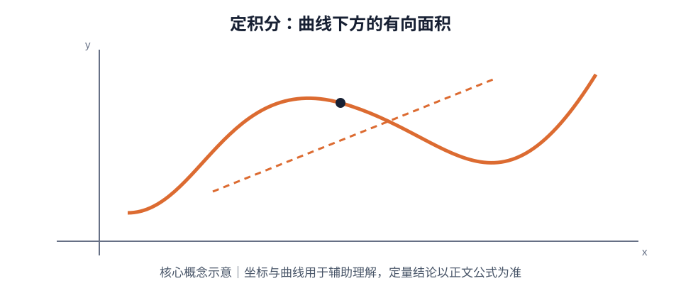

# 第 04 章｜不定积分与定积分

> 数学二 · 高等数学 · 基础阶段。围绕原函数、积分方法、定积分性质与变上限积分建立统一框架；具体考试范围以 2028 年正式大纲为准。

## 01. 知识地图

~~~mermaid
flowchart TD
 A[积分学] --> B[不定积分]
 A --> C[定积分]
 B --> D[基本积分公式]
 B --> E[换元积分法]
 B --> F[分部积分法]
 C --> G[定义与几何意义]
 C --> H[性质与积分中值定理]
 C --> I[变上限积分]
 C --> J[反常积分]
~~~

## 02. 原函数与不定积分

若 $F'(x)=f(x)$，则称 $F(x)$ 是 $f(x)$ 的一个原函数。若 $F$ 是一个原函数，则所有原函数构成：

$$
\int f(x)\,dx=F(x)+C
$$

其中 $C$ 为任意常数。求不定积分的核心是识别被积函数结构，并逆向匹配求导公式。

### 基本积分公式

| 被积函数 | 不定积分（$C$ 为常数） |
|---|---|
| $x^\alpha$（$\alpha\ne-1$） | $\dfrac{x^{\alpha+1}}{\alpha+1}+C$ |
| $\dfrac1x$ | $\ln|x|+C$ |
| $e^x$ | $e^x+C$ |
| $a^x$（$a>0,a\ne1$） | $\dfrac{a^x}{\ln a}+C$ |
| $\sin x$ | $-\cos x+C$ |
| $\cos x$ | $\sin x+C$ |
| $\dfrac1{1+x^2}$ | $\arctan x+C$ |
| $\dfrac1{\sqrt{1-x^2}}$ | $\arcsin x+C$ |

**检查方法：** 对积分结果求导，确认是否还原为原被积函数。

## 03. 换元积分法

### 3.1 第一类换元：凑微分

若被积函数可写成 $f(g(x))g'(x)$，令 $u=g(x)$，则：

$$
\int f(g(x))g'(x)\,dx=\int f(u)\,du
$$

常见识别信号：复合函数内部表达式的导数同时出现在被积式中。

例：

$$
\int 2x\cos(x^2)\,dx
=\sin(x^2)+C
$$

### 3.2 第二类换元：变量代换

通过 $x=\varphi(t)$ 将复杂被积式化为更易积分的形式。换元时必须同步替换 $dx$、积分区间（定积分）和被积函数，最后按需要换回原变量。

## 04. 分部积分法

由乘积求导公式得到：

$$
\int u\,dv=uv-\int v\,du
$$

定积分形式：

$$
\int_a^b u(x)v'(x)\,dx
=\left. u(x)v(x)\right|_a^b-\int_a^b v(x)u'(x)\,dx
$$

选择原则：优先把求导后会简化的部分设为 $u$，把容易积分的部分设为 $dv$。常见场景包括多项式与指数、三角、对数函数的乘积。

例：

$$
\int xe^x\,dx=xe^x-e^x+C
$$

## 05. 定积分的定义与几何意义

定积分可理解为连续函数在区间上的累积量。黎曼和形式为：

$$
\int_a^b f(x)\,dx
=\lim_{n\to\infty}\sum_{i=1}^{n}f(\xi_i)\Delta x
$$

其中分割区间的最大长度趋于 0，$\xi_i$ 位于第 $i$ 个小区间内。

当 $f(x)\ge0$ 时，定积分表示曲线 $y=f(x)$、$x$ 轴与两条端线围成的面积；函数在 $x$ 轴下方时积分为负，几何面积需取绝对值或分段处理。

## 06. 定积分基本性质

$$
\int_a^a f(x)\,dx=0,\qquad
\int_a^b f(x)\,dx=-\int_b^a f(x)\,dx
$$

$$
\int_a^b[\alpha f(x)+\beta g(x)]\,dx
=\alpha\int_a^b f(x)\,dx+\beta\int_a^b g(x)\,dx
$$

区间可加性：

$$
\int_a^b f(x)\,dx
=\int_a^c f(x)\,dx+\int_c^b f(x)\,dx
$$

若 $f(x)\le g(x)$，则：

$$
\int_a^b f(x)\,dx\le\int_a^b g(x)\,dx
$$

对称区间上的奇偶性：

- 若 $f$ 为奇函数，$\int_{-a}^{a}f(x)\,dx=0$；
- 若 $f$ 为偶函数，$\int_{-a}^{a}f(x)\,dx=2\int_0^a f(x)\,dx$。

使用前先确认积分区间关于原点对称，且函数满足相应奇偶性。

## 07. 微积分基本定理与变上限积分

若 $f$ 在 $[a,b]$ 连续，且 $F'(x)=f(x)$，则：

$$
\int_a^b f(x)\,dx=F(b)-F(a)
$$

若定义：

$$
\Phi(x)=\int_a^x f(t)\,dt
$$

则：

$$
\Phi'(x)=f(x)
$$

更一般地，若上下限均为函数：

$$
\frac{d}{dx}\int_{\alpha(x)}^{\beta(x)}f(t)\,dt
=f(\beta(x))\beta'(x)-f(\alpha(x))\alpha'(x)
$$

例：

$$
\frac{d}{dx}\int_{x^2}^{\sin x}e^{t^2}\,dt
=e^{\sin^2x}\cos x-2xe^{x^4}
$$

## 08. 积分中值定理

若 $f$ 在 $[a,b]$ 连续，则至少存在 $\xi\in[a,b]$，使：

$$
\int_a^b f(x)\,dx=f(\xi)(b-a)
$$

几何理解：存在某一点的函数值等于区间上的平均函数值。该结论强调“存在”，不能把 $f(\xi)$ 替换为任意点的函数值。

## 09. 反常积分基础

无穷区间或被积函数在端点/区间内部无界时，需要用极限定义反常积分。例如：

$$
\int_a^{+\infty}f(x)\,dx
=\lim_{R\to+\infty}\int_a^R f(x)\,dx
$$

若极限存在且有限，则积分收敛；否则发散。瑕点位于区间内部时，应在瑕点处分段取单侧极限，两侧都收敛才收敛。

常见 $p$ 型判别：

$$
\int_1^{+\infty}\frac{1}{x^p}\,dx
\begin{cases}
\text{收敛},&p>1\\
\text{发散},&p\le1
\end{cases}
$$

$$
\int_0^1\frac{1}{x^p}\,dx
\begin{cases}
\text{收敛},&p<1\\
\text{发散},&p\ge1
\end{cases}
$$

## 10. 典型例题

### 例 1｜换元积分

$$
\int \frac{2x}{1+x^2}\,dx
$$

令 $u=1+x^2$，则 $du=2x\,dx$，所以结果为：

$$
\ln(1+x^2)+C
$$

### 例 2｜分部积分

$$
\int x\cos x\,dx
=x\sin x+\cos x+C
$$

### 例 3｜定积分计算

$$
\int_0^1(3x^2+2x)\,dx
=\left.[x^3+x^2]\right|_0^1=2
$$

### 例 4｜对称性

计算 $\int_{-2}^{2}(x^3+\cos x)\,dx$。其中 $x^3$ 为奇函数，$\cos x$ 为偶函数，因此：

$$
\int_{-2}^{2}(x^3+\cos x)\,dx
=2\int_0^2\cos x\,dx=2\sin2
$$

## 11. 高频易错点

- 不定积分结果必须包含积分常数 $C$；
- 换元后不能遗漏 $dx$ 的变换；
- 分部积分要正确处理边界项；
- 定积分上下限交换会改变积分符号；
- 奇偶函数性质只能在对称区间上直接使用；
- 定积分是带符号累积量，不总等于几何面积；
- 变上限积分求导时，必须使用链式法则处理上下限；
- 反常积分必须先写极限，不能只对形式表达式套原函数。

## 12. 章节自测

1. 求 $\int(3x^2-2x+1)\,dx$。
2. 求 $\int 2x e^{x^2}\,dx$。
3. 求 $\int x\ln x\,dx$（$x>0$）。
4. 计算 $\int_0^2(2x+1)\,dx$。
5. 若 $\Phi(x)=\int_1^{x^2}\cos t\,dt$，求 $\Phi'(x)$。
6. 判断 $\int_1^{+\infty}x^{-3/2}\,dx$ 收敛还是发散。
7. 说明为什么 $\int_{-a}^{a}f(x)\,dx=0$ 不能对任意函数成立。

### 参考答案

1. $x^3-x^2+x+C$。
2. $e^{x^2}+C$。
3. $\frac{x^2}{2}\ln x-\frac{x^2}{4}+C$。
4. $[x^2+x]_0^2=6$。
5. $2x\cos(x^2)$。
6. 收敛，因为 $p=3/2>1$。
7. 该结论需要 $f$ 为奇函数且积分区间关于原点对称；一般函数不满足此条件。

## 13. 本章达标检查

- [ ] 能熟练使用基本积分公式
- [ ] 能识别并完成凑微分与变量代换
- [ ] 能正确选择 $u$ 与 $dv$ 完成分部积分
- [ ] 能使用定积分性质与微积分基本定理
- [ ] 能处理变上限积分求导
- [ ] 能识别基础反常积分的收敛性
- [ ] 能解释定积分与几何面积的区别

## 补充专题｜公式定理速查与图像理解

基本公式：$\int x^\alpha dx=x^{\alpha+1}/(\alpha+1)+C$（$\alpha\ne-1$），$\int dx/x=\ln|x|+C$，$\int e^xdx=e^x+C$，$\int\sin xdx=-\cos x+C$。换元法与分部积分 $\int u\,dv=uv-\int v\,du$。Newton-Leibniz：$\int_a^b f=F(b)-F(a)$。变上限求导：$d/dx\int_a^{\phi(x)}f(t)dt=f(\phi(x))\phi'(x)$。奇函数在对称区间积分为零，偶函数积分为两倍半区间积分。

### 图像/几何示意

