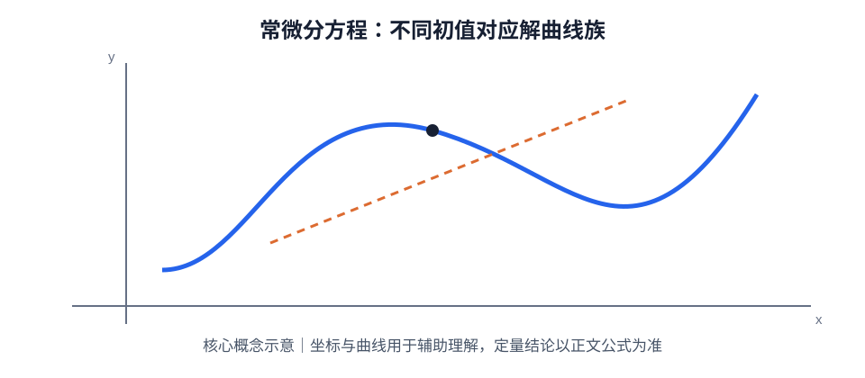

# 第 05 章｜常微分方程

> 数学二 · 高等数学 · 基础阶段。核心是根据方程结构识别类型，选择变量分离、一阶线性方程、可降阶方程或二阶常系数线性方程的方法。解题时必须代回检查，并结合初始条件确定常数。

## 01. 知识地图

~~~mermaid
flowchart TD
 A[常微分方程] --> B[基本概念]
 A --> C[一阶方程]
 A --> D[高阶方程]
 C --> C1[可分离变量]
 C --> C2[一阶线性]
 D --> D1[可降阶]
 D --> D2[二阶常系数线性]
 D2 --> D3[齐次方程]
 D2 --> D4[非齐次方程]
~~~

## 02. 基本概念

微分方程是含有未知函数及其导数的方程。未知函数的最高阶导数的阶数称为方程的阶。

- 通解：含有与方程阶数相对应的独立任意常数的解。
- 特解：满足给定初始条件或边界条件的解。
- 初值问题：给定某点处函数及必要阶数导数的值，用于确定通解中的常数。

求解时注意定义域：分离变量可能涉及除以某个函数，除法前应单独检查被除函数为 0 的情形。

## 03. 可分离变量的一阶方程

若方程可化为：

$$
\frac{dy}{dx}=g(x)h(y)
$$

在 $h(y)\ne0$ 的区间内分离变量：

$$
\frac{dy}{h(y)}=g(x)\,dx
$$

两边积分：

$$
\int\frac{1}{h(y)}\,dy=\int g(x)\,dx+C
$$

**步骤：**
1. 先检查 $h(y)=0$ 是否给出常值解。
2. 分离 $x$ 与 $y$。
3. 两边积分。
4. 根据初始条件确定常数。
5. 检查所得解的定义域和遗漏解。

例：求 $y'=xy$。

当 $y\ne0$ 时：

$$
\frac{dy}{y}=x\,dx
\quad\Rightarrow\quad
\ln|y|=\frac{x^2}{2}+C
$$

因此 $y=Ce^{x^2/2}$，其中 $C$ 可取任意实数，包含零解。

## 04. 一阶线性微分方程

标准形式：

$$
y'+P(x)y=Q(x)
$$

积分因子：

$$
\mu(x)=e^{\int P(x)\,dx}
$$

两边乘以积分因子后，左侧可合并为乘积导数：

$$
(\mu y)'=\mu Q
$$

因此通解：

$$
y=e^{-\int P(x)\,dx}
\left[\int Q(x)e^{\int P(x)\,dx}\,dx+C\right]
$$

例：求 $y'+y=e^x$。

取积分因子 $\mu=e^x$：

$$
(e^xy)'=e^{2x}
$$

积分得：

$$
e^xy=\frac12e^{2x}+C
\quad\Rightarrow\quad
y=\frac12e^x+Ce^{-x}
$$

## 05. 可降阶的高阶微分方程

### 类型一：不显含未知函数 y

若方程只含 $x,y',y''$，令 $p=y'$，则 $y''=p'$，可降为关于 $p$ 的一阶方程。

### 类型二：不显含自变量 x

若方程含 $y,y',y''$ 而不显含 $x$，令 $p(y)=y'$，利用链式法则：

$$
y''=\frac{dp}{dx}
=\frac{dp}{dy}\frac{dy}{dx}
=p\frac{dp}{dy}
$$

从而将二阶方程降为关于 $p$ 与 $y$ 的一阶方程。求出 $p(y)$ 后，再由 $y'=p(y)$ 分离变量求 $y(x)$。

## 06. 二阶常系数线性微分方程

标准形式：

$$
y''+py'+qy=f(x)
$$

对应齐次方程：

$$
y''+py'+qy=0
$$

特征方程：

$$
r^2+pr+q=0
$$

### 特征根情况

| 特征根 | 齐次通解 |
|:---|:---|
| 两个不相等实根 $r_1,r_2$ | $C_1e^{r_1x}+C_2e^{r_2x}$ |
| 二重实根 $r$ | $(C_1+C_2x)e^{rx}$ |
| 共轭复根 $\alpha\pm\beta i$ | $e^{\alpha x}(C_1\cos\beta x+C_2\sin\beta x)$ |

### 非齐次方程

非齐次通解由齐次通解与一个特解相加：

$$
y=y_h+y_p
$$

其中 $y_h$ 为对应齐次方程通解，$y_p$ 为非齐次方程的一个特解。

对于右端为指数、正弦/余弦或多项式的常见形式，可尝试待定系数法；若试探形式与齐次解重复，需要乘以适当的 $x$ 的幂次后再代入确定系数。不要忽略共振情形。

## 07. 初值条件与验证

- 一阶方程通常给一个初值，用于确定一个任意常数。
- 二阶方程通常给 $y(x_0)$ 与 $y'(x_0)$，用于确定两个任意常数。
- 将求得的解及导数代回原方程，是检查计算错误的直接方法。
- 初始条件必须代入原函数表达式，而不是只代入导数关系。

## 08. 常见失分点

1. 分离变量时除以 $y$，却漏掉 $y=0$ 的解。
2. 一阶线性方程误把积分因子写成 $e^{\int Q(x)dx}$；正确对象是系数 $P(x)$。
3. 二阶方程的特征根为重根时漏掉 $x$ 因子。
4. 复根情形只写指数函数，未转化为正弦、余弦实解。
5. 非齐次方程只求特解或只求齐次解，没有相加。
6. 待定系数法遇到与齐次解重复的试探项时，没有乘以 $x$ 消除重复。
7. 使用初值确定常数后不回代检查。

## 09. 章节自测

1. 求微分方程 $y'=2xy$ 的通解。
2. 求 $y'+2y=1$ 的通解。
3. 求 $y''-3y'+2y=0$ 的通解。
4. 求 $y''-2y'+y=0$ 的通解。
5. 求 $y''+4y=0$ 的通解。
6. 对方程 $y''=F(y,y')$，令 $p=y'$，写出 $y''$ 关于 $p$ 与 $y$ 的表达式。
7. 二阶非齐次线性方程的通解由哪两部分构成？

## 10. 自测参考答案

1. 分离变量得 $dy/y=2x\,dx$，故 $y=Ce^{x^2}$，并包含零解。
2. 积分因子为 $e^{2x}$，得 $(e^{2x}y)'=e^{2x}$，所以 $y=1/2+Ce^{-2x}$。
3. 特征方程 $(r-1)(r-2)=0$，故 $y=C_1e^x+C_2e^{2x}$。
4. 特征方程 $(r-1)^2=0$，故 $y=(C_1+C_2x)e^x$。
5. 特征根为 $\pm2i$，故 $y=C_1\cos2x+C_2\sin2x$。
6. $y''=p\,\frac{dp}{dy}$。
7. 对应齐次方程的通解 $y_h$ 与非齐次方程的一个特解 $y_p$，即 $y=y_h+y_p$。

## 11. 复习清单

- [ ] 能识别并求解可分离变量方程
- [ ] 能熟练使用一阶线性方程积分因子
- [ ] 能判断可降阶方程的类型并正确换元
- [ ] 能根据特征根写出二阶齐次通解
- [ ] 能理解非齐次通解结构及待定系数法的共振修正
- [ ] 能使用初值条件确定常数并代回验证

## 补充专题｜公式定理速查与图像理解

可分离变量：$y'=g(x)h(y)\Rightarrow dy/h(y)=g(x)dx$。一阶线性：$y'+P(x)y=Q(x)$，积分因子 $\mu=e^{\int Pdx}$，$y=\mu^{-1}(\int\mu Qdx+C)$。二阶常系数齐次：$y''+py'+qy=0$，特征方程 $r^2+pr+q=0$；两异实根对应 $C_1e^{r_1x}+C_2e^{r_2x}$，重根对应 $(C_1+C_2x)e^{rx}$，复根 $\alpha\pm\beta i$ 对应 $e^{\alpha x}(C_1\cos\beta x+C_2\sin\beta x)$。分离变量时检查被除因子为零的常值解。

### 图像/几何示意

