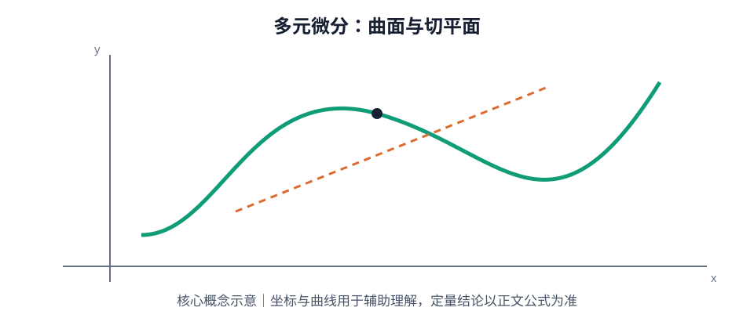

# 第 06 章｜多元函数微分学

> 数学二 · 高等数学 · 基础阶段。重点掌握二元函数的偏导数、全微分、复合函数求导、隐函数求导与极值。学习时要区分“偏导数存在”“连续”“可微”之间的逻辑关系。

## 01. 知识地图

~~~mermaid
flowchart TD
 A[多元函数微分学] --> B[极限与连续]
 A --> C[偏导数]
 A --> D[全微分与可微]
 A --> E[复合函数求导]
 A --> F[隐函数求导]
 A --> G[极值与最值]
 C --> C1[高阶偏导]
 E --> E1[链式法则]
 G --> G1[无条件极值]
 G --> G2[条件极值]
~~~

## 02. 二元函数的极限与连续

二元函数 $z=f(x,y)$ 在点 $(x_0,y_0)$ 的极限，要求 $(x,y)$ 从任意方向趋近该点时函数值趋于同一常数。

判断极限不存在时，可选取两条不同路径趋近同一点；若沿两条路径得到不同极限值，则二元极限不存在。沿任意有限条路径结果相同，并不能单独证明极限存在。

若 $f(x,y)$ 在 $(x_0,y_0)$ 有定义，且：

$$
\lim_{(x,y)\to(x_0,y_0)}f(x,y)=f(x_0,y_0)
$$

则函数在该点连续。

## 03. 偏导数

对 $z=f(x,y)$，分别固定另一个变量：

$$
f_x(x,y)=\lim_{\Delta x\to0}
\frac{f(x+\Delta x,y)-f(x,y)}{\Delta x}
$$

$$
f_y(x,y)=\lim_{\Delta y\to0}
\frac{f(x,y+\Delta y)-f(x,y)}{\Delta y}
$$

计算时把另一个变量视为常数。偏导数描述沿坐标方向的局部变化率。

### 高阶偏导数

二阶偏导包括 $f_{xx}$、$f_{xy}$、$f_{yx}$、$f_{yy}$。在混合偏导连续等适当条件下，有：

$$
f_{xy}=f_{yx}
$$

不能在没有条件时把混合偏导可交换当作无条件结论。

## 04. 全微分与可微

若函数在点 $(x,y)$ 可微，则全微分为：

$$
dz=f_x(x,y)\,dx+f_y(x,y)\,dy
$$

可微蕴含连续，连续不必然可微；偏导数存在也不必然可微。

若偏导数在点的某邻域内存在且在该点连续，则函数在该点可微，这是常用的充分条件。

线性主部：

$$
\Delta z=f_x(x,y)\Delta x+f_y(x,y)\Delta y
+o\left(\sqrt{(\Delta x)^2+(\Delta y)^2}\right)
$$

## 05. 复合函数求导

若 $z=f(u,v)$，且 $u=u(x,y)$、$v=v(x,y)$，则：

$$
\frac{\partial z}{\partial x}
=f_u\frac{\partial u}{\partial x}
+f_v\frac{\partial v}{\partial x}
$$

$$
\frac{\partial z}{\partial y}
=f_u\frac{\partial u}{\partial y}
+f_v\frac{\partial v}{\partial y}
$$

若中间变量还依赖其他变量，沿依赖路径继续使用链式法则。建议先画变量依赖图，再逐条累加路径上的偏导数乘积。

## 06. 隐函数求导

若方程 $F(x,y)=0$ 在适当条件下确定 $y=y(x)$，且 $F_y\ne0$，则：

$$
\frac{dy}{dx}=-\frac{F_x}{F_y}
$$

若 $F(x,y,z)=0$ 确定 $z=z(x,y)$，则：

$$
\frac{\partial z}{\partial x}=-\frac{F_x}{F_z},
\qquad
\frac{\partial z}{\partial y}=-\frac{F_y}{F_z}
$$

求导时把 $F$ 视为复合函数，不能把依赖变量的导数漏掉。

## 07. 多元函数极值

若二元函数在内点取得极值且偏导数存在，则该点为驻点，满足：

$$
f_x(x_0,y_0)=0,\qquad f_y(x_0,y_0)=0
$$

驻点不一定是极值点，还可能是鞍点。

令：

$$
A=f_{xx}(x_0,y_0),\quad
B=f_{xy}(x_0,y_0),\quad
C=f_{yy}(x_0,y_0)
$$

判别式：

$$
\Delta=AC-B^2
$$

- $\Delta>0$ 且 $A>0$：极小值点。
- $\Delta>0$ 且 $A<0$：极大值点。
- $\Delta<0$：鞍点。
- $\Delta=0$：该判别法不能确定，需要进一步分析。

求闭区域上的最大值与最小值时，不能只检查内部驻点，还要检查边界及必要的端点。

## 08. 条件极值与 Lagrange 乘数法

求约束 $g(x,y)=0$ 下的极值，可构造：

$$
L(x,y,\lambda)=f(x,y)-\lambda g(x,y)
$$

求解方程组：

$$
\begin{cases}
f_x-\lambda g_x=0\\
f_y-\lambda g_y=0\\
g(x,y)=0
\end{cases}
$$

该方法适用于满足相应可微性和约束正则条件的情形。得到候选点后仍需结合题目要求判断极值。

## 09. 典型例题

### 例 1：偏导数

设 $f(x,y)=x^2y+3xy^2$，求 $f_x$ 与 $f_y$。

$$
f_x=2xy+3y^2,\qquad
f_y=x^2+6xy
$$

### 例 2：隐函数求导

设 $x^2+y^2=1$，在 $y\ne0$ 处求 $dy/dx$。

令 $F=x^2+y^2-1$，则：

$$
\frac{dy}{dx}=-\frac{2x}{2y}=-\frac{x}{y}
$$

### 例 3：极值判别

设 $f(x,y)=x^2+y^2-2x-4y$。

驻点满足 $2x-2=0$、$2y-4=0$，得 $(1,2)$。此时 $A=2$、$B=0$、$C=2$，所以 $\Delta=4>0$ 且 $A>0$，该点为极小值点，极小值为 $-5$。

## 10. 常见失分点

1. 求偏导时没有固定另一个变量。
2. 混淆偏导数存在、连续和可微的逻辑关系。
3. 计算复合函数偏导时漏掉中间变量的依赖路径。
4. 隐函数求导时遗漏 $y$ 或 $z$ 对自变量的依赖。
5. 把所有驻点都当作极值点。
6. 极值判别式 $\Delta=0$ 时仍强行下结论。
7. 闭区域最值问题遗漏边界。

## 11. 章节自测

1. 求 $f(x,y)=x^3y+2xy^2$ 的两个一阶偏导数。
2. 写出二元函数可微时的全微分表达式。
3. 若 $z=u^2+v$，$u=x+y$、$v=xy$，求 $\partial z/\partial x$。
4. 若 $x^2+xy+y^2=1$，求 $dy/dx$。
5. 二阶极值判别中，$\Delta<0$ 说明什么？
6. 若 $\Delta=0$，能否据此判断极大值或极小值？
7. 求 $f(x,y)=x^2+4y^2-2x+8y$ 的驻点并判断类型。

## 12. 自测参考答案

1. $f_x=3x^2y+2y^2$，$f_y=x^3+4xy$。
2. $dz=f_xdx+f_ydy$。
3. $z_x=2u\,u_x+v_x=2(x+y)+y=2x+3y$。
4. 隐式求导得 $2x+y+(x+2y)y'=0$，故 $y'=-(2x+y)/(x+2y)$（分母非零处）。
5. 驻点为鞍点。
6. 不能，需进一步分析函数在该点附近的变化。
7. $f_x=2x-2=0$、$f_y=8y+8=0$，驻点为 $(1,-1)$；$A=2$、$B=0$、$C=8$，$\Delta=16>0$ 且 $A>0$，为极小值点。

## 13. 复习清单

- [ ] 能用路径法证明二元极限不存在
- [ ] 能熟练计算一阶与二阶偏导
- [ ] 能说明可微、连续、偏导数存在之间的关系
- [ ] 能使用多元复合函数链式法则
- [ ] 能对显式与隐式方程求偏导
- [ ] 能判断驻点类型并处理闭区域边界
- [ ] 能列出条件极值的 Lagrange 方程组

## 补充专题｜公式定理速查与图像理解

全微分：$dz=f_xdx+f_ydy$。复合链式：$z_x=f_uu_x+f_vv_x$，$z_y=f_uu_y+f_vv_y$。隐函数 $F(x,y,z)=0$：$z_x=-F_x/F_z$，$z_y=-F_y/F_z$。极值判别令 $D=f_{xx}f_{yy}-f_{xy}^2$：$D>0,f_{xx}>0$ 极小；$D>0,f_{xx}<0$ 极大；$D<0$ 鞍点；$D=0$ 不确定。偏导存在不保证连续或可微；闭区域最值还须检查边界。

### 图像/几何示意

