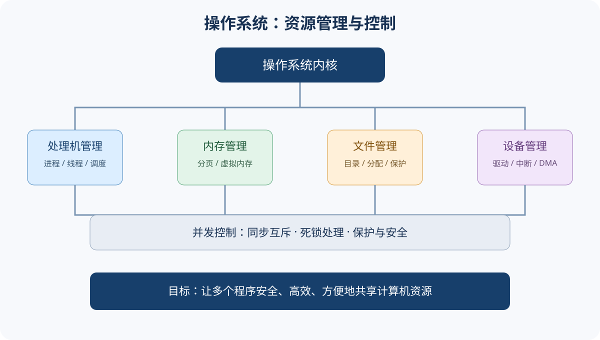

# 408｜操作系统

## 基础概念入口
- [基础概念与核心术语](./基础概念与核心术语.md)｜先理解操作系统的资源管理、系统调用、进程、同步和虚拟内存
- 

## 知识地图
~~~mermaid
flowchart TD
 A[操作系统] --> B[基础与运行环境]
 A --> C[进程与线程]
 A --> D[同步与死锁]
 A --> E[内存管理]
 A --> F[文件管理]
 A --> G[I/O管理]
~~~

## 章节清单
1. 操作系统基础：功能、特征、发展、内核态/用户态、中断异常、系统调用、链接装入、虚拟机。
2. 进程与线程：PCB、状态转换、线程模型、调度层次与算法、进程通信。
3. 同步与死锁：临界区、互斥/同步、信号量与 PV、管程、死锁必要条件、银行家算法。
4. 内存管理：地址绑定、连续分配、分页、分段、段页式、虚拟内存、缺页异常、页面置换。
5. 文件管理：文件逻辑/物理结构、目录、文件系统实现、空闲空间管理、文件共享与保护。
6. I/O 管理：设备控制器、I/O 软件层次、程序控制/中断/DMA、缓冲、假脱机、磁盘调度。

## 已编写章节

- [第 01 章｜操作系统概述与运行环境](./第01章-操作系统概述与运行环境.md)
- [第 02 章｜进程与线程：状态转换、调度、线程模型与进程通信](./第02章-进程与线程.md)
- [第 03 章｜同步与死锁：临界区、PV、管程、银行家算法](./第03章-同步与死锁.md)
- [第 04 章｜内存管理：分页、分段、TLB、虚拟内存与页面置换](./第04章-内存管理.md)
- [第 05 章｜文件管理：目录、分配方式、索引结构与空闲空间](./第05章-文件管理.md)
- [第 06 章｜I/O 管理：设备控制、DMA、缓冲、SPOOLing 与磁盘调度](./第06章-I-O管理.md)

(./第01章-操作系统概述与运行环境.md)

(./第01章-操作系统概述与运行环境.md)

(./第01章-操作系统概述与运行环境.md)

## 核心判断
- 页号：$\lfloor\text{逻辑地址}/\text{页面大小}\rfloor$；页内偏移：$\text{逻辑地址}\bmod\text{页面大小}$。
- 有效访问时间要按题目给出的命中率、缺页率和各级访问代价建模，不能套用单一公式。
- 死锁必要条件：互斥、占有并等待、不可剥夺、循环等待；破坏任一条件可避免死锁。
- 银行家算法判断安全性时，必须逐步更新 Work 和 Finish。

## 高频失分点
- 进程状态、调度状态与阻塞原因混淆。
- PV 操作的 P/V 顺序、初值和执行路径不完整。
- 死锁、饥饿、死循环不是同一概念。
- 页面置换时忘记区分访问命中与缺页。
- 文件索引分配中直接/一级/多级索引地址计算错误。
- 磁盘调度算法要区分寻道顺序和总移动磁道数。

## 自测
- [ ] 画进程状态转换图
- [ ] 完成调度算法时间计算
- [ ] 写出生产者消费者等 PV 题完整伪代码
- [ ] 判断死锁并执行银行家算法
- [ ] 完成分页地址转换和页面置换
- [ ] 计算文件索引结构的最大文件大小
- [ ] 比较 I/O 控制方式
