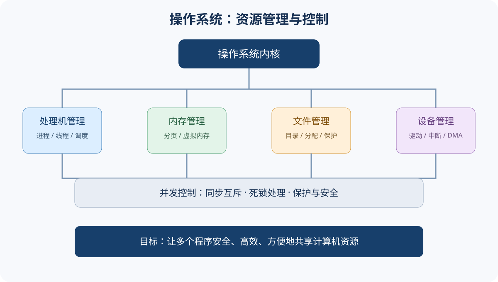
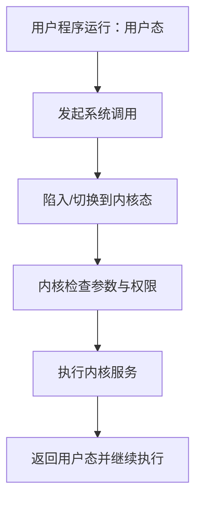

# 操作系统｜基础概念与核心术语

## 1. 操作系统是什么

操作系统（OS）是管理计算机硬件与软件资源、控制程序执行并向用户和应用程序提供服务的系统软件。它既是资源管理者，也是用户与硬件之间的接口。

核心目标：方便性、有效性、可扩展性与安全性。常见特征包括并发、共享、虚拟和异步；这些特征相互关联。

## 2. 四类核心管理功能

| 功能 | 管理对象 | 典型问题 |
|---|---|---|
| 处理机管理 | 进程、线程、CPU | 调度、同步、死锁 |
| 存储器管理 | 主存与虚拟地址空间 | 分配、地址转换、页面置换 |
| 文件管理 | 文件、目录、磁盘空间 | 命名、组织、存取与保护 |
| 设备管理 | I/O设备及控制器 | 驱动、中断、缓冲、DMA |

## 3. 用户态、内核态与系统调用

处理器通常提供不同特权级。用户程序不能直接执行所有特权操作；当程序需要操作文件、创建进程或访问受保护资源时，通过系统调用请求内核服务。

系统调用是应用程序请求操作系统服务的编程接口；库函数不一定都对应系统调用。

## 4. 进程与线程

- **程序**是静态指令集合；**进程**是程序的一次执行过程，是资源分配和保护的基本单位（教材常见表述）。
- **线程**是进程中的执行流，是CPU调度的基本单位（在常见操作系统模型中）。
- PCB 保存进程管理所需信息，如状态、标识、寄存器现场、调度信息和资源信息。
- 进程状态常见为新建、就绪、运行、阻塞、终止；状态图要结合具体模型。

并发是多个程序在一段时间内交替推进；并行是同一时刻在多个处理单元上执行。并发不等于并行。

## 5. 同步、互斥与死锁

临界资源是一次只允许有限（常见为一个）进程访问的资源；临界区是进程中访问临界资源的代码段。

- 互斥：同一时刻不允许多个执行流进入同一临界区。
- 同步：执行流之间按一定先后次序协调。
- 信号量通过 P/V（wait/signal）操作实现同步与互斥，必须关注初值、执行顺序和阻塞队列语义。
- 死锁四个必要条件：互斥、占有并等待、不可剥夺、循环等待。

## 6. 内存管理

逻辑地址由程序生成，物理地址对应实际主存位置。分页把逻辑地址空间和物理内存划分为固定大小的页与页框；页表记录映射关系，TLB 缓存近期地址转换结果。

虚拟存储允许进程地址空间大于当前分配的物理内存，按需调入页面。缺页异常表示访问的页面当前不在内存，需要操作系统处理；缺页不等于程序非法访问。

## 7. 文件与 I/O 管理

文件系统提供命名、目录、存储组织、访问控制和持久化。文件逻辑结构是用户看到的组织形式，物理结构是磁盘块的分配方式。

I/O 管理通过设备驱动、中断、DMA、缓冲和设备分配协调设备与CPU/内存。SPOOLing 利用磁盘空间模拟独占设备的共享使用。

## 8. 易混点

1. 并发强调宏观上交替推进，并行强调同一时刻执行。
2. 就绪态进程具备运行条件，只等待CPU；阻塞态等待某事件，不能仅靠分配CPU恢复。
3. 进程切换通常比同一进程内线程切换涉及更多资源与状态处理，但具体开销依赖实现。
4. 死锁是循环等待导致的僵局；饥饿是长期得不到资源/服务；二者不同。
5. 缺页异常是虚拟内存管理的正常机制之一，不必然代表错误。
6. 文件逻辑组织与磁盘物理分配方式不能混为一谈。

## 9. 基础自测

1. 操作系统为什么既是资源管理者又是用户接口？
2. 系统调用为什么需要从用户态进入内核态？
3. 就绪态与阻塞态的关键区别是什么？
4. 并发和并行有什么区别？
5. 写出死锁的四个必要条件。

参考答案

1. 它分配、回收和保护资源，同时向应用提供统一服务接口。
2. 内核服务涉及受保护资源和特权操作，需要内核检查权限并执行。
3. 就绪态只缺CPU；阻塞态还在等待某个事件或资源。
4. 并发是时间段内交替推进；并行是同一时刻同时执行。
5. 互斥、占有并等待、不可剥夺、循环等待。

## 10. 与章节的关系

基础与运行环境见[第01章](./第01章-操作系统概述与运行环境.md)，进程线程、同步死锁、内存、文件和I/O见第02—06章。
