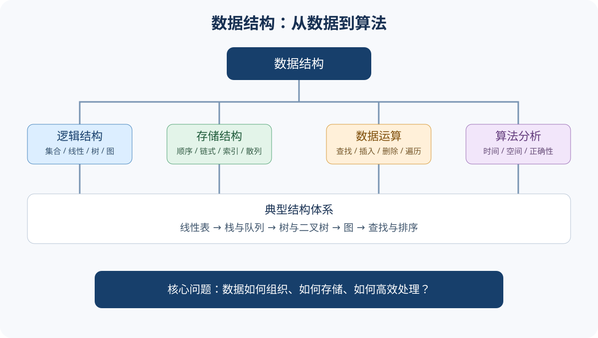

# 408｜数据结构

## 基础概念入口
- [基础概念与核心术语](./基础概念与核心术语.md)｜先建立数据、数据结构、逻辑/存储结构与算法复杂度的完整认知
- [五大经典学习法应用指南](./五大经典学习法应用指南.md)｜覆盖本学科 7 章核心概念，按费曼、西蒙、SQ3R、番茄、康奈尔五法学习
- 

## 学习目标
掌握逻辑结构、存储结构、基本操作与算法分析；能够用 C/C++ 描述算法、解释正确性并分析复杂度。

## 五法学习要求
本学科每个概念都必须完成五个环节：费曼（解释+类比+反例）、西蒙（知识块拆分+先修关系+练习反馈）、SQ3R（浏览/提问/精读/复述/复习）、番茄（25+5 分钟任务）、康奈尔（线索/笔记/总结）。具体到各章的学习任务见[应用指南](./五大经典学习法应用指南.md)，统一模板见[408 五大经典学习法](../五大经典学习法-408统一模板.md)。

## 原子化概念卡｜第 01 章

- [01 数据结构基本概念与 ADT](./概念卡/01-数据结构基本概念与ADT.md)
- [02 逻辑结构与存储结构](./概念卡/02-逻辑结构与存储结构.md)
- [03 算法特征与算法评价](./概念卡/03-算法特征与算法评价.md)
- [04 时间复杂度与代码分析](./概念卡/04-时间复杂度与代码分析.md)
- [05 渐近记号与复杂度情形](./概念卡/05-渐近记号与复杂度情形.md)
- [06 空间复杂度与递归栈](./概念卡/06-空间复杂度与递归栈.md)

> 每张概念卡均独立应用费曼、西蒙、SQ3R、番茄、康奈尔五法，并提供自测与掌握标准。后续章节按同一标准逐章扩展。

### 第 02 章｜线性表概念卡
- [07 线性表 ADT 与逻辑特征](./概念卡/07-线性表ADT与逻辑特征.md)
- [08 顺序表与数组操作](./概念卡/08-顺序表与数组操作.md)
- [09 单链表指针操作与内存管理](./概念卡/09-单链表指针操作与内存管理.md)
- [10 双链表、循环链表与静态链表](./概念卡/10-双链表循环链表与静态链表.md)
- [11 线性表经典算法与复杂度](./概念卡/11-线性表经典算法与复杂度.md)

### 第 03 章｜栈、队列与数组概念卡
- [12 栈 ADT、顺序栈与链栈](./概念卡/12-栈ADT与顺序栈链栈.md)
- [13 队列 ADT、循环队列与链式队列](./概念卡/13-队列ADT与循环队列链式队列.md)
- [14 栈队列应用与表达式求值](./概念卡/14-栈队列应用与表达式求值.md)
- [15 多维数组地址计算](./概念卡/15-多维数组地址计算.md)
- [16 特殊矩阵压缩存储](./概念卡/16-特殊矩阵压缩存储.md)

### 第 04 章｜树与二叉树概念卡
- [17 树的基本术语与森林](./概念卡/17-树的基本术语与森林.md)
- [18 二叉树定义、形态与性质](./概念卡/18-二叉树定义形态与性质.md)
- [19 二叉树存储结构与遍历](./概念卡/19-二叉树存储结构与遍历.md)
- [20 线索二叉树与树、森林转换](./概念卡/20-线索二叉树与树森林转换.md)
- [21 Huffman 树与带权路径长度](./概念卡/21-Huffman树与带权路径长度.md)

> 本章正文的 `## 我的笔记记录` 已按第 01 章样式整理：概念卡双栏索引、知识卡思维导图与双栏解题卡；每张原子概念卡均配套五大经典学习法、自测和边界说明。

### 第 05 章｜图概念卡
- [22 图的基本概念与性质](./概念卡/22-图的基本概念与性质.md)
- [23 图的存储结构与复杂度](./概念卡/23-图的存储结构与复杂度.md)
- [24 图的深度优先与广度优先遍历](./概念卡/24-图的深度优先与广度优先遍历.md)
- [25 最小生成树 Prim 与 Kruskal](./概念卡/25-最小生成树Prim与Kruskal.md)
- [26 拓扑排序与关键路径](./概念卡/26-拓扑排序与关键路径.md)
- [27 Dijkstra 与 Floyd 最短路径](./概念卡/27-Dijkstra与Floyd最短路径.md)

> 本章正文已增加 `## 我的笔记记录`，包含概念卡双栏区、知识地图与双栏知识卡，覆盖存储选择、DFS/BFS、MST、拓扑排序、关键路径和最短路径算法条件。

## 章节清单

- [第 01 章｜绪论与算法分析：知识结构、复杂度推导、例题与自测](./第01章-绪论与算法分析.md)
- [第 02 章｜线性表：顺序表、链表、操作实现与复杂度](./第02章-线性表.md)
- [第 03 章｜栈、队列与数组：存储实现、典型应用与矩阵压缩](./第03章-栈队列与数组.md)
- [第 04 章｜树与二叉树：性质、遍历、线索化、Huffman 树](./第04章-树与二叉树.md)
- [第 05 章｜图：存储、DFS/BFS、生成树、拓扑排序、关键路径与最短路径](./第05章-图.md)
- [第 06 章｜查找：顺序、折半、BST、AVL、B/B+ 树与散列](./第06章-查找.md)
- [第 07 章｜排序：插入、交换、选择、归并、基数与复杂度比较](./第07章-排序.md)

## 算法训练模板
每题写清输入输出与边界条件、核心思想、伪代码或 C/C++ 实现、正确性说明、最好/平均/最坏时间复杂度、辅助空间，以及空表/单元素/重复值等边界测试。

## 高频易错点
- 循环队列判空判满条件与牺牲一个存储单元的约定。
- 链表头结点与首元结点的区别，删除/插入时指针更新顺序。
- 二叉树结点数、叶结点数、度为 1/2 结点数关系。
- DFS/BFS 的访问标记时机。
- 最小生成树与最短路径问题不能混用。
- 快速排序最坏情况、堆排序调整过程、归并排序额外空间。
- 折半查找要求顺序表有序且支持随机访问。

## 自测
- [ ] 比较顺序表与链表操作复杂度
- [ ] 独立写出链表插入、删除、逆置
- [ ] 手算栈/队列操作和表达式求值
- [ ] 由遍历序列恢复二叉树（条件充分时）
- [ ] 手算 DFS/BFS、拓扑排序、最短路径
- [ ] 计算查找成功/失败 ASL
- [ ] 比较排序算法稳定性与复杂度

## 章节笔记统一规范｜我的笔记记录

后续每章正文统一参照[第 01 章《绪论与算法分析》](./第01章-绪论与算法分析.md)中的 `## 我的笔记记录`：

1. **概念卡**：用双栏卡片整理本章核心定义、分类、性质、适用条件和关键边界，并链接对应原子化概念卡。
2. **知识卡**：用思维导图建立章节全景，再以双栏卡片沉淀公式、操作步骤、复杂度对照、典型例题思路和易错点。
3. **原子化**：一张卡只表达一个独立知识点，包含必要上下文、例子/推导、适用条件与关联链接。
4. **五法学习**：每个核心概念继续配套费曼、西蒙、SQ3R、番茄和康奈尔五种学习法。
5. **版式要求**：保留 `## 我的笔记记录`、`> 概念卡`、`> 知识卡` 的层级与双栏布局；不再使用只有占位文字的空卡片。

### 第 06 章｜查找概念卡
- [28 顺序查找与折半查找](./概念卡/28-顺序查找与折半查找.md)
- [29 BST 二叉排序树：查找、插入与删除](./概念卡/29-BST二叉排序树查找插入与删除.md)
- [30 AVL 平衡二叉树与四种旋转](./概念卡/30-AVL平衡二叉树与四种旋转.md)
- [31 B 树与 B+ 树：外存索引](./概念卡/31-B树与B加树外存索引.md)
- [32 散列函数、冲突处理与装填因子](./概念卡/32-散列函数冲突处理与装填因子.md)

> 第 06 章已补齐五张原子卡，并在章节正文增加概念卡双栏索引、查找知识地图、查找方法对照与五法复习闭环。

### 第 07 章｜排序概念卡
- [33 直接插入排序与希尔排序](./概念卡/33-直接插入与希尔排序.md)
- [34 冒泡排序与快速排序](./概念卡/34-冒泡排序与快速排序.md)
- [35 简单选择排序与堆排序](./概念卡/35-简单选择与堆排序.md)
- [36 归并排序与分治思想](./概念卡/36-归并排序与分治思想.md)
- [37 基数排序、稳定性与复杂度](./概念卡/37-基数排序稳定性与复杂度.md)

> 第 07 章已补齐五张原子卡，并在章节正文增加概念卡双栏索引、排序知识地图、复杂度/稳定性对照与五法复习闭环。
