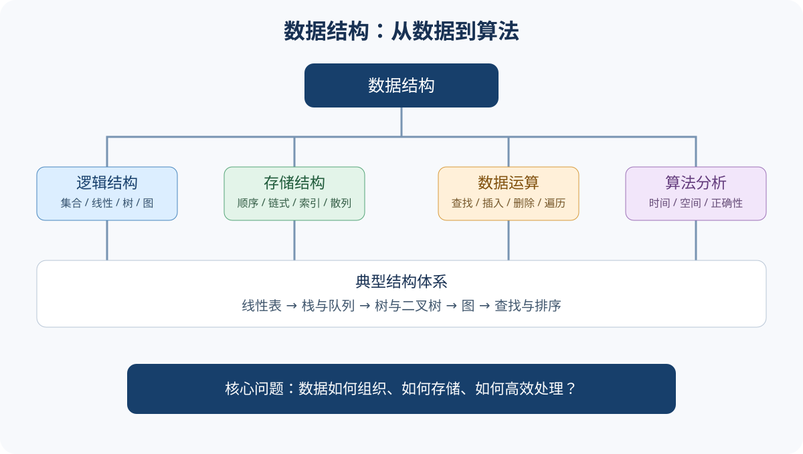
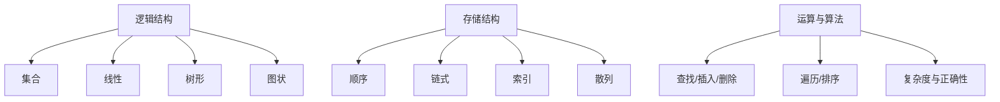

# 数据结构｜基础概念与核心术语

> **五法学习要求：** 本页的每个概念问题都必须完成[费曼学习法、西蒙学习法、SQ3R 阅读法、番茄工作法、康奈尔笔记法](../五大经典学习法-408统一模板.md)五个环节；本学科的章节化练习见[数据结构五大经典学习法应用指南](./五大经典学习法应用指南.md)。

## 1. 数据结构究竟研究什么

数据结构研究数据元素之间的组织关系、数据在计算机中的存储方式，以及对数据实施的运算。一个完整的数据结构通常从三个层面理解：

- **逻辑结构**：数据元素之间的逻辑关系，与具体机器无关。
- **存储结构（物理结构）**：逻辑关系在内存中的表示，常见顺序、链式、索引、散列。
- **数据运算**：查找、插入、删除、修改、遍历、排序等操作及其实现。

## 2. 基本术语

| 术语 | 含义 | 例子 |
|---|---|---|
| 数据 | 能被计算机识别、存储和处理的符号集合 | 整数、字符、图像编码 |
| 数据元素 | 数据的基本单位 | 一条学生记录 |
| 数据项 | 数据元素中不可再分的字段 | 学号、姓名 |
| 数据对象 | 性质相同的数据元素集合 | 全体学生记录 |
| 数据结构 | 相互之间存在一种或多种特定关系的数据元素集合 | 线性表、树、图 |
| 抽象数据类型 ADT | 数据对象、数据关系及操作的数学模型 | List 的插入、删除接口 |

**抽象数据类型**强调“做什么”，不限定“怎么做”。例如 List 可以用数组或链表实现；接口相同，性能特征却不同。

## 3. 四类逻辑结构

- **集合结构**：元素之间除同属一个集合外没有其他关系。
- **线性结构**：除首尾外，每个元素有唯一直接前驱和后继，如线性表、栈、队列。
- **树形结构**：存在层次关系，通常有唯一根结点，子树之间互不相交。
- **图状结构**：元素之间是多对多关系，可有向或无向、带权或无权。

注意：栈和队列是受限操作的线性结构；树和图不是“存储结构”，而是逻辑结构。

## 4. 四种存储方式

| 存储方式 | 核心思想 | 优点 | 典型代价/限制 |
|---|---|---|---|
| 顺序存储 | 相邻元素存放在连续地址 | 随机访问快、空间连续 | 插入删除可能移动大量元素 |
| 链式存储 | 结点通过指针连接 | 插入删除便于调整链接 | 额外指针空间，访问需沿链遍历 |
| 索引存储 | 建立关键字到记录地址的索引 | 加快检索 | 维护索引需要额外空间与成本 |
| 散列存储 | 散列函数映射关键字到存储位置 | 平均查找可很快 | 冲突不可避免，需冲突处理 |

## 5. 算法与复杂度

算法是解决特定问题的有限操作序列。常见特性：有穷性、确定性、可行性、输入、输出。评价算法还要考虑正确性、可读性、健壮性和效率。

- 时间复杂度描述基本操作次数随输入规模 $n$ 的增长趋势。
- 空间复杂度描述算法运行所需辅助空间随 $n$ 的增长趋势。
- 大 $O$ 表示渐近上界，$Theta$ 表示同阶界，$Omega$ 表示渐近下界。

常见增长级别（由慢到快）：

$$O(1)<O(\log n)<O(n)<O(n\log n)<O(n^2)<O(2^n)<O(n!)$$

分析时关注循环次数、递归关系和输入规模；不能只数代码行数。递归算法常通过递推式分析，例如 $T(n)=2T(n/2)+O(n)$ 得到 $T(n)=O(n\log n)$。

## 6. 核心结构关系图

## 7. 易混点

1. 逻辑结构回答“元素之间是什么关系”；存储结构回答“这些关系如何落到内存”。
2. 顺序表的随机访问为 $O(1)$，链表按位查找通常为 $O(n)$。
3. 链表插入在已知前驱位置时可为 $O(1)$，但先找到位置可能仍需 $O(n)$。
4. 算法复杂度不是程序运行的绝对秒数，而是增长趋势。
5. 平均时间复杂度必须说明采用的输入分布或概率模型。

## 8. 基础自测

1. 数据元素与数据项有什么区别？
2. 线性表采用顺序存储和链式存储时，按序号访问的复杂度分别是什么？
3. 树和图分别属于哪类逻辑结构？
4. 已知链表中某结点地址，插入新结点为何可以不移动其他结点？
5. $T(n)=T(n-1)+O(1)$ 的时间复杂度是多少？

参考答案

1. 数据元素是基本单位，数据项是构成数据元素的字段。
2. 顺序表 $O(1)$；单链表按序号访问 $O(n)$。
3. 树形结构、图状结构。
4. 只需修改相关指针；前提是已定位插入位置且处理好边界。
5. 展开递推可得 $O(n)$。

## 9. 与章节的关系

本页是术语入口。深入学习顺序表/链表见[第02章](./第02章-线性表.md)，栈队列见[第03章](./第03章-栈队列与数组.md)，树图见[第04章](./第04章-树与二叉树.md)和[第05章](./第05章-图.md)，查找排序见第06、07章。
