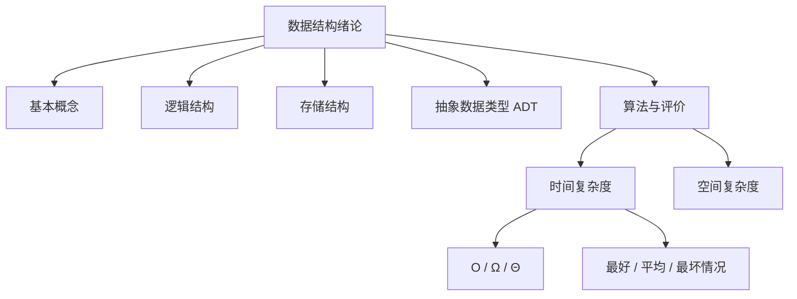
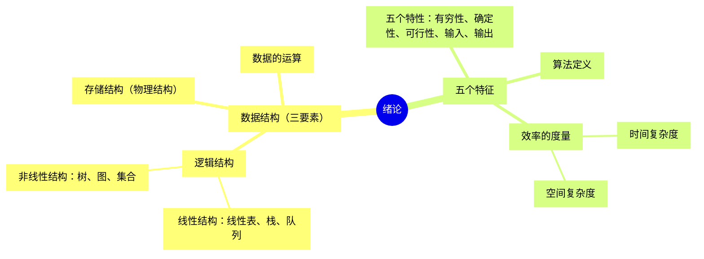

# 第 01 章｜绪论与算法分析

> 408·数据结构基础篇。本章建立“逻辑结构—存储结构—数据运算—算法效率”的整体认知，并训练基础算法复杂度分析。

## 1. 知识地图



## 2. 基本概念

| 术语         | 含义                                   | 示例                      |
| ------------ | -------------------------------------- | ------------------------- |
| 数据         | `客观事物的符号表示`                   | 整数、字符、图像像素      |
| 数据元素     | `数据的基本单位`                       | <mark>一个学生记录</mark> |
| 数据项       | 数据元素中不可再分的最小单位           | 学号、姓名、成绩          |
| 数据对象     | 性质相同的数据元素集合                 | 全体学生记录              |
| 数据结构     | 数据元素及其相互关系的集合             | 线性表、树、图            |
| 抽象数据类型 | 数据对象、数据关系和操作集合的抽象描述 | List、Stack、Queue        |

数据结构不仅是数据容器，还描述元素之间的关系以及可以实施的操作。

## 3. 逻辑结构

- **集合结构**：元素除同属一个集合外，没有其他特定关系。
- **线性结构**：元素之间存在一对一的前驱/后继关系，如线性表、栈、队列。
- **树形结构**：元素之间存在一对多的层次关系，如树、二叉树。
- **图状结构**：元素之间存在多对多关系，如有向图、无向图。

记忆主线：无特定关系 → 一对一 → 一对多 → 多对多。

## 4. 存储结构

| 方式     | 基本思想                 | 优势             | 局限                             |
| -------- | ------------------------ | ---------------- | -------------------------------- |
| 顺序存储 | 逻辑相邻元素通常物理相邻 | 随机访问方便     | 插入删除可能移动大量元素         |
| 链式存储 | 指针/链接表达逻辑关系    | 局部插入删除灵活 | 按位序访问需遍历，指针占空间     |
| 索引存储 | 建立附加索引表           | 加快查找         | 需要额外空间与维护成本           |
| 散列存储 | 散列函数映射关键字到地址 | 平均查找效率较高 | 需要处理冲突，性能受散列函数影响 |

顺序表按位序访问通常为 $O(1)$，链表按位序访问通常为 $O(n)$。链表只有在已经定位到插入位置或前驱结点时，链接修改才是 $O(1)$。

## 5. 抽象数据类型 ADT

ADT 从使用者视角描述数据类型，不绑定具体存储实现。以线性表为例：

- 数据对象：有限个数据元素构成的序列；
- 数据关系：元素具有线性前驱/后继关系；
- 基本操作：初始化、销毁、插入、删除、按值查找、按位序取值、求长度。

同一个 ADT 可以由顺序表或链表实现。接口语义相同，不代表操作复杂度相同。

## 6. 算法及其评价

算法是解决特定问题的有限操作序列，具有：

1. **有穷性**：执行有限步后终止；
2. **确定性**：每一步含义明确；
3. **可行性**：每一步可由已有基本操作实现；
4. **输入**：可以有零个或多个输入；
5. **输出**：至少产生一个输出。

评价算法时关注正确性、可读性、健壮性、时间效率和空间效率。

## 7. 时间复杂度

时间复杂度描述算法执行时间随输入规模增长的趋势。通常统计基本操作次数 $T(n)$，再分析渐近增长阶。

常见增长阶从低到高：

$$
O(1)<O(\log n)<O(n)<O(n\log n)<O(n^2)<O(n^3)<O(2^n)<O(n!)
$$

Big-O 是渐近上界记号。考试中常用它表达最坏情况下的增长阶，但最坏情况是分析对象，Big-O 是数学记号，两者不是同一个概念。

### 7.1 常见代码结构

**常数时间：** 只执行固定数量的基本操作，复杂度 $O(1)$。

```c
int x = a[0];
```

**线性时间：** 循环体执行 n 次，复杂度 $O(n)$。

```c
for (int i = 0; i < n; i++) {
    sum += a[i];
}
```

**平方时间：** 两层循环分别执行 n 次，复杂度 $O(n^2)$。

```c
for (int i = 0; i < n; i++) {
    for (int j = 0; j < n; j++) {
        count++;
    }
}
```

**对数时间：** 循环变量按常数倍增长，复杂度 $O(\log n)$。

```c
for (int i = 1; i < n; i *= 2) {
    work();
}
```

执行 $k$ 次后 $2^k$ 达到或超过 $n$，因此 $k$ 约为 $\log_2 n$。

### 7.2 嵌套循环求和

```c
for (int i = 0; i < n; i++) {
    for (int j = 0; j < i; j++) {
        work();
    }
}
```

总执行次数为：

$$
0+1+2+\cdots+(n-1)=\frac{n(n-1)}2
$$

因此为 $O(n^2)$。嵌套循环不能只看层数，必须按边界计算实际执行次数。

### 7.3 顺序语句与分支

- 顺序执行：复杂度相加，保留最高阶项；
- 嵌套循环：根据实际执行次数建立求和；
- 条件分支：按题目要求分析最好、最坏或平均情况；最坏情况取可能分支中的最大代价。

## 8. 渐近记号 O、Ω、Θ

设 f(n)、g(n) 为非负函数：

- $f(n)=O(g(n))$：存在常数 $c>0$、$n_0$，使 $n\ge n_0$ 时 $f(n)\le c\cdot g(n)$，表示渐近上界；
- $f(n)=\Omega(g(n))$：存在常数 $c>0$、$n_0$，使 $n\ge n_0$ 时 $f(n)\ge c\cdot g(n)$，表示渐近下界；
- $f(n)=\Theta(g(n))$：同时满足 $O$ 和 $\Omega$，表示同阶。

例如：

$$
f(n)=3n^2+5n+7=\Theta(n^2)
$$

## 9. 最好、最坏与平均情况

以顺序查找长度为 n 的表为例：

- 最好情况：第一个元素就是目标，比较 1 次；
- 最坏情况：最后一个元素才是目标，或目标不存在，比较 n 次；
- 平均情况：必须给出输入概率分布。若目标等概率出现在每个位置且必定存在，则
  $$
  ASL=\frac{1+2+\cdots+n}{n}=\frac{n+1}{2}
  $$

若将查找失败也纳入平均情况，必须明确失败概率与失败时比较次数，不能直接套用上述公式。

## 10. 空间复杂度

空间复杂度描述算法运行过程中额外空间需求随输入规模增长的趋势。通常区分输入本身占用空间与辅助空间，具体以题目约定为准。

- $O(1)$：只使用固定数量辅助变量；
- $O(n)$：额外数组或递归栈随输入规模线性增长；
- 递归算法还要考虑递归深度与每层栈帧空间。

迭代求和只使用固定变量，辅助空间为 $O(1)$；复制长度为 $n$ 的数组，需要 $O(n)$ 辅助空间。

## 11. 复杂度分析解题模板

1. 明确输入规模 n 的含义；
2. 选定基本操作（比较、赋值、访问或循环体执行）；
3. 写出执行次数 $T(n)$；
4. 对循环、递归或分支建立求和/递推关系；
5. 化简并保留最高阶项；
6. 分别说明时间复杂度、辅助空间复杂度及分析情形。

## 12. 典型例题

### 例 1：对数循环

```c
int i = 1;
while (i <= n) {
    i *= 3;
}
```

执行 k 次后 i=3^k。循环结束时 3^k>n，故 k=⌊log₃n⌋+1（n≥1），时间复杂度 $O(\log n)$。

### 例 2：三角形循环

```c
for (int i = 1; i <= n; i++) {
    for (int j = 1; j <= n - i + 1; j++) {
        x++;
    }
}
```

总次数：

$$
n+(n-1)+\cdots+1=\frac{n(n+1)}2
$$

时间复杂度 $O(n^2)$。

### 例 3：渐近阶判断

$$
f(n)=7n\log_2n+100n+300
$$

n log n 的增长快于 n 与常数项，所以 $f(n)=\Theta(n\log n)$。

## 13. 高频易错点

| 易错点                        | 纠正方式                       |
| ----------------------------- | ------------------------------ |
| 将逻辑结构与存储结构混淆      | 前者回答关系，后者回答如何存放 |
| 将数据结构等同于数据类型      | 数据结构还包含元素关系与操作   |
| 认为链表插入总是 O(1)         | 先定位结点可能需要 O(n)        |
| 将所有双重循环都判为 O(n²)    | 计算真实循环边界与总次数       |
| 把 O、Ω、Θ 混为一谈           | 分别理解为上界、下界、同阶     |
| 把最坏情况与 Big-O 当作同义词 | 一个是分析情形，一个是渐近记号 |
| 平均复杂度不写概率假设        | 明确输入分布与概率模型         |
| 空间复杂度忽略递归栈          | 统计辅助结构与调用栈           |

## 14. 章节自测

1. 数据结构的四种常见逻辑结构是什么？各自的关系特征是什么？
2. 顺序存储与链式存储的核心差别是什么？已知前驱时链表插入的链接修改复杂度是多少？
3. 分析下列算法时间复杂度：

```c
for (int i = 1; i <= n; i *= 2) {
    for (int j = 0; j < n; j++) {
        x++;
    }
}
```

4. 分析下列循环的总执行次数和时间复杂度：

```c
for (int i = 0; i < n; i++) {
    for (int j = 0; j <= i; j++) {
        x++;
    }
}
```

5. 若 $f(n)=4n^3+9n^2+2$，其渐近阶是什么？
6. “最坏时间复杂度是 $O(n^2)$”这句话需要区分哪两个概念？

<details>
<summary>参考答案与解析</summary>

1. 集合（无特定关系）、线性（一对一）、树形（一对多）、图状（多对多）。
2. 顺序存储通常连续且支持随机访问；链式存储通过链接表达关系。已知前驱时只需常数次指针修改，为 $O(1)$。
3. 外层约 log₂n 次，内层每次 n 次，总复杂度 $O(n\log n)$。
4. 总次数 1+2+…+n=n(n+1)/2，复杂度 $O(n^2)$。
5. Θ(n³)。
6. 最坏情况是分析情形，Big-O 是渐近上界记号。

</details>

## 15. 本章掌握度检查

- [ ] 能区分数据、数据元素、数据项、数据对象与数据结构
- [ ] 能比较四类逻辑结构和四种存储方式
- [ ] 能解释 ADT 与具体实现的关系
- [ ] 能分析单层、嵌套、对数及分支循环
- [ ] 能区分 O、Ω、Θ 以及最好、平均、最坏情况
- [ ] 能说明辅助空间与递归栈的计算口径
- [ ] 自测正确率达到 80% 以上，并能写出复杂度推导过程

## 延伸参考

- [NIST｜Dictionary of Algorithms and Data Structures](https://www.nist.gov/publications/dictionary-algorithms-and-data-structures)：算法、数据结构与复杂度术语参考。
- [OpenDSA｜Algorithm Analysis](https://opendsax.cs.vt.edu/OpenDSA/Books/Everything/html/AnalChap.html)：渐近分析、增长率与算法效率分析。
- [OpenStax｜Formal Properties of Algorithms](https://openstax.org/books/introduction-computer-science/pages/3-3-formal-properties-of-algorithms)：时间/空间复杂度与 Big-O 入门。

本笔记为个人学习总结；考试范围以 2028 年正式考试大纲为准。

---

## 我的笔记记录

> 概念卡

<table>
  <tr>
    <td width="50%" valign="top">
      <h3>🚀 左侧卡片标题</h3>
      <p>这里是左侧卡片的简介内容，支持 <b>加粗</b> 和各种格式。</p>
      <ul>
        <li>特性一：支持列表</li>
        <li>特性二：支持内嵌图片</li>
      </ul>
    </td>
    <td width="50%" valign="top">
      <h3>🎨 右侧卡片标题</h3>
      <p>这里是右侧卡片的简介内容，保持与左侧顶部对齐。</p>
      <ul>
        <li>特性一：自适应双栏</li>
        <li>特性二：暗黑模式友好</li>
      </ul>
    </td>
  </tr>
</table>

---

> 知识卡

<table>
  <tr>
    <!-- 左侧卡片：代码高亮 -->
    <td width="50%" valign="top">
      <h3>💻 思维导图</h3>
      <p>使用 HTML 表格嵌套代码块时，反引号上下<b>必须留出空行</b>：</p>

```python
def hello_github():
    # 支持完整的语法高亮
    message = "Hello, GitHub Cards!"
    print(message)
    return True
```



  </tr>
</table>

---

<table width="100%">
  <!-- 第一排：两张并排的卢曼卡片 -->
  <tr>
    <!-- 左侧卡片：1a 核心概念与代码 -->
    <td width="50%" valign="top">
      <code>🆔 1a</code> &nbsp; <b>数据结构的基本概念</b><br>
      <sub>📅 2026-11-11 &nbsp;|&nbsp; 🏷️ #数据结构 #术语</sub>
      <hr>
      <p>每张卡片只记录<b>一个独立且完整的概念</b>，使其能够脱离上下文独立被理解，并与其他卡片自由重组。</p>
<pre lang="python"><code># 卡片数据结构示例
card = {
    "id": "1a",
    "title": "原子化笔记原则",
    "links": ["1a1", "2b"]
}</code></pre>
      <hr>
      <sub>
        ⬆️ <b>父级：</b> <a href="#1">1 卡片盒方法论</a><br>
        ➡️ <b>延伸：</b> <a href="#1a1">1a1 为什么避免长篇大论</a><br>
        🔗 <b>关联：</b> <a href="#2b">2b 双向链接的价值</a>
      </sub>
    </td>

  </tr>

</table>


<table width="100%">
  <!-- 第一排：两张并排的卢曼卡片 -->
  <tr>
    <!-- 左侧卡片：1a 核心概念与代码 -->
    <td width="50%" valign="top">
      <code>🆔 1a</code> &nbsp; <b>原子化笔记原则</b><br>
      <sub>📅 2026-11-11 &nbsp;|&nbsp; 🏷️ #知识管理 #Zettelkasten</sub>
      <hr>
      <p>每张卡片只记录<b>一个独立且完整的概念</b>，使其能够脱离上下文独立被理解，并与其他卡片自由重组。</p>
<pre lang="python"><code># 卡片数据结构示例
card = {
    "id": "1a",
    "title": "原子化笔记原则",
    "links": ["1a1", "2b"]
}</code></pre>
      <hr>
      <sub>
        ⬆️ <b>父级：</b> <a href="#1">1 卡片盒方法论</a><br>
        ➡️ <b>延伸：</b> <a href="#1a1">1a1 为什么避免长篇大论</a><br>
        🔗 <b>关联：</b> <a href="#2b">2b 双向链接的价值</a>
      </sub>
    </td>

  </tr>

</table>

