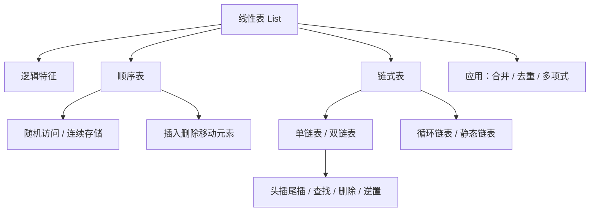

# 第 02 章｜线性表

> 408·线性结构核心章节。围绕同一抽象数据类型，比较顺序表与链表的组织方式、操作代价和适用场景，并掌握常见算法实现。

## 1. 知识地图



## 2. 线性表的定义与特点

线性表是具有相同数据类型的 $n$（$n\ge0$）个数据元素的有限序列，记为：

$$
L=(a_1,a_2,\ldots,a_n)
$$

其中 $n$ 为表长，$n=0$ 时为空表。

逻辑特征：

- 存在唯一的第一个元素；
- 存在唯一的最后一个元素；
- 除第一个元素外，每个元素有且仅有一个直接前驱；
- 除最后一个元素外，每个元素有且仅有一个直接后继。

线性表强调逻辑上的前后关系，不要求物理存储位置连续。

## 3. 顺序表

顺序表使用一组地址连续的存储单元依次存储线性表元素。支持按下标随机访问。

```c
#define MAXSIZE 100
typedef int ElemType;

typedef struct {
    ElemType data[MAXSIZE];
    int length;
} SqList;
```

### 3.1 按位序取值

位序从 1 开始，数组下标从 0 开始：

```c
bool GetElem(SqList L, int i, ElemType *e) {
    if (i < 1 || i > L.length) return false;
    *e = L.data[i - 1];
    return true;
}
```

时间复杂度 $O(1)$，前提是数组支持随机访问。

### 3.2 插入操作

在第 i 个位置插入元素 e，需要将第 i 个及之后元素整体后移：

```c
bool ListInsert(SqList *L, int i, ElemType e) {
    if (L == NULL || L->length >= MAXSIZE) return false;
    if (i < 1 || i > L->length + 1) return false;

    for (int j = L->length; j >= i; --j) {
        L->data[j] = L->data[j - 1];
    }
    L->data[i - 1] = e;
    ++L->length;
    return true;
}
```

- 最好情况：在表尾插入，移动 0 个元素，$O(1)$；
- 最坏情况：在表头插入，移动 n 个元素，$O(n)$；
- 若插入位置等概率，平均移动约 n/2 个元素，时间复杂度 $O(n)$。

### 3.3 删除操作

删除第 i 个元素后，将后续元素前移：

```c
bool ListDelete(SqList *L, int i, ElemType *e) {
    if (L == NULL || e == NULL) return false;
    if (i < 1 || i > L->length) return false;

    *e = L->data[i - 1];
    for (int j = i; j < L->length; ++j) {
        L->data[j - 1] = L->data[j];
    }
    --L->length;
    return true;
}
```

表尾删除无需移动元素，为 $O(1)$；表头删除需要移动 n-1 个元素，为 O(n)。

## 4. 单链表

单链表结点由数据域和指针域构成，指针域指向直接后继。首元结点是第一个实际存储数据的结点；头结点是可选的辅助结点，不存放线性表数据。

```c
typedef struct LNode {
    ElemType data;
    struct LNode *next;
} LNode, *LinkList;
```

### 4.1 带头结点与不带头结点

带头结点可以统一空表和非空表的首结点操作，简化插入删除。若采用带头结点表示，空表满足 head->next == NULL。

### 4.2 按位序查找

```c
LNode *GetElem(LinkList L, int i) {
    if (L == NULL || i < 0) return NULL;
    LNode *p = L;
    int j = 0;
    while (p != NULL && j < i) {
        p = p->next;
        ++j;
    }
    return p;
}
```

上述函数约定 L 指向头结点，i=0 返回头结点，i=1 返回首元结点。按位序查找需要遍历，时间复杂度 $O(n)$。

### 4.3 在指定结点后插入

```c
bool InsertAfter(LNode *p, ElemType e) {
    if (p == NULL) return false;
    LNode *s = (LNode *)malloc(sizeof(LNode));
    if (s == NULL) return false;

    s->data = e;
    s->next = p->next;
    p->next = s;
    return true;
}
```

已知前驱结点 p 时，链接修改为 $O(1)$。如果需要先按位序查找 p，总时间仍为 $O(n)$。

### 4.4 删除指定结点的后继

```c
bool DeleteAfter(LNode *p, ElemType *e) {
    if (p == NULL || p->next == NULL || e == NULL) return false;
    LNode *q = p->next;
    *e = q->data;
    p->next = q->next;
    free(q);
    return true;
}
```

注意释放被删除结点，且更新链接前先保存待删除结点地址。

## 5. 单链表常见算法

### 5.1 头插法建立链表

每次将新结点插入头结点之后，最终得到的链表顺序与输入顺序相反。

```c
void HeadInsert(LinkList *L, ElemType x) {
    LNode *s = (LNode *)malloc(sizeof(LNode));
    if (s == NULL) return;
    s->data = x;
    s->next = (*L)->next;
    (*L)->next = s;
}
```

### 5.2 尾插法建立链表

维护尾指针，每次将新结点接到尾部。若初始时 tail 指向头结点，插入后更新 tail=s。整体建立 $n$ 个结点为 $O(n)$。

### 5.3 链表逆置

```c
void ReverseList(LinkList L) {
    if (L == NULL) return;
    LNode *prev = NULL;
    LNode *cur = L->next;

    while (cur != NULL) {
        LNode *next = cur->next;
        cur->next = prev;
        prev = cur;
        cur = next;
    }
    L->next = prev;
}
```

时间复杂度 $O(n)$，辅助空间 $O(1)$。循环不变量：每轮开始时，prev 指向已经逆置的前缀，cur 指向尚未处理的后缀。

## 6. 双链表、循环链表与静态链表

| 结构       | 结点/链接特点                    | 典型用途与注意事项                                     |
| ---------- | -------------------------------- | ------------------------------------------------------ |
| 双链表     | 有 prior 与 next 两个指针域      | 已知结点时可方便访问前驱和后继；插入删除需维护两侧链接 |
| 循环单链表 | 尾结点 next 指向头结点或首元结点 | 从任意结点可沿链循环访问；判结束条件不能简单写 p!=NULL |
| 循环双链表 | 首尾相连，头尾链接互通           | 适合双向循环遍历；需维护首尾两端                       |
| 静态链表   | 数组元素中用游标表示链接         | 在不便使用指针的环境模拟链式结构；需管理备用结点       |

双链表在结点 p 后插入 s，关键链接关系为：

$$
s.prev=p,\quad s.next=p.next
$$

并同步修改原后继结点的 prior 和 p 的 next；若 p 原来是尾结点，还要更新尾指针（若实现中维护尾指针）。

## 7. 顺序表与链表对比

| 操作             |                顺序表 | 单链表（已知前驱时） |
| ---------------- | --------------------: | -------------------: |
| 按位序访问       |                $O(1)$ |               $O(n)$ |
| 按值查找（无序） |                $O(n)$ |               $O(n)$ |
| 已知位置插入     |                $O(n)$ |               $O(1)$ |
| 已知位置删除     |                $O(n)$ |   $O(1)$（已知前驱） |
| 存储空间         | 预分配/扩容，连续空间 |     结点额外指针开销 |
| 缓存局部性       |              通常较好 |             通常较弱 |

“链表插入删除 $O(1)$”必须附带前提：已经找到相应位置/前驱结点。若按位序定位，查找成本不能忽略。

## 8. 线性表应用：有序表合并

设两个非递减顺序表 A、B，使用双指针依次取较小元素，合并为 C：

```c
void Merge(int A[], int m, int B[], int n, int C[]) {
    int i = 0, j = 0, k = 0;
    while (i < m && j < n) {
        if (A[i] <= B[j]) C[k++] = A[i++];
        else C[k++] = B[j++];
    }
    while (i < m) C[k++] = A[i++];
    while (j < n) C[k++] = B[j++];
}
```

时间复杂度 $O(m+n)$，辅助空间 $O(m+n)$（输出数组不计入辅助空间时，可另行说明）。相等时先取 A 的元素，算法保持同一输入内部的相对次序。

## 9. 复杂度与能力清单

| 算法                      | 时间复杂度 |        辅助空间 |
| ------------------------- | ---------: | --------------: |
| 顺序表按位序访问          |       O(1) |            O(1) |
| 顺序表插入/删除           |       O(n) |            O(1) |
| 单链表按位序查找          |       O(n) |            O(1) |
| 已知前驱的单链表插入/删除 |       O(1) |            O(1) |
| 单链表逆置                |       O(n) |            O(1) |
| 两个有序表合并            |     O(m+n) | O(m+n) 输出数组 |

## 10. 高频错误诊断

- **位序与数组下标混淆**：线性表位序从 1 开始，C 数组下标从 0 开始。
- **插入移动方向错误**：顺序表插入必须从后向前移动，避免覆盖未移动数据。
- **删除循环边界错误**：删除后只需将后续元素前移，长度减 1。
- **头结点与首元结点混淆**：明确函数参数指向头结点还是首元结点。
- **指针更新顺序错误**：插入前先保存原后继；删除前先保存待释放结点。
- **内存管理遗漏**：malloc 后检查是否成功，删除结点后 free。
- **复杂度只分析指针修改**：若定位位置需要遍历，应把查找成本计入总复杂度。

## 11. 章节自测

1. 线性表的逻辑特征是什么？空表是否属于线性表？
2. 顺序表在第 1 个位置插入元素，需要移动多少个原有元素？
3. 带头结点的单链表中，头结点与首元结点分别是什么？
4. 已知单链表某结点 p，若要在 p 后插入一个结点，时间复杂度是多少？若先按位序找到 p 呢？
5. 单链表按位序查找为什么不是 $O(1)$？
6. 写出单链表逆置的核心思想，并说明空间复杂度。
7. 两个长度分别为 m、n 的有序表合并，时间复杂度是多少？
8. 顺序表与链表在随机访问能力上有何根本区别？

<details>
<summary>参考答案与解析</summary>

1. 有限个相同类型元素构成序列；除首尾外，每个元素有唯一直接前驱和后继。空表 $n=0$，仍属于线性表。
2. 移动 n 个原有元素，所有元素向后移动一位。
3. 头结点是辅助结点，首元结点是第一个实际数据结点；空表时头结点 next 为 NULL。
4. 已知 p 时只需常数次链接修改，为 $O(1)$；若先定位 p，需 O(n) 查找。
5. 链表结点不保证连续存储，必须从头结点沿 next 逐个访问。
6. 使用 prev、cur、next 三个指针逐结点反转 next；时间 $O(n)$，辅助空间 $O(1)$。
7. $O(m+n)$，每个元素最多被比较/移动常数次。
8. 顺序表可根据下标直接计算地址，$O(1)$；链表需沿指针逐个遍历，O(n)。

</details>

## 12. 本章掌握度检查

- [ ] 能说明线性表的逻辑定义与边界
- [ ] 能手写顺序表取值、插入、删除
- [ ] 能手写单链表查找、插入、删除和逆置
- [ ] 能区分头结点、首元结点和尾结点
- [ ] 能解释双链表、循环链表、静态链表的结构特点
- [ ] 能准确分析操作复杂度及其前提条件
- [ ] 能完成有序线性表合并并说明复杂度

## 延伸参考

- [OpenDSA｜Lists](https://opendsa-server.cs.vt.edu/ODSA/Books/Everything/html/ListADT.html)：线性表抽象数据类型与实现。
- [NIST｜Dictionary of Algorithms and Data Structures](https://www.nist.gov/publications/dictionary-algorithms-and-data-structures)：数据结构术语参考。

本章代码为教学示例，实际工程使用时还需补充完整的创建、销毁、错误处理和内存释放逻辑。

---

## 15. 本章五大经典学习法｜线性表概念与算法训练

### 15.1 费曼学习法：讲清楚“同一个线性表，两种实现”

**用自己的话解释：** 线性表是具有先后次序的有限元素序列。它描述逻辑关系，不要求元素在内存中连续。顺序表用连续空间保存元素，链表用结点和指针连接元素。

- **顺序表类比：** 像一排连续编号的储物柜，可以直接按编号找到柜子；中间插入时，后面的物品可能要整体挪动。
- **链表类比：** 像一串带有下一站地址的寻路卡片；找到某张卡片后，改写链接就能插入新卡片，但从头找第 k 张卡片需要逐个走访。
- **必须解释的边界：** 链表插入“指针修改”可以是 O(1)，但若题目要求先按位序找到插入点，总时间仍可能是 O(n)。

**费曼复述题：**

1. 为什么顺序表按下标访问是 O(1)，单链表按位序访问是 O(n)？
2. 为什么顺序表在表尾插入与在表头插入的移动代价不同？
3. 已知单链表前驱结点时，插入操作需要修改哪两个链接？
4. 头结点与首元结点有什么区别？空表如何表示？
5. 头插法为什么会使新链表元素次序与输入次序相反？

**验收：** 不看代码，画出顺序表插入、单链表插入、单链表删除三个过程，并逐步解释每次赋值的作用。

### 15.2 西蒙学习法：按实现与操作拆分知识块

| 知识块 | 核心内容 | 前置关系 | 达标练习 |
|---|---|---|---|
| A. ADT 与逻辑特征 | 有限序列、位序、空表、前驱/后继 | 第 01 章 | 判断 6 个序列是否合法，说明边界 |
| B. 顺序表 | 结构定义、取值、插入、删除、扩容 | A | 手写 GetElem、ListInsert、ListDelete |
| C. 单链表 | 结点、头结点、查找、插入、删除 | A、B | 手画指针变化，写出边界判断 |
| D. 其他链表 | 双链表、循环链表、静态链表 | C | 比较指针域、判空条件与适用场景 |
| E. 综合应用 | 逆置、合并、有序表去重、多项式 | B、C、D | 独立实现 3 道算法并分析复杂度 |

**刻意练习阶梯：**

1. 先读懂代码并指出每个指针/下标的含义。
2. 不看代码，画出操作前后的内存或结点关系。
3. 根据图写出伪代码。
4. 补齐空表、首元、表尾、越界、内存分配失败等边界。
5. 最后再写 C 语言实现，并给出时间与辅助空间复杂度。

错误反馈分类：位序/下标混淆、头结点处理错误、指针覆盖导致丢链、释放结点遗漏、循环终止条件错误、复杂度只统计局部操作。

### 15.3 SQ3R 阅读法：带着操作问题精读

- **Survey 浏览：** 先看顺序表与链表的结构图、插入删除代码和复杂度表，找到本章主线：抽象序列 → 存储实现 → 操作实现 → 综合算法。
- **Question 提问：** 阅读前写下：为什么数组支持随机访问？链表为什么不能直接访问第 k 个元素？插入时为什么要先连新结点再改前驱链接？删除后为什么要释放空间？
- **Read 精读：** 逐行阅读插入/删除函数，标出每个判断保护的边界；对每次指针赋值说明赋值前后链表形态。
- **Recite 复述：** 合上笔记，分别画出顺序表第 i 位插入、单链表 p 后插入、删除 p 后继的图；口述最好/最坏/平均复杂度。
- **Review 复习：** 当天重画指针图，次日默写两段核心代码，第 3 天完成综合应用，第 7 天重做错题。

**精读问题：**

1. 顺序表插入时，循环变量为什么从 length 向 i 递减？
2. 若从 i 向 length 递增移动，会发生什么覆盖问题？
3. 单链表插入时为什么先令 s->next=p->next，再令 p->next=s？
4. 删除结点时为什么要先保存 q，再调整链接并 free(q)？
5. 双链表删除时，为什么通常要同时修改前驱和后继的指针？

### 15.4 番茄工作法：五个番茄完成线性表

| 番茄 | 25 分钟任务 | 可验收产出 |
|---|---|---|
| 1 | 复习线性表定义、位序与空表 | 写出逻辑特征并画 3 个序列 |
| 2 | 顺序表取值、插入、删除 | 默写 3 个函数，标出循环边界 |
| 3 | 单链表查找、插入、删除 | 画 3 张指针变化图并写代码 |
| 4 | 双链表、循环链表、静态链表 | 完成结构对照表和判空条件 |
| 5 | 逆置、合并、去重等综合应用 | 独立完成 2 题，写时间/空间复杂度 |

每轮休息 5 分钟。若代码写不出来，不要直接看答案：先在纸上画结构变化，再补一行关键语句。每个番茄结束写下“产出、错误类型、下一步”。

### 15.5 康奈尔笔记法：线性表核心对照卡

| 左侧线索 / 提问 | 右侧主体笔记 |
|---|---|
| 线性表定义？ | n 个相同数据类型元素构成的有限序列；n 可以为 0。 |
| 顺序表的优势？ | 连续存储、支持随机访问，按下标访问为 O(1)。 |
| 顺序表插入代价？ | 需要移动插入位置及其后的元素；表头最坏 O(n)，表尾在有容量时 O(1)。 |
| 单链表的优势？ | 通过修改链接完成局部插入删除，不需要整体移动元素。 |
| 单链表的限制？ | 按位序访问需从头遍历，通常为 O(n)。 |
| 头结点的作用？ | 作为辅助结点统一首元结点插入/删除逻辑；它不属于实际数据元素。 |
| 头插法与尾插法？ | 头插法每次插在头结点后，输入次序反转；尾插法保持输入次序，需维护尾指针以提高效率。 |
| 链表插入为何可能不是 O(1)？ | 修改链接本身是 O(1)，但定位插入位置的遍历成本可能是 O(n)。 |

**页底总结：** 线性表的逻辑定义独立于存储实现。选择顺序表还是链表，关键看访问模式、插入删除位置和空间管理；分析操作复杂度时，必须把“定位位置”和“真正修改结构”分开统计。

### 15.6 五法融合自测

1. 长度为 n 的顺序表，在第 1 位插入一个元素，最多需要移动多少个原有元素？时间复杂度是多少？
2. 若已知单链表结点 p，要求在 p 后插入 s，写出正确的两条链接赋值顺序。
3. 为什么不能先执行 p->next=s，再执行 s->next=p->next？
4. 带头结点的空单链表满足什么条件？
5. 在单链表中删除 p 的后继，写出需要考虑的两个边界条件。
6. 比较头插法与尾插法建立链表的结果顺序。
7. 顺序表按位序查找与单链表按位序查找的时间复杂度分别是多少？

**答案要点：**

- 第 1 题：移动 n 个元素，O(n)。
- 第 2 题：先 s->next=p->next，再 p->next=s。
- 第 3 题：会让 s->next 指向自身或丢失原后继，取决于赋值后的状态；正确做法是先保存原后继链接。
- 第 4 题：head != NULL 且 head->next == NULL。
- 第 5 题：p 不能为空，p->next 不能为空；还需确保输出参数有效并释放被删结点。
- 第 6 题：头插法逆序，尾插法保持输入顺序。
- 第 7 题：顺序表 O(1)，单链表 O(n)。

**本章通关条件：**

- [ ] 能准确区分线性表、顺序表与链表
- [ ] 能独立写出顺序表插入/删除并分析移动次数
- [ ] 能独立写出单链表查找、插入、删除
- [ ] 能画出头结点、首元结点、尾结点及空表
- [ ] 能处理指针更新、内存释放和边界条件
- [ ] 能完成至少两道综合算法并写出复杂度

## 16. 原子化概念卡

- [线性表 ADT 与逻辑特征](./概念卡/07-线性表ADT与逻辑特征.md)
- [顺序表与数组操作](./概念卡/08-顺序表与数组操作.md)
- [单链表指针操作与内存管理](./概念卡/09-单链表指针操作与内存管理.md)
- [双链表、循环链表与静态链表](./概念卡/10-双链表循环链表与静态链表.md)
- [线性表经典算法与复杂度](./概念卡/11-线性表经典算法与复杂度.md)
