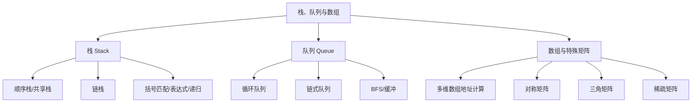

# 第 03 章｜栈、队列与数组

> 408 · 数据结构 · 基础阶段。范围以现行 408 考查内容为参考，2028 年正式大纲发布后逐项复核。

## 01. 知识地图



## 02. 栈（Stack）

### 2.1 定义与基本操作

栈是只允许在一端进行插入和删除的线性表，该端称为栈顶，另一端称为栈底。栈遵循 **后进先出（LIFO）**。

基本操作：InitStack、DestroyStack、Push、Pop、GetTop、StackEmpty。

### 2.2 顺序栈

以下实现约定空栈 $top=-1$：

```c
#define MAXSIZE 100
typedef int ElemType;

typedef struct {
    ElemType data[MAXSIZE];
    int top;
} SqStack;

void InitStack(SqStack *s) {
    s->top = -1;
}

int StackEmpty(const SqStack *s) {
    return s->top == -1;
}

int Push(SqStack *s, ElemType x) {
    if (s->top == MAXSIZE - 1) return 0;
    s->data[++s->top] = x;
    return 1;
}

int Pop(SqStack *s, ElemType *x) {
    if (StackEmpty(s)) return 0;
    *x = s->data[s->top--];
    return 1;
}
```

- Push、Pop、GetTop：时间复杂度均为 $O(1)$。
- 顺序栈容量固定，入栈前必须检查栈满。
- $top=-1$ 是本实现约定；若定义为 $top=0$，边界判断需同步调整。

### 2.3 共享栈

两个栈共享同一数组空间，栈底分别位于数组两端，栈顶向中间增长。常见判满条件为 $top_1+1=top_2$。共享栈能提高空间利用率，但总空间仍然有限。

### 2.4 链栈

链栈通常以单链表头部作为栈顶。头插、头删均为 $O(1)$，无需预先指定固定容量（仍受系统可用内存限制）。若采用带头结点结构，需区分头结点与实际栈顶元素结点。

## 03. 队列（Queue）

### 3.1 定义

队列只允许在队尾插入、队头删除，遵循 **先进先出（FIFO）**。基本操作包括 EnQueue、DeQueue、GetHead 和 QueueEmpty。

### 3.2 循环队列

假设数组容量为 MAXSIZE，采用“牺牲一个存储单元”区分队满和队空：

- 队空：$front=rear$
- 队满：$(rear+1)\bmod MAXSIZE=front$
- 入队：`data[rear] = x`；`rear = (rear + 1) % MAXSIZE`
- 出队：读取 `data[front]`，再令 `front = (front + 1) % MAXSIZE`

有效元素个数：$(rear-front+MAXSIZE)\bmod MAXSIZE$。

```c
#define MAXSIZE 100
typedef struct {
    int data[MAXSIZE];
    int front;
    int rear;
} SqQueue;

void InitQueue(SqQueue *q) {
    q->front = q->rear = 0;
}

int QueueEmpty(const SqQueue *q) {
    return q->front == q->rear;
}

int EnQueue(SqQueue *q, int x) {
    if ((q->rear + 1) % MAXSIZE == q->front) return 0;
    q->data[q->rear] = x;
    q->rear = (q->rear + 1) % MAXSIZE;
    return 1;
}

int DeQueue(SqQueue *q, int *x) {
    if (QueueEmpty(q)) return 0;
    *x = q->data[q->front];
    q->front = (q->front + 1) % MAXSIZE;
    return 1;
}
```

**容量陷阱：** 数组长度为 $MAXSIZE$，但牺牲一个单元后最多存放 $MAXSIZE-1$ 个元素。

### 3.3 链式队列

链式队列一般设置 front、rear 指针。入队在尾部插入，出队在头部删除，均可实现为 $O(1)$。空队列时需要特别处理：删除最后一个结点后，应让队尾指针恢复到空队列约定状态。

### 3.4 栈与队列对比

| 比较项   | 栈                     | 队列                     |
| -------- | ---------------------- | ------------------------ |
| 次序     | LIFO                   | FIFO                     |
| 插入位置 | 栈顶                   | 队尾                     |
| 删除位置 | 栈顶                   | 队头                     |
| 典型应用 | 函数调用、表达式、回溯 | 层序遍历、缓冲、任务排队 |
| 顺序实现 | 顺序栈                 | 循环队列                 |

## 04. 栈和队列的典型应用

### 4.1 括号匹配

扫描表达式：遇到左括号入栈；遇到右括号，若栈空则不匹配，否则弹出栈顶并检查类型；扫描结束后，栈必须为空。时间复杂度 $O(n)$，辅助空间最坏 $O(n)$。

### 4.2 表达式求值

中缀表达式转后缀表达式时，常用操作数输出序列和运算符栈。处理重点：

- 操作数直接输出；
- 左括号入栈；
- 右括号触发弹栈，直到对应左括号；
- 新运算符与栈顶运算符比较优先级和结合性；
- 扫描结束后弹出剩余运算符。

注意一元负号、乘方结合性和括号优先级等边界规则，不能只依赖简单的优先级比较。

### 4.3 递归与函数调用

递归调用需要保存返回地址、局部变量和现场信息，运行时通常通过调用栈管理。递归深度为 d 时，栈空间通常与 d 同阶；递归不一定比迭代更省空间。

### 4.4 队列应用

- BFS：访问当前顶点后，将尚未访问的邻接顶点依次入队；
- 生产者—消费者：缓冲区常用循环队列建模；
- 任务排队：体现 FIFO 思想，但实际调度策略可能并非纯 FIFO。

## 05. 数组与特殊矩阵

### 5.1 多维数组地址计算

二维数组按行优先存储，元素 A[i][j] 的地址为：

> $\operatorname{LOC}(A[i][j])=\operatorname{LOC}(A[0][0])+(i\cdot n+j)L$

其中 n 为列数，L 为每个元素占用的字节数。若下标从 l1、l2 开始，则偏移量为 $[(i-l_1)n+(j-l_2)]L$。列优先存储则先计算列偏移，再计算行偏移；做题必须确认存储次序和下标起点。

### 5.2 对称矩阵压缩存储

对称矩阵满足 $a_{ij}=a_{ji}$，只需存储主对角线及其一侧元素。若采用下三角按行优先、从 0 开始的一维数组：

当 i≥j 时，元素映射下标 $k=\frac{i(i+1)}2+j$。  
当 i<j 时，利用对称性交换下标，再按上式计算。

### 5.3 三角矩阵压缩存储

下三角（含主对角线）按行优先存储时，存储元素数为 $\frac{n(n+1)}2$。上三角矩阵需按题目给出的行/列优先约定推导映射公式，不要套用未经确认的公式。

### 5.4 稀疏矩阵

非零元素远少于矩阵元素总数时，可采用压缩存储：

- 三元组表：记录 (行, 列, 值)，适合稀疏矩阵的顺序表示；
- 十字链表：每个非零结点同时链接所在行和列，便于按行、列操作。

三元组表节省空间，但插入、删除可能涉及移动；十字链表结构灵活，但指针管理更复杂。

## 06. 典型例题

### 例 1｜循环队列容量

循环队列数组长度为 $8$，采用牺牲一个单元的判满方式，最多能存放多少个元素？

**解：** 最多存放 $8-1=7$ 个元素。

### 例 2｜栈操作

空栈依次执行 Push(3)、Push(5)、Pop、Push(7)、Pop，最后栈顶元素是什么？

**解：** 入 3、入 5、出 5、入 7、出 7，栈中只剩 3，因此栈顶为 3。

### 例 3｜二维数组地址

二维数组 A[0..3][0..4] 按行优先存储，每个元素 4 字节，首地址为 1000，求 A[2][3] 地址。

**解：** 偏移元素数为 $2\times5+3=13$，字节偏移为 $13\times4=52$，地址为 $1052$。

### 例 4｜对称矩阵映射

下三角按行优先、0 起始存储，求 a₃₁ 在一维数组中的下标。

**解：** $k=\frac{3\times4}{2}+1=7$。

## 07. 复杂度速查

| 结构/操作         | 时间复杂度 | 说明                        |
| ----------------- | ---------: | --------------------------- |
| 顺序栈入栈/出栈   |     $O(1)$ | 仅更新栈顶                  |
| 链栈入栈/出栈     |     $O(1)$ | 头插、头删                  |
| 循环队列入队/出队 |     $O(1)$ | 取模更新指针                |
| 链式队列入队/出队 |     $O(1)$ | 维护队头、队尾              |
| 括号匹配          |     $O(n)$ | 每个字符至多入栈/出栈一次   |
| 表达式转换        |     $O(n)$ | 每个符号至多入栈/出栈常数次 |
| 二维数组随机访问  |     $O(1)$ | 地址直接计算                |

## 08. 高频易错点

- 栈顶 top 表示下标还是元素个数，必须先看初始化约定；
- 循环队列判满公式依赖“牺牲一个单元”的实现；
- 循环队列数组长度为 m，可用容量不是 m，而是 m−1；
- 链式队列删除最后一个元素后，必须正确更新队尾指针；
- 表达式求值不能忽略运算符结合性和一元运算符；
- 多维数组地址计算要确认行优先/列优先、下标起点、元素长度；
- 对称矩阵压缩存储时，先判断所在三角区域，再映射下标；
- 稀疏矩阵的三元组表和十字链表结构不能混淆。

## 09. 章节自测

1. 栈和队列分别遵循什么存取原则？
2. 顺序栈若以 $top=-1$ 表示空栈，入栈时先移动 top 还是先写入数据？
3. 长度为 $12$ 的循环队列采用牺牲一个单元方案，最多可存放多少个元素？
4. 循环队列 $front=5$、$rear=2$、$MAXSIZE=10$，当前元素个数是多少？
5. 空栈依次执行 Push(1)、Push(2)、Pop、Push(3)、Pop，最终栈内元素是什么？
6. 二维数组 B[1..4][1..6] 按行优先存储，每个元素 2 字节，首地址 2000，求 B[3][5] 地址。
7. 下三角矩阵按行优先、0 起始压缩存储，求 a₄₂ 的一维下标。
8. 括号匹配算法为什么需要在扫描结束时检查栈是否为空？

### 参考答案

1. 栈为后进先出（LIFO），队列为先进先出（FIFO）。
2. 先移动 top，再写入 data[top]。
3. $12-1=11$ 个。
4. $(2-5+10)\bmod10=7$ 个。
5. 依次入 1、入 2、出 2、入 3、出 3，最终仅剩 1。
6. 偏移元素数为 $(3-1)\times6+(5-1)=16$，字节偏移 $32$，地址为 $2032$。
7. $k=\frac{4\times5}{2}+2=12$。
8. 扫描过程中可能没有多余右括号，但仍残留未匹配的左括号；栈非空说明匹配未完成。

## 10. 本章达标检查

- [ ] 能独立实现顺序栈、链栈、循环队列
- [ ] 能区分栈空/栈满与队空/队满
- [ ] 能手算栈和队列的操作序列
- [ ] 能完成括号匹配与基础表达式转换
- [ ] 能计算二维数组地址
- [ ] 能完成对称矩阵压缩下标映射
- [ ] 能解释三元组表和十字链表的适用特点

---

## 11. 本章五大经典学习法｜栈、队列与数组

### 11.1 费曼学习法：用生活模型解释 LIFO、FIFO 与地址映射

- **栈（LIFO）**：像一摞盘子，最后放上去的盘子最先拿走。入栈和出栈都发生在栈顶。
- **队列（FIFO）**：像排队买票，先到的人先离开。队尾入队，队头出队。
- **循环队列**：像环形跑道，指针走到数组末尾后回到下标 0；牺牲一个存储单元可以区分队满和队空。
- **数组地址计算**：像一排连续编号的座位，行优先存储时先跨过前面的整行，再在当前行内偏移。

**费曼复述任务：**

1. 不看资料解释为什么栈的 Push 和 Pop 都只在栈顶进行。
2. 解释队列的 front 与 rear 各自代表什么，以及为什么循环队列要取模。
3. 解释牺牲一个存储单元后，长度为 m 的数组最多存放 m−1 个队列元素。
4. 用自己的话推导二维数组行优先地址公式。
5. 解释为什么括号匹配适合用栈，而 BFS 适合用队列。

**必须讲出的边界：** top 的定义可能是“栈顶元素下标”或“栈中元素个数”；front/rear 的更新规则也依赖实现约定。先确认约定，再写判空判满公式。

### 11.2 西蒙学习法：按结构、操作和应用分块

| 模块 | 内容 | 前置知识 | 独立练习 |
|---|---|---|---|
| A. 栈基础 | LIFO、顺序栈、链栈、共享栈 | 线性表 | 手算 Push/Pop，写顺序栈代码 |
| B. 队列基础 | FIFO、循环队列、链式队列 | A、线性表 | 手算 front/rear，写入队出队 |
| C. 栈队列应用 | 括号匹配、表达式求值、递归、BFS | A、B | 手算符号栈和队列变化 |
| D. 数组地址 | 一维/二维数组、行优先/列优先 | 下标与字节单位 | 计算指定元素地址 |
| E. 压缩存储 | 对称矩阵、三角矩阵、稀疏矩阵 | D | 推导映射下标并检查边界 |

练习反馈分三层：先能手算状态变化，再能解释算法为何正确，最后能写出实现和复杂度。循环队列题必须每一步同时记录 front、rear、当前元素个数，不能只凭直觉判断。

### 11.3 SQ3R 阅读法：把公式转化成问题

- **Survey 浏览：** 先看栈/队列定义、循环队列状态图、矩阵地址公式与稀疏矩阵结构图。
- **Question 提问：** 为什么栈顶操作为 O(1)？为什么循环队列容量少 1？为什么删除最后一个链式队列结点要更新 rear？行优先公式中的列数为何乘在行偏移前？
- **Read 精读：** 逐行追踪 Push、Pop、EnQueue、DeQueue；对每条赋值记录执行前后的指针状态。
- **Recite 复述：** 合上资料，手算一组混合入栈出栈和入队出队序列；从地址公式反推元素下标。
- **Review 复习：** 当天重做循环队列判空判满，次日默写地址公式，第 3 天做矩阵压缩题，第 7 天复盘表达式求值。

**自问清单：**

1. top=-1 的顺序栈，第一次 Push 后 top 变成多少？
2. front=rear 为什么表示空队列？
3. (rear+1)%MAXSIZE==front 为什么表示队满？
4. 当前元素数为什么是 (rear-front+MAXSIZE)%MAXSIZE？
5. 括号匹配结束时为什么还要检查栈是否为空？
6. 行优先和列优先地址计算最关键的差别是什么？
7. 对称矩阵映射前，为什么必须先判断 i 与 j 的大小关系？

### 11.4 番茄工作法：四个番茄完成本章

| 番茄 | 25 分钟专注任务 | 验收产出 |
|---|---|---|
| 1 | 顺序栈、链栈、共享栈 | 默写 Push/Pop 并手算 2 组操作 |
| 2 | 循环队列、链式队列 | 完成 3 组 front/rear 状态追踪 |
| 3 | 括号匹配、表达式转换、递归/BFS | 手算 2 个表达式或遍历过程 |
| 4 | 二维数组地址、矩阵压缩 | 完成 4 道地址/下标计算题 |

每轮结束休息 5 分钟。出现错误时，先定位是定义约定、指针更新、取模计算还是下标起点问题，再进行下一轮。

### 11.5 康奈尔笔记法：本章高频线索卡

| 左侧线索 / 问题 | 右侧主体笔记 |
|---|---|
| 栈的存取规则？ | LIFO，只能在栈顶插入和删除。 |
| 队列的存取规则？ | FIFO，队尾插入、队头删除。 |
| top=-1 的空栈？ | top 指向栈顶元素下标；空栈时没有有效下标。入栈先 ++top 再写入。 |
| 循环队列判空/判满？ | 判空 front==rear；牺牲一个单元时判满 (rear+1)%m==front。 |
| 循环队列当前长度？ | (rear-front+m)%m，结果范围 0 到 m−1。 |
| 括号匹配为什么用栈？ | 最近遇到的左括号必须最先与右括号匹配，符合后进先出。 |
| BFS 为什么用队列？ | 先发现的顶点先扩展，保证按层次推进。 |
| 二维数组行优先偏移？ | 零起始下标时，元素偏移数为 i×列数+j，再乘每个元素字节数。 |
| 稀疏矩阵三元组？ | 每个非零元素保存行、列、值；节省空间，但按行/列操作不如十字链表灵活。 |

**页底总结：** 栈和队列都是受限线性表，差别在于操作端点和访问次序。数组地址计算要把逻辑下标转换为线性偏移，再乘元素字节数；压缩矩阵则是在保存规则下建立二维坐标到一维位置的映射。

### 11.6 五法融合自测

1. 空栈依次 Push(4)、Push(6)、Pop、Push(8)，栈顶是什么？
2. MAXSIZE=10 的循环队列最多存放几个元素？
3. front=7、rear=3、MAXSIZE=10，当前元素个数是多少？
4. 为什么括号匹配只需线性扫描一次，时间复杂度为 O(n)？
5. A[0..4][0..6] 按行优先存储，每个元素 4 字节，首地址 100，求 A[3][2] 地址。
6. 对称矩阵下三角按行优先、0 起始存储，a₄₂ 的下标是多少？
7. 稀疏矩阵三元组表每个非零元素至少需要保存哪三个字段？

**答案要点：** 1. 8；2. 9；3. (3−7+10)%10=6；4. 每个字符最多入栈一次、出栈一次；5. (3×7+2)×4+100=192；6. 4×5/2+2=12；7. 行号、列号、数值。

**通关条件：**

- [ ] 能独立实现顺序栈、循环队列
- [ ] 能正确追踪 top、front、rear 的变化
- [ ] 能解释循环队列牺牲一个单元的原因
- [ ] 能完成括号匹配与基础表达式求值
- [ ] 能计算二维数组地址和矩阵压缩下标
- [ ] 能区分三元组表与十字链表
