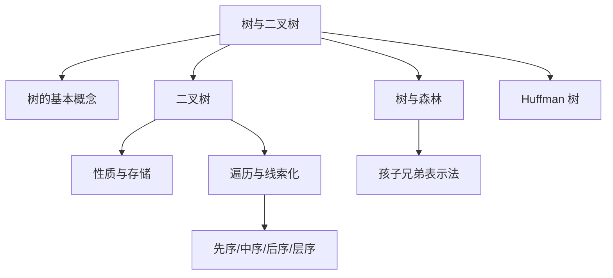

# 第 04 章｜树与二叉树

> 408 · 数据结构 · 基础阶段。重点掌握树的术语、二叉树性质、存储结构、遍历、线索化、树森林转换与 Huffman 树。

## 01. 知识地图



## 02. 树的基本概念

树是 $n\ge0$ 个结点构成的有限集合。$n=0$ 时为空树；非空树满足：

- 有且仅有一个根结点；
- 除根结点外，其余结点分成互不相交的有限集合，每个集合本身又是一棵树；
- 结点之间具有明确的层次关系。

常用术语：

| 术语     | 含义                                           |
| -------- | ---------------------------------------------- |
| 结点的度 | 该结点拥有的孩子数                             |
| 树的度   | 所有结点度的最大值                             |
| 叶结点   | 度为 0 的结点                                  |
| 分支结点 | 度不为 0 的结点                                |
| 结点深度 | 从根到该结点路径上的边数（需留意题目层数定义） |
| 结点高度 | 从该结点到最深叶结点的最长路径长度             |
| 森林     | $m$ 棵互不相交树的集合                         |

考试题常把根结点所在层记为第 1 层；此时层数与以边数定义的深度相差 1，答题时先确认口径。

## 03. 二叉树定义与形态

二叉树是每个结点最多有两棵子树，且左右子树有次序之分的树。常见形态：

- 满二叉树：所有层都达到最大结点数；
- 完全二叉树：除最后一层外均满，最后一层结点从左向右连续排列；
- 斜树：每个分支结点只有一个孩子；
- 平衡二叉树：任意结点左右子树高度差的绝对值不超过 1（具体定义以教材语境为准）。

## 04. 二叉树的重要性质

若根结点所在层为第 1 层：

1. 第 $i$ 层最多有 $2^{i-1}$ 个结点；
2. 高度为 $h$ 的二叉树最多有 $2^h-1$ 个结点；
3. 对任意非空二叉树，若 $n_0$、$n_1$、$n_2$ 分别表示度为 0、1、2 的结点数，则：

$$
n_0=n_2+1
$$

推导：二叉树边数既等于结点总数减 1，也等于所有结点孩子数之和：

$$
n_0+n_1+n_2-1=n_1+2n_2
$$

整理得 $n_0=n_2+1$。

4. 具有 $n$ 个结点的完全二叉树高度为：

$$
h=\lfloor\log_2 n\rfloor+1
$$

5. 完全二叉树按层序从 1 开始编号时，结点 $i$ 的左孩子为 $2i$，右孩子为 $2i+1$，双亲为 $\lfloor i/2\rfloor$（存在时）。

## 05. 二叉树存储结构

### 5.1 顺序存储

适合完全二叉树或接近完全的结构。按层序存入数组，使用编号关系定位双亲和孩子。一般二叉树若形态稀疏，顺序存储可能浪费大量空间。

### 5.2 链式存储

常见二叉链表结点：

```c
typedef struct BiTNode {
    ElemType data;
    struct BiTNode *lchild;
    struct BiTNode *rchild;
} BiTNode, *BiTree;
```

每个结点保存数据、左孩子指针和右孩子指针。若需要频繁访问双亲，可扩展 parent 指针。

## 06. 二叉树遍历

- 先序：根 → 左 → 右；
- 中序：左 → 根 → 右；
- 后序：左 → 右 → 根；
- 层序：从上到下、从左到右，通常借助队列。

递归先序遍历：

```c
void PreOrder(BiTree T) {
    if (T == NULL) return;
    visit(T);
    PreOrder(T->lchild);
    PreOrder(T->rchild);
}
```

递归中序与后序只需调整 visit 的位置。每个结点访问一次，时间复杂度为 $O(n)$；递归辅助空间取决于树高 $h$，调用栈为 $O(h)$。

### 6.1 由遍历序列确定二叉树

- 先序 + 中序：若结点值唯一，可唯一确定二叉树；
- 后序 + 中序：若结点值唯一，可唯一确定二叉树；
- 先序 + 后序：一般不能唯一确定，因为无法区分单孩子结点位于左侧还是右侧。

若结点值重复，仅凭遍历序列可能无法唯一确定结构，必须结合额外标记或约束。

## 07. 线索二叉树

普通二叉链表中大量空指针可用于存放遍历前驱或后继信息。线索化时通常设置标志位区分孩子指针和线索指针。

- 先序线索：空指针可指向先序前驱/后继；
- 中序线索：可在不使用递归栈或显式栈的情况下寻找中序前驱/后继；
- 后序线索：后继查找还需要考虑双亲或其他辅助信息。

线索化不是简单地把所有空指针随意连接；必须严格按指定遍历次序确定前驱和后继。

## 08. 树、森林与二叉树转换

常用孩子兄弟表示法（左孩子右兄弟）：

- 左指针指向第一个孩子；
- 右指针指向下一个兄弟。

森林转换为二叉树的基本步骤：

1. 将每棵树的所有兄弟结点连接为右链；
2. 保留每个结点与其最左孩子的关系；
3. 将森林中第一棵树的根作为二叉树根，其余树根依次作为右兄弟。

树转换为二叉树后，原树的兄弟关系由右链表示，不能把右链误认为原树的右孩子。

## 09. Huffman 树与带权路径长度

给定 $n$ 个权值，反复选取当前权值最小的两棵树合并，新结点权值为二者之和，直到形成一棵树。所得 Huffman 树具有最小带权路径长度。

$$
WPL=\sum_{i=1}^{n}w_i l_i
$$

其中 $w_i$ 是叶结点权值，$l_i$ 是叶结点到根的路径长度（边数）。

构造步骤：

1. 将所有权值放入候选集合；
2. 每次选取两个最小权值；
3. 合并为新结点，新权值等于两者之和；
4. 将新权值放回集合；
5. 重复直到只剩一个结点。

Huffman 树中没有度为 1 的结点（对标准二叉 Huffman 构造而言），共有 $n$ 个叶结点时，内部结点数为 $n-1$，总结点数为 $2n-1$。

## 10. 典型例题

### 例 1｜结点数关系

一棵非空二叉树有 12 个度为 2 的结点，求叶结点数。

由 $n_0=n_2+1$，得 $n_0=13$。

### 例 2｜完全二叉树编号

完全二叉树按层序从 1 编号，结点 9 的双亲编号为 $\lfloor9/2\rfloor=4$，左孩子编号为 18（若存在），右孩子编号为 19（若存在）。

### 例 3｜Huffman 树 WPL

权值为 2、3、7、9。合并过程：$2+3=5$，$5+7=12$，$9+12=21$。叶结点路径长度分别为 3、3、2、1，因此：

$$
WPL=2\times3+3\times3+7\times2+9\times1=38
$$

## 11. 高频易错点

- 树的度与结点的度不是同一个概念；
- 结点深度/高度的定义可能按边数或层数，先统一口径；
- 满二叉树与完全二叉树不能混淆；
- $n_0=n_2+1$ 只适用于二叉树；
- 完全二叉树数组编号公式依赖从 1 开始编号；
- 先序+后序通常不能唯一确定二叉树；
- 递归遍历时间为 $O(n)$，辅助栈空间与树高相关；
- Huffman 树合并时必须每次选择当前最小的两个权值。

## 12. 章节自测

1. 树的度与结点的度分别是什么？
2. 若二叉树有 15 个度为 2 的结点，叶结点有多少个？
3. 高度为 4（根所在层为第 1 层）的二叉树最多有多少个结点？
4. 完全二叉树按层序从 1 编号，结点 13 的双亲编号是多少？
5. 哪两种遍历序列组合（结点值唯一时）可以唯一确定二叉树？
6. 为什么先序和后序遍历通常不能唯一确定二叉树？
7. 对权值 1、4、6 构造 Huffman 树，其 WPL 是多少？

### 参考答案

1. 结点的度是该结点孩子数；树的度是所有结点度的最大值。
2. $n_0=n_2+1=16$。
3. $2^4-1=15$。
4. $\lfloor13/2\rfloor=6$。
5. 先序+中序，或后序+中序。
6. 单孩子结点无法仅由先序和后序判断孩子位于左侧还是右侧。
7. 先合并 1 与 4 得 5，再与 6 合并得 11；WPL=$1\times2+4\times2+6\times1=16$。

## 13. 本章达标检查

- [ ] 能准确解释树与二叉树基本术语
- [ ] 能推导并使用二叉树性质
- [ ] 能实现先序、中序、后序和层序遍历
- [ ] 能根据遍历序列恢复二叉树（满足唯一性条件时）
- [ ] 能解释线索二叉树的指针含义
- [ ] 能完成树/森林与二叉树转换
- [ ] 能手工构造 Huffman 树并计算 WPL

---

## 14. 本章五大经典学习法｜树与二叉树

### 14.1 费曼学习法：把树的层次关系讲清楚

- **树**：由根结点和若干互不相交的子树构成，表达一对多的层次关系。
- **二叉树**：每个结点最多有两个孩子，并且左孩子、右孩子有明确区别；它不是“每个结点必须有两个孩子”。
- **完全二叉树**：除最后一层外都填满，最后一层从左到右连续排列，因此可以高效使用数组编号。
- **遍历**：先序/中序/后序的区别只是“访问根结点”的时机；层序遍历按层推进，通常借助队列。
- **Huffman 树**：每轮合并当前权值最小的两棵树，让权值大的叶子倾向于处在较浅位置，从而使 WPL 最小。

**费曼复述练习：**

1. 用一个组织架构或文件夹例子解释树、根、叶子、孩子、双亲和森林。
2. 为什么二叉树的左子树与右子树不能随意交换？
3. 为什么完全二叉树适合顺序存储，而稀疏斜树可能浪费数组空间？
4. 为什么先序+中序可以确定唯一二叉树（结点值唯一），而先序+后序通常不行？
5. 用自己的话解释 Huffman 树为什么每次合并最小的两个权值。

**边界检查：** 结点深度和高度的定义可能按边数或层数计量；满二叉树、完全二叉树、平衡二叉树含义不同；遍历序列唯一性结论依赖结点值不重复等前提。

### 14.2 西蒙学习法：按性质、遍历、转换与构造拆分

| 知识块 | 核心内容 | 先修关系 | 达标练习 |
|---|---|---|---|
| A. 树术语 | 结点度、树的度、叶子、深度、高度、森林 | 无 | 根据树图统计术语 |
| B. 二叉树性质 | 满/完全二叉树、结点数、编号关系、n₀=n₂+1 | A | 公式推导与数量计算 |
| C. 存储与遍历 | 顺序/链式存储、四种遍历、递归栈 | B | 手算遍历序列并写递归代码 |
| D. 线索与转换 | 线索二叉树、树/森林与二叉树转换 | C | 补全前驱后继与孩子兄弟关系 |
| E. Huffman | 构造、WPL、内部结点数 | A、B | 手工合并权值并计算 WPL |

**刻意练习路径：**

1. 给出一棵树，先只标出根、叶子、结点度和层数。
2. 对同一棵二叉树分别写出先序、中序、后序和层序。
3. 根据两种遍历序列恢复树，并说明唯一性条件。
4. 画出 Huffman 每一轮合并后的森林，不跳步。
5. 对错题标记：术语口径、性质套用、遍历顺序、唯一性条件、WPL 路径长度计算。

每个知识块至少连续两次独立完成后再推进；若遍历题错，先回到“根结点何时访问”，不要只背序列口诀。

### 14.3 SQ3R 阅读法：用问题引导阅读

- **Survey 浏览：** 先看树的术语表、二叉树性质、遍历示意图、Huffman 合并过程。
- **Question 提问：** 二叉树为何有 n₀=n₂+1？完全二叉树编号公式从哪里来？为什么中序遍历 BST 会得到递增序列？为什么先序+后序不足以唯一确定树？
- **Read 精读：** 对每个性质写出前提；对每种遍历用同一棵树手动执行；对 Huffman 每轮排序并标记合并的两个最小权值。
- **Recite 复述：** 合上笔记，重新推导 n₀=n₂+1，口述四种遍历，独立恢复一棵二叉树。
- **Review 复习：** 当天复画遍历，第 1 天后重做性质题，第 3 天重做恢复树和 Huffman，第 7 天综合复习。

**阅读时必须回答：**

1. 一棵非空二叉树的边数为什么是 n−1？
2. 为什么度为 2 的结点总数决定叶结点数？
3. 完全二叉树按 1 起始编号时，孩子编号公式如何得到？
4. 递归遍历的时间复杂度为何是 O(n)，调用栈为何与树高相关？
5. 为什么中序线索能帮助寻找中序前驱和后继？
6. Huffman 树的 WPL 为什么按叶结点权值乘路径长度求和？

### 14.4 番茄工作法：五个番茄完成本章

| 番茄 | 25 分钟任务 | 可验收产出 |
|---|---|---|
| 1 | 树术语与二叉树形态 | 给定两棵树，标注度、深度、高度、叶子 |
| 2 | 二叉树性质与编号 | 推导 n₀=n₂+1，完成 5 道数量题 |
| 3 | 四种遍历与恢复树 | 手算 4 组遍历，恢复 1 棵二叉树 |
| 4 | 线索化、树/森林转换 | 画出孩子兄弟表示法和线索关系 |
| 5 | Huffman 树 | 完成 2 组构造并计算 WPL |

每轮结束休息 5 分钟。遍历题先用纸笔标记递归访问顺序；Huffman 题每次都把当前候选权值重新排序，避免漏选最小值。

### 14.5 康奈尔笔记法：树与二叉树线索卡

| 左侧线索 / 问题 | 右侧主体笔记 |
|---|---|
| 结点的度？树的度？ | 结点的度是该结点孩子数；树的度是所有结点度的最大值。 |
| 二叉树的定义？ | 每个结点最多有两棵子树，且左右子树有次序；允许只有左孩子或右孩子。 |
| n₀ 与 n₂ 的关系？ | 非空二叉树中 n₀=n₂+1。由边数 n−1 等于孩子指针总数 n₁+2n₂ 推出。 |
| 完全二叉树编号？ | 从 1 编号时，i 的左孩子 2i、右孩子 2i+1、双亲 ⌊i/2⌋（若存在）。 |
| 四种遍历？ | 先序根左右；中序左根右；后序左右根；层序逐层访问。 |
| 哪些遍历组合可恢复树？ | 结点值唯一时，先序+中序或后序+中序可唯一确定；先序+后序一般不行。 |
| 遍历复杂度？ | 每个结点访问一次，时间 O(n)；递归调用栈 O(h)，h 为树高。 |
| Huffman 树如何构造？ | 每轮取当前最小的两个权值合并，新权值为二者之和，重复至只剩一棵树。 |
| WPL 公式？ | WPL=Σ(wᵢ×lᵢ)，wᵢ 为叶权值，lᵢ 为叶到根的边数。 |

**页底总结：** 树章节的核心是层次关系与遍历次序。性质题要先确认层数/深度口径；遍历题要明确根结点访问时机；恢复树要检查唯一性前提；Huffman 题必须逐轮选择当前最小的两个权值。

### 14.6 五法融合自测

1. 一棵非空二叉树有 9 个度为 2 的结点，叶结点数是多少？
2. 高度为 5、根所在层为第 1 层的二叉树最多有多少个结点？
3. 完全二叉树按层序从 1 编号，结点 18 的双亲编号是多少？
4. 为什么先序+中序能唯一确定二叉树，而先序+后序一般不能？
5. 一棵树的遍历递归调用栈空间取决于什么？
6. 对权值 2、4、5、7 构造 Huffman 树，写出每轮合并过程和 WPL。

**答案要点：** 1. 10；2. 2⁵−1=31；3. ⌊18/2⌋=9；4. 中序能确定根左右子树边界，先序/后序单独无法判断单孩子方向；5. 树高 h，最坏 O(h)；6. 合并 2+4=6，5+6=11，7+11=18；叶深度为 3、3、2、1，WPL=2×3+4×3+5×2+7×1=31。

**本章通关条件：**

- [ ] 能正确使用树与二叉树术语
- [ ] 能推导并使用二叉树性质
- [ ] 能手算四种遍历并恢复满足条件的二叉树
- [ ] 能解释线索二叉树和孩子兄弟表示法
- [ ] 能逐轮构造 Huffman 树并计算 WPL
