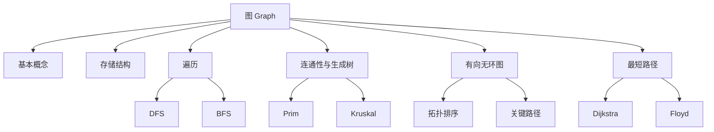
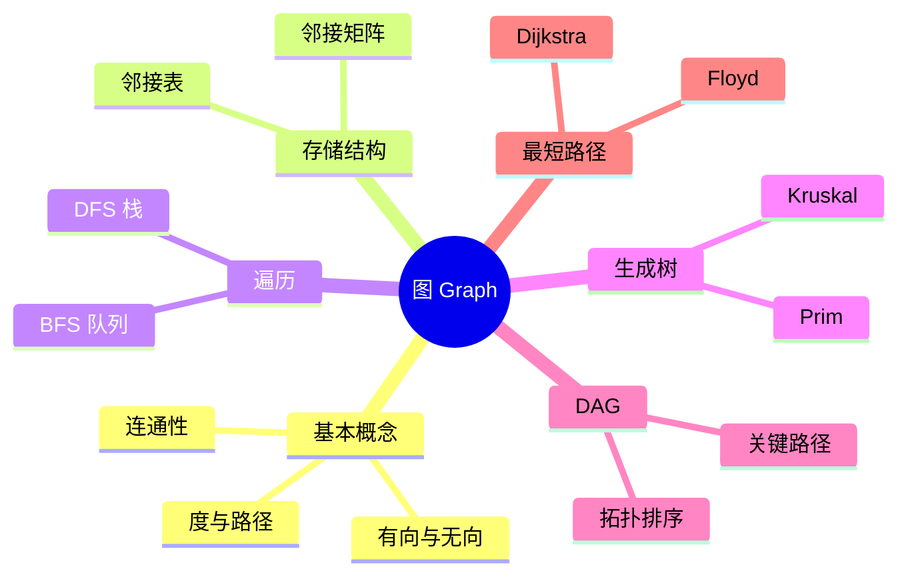

# 第 05 章｜图

> 408 · 数据结构 · 基础阶段。围绕图的存储、遍历、连通性、生成树、拓扑排序、关键路径与最短路径建立完整解题框架。算法适用条件必须与结论一起记忆。

## 01. 知识地图

## 02. 基本概念与性质

- **图**：由顶点集 $V$ 与边集 $E$ 构成，记为 $G=(V,E)$。
- **有向图**：边是有序对；**无向图**：边是无序对。
- **简单图**：不存在重复边和顶点到自身的边。
- **度**：无向图顶点 $v$ 的度为与其关联的边数；有向图区分入度 $id(v)$ 与出度 $od(v)$。
- **路径长度**：路径上边的数量；路径中顶点不重复时称简单路径。
- **连通图**：无向图任意两个顶点之间均存在路径；有向图需区分强连通与弱连通。
- **连通分量**：无向图中的极大连通子图；强连通分量是有向图中的极大强连通子图。

无向图的度数和等于边数的两倍：

$$
\sum_{v\in V}deg(v)=2|E|
$$

有向图中：

$$
\sum_{v\in V}id(v)=\sum_{v\in V}od(v)=|E|
$$

含 $n$ 个顶点的简单无向图最多有：

$$
\frac{n(n-1)}{2}
$$

条边。无向完全图每个顶点的度为 $n-1$。

## 03. 存储结构

### 邻接矩阵

使用 $n\times n$ 矩阵表示顶点之间是否有边或边权。

- 无向图的邻接矩阵对称。
- 无权图可用 0/1 表示边是否存在；带权图需约定无边时的特殊值。
- 判断两顶点是否邻接为 $O(1)$。
- 遍历某顶点的所有邻接点需扫描一行，时间为 $O(n)$。
- 空间复杂度为 $O(n^2)$，适合稠密图。

### 邻接表

每个顶点维护一条边结点链表（或动态数组），记录其邻接点及可选边权。

- 有向图邻接表通常存出边；逆邻接表存入边。
- 无向图每条边在两个顶点的表中各出现一次。
- 空间复杂度为 $O(n+|E|)$。
- 遍历某顶点邻接点的代价与该顶点的度成正比，适合稀疏图。

| 比较项     | 邻接矩阵           | 邻接表                 |
| :--------- | :----------------- | :--------------------- | --- | --- |
| 空间       | $O(n^2)$           | $O(n+                  | E   | )$  |
| 查边       | $O(1)$             | 最坏 $O(deg(v))$       |
| 遍历邻接点 | $O(n)$             | $O(deg(v))$            |
| 适合       | 稠密图             | 稀疏图                 |
| 无向图存边 | 矩阵对称位置各记录 | 两个顶点表中各记录一次 |

## 04. 图的遍历

### 深度优先搜索 DFS

从一个顶点出发，沿未访问的邻接点尽可能深入，无法继续时回退。必须在递归/入栈前标记访问，避免重复访问和无限递归。

算法框架：

1. 将当前顶点标记为已访问并访问它。
2. 依次检查其邻接点。
3. 对每个尚未访问的邻接点递归执行 DFS。
4. 若图不连通，对其他未访问顶点再次启动 DFS。

### 广度优先搜索 BFS

使用队列，按距离起点从近到远访问顶点。顶点应在入队时标记，避免重复入队。

算法框架：

1. 将起点标记为已访问并入队。
2. 队列非空时，队头顶点出队并访问。
3. 将该顶点所有未访问邻接点标记后入队。
4. 队列清空后，若仍有未访问顶点，则从其启动新一轮遍历。

| 存储结构 | DFS 时间 | BFS 时间 | 额外空间 |
| :------- | -------: | -------: | -------: | ----- | --- | --- | ------ |
| 邻接矩阵 | $O(n^2)$ | $O(n^2)$ |   $O(n)$ |
| 邻接表   |    $O(n+ |        E |       )$ | $O(n+ | E   | )$  | $O(n)$ |

DFS/BFS 的具体访问序列取决于邻接点的处理顺序。

## 05. 最小生成树

连通无向带权图的生成树包含全部顶点、恰有 $n-1$ 条边且无回路。最小生成树（MST）是所有生成树中边权总和最小者。

### Prim 算法

- 从任意顶点开始，维护已加入集合到未加入顶点的最小横切边。
- 每次选择权值最小的横切边，将新顶点加入。
- 常见邻接矩阵实现为 $O(n^2)$，适合稠密图。
- 适用于连通无向带权图。

### Kruskal 算法

- 将边按权值从小到大排序。
- 依次考察边，若两端点属于不同连通集合则选入，否则舍弃。
- 使用并查集判断是否连通；排序通常是主要开销，复杂度约为 $O(|E|\log |E|)$。
- 适合稀疏图。

**易错辨析：** MST 解决“连接所有顶点且总边权最小”；最短路径解决“从源点到目标点的路径长度最小”。二者目标不同。

## 06. 有向无环图：拓扑排序与关键路径

### 拓扑排序

对有向无环图（DAG）的顶点线性排序，使每条有向边 $u\to v$ 中 $u$ 都出现在 $v$ 之前。

Kahn 算法：

1. 计算每个顶点的入度。
2. 将所有入度为 0 的顶点入队。
3. 取出一个顶点并输出；删除其所有出边，对邻接点入度减 1。
4. 新产生入度为 0 的顶点入队。
5. 若输出顶点数小于 $n$，图中存在有向环，不存在拓扑序列。

邻接表实现时间复杂度为 $O(n+|E|)$。拓扑序列可能不唯一。

### 关键路径

AOE 网以顶点表示事件、边表示活动，边权表示活动持续时间。关键路径是从源点到汇点的最长路径，决定工程最短完成时间。

- 事件最早发生时间 $ve(v)$：按拓扑序递推，取所有前驱路径到达时间的最大值。
- 事件最迟发生时间 $vl(v)$：按逆拓扑序递推，取所有后继允许时间的最小值。
- 活动 $a_i=(u,v)$，持续时间为 $w_i$：
  - 最早开始时间：$e(a_i)=ve(u)$。
  - 最迟开始时间：$l(a_i)=vl(v)-w_i$。
  - 时间余量：$l(a_i)-e(a_i)$；余量为 0 的活动为关键活动。

关键路径长度为工程最短完成时间。活动持续时间变化后，关键路径可能改变；多条关键路径也可能同时存在。

## 07. 最短路径

### Dijkstra

求单源最短路径，要求边权非负。

- 初始化源点距离为 0，其余为无穷大。
- 每轮从未确定顶点中选取当前距离最小者，将其距离确定。
- 用该顶点松弛所有出边：若 $dist[u]+w(u,v)<dist[v]$，则更新。
- 邻接矩阵朴素实现为 $O(n^2)$；邻接表加优先队列可优化。

**不能用于存在负权边的图**，因为已确定的最短距离可能被后续负权路径改写。

### Floyd

求所有顶点对之间的最短路径，允许负权边，但不能存在负权回路。

$$
D_{ij}^{(k)}=
\min\left(D_{ij}^{(k-1)},D_{ik}^{(k-1)}+D_{kj}^{(k-1)}\right)
$$

三重循环依次枚举中间顶点 $k$、起点 $i$、终点 $j$。时间复杂度 $O(n^3)$，空间复杂度 $O(n^2)$。若最终某个 $D_{ii}<0$，说明存在负权回路。

| 算法     | 问题              | 权值限制             | 典型复杂度       |
| :------- | :---------------- | :------------------- | :--------------- |
| Dijkstra | 单源最短路径      | 非负权               | $O(n^2)$（朴素） |
| Floyd    | 多源/全源最短路径 | 可有负权，无负权回路 | $O(n^3)$         |

## 08. 常见失分点

1. 把无向边在邻接表中只存一次；实际上通常需要在两个顶点的表中各存一次。
2. DFS/BFS 忘记标记访问，或 BFS 出队后才标记导致重复入队。
3. 不连通图只从一个顶点开始遍历，遗漏其他连通分量。
4. 把拓扑排序误认为唯一序列；只要满足所有有向边的先后约束即可。
5. 关键路径求的是最长路径，不是最短路径；活动余量为 0 才是关键活动。
6. Prim/Kruskal 用于最小生成树，Dijkstra/Floyd 用于最短路径。
7. Dijkstra 不适用于负权边；Floyd 也不能解决含负权回路的最短路问题。

## 09. 章节自测

1. 含 8 个顶点的简单无向图最多有多少条边？若是完全图，每个顶点的度是多少？
2. 一个无向图有 12 条边，所有顶点度数之和是多少？
3. 邻接矩阵和邻接表分别更适合稠密图还是稀疏图？说明空间复杂度。
4. DFS 与 BFS 分别使用什么基本数据结构？BFS 为什么应在入队时标记？
5. 拓扑排序输出顶点数少于图的顶点数，能得出什么结论？
6. 某 AOE 网活动 $u\to v$ 的持续时间为 4，$ve(u)=6$、$vl(v)=13$，求活动最早开始、最迟开始时间和时间余量。
7. Dijkstra 与 Floyd 的适用问题和权值限制分别是什么？
8. Prim 与 Kruskal 的共同目标是什么？它们与最短路径算法有何区别？

## 10. 自测参考答案

1. 最多 $8\times7/2=28$ 条；完全图每个顶点度为 7。
2. 度数和为 $2|E|=24$。
3. 邻接矩阵 $O(n^2)$，适合稠密图；邻接表 $O(n+|E|)$，适合稀疏图。
4. DFS 通常使用递归栈/显式栈；BFS 使用队列。入队即标记可避免同一顶点被多个前驱重复入队。
5. 图中存在有向环，因此不是 DAG，不存在拓扑序列。
6. $e=ve(u)=6$；$l=vl(v)-4=9$；余量 $=9-6=3$，该活动不是关键活动。
7. Dijkstra 求单源最短路径，要求边权非负；Floyd 求全源最短路径，可有负权边但不能有负权回路。
8. 都求连通无向带权图的最小生成树；最短路径算法求指定源点/顶点对间路径长度最小，问题目标不同。

## 11. 复习清单

- [ ] 能从边集画出邻接矩阵和邻接表
- [ ] 能手工执行 DFS/BFS 并说明访问序列依赖的邻接顺序
- [ ] 能判断图的连通性并计算度数
- [ ] 能完整执行 Prim 与 Kruskal
- [ ] 能判断 DAG 并写出一种拓扑序列
- [ ] 能计算 AOE 网的 ve、vl、活动时间余量和关键路径
- [ ] 能手算 Dijkstra 与 Floyd，并说明算法适用条件

---

## 12. 本章五大经典学习法｜图结构与图算法

### 12.1 费曼学习法：用关系网络解释图

图由顶点和边构成，适合描述多对多关系。社交网络中“人”是顶点、“关注/好友关系”是边；道路网络中“地点”是顶点、“道路”是边，边权可表示距离或时间。

- **邻接矩阵**像一张完整的关系表：查两点是否相邻很快，但稀疏图会浪费空间。
- **邻接表**像每个人只保存自己的邻居名单：稀疏网络更省空间，但查找某条边可能需要遍历邻居。
- **DFS**像沿一条路线尽量走深，走不通再回退。
- **BFS**像从起点向外一圈圈扩散，适合无权图的最少边数路径。
- **最小生成树**要把所有顶点连接起来且总边权最小；**最短路径**只关心指定起点到目标点的路径代价最小。

**费曼复述练习：**

1. 解释无向图度数和为什么等于 2|E|。
2. 解释邻接矩阵为什么适合稠密图，邻接表为什么适合稀疏图。
3. 解释 BFS 为什么要在入队时标记顶点。
4. 解释 Prim/Kruskal 与 Dijkstra/Floyd 解决的不是同一个问题。
5. 解释 Dijkstra 为什么不能处理负权边，Floyd 为什么不能有负权回路。

**边界条件：** DFS/BFS 的具体访问序列依赖邻接点处理顺序；图可能不连通；Dijkstra 要求边权非负；Floyd 可有负权边但不能有负权回路。

### 12.2 西蒙学习法：按图的结构与算法分层

| 知识块 | 内容 | 前置关系 | 达标练习 |
|---|---|---|---|
| A. 图的术语 | 有向/无向、度、路径、连通、完全图 | 无 | 根据图计算度数、边数和连通分量 |
| B. 图的存储 | 邻接矩阵、邻接表、逆邻接表 | A | 同一图画出两种存储 |
| C. 图的遍历 | DFS、BFS、访问标记、非连通图 | B | 手算访问序列并写伪代码 |
| D. 生成树与 DAG | Prim、Kruskal、拓扑排序、关键路径 | B、C | 手算选边、入度与 ve/vl |
| E. 最短路径 | Dijkstra、Floyd、松弛操作 | B | 手算 dist 表和矩阵更新 |

**刻意练习顺序：** 先把图画准确，再选存储结构；先完成遍历，再进入生成树与路径算法。每道算法题都要同时记录“当前已确定集合、候选边/距离、更新原因”，不能只写最终答案。

错误分类：漏记无向边、度数计算错误、访问标记时机错误、未覆盖非连通分量、算法目标混淆、边权条件遗漏、松弛顺序错误。

### 12.3 SQ3R 阅读法：把算法条件转化为提问

- **Survey 浏览：** 看知识地图、存储结构对比、DFS/BFS、MST、拓扑排序、关键路径和最短路径总表。
- **Question 提问：** 为什么无向边要在邻接表中记录两次？BFS 为何入队时标记？MST 为什么有 n−1 条边？Dijkstra 为何要求非负权？拓扑排序为何能检测有向环？
- **Read 精读：** 对每轮算法更新写出“候选值、当前最优值、是否更新、依据的条件”。
- **Recite 复述：** 合上资料，独立画出一张小图并完成 DFS/BFS、Prim/Kruskal、Dijkstra 三类手算。
- **Review 复习：** 当天重做访问序列，第 1 天重做生成树，第 3 天重做拓扑排序/关键路径，第 7 天重做最短路径。

**自问清单：**

1. 无向图与有向图的度数关系分别是什么？
2. 邻接矩阵查边和遍历邻接点的复杂度分别是多少？
3. 邻接表遍历整个图为何通常为 O(V+E)？
4. BFS 在无权图中为何能得到边数最少路径？
5. Prim 和 Kruskal 如何保证加入新边后不形成回路？
6. 拓扑排序输出顶点少于 V 时意味着什么？
7. 关键活动的时间余量为什么为 0？
8. Dijkstra 的“确定”操作为何不能被负权边推翻？

### 12.4 番茄工作法：五个番茄完成图算法

| 番茄 | 25 分钟任务 | 可验收产出 |
|---|---|---|
| 1 | 图的术语、度数和存储结构 | 从边集画邻接矩阵与邻接表 |
| 2 | DFS/BFS | 手算 2 张图的遍历序列，覆盖不连通情况 |
| 3 | Prim/Kruskal | 对同一带权图完成两种 MST |
| 4 | 拓扑排序与关键路径 | 写出拓扑序、ve/vl 和关键活动 |
| 5 | Dijkstra/Floyd | 手算单源 dist 更新与全源矩阵 |

每轮休息 5 分钟。若一轮未完成，不要把错误结论带到下一算法；先写出卡住的状态表，再继续练习。

### 12.5 康奈尔笔记法：图算法比较卡

| 左侧线索 / 问题 | 右侧主体笔记 |
|---|---|
| 无向图度数和？ | Σdeg(v)=2|E|，每条无向边贡献两个端点度数。 |
| 有向图入度/出度？ | 入度和、出度和都等于边数 |E|。 |
| 邻接矩阵/邻接表？ | 矩阵 O(V²)，适合稠密图；邻接表 O(V+E)，适合稀疏图。 |
| DFS/BFS 的容器？ | DFS 使用递归栈/显式栈；BFS 使用队列。 |
| BFS 标记时机？ | 入队时标记，避免多个前驱重复入队。 |
| Prim/Kruskal？ | 都求连通无向带权图的最小生成树；Prim 扩展顶点集合，Kruskal 按边排序并查集合并。 |
| 拓扑排序？ | 只适用于 DAG；若输出顶点数小于 V，图中存在有向环。 |
| 关键路径？ | AOE 网源点到汇点的最长路径；活动余量为 0 的活动是关键活动。 |
| Dijkstra/Floyd？ | Dijkstra 求单源最短路径，要求非负边权；Floyd 求全源最短路径，可有负边但不能有负权回路。 |

**页底总结：** 图题第一步不是套算法，而是确认图的方向、权值、连通性和问题目标。随后选择合适存储结构，按算法状态逐轮更新；每个算法的适用条件必须和结论一起写出。

### 12.6 五法融合自测

1. 含 10 个顶点的简单无向完全图有多少条边？每个顶点度数是多少？
2. 一个无向图有 15 条边，所有顶点度数之和是多少？
3. 邻接表存储无向图时，一条边通常出现几次？
4. BFS 应在什么时候标记顶点？原因是什么？
5. 拓扑排序只输出 V−1 个顶点，可以判断什么？
6. 某活动持续时间为 5，ve(u)=8，vl(v)=16，求最早开始、最迟开始和时间余量。
7. Dijkstra 和 Floyd 的核心适用条件分别是什么？
8. Prim 与 Kruskal 和 Dijkstra 的目标有何不同？

**答案要点：** 1. 45 条，每个顶点度 9；2. 30；3. 两次，分别记录在两个端点的邻接表中；4. 入队时标记，避免重复入队；5. 图中存在有向环；6. e=8，l=16−5=11，余量=3；7. Dijkstra 单源且非负权，Floyd 全源且允许负权但无负权回路；8. Prim/Kruskal 求连接所有顶点的最小生成树，Dijkstra 求源点到其他顶点的最短路径。

**本章通关条件：**

- [ ] 能从边集构造邻接矩阵和邻接表
- [ ] 能计算度数、路径与连通性
- [ ] 能手算 DFS/BFS 并覆盖不连通图
- [ ] 能完整执行 Prim 和 Kruskal
- [ ] 能完成拓扑排序、ve/vl 和关键路径
- [ ] 能手算 Dijkstra/Floyd 并说清权值限制

---

## 我的笔记记录

> 概念卡

<table>
  <tr>
    <td width="50%" valign="top">
      <h3>🕸️ 图的基本概念与性质</h3>
      
图 G=(V,E) 表达顶点之间的多对多关系；先判断有向/无向，再分析度、路径与连通性。

      <ul><li>无向图：Σdeg(v)=2|E|</li><li>有向图：Σid(v)=Σod(v)=|E|</li><li>简单无向图最大边数 V(V−1)/2</li></ul>
      
<a href="./概念卡/22-图的基本概念与性质.md">打开概念卡 22｜图的基本概念与性质</a>

    </td>
    <td width="50%" valign="top">
      <h3>🗂️ 图的存储结构与复杂度</h3>
      
邻接矩阵适合稠密图；邻接表适合稀疏图。空间与查边代价是选择关键。

      <ul><li>矩阵：O(V²)，查边 O(1)</li><li>邻接表：O(V+E)，遍历邻接点 O(deg(v))</li><li>无向边在邻接表通常出现两次</li></ul>
      
<a href="./概念卡/23-图的存储结构与复杂度.md">打开概念卡 23｜图的存储结构与复杂度</a>

    </td>
  </tr>
  <tr>
    <td width="50%" valign="top">
      <h3>🔍 DFS 与 BFS 遍历</h3>
      
DFS 沿路径深入再回退；BFS 使用队列按层扩展。

      <ul><li>DFS：递归栈/显式栈</li><li>BFS：队列，入队时标记</li><li>邻接表全图遍历 O(V+E)</li></ul>
      
<a href="./概念卡/24-图的深度优先与广度优先遍历.md">打开概念卡 24｜图的 DFS 与 BFS 遍历</a>

    </td>
    <td width="50%" valign="top">
      <h3>🌉 最小生成树 Prim 与 Kruskal</h3>
      
连接所有顶点且边权总和最小；连通无向带权图的生成树含 V−1 条边。

      <ul><li>Prim：扩展已选顶点集合</li><li>Kruskal：边排序 + 并查集判环</li><li>不连通时得到最小生成森林</li></ul>
      
<a href="./概念卡/25-最小生成树Prim与Kruskal.md">打开概念卡 25｜最小生成树 Prim 与 Kruskal</a>

    </td>
  </tr>
  <tr>
    <td width="50%" valign="top">
      <h3>🧭 拓扑排序与关键路径</h3>
      
拓扑排序处理 DAG 的先后约束；AOE 网关键路径是源点到汇点的最长路径。

      <ul><li>Kahn：入度 0 队列，输出少于 V 表示有环</li><li>ve 正向递推，vl 逆向递推</li><li>活动余量为 0 即关键活动</li></ul>
      
<a href="./概念卡/26-拓扑排序与关键路径.md">打开概念卡 26｜拓扑排序与关键路径</a>

    </td>
    <td width="50%" valign="top">
      <h3>🛣️ Dijkstra 与 Floyd 最短路径</h3>
      
Dijkstra 求单源；Floyd 求全源。权值条件决定算法能否使用。

      <ul><li>Dijkstra：非负权，朴素 O(V²)</li><li>Floyd：可有负权但无负权回路，O(V³)</li><li>两者都通过松弛更新距离</li></ul>
      
<a href="./概念卡/27-Dijkstra与Floyd最短路径.md">打开概念卡 27｜Dijkstra 与 Floyd 最短路径</a>

    </td>
  </tr>
</table>

---

> 知识卡

<table>
  <tr>
    <td width="50%" valign="top">
      <h3>🧠 思维导图</h3>

    </td>
    <td width="50%" valign="top">
      <h3>📊 知识卡 1｜存储结构选择</h3>
      <table>
        <tr><th>比较</th><th>邻接矩阵</th><th>邻接表</th></tr>
        <tr><td>空间</td><td>O(V²)</td><td>O(V+E)</td></tr>
        <tr><td>查边</td><td>O(1)</td><td>O(deg)</td></tr>
        <tr><td>遍历邻接点</td><td>O(V)</td><td>O(deg)</td></tr>
        <tr><td>适用</td><td>稠密图</td><td>稀疏图</td></tr>
      </table>
      
记忆：矩阵换查边速度，邻接表换空间效率。

    </td>
  </tr>
  <tr>
    <td width="50%" valign="top">
      <h3>🧮 知识卡 2｜DFS/BFS 与遍历复杂度</h3>
      <ul><li>DFS：访问、标记、递归未访问邻接点</li><li>BFS：标记起点入队；出队；未访问邻接点标记并入队</li><li>邻接表：O(V+E)；邻接矩阵：O(V²)</li></ul>
      
非连通图需外层扫描所有顶点。BFS 在无权图中可求边数最少路径。

    </td>
    <td width="50%" valign="top">
      <h3>🌉 知识卡 3｜MST 算法对照</h3>
      <table>
        <tr><th>算法</th><th>选择规则</th><th>关键结构</th></tr>
        <tr><td>Prim</td><td>跨集合最小边</td><td>lowcost/候选点</td></tr>
        <tr><td>Kruskal</td><td>全局最小且不成环</td><td>排序 + 并查集</td></tr>
      </table>
      
目标是连通所有顶点的总权值最小，不是求某个源点的最短路径。

    </td>
  </tr>
  <tr>
    <td width="50%" valign="top">
      <h3>🧾 知识卡 4｜拓扑排序与关键路径</h3>
      <ol><li>计算入度，将入度 0 顶点入队</li><li>出队输出并删除出边</li><li>更新入度，新的 0 入度顶点入队</li><li>输出数小于 V 则有环</li></ol>
      
关键路径：正向求 ve，逆向求 vl；e(a)=ve(u)，l(a)=vl(v)−w；l−e=0 为关键活动。

    </td>
    <td width="50%" valign="top">
      <h3>🛣️ 知识卡 5｜最短路径算法选择</h3>
      <table>
        <tr><th>算法</th><th>范围</th><th>限制</th><th>时间</th></tr>
        <tr><td>Dijkstra</td><td>单源</td><td>非负权</td><td>O(V²)</td></tr>
        <tr><td>Floyd</td><td>全源</td><td>无负权回路</td><td>O(V³)</td></tr>
      </table>
      
松弛：若 dist[u]+w(u,v) 更小，则更新 dist[v]。Floyd 依次枚举中间顶点 k。

    </td>
  </tr>
</table>

**原子化笔记原则：** 一张卡只记录一个独立概念，保留定义、算法步骤、适用条件、复杂度和易错边界。图算法题先识别问题目标，再检查有向性、权值是否非负、是否连通及是否存在环；五大经典学习法继续应用于每张核心概念卡。
