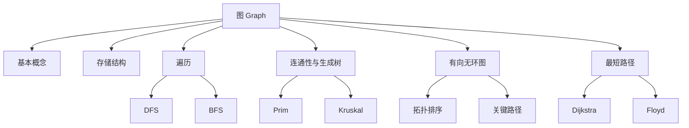

# 第 05 章｜图

> 408 · 数据结构 · 基础阶段。围绕图的存储、遍历、连通性、生成树、拓扑排序、关键路径与最短路径建立完整解题框架。算法适用条件必须与结论一起记忆。

## 01. 知识地图

## 02. 基本概念与性质

- **图**：由顶点集 $V$ 与边集 $E$ 构成，记为 $G=(V,E)$。
- **有向图**：边是有序对；**无向图**：边是无序对。
- **简单图**：不存在重复边和顶点到自身的边。
- **度**：无向图顶点 $v$ 的度为与其关联的边数；有向图区分入度 $id(v)$ 与出度 $od(v)$。
- **路径长度**：路径上边的数量；路径中顶点不重复时称简单路径。
- **连通图**：无向图任意两个顶点之间均存在路径；有向图需区分强连通与弱连通。
- **连通分量**：无向图中的极大连通子图；强连通分量是有向图中的极大强连通子图。

无向图的度数和等于边数的两倍：

$$
\sum_{v\in V}deg(v)=2|E|
$$

有向图中：

$$
\sum_{v\in V}id(v)=\sum_{v\in V}od(v)=|E|
$$

含 $n$ 个顶点的简单无向图最多有：

$$
\frac{n(n-1)}{2}
$$

条边。无向完全图每个顶点的度为 $n-1$。

## 03. 存储结构

### 邻接矩阵

使用 $n\times n$ 矩阵表示顶点之间是否有边或边权。

- 无向图的邻接矩阵对称。
- 无权图可用 0/1 表示边是否存在；带权图需约定无边时的特殊值。
- 判断两顶点是否邻接为 $O(1)$。
- 遍历某顶点的所有邻接点需扫描一行，时间为 $O(n)$。
- 空间复杂度为 $O(n^2)$，适合稠密图。

### 邻接表

每个顶点维护一条边结点链表（或动态数组），记录其邻接点及可选边权。

- 有向图邻接表通常存出边；逆邻接表存入边。
- 无向图每条边在两个顶点的表中各出现一次。
- 空间复杂度为 $O(n+|E|)$。
- 遍历某顶点邻接点的代价与该顶点的度成正比，适合稀疏图。

| 比较项     | 邻接矩阵           | 邻接表                 |
| :--------- | :----------------- | :--------------------- | --- | --- |
| 空间       | $O(n^2)$           | $O(n+                  | E   | )$  |
| 查边       | $O(1)$             | 最坏 $O(deg(v))$       |
| 遍历邻接点 | $O(n)$             | $O(deg(v))$            |
| 适合       | 稠密图             | 稀疏图                 |
| 无向图存边 | 矩阵对称位置各记录 | 两个顶点表中各记录一次 |

## 04. 图的遍历

### 深度优先搜索 DFS

从一个顶点出发，沿未访问的邻接点尽可能深入，无法继续时回退。必须在递归/入栈前标记访问，避免重复访问和无限递归。

算法框架：

1. 将当前顶点标记为已访问并访问它。
2. 依次检查其邻接点。
3. 对每个尚未访问的邻接点递归执行 DFS。
4. 若图不连通，对其他未访问顶点再次启动 DFS。

### 广度优先搜索 BFS

使用队列，按距离起点从近到远访问顶点。顶点应在入队时标记，避免重复入队。

算法框架：

1. 将起点标记为已访问并入队。
2. 队列非空时，队头顶点出队并访问。
3. 将该顶点所有未访问邻接点标记后入队。
4. 队列清空后，若仍有未访问顶点，则从其启动新一轮遍历。

| 存储结构 | DFS 时间 | BFS 时间 | 额外空间 |
| :------- | -------: | -------: | -------: | ----- | --- | --- | ------ |
| 邻接矩阵 | $O(n^2)$ | $O(n^2)$ |   $O(n)$ |
| 邻接表   |    $O(n+ |        E |       )$ | $O(n+ | E   | )$  | $O(n)$ |

DFS/BFS 的具体访问序列取决于邻接点的处理顺序。

## 05. 最小生成树

连通无向带权图的生成树包含全部顶点、恰有 $n-1$ 条边且无回路。最小生成树（MST）是所有生成树中边权总和最小者。

### Prim 算法

- 从任意顶点开始，维护已加入集合到未加入顶点的最小横切边。
- 每次选择权值最小的横切边，将新顶点加入。
- 常见邻接矩阵实现为 $O(n^2)$，适合稠密图。
- 适用于连通无向带权图。

### Kruskal 算法

- 将边按权值从小到大排序。
- 依次考察边，若两端点属于不同连通集合则选入，否则舍弃。
- 使用并查集判断是否连通；排序通常是主要开销，复杂度约为 $O(|E|\log |E|)$。
- 适合稀疏图。

**易错辨析：** MST 解决“连接所有顶点且总边权最小”；最短路径解决“从源点到目标点的路径长度最小”。二者目标不同。

## 06. 有向无环图：拓扑排序与关键路径

### 拓扑排序

对有向无环图（DAG）的顶点线性排序，使每条有向边 $u\to v$ 中 $u$ 都出现在 $v$ 之前。

Kahn 算法：

1. 计算每个顶点的入度。
2. 将所有入度为 0 的顶点入队。
3. 取出一个顶点并输出；删除其所有出边，对邻接点入度减 1。
4. 新产生入度为 0 的顶点入队。
5. 若输出顶点数小于 $n$，图中存在有向环，不存在拓扑序列。

邻接表实现时间复杂度为 $O(n+|E|)$。拓扑序列可能不唯一。

### 关键路径

AOE 网以顶点表示事件、边表示活动，边权表示活动持续时间。关键路径是从源点到汇点的最长路径，决定工程最短完成时间。

- 事件最早发生时间 $ve(v)$：按拓扑序递推，取所有前驱路径到达时间的最大值。
- 事件最迟发生时间 $vl(v)$：按逆拓扑序递推，取所有后继允许时间的最小值。
- 活动 $a_i=(u,v)$，持续时间为 $w_i$：
  - 最早开始时间：$e(a_i)=ve(u)$。
  - 最迟开始时间：$l(a_i)=vl(v)-w_i$。
  - 时间余量：$l(a_i)-e(a_i)$；余量为 0 的活动为关键活动。

关键路径长度为工程最短完成时间。活动持续时间变化后，关键路径可能改变；多条关键路径也可能同时存在。

## 07. 最短路径

### Dijkstra

求单源最短路径，要求边权非负。

- 初始化源点距离为 0，其余为无穷大。
- 每轮从未确定顶点中选取当前距离最小者，将其距离确定。
- 用该顶点松弛所有出边：若 $dist[u]+w(u,v)<dist[v]$，则更新。
- 邻接矩阵朴素实现为 $O(n^2)$；邻接表加优先队列可优化。

**不能用于存在负权边的图**，因为已确定的最短距离可能被后续负权路径改写。

### Floyd

求所有顶点对之间的最短路径，允许负权边，但不能存在负权回路。

$$
D_{ij}^{(k)}=
\min\left(D_{ij}^{(k-1)},D_{ik}^{(k-1)}+D_{kj}^{(k-1)}\right)
$$

三重循环依次枚举中间顶点 $k$、起点 $i$、终点 $j$。时间复杂度 $O(n^3)$，空间复杂度 $O(n^2)$。若最终某个 $D_{ii}<0$，说明存在负权回路。

| 算法     | 问题              | 权值限制             | 典型复杂度       |
| :------- | :---------------- | :------------------- | :--------------- |
| Dijkstra | 单源最短路径      | 非负权               | $O(n^2)$（朴素） |
| Floyd    | 多源/全源最短路径 | 可有负权，无负权回路 | $O(n^3)$         |

## 08. 常见失分点

1. 把无向边在邻接表中只存一次；实际上通常需要在两个顶点的表中各存一次。
2. DFS/BFS 忘记标记访问，或 BFS 出队后才标记导致重复入队。
3. 不连通图只从一个顶点开始遍历，遗漏其他连通分量。
4. 把拓扑排序误认为唯一序列；只要满足所有有向边的先后约束即可。
5. 关键路径求的是最长路径，不是最短路径；活动余量为 0 才是关键活动。
6. Prim/Kruskal 用于最小生成树，Dijkstra/Floyd 用于最短路径。
7. Dijkstra 不适用于负权边；Floyd 也不能解决含负权回路的最短路问题。

## 09. 章节自测

1. 含 8 个顶点的简单无向图最多有多少条边？若是完全图，每个顶点的度是多少？
2. 一个无向图有 12 条边，所有顶点度数之和是多少？
3. 邻接矩阵和邻接表分别更适合稠密图还是稀疏图？说明空间复杂度。
4. DFS 与 BFS 分别使用什么基本数据结构？BFS 为什么应在入队时标记？
5. 拓扑排序输出顶点数少于图的顶点数，能得出什么结论？
6. 某 AOE 网活动 $u\to v$ 的持续时间为 4，$ve(u)=6$、$vl(v)=13$，求活动最早开始、最迟开始时间和时间余量。
7. Dijkstra 与 Floyd 的适用问题和权值限制分别是什么？
8. Prim 与 Kruskal 的共同目标是什么？它们与最短路径算法有何区别？

## 10. 自测参考答案

1. 最多 $8\times7/2=28$ 条；完全图每个顶点度为 7。
2. 度数和为 $2|E|=24$。
3. 邻接矩阵 $O(n^2)$，适合稠密图；邻接表 $O(n+|E|)$，适合稀疏图。
4. DFS 通常使用递归栈/显式栈；BFS 使用队列。入队即标记可避免同一顶点被多个前驱重复入队。
5. 图中存在有向环，因此不是 DAG，不存在拓扑序列。
6. $e=ve(u)=6$；$l=vl(v)-4=9$；余量 $=9-6=3$，该活动不是关键活动。
7. Dijkstra 求单源最短路径，要求边权非负；Floyd 求全源最短路径，可有负权边但不能有负权回路。
8. 都求连通无向带权图的最小生成树；最短路径算法求指定源点/顶点对间路径长度最小，问题目标不同。

## 11. 复习清单

- [ ] 能从边集画出邻接矩阵和邻接表
- [ ] 能手工执行 DFS/BFS 并说明访问序列依赖的邻接顺序
- [ ] 能判断图的连通性并计算度数
- [ ] 能完整执行 Prim 与 Kruskal
- [ ] 能判断 DAG 并写出一种拓扑序列
- [ ] 能计算 AOE 网的 ve、vl、活动时间余量和关键路径
- [ ] 能手算 Dijkstra 与 Floyd，并说明算法适用条件
