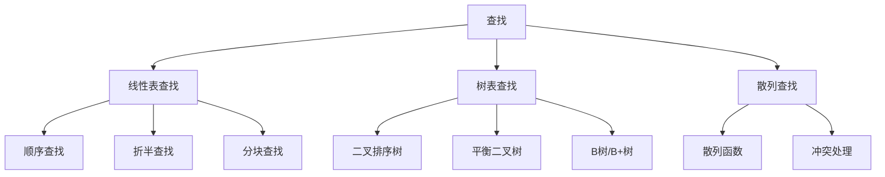
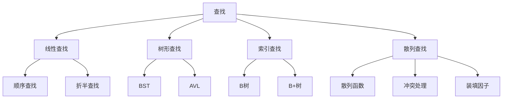

# 第 06 章｜查找

> 408 · 数据结构。查找算法不仅考查比较次数，还考查查找结构、成功/失败概率、平均查找长度（ASL）以及动态维护代价。

## 01. 知识地图



## 02. 平均查找长度 ASL

平均查找长度是查找过程中关键字比较次数的期望值。

若查找 $n$ 个记录，成功查找概率为 $p_i$，对应比较次数为 $c_i$，则：

$$
ASL_{成功}=\sum_{i=1}^{n}p_ic_i
$$

失败查找也需按各失败区间的概率加权：

$$
ASL_{失败}=\sum_j q_jc_j
$$

题目未给概率时，通常按等概率假设计算，但必须明确假设。查找长度的计数口径以题目定义为准。

## 03. 顺序查找

从表的一端开始逐个比较，直到找到目标或查找结束。

- 适用于顺序存储或链式存储。
- 不要求表有序。
- 成功查找在等概率条件下平均比较次数为 $(n+1)/2$。
- 查找失败通常需要比较 $n$ 次。

顺序查找适合数据规模较小、数据无序或需要频繁插入删除的场景。

## 04. 折半查找

折半查找要求查找表按关键字有序，并且支持随机访问，典型对象是有序顺序表。

每次比较中间元素，根据大小关系将查找区间缩小一半。时间复杂度为 $O(\log n)$，迭代实现额外空间可为 $O(1)$。

对长度为 $n$ 的有序表，判定树高度为 $O(\log n)$。成功与失败 ASL 应根据具体判定树和概率计算，不能把最坏比较次数直接当作平均查找长度。

## 05. 分块查找

将查找表分成若干块，块内可无序，但块间需满足索引所依据的有序关系。先查索引确定块，再在块内顺序查找。

平均代价由索引查找与块内查找两部分组成。若索引使用顺序查找，块数为 $m$、每块约 $n/m$ 个元素，等概率下粗略比较代价可写为：

$$
\frac{m+1}{2}+\frac{n/m+1}{2}
$$

该近似依赖块大小均匀、概率均匀等假设。

## 06. 二叉排序树 BST

二叉排序树满足：左子树所有关键字小于根，右子树所有关键字大于根（重复关键字处理需另行约定），左右子树也分别是二叉排序树。

- 查找、插入、删除的时间与树高 $h$ 成正比。
- 平均情况下可接近 $O(\log n)$，退化成单支树时最坏为 $O(n)$。
- 中序遍历得到递增序列。

删除结点：

1. 叶结点：直接删除。
2. 只有一个孩子：用孩子替代该结点。
3. 有两个孩子：用其中序前驱或中序后继替代，再删除被替代结点。

## 07. 平衡二叉树 AVL

AVL 树是高度平衡的二叉排序树。任意结点左右子树高度差的绝对值不超过 1。

插入导致失衡时，按失衡位置与插入方向分为 LL、RR、LR、RL 四种情况，通过单旋或双旋恢复平衡。AVL 树高度为 $O(\log n)$，查找、插入、删除均为对数级复杂度。

删除操作可能使多个祖先结点继续失衡，需要向上检查并调整。

## 08. B 树与 B+ 树

B 树是多路平衡查找树，适合外存索引：

- 结点可包含多个关键字和多个孩子。
- 所有叶结点处于同一层。
- 插入时结点溢出可能分裂；删除时可能借关键字或合并结点。

B+ 树的典型特征：

- 数据记录或记录指针集中在叶结点。
- 内部结点主要保存索引关键字。
- 叶结点通常按关键字顺序链接，便于范围查询。
- 内部结点关键字可能在叶结点再次出现。

具体阶数、最少关键字数和分裂规则需按教材采用的定义及题目约定判断。

## 09. 散列查找

散列函数将关键字映射为地址：

$$
H(key)\in[0,m-1]
$$

不同关键字映射到同一地址称为冲突。常见冲突处理：

- 开放定址：线性探测、平方探测、再散列。
- 拉链法：同一散列地址的记录组织成链表或桶。

装填因子：

$$
\alpha=\frac{\text{表中记录数}}{\text{散列表长度}}
$$

装填因子越大，冲突通常越多。散列查找平均性能还取决于散列函数、冲突处理方式和关键字分布；不能只由 $\alpha$ 单独精确确定。

## 10. 方法比较

| 方法     | 前提/结构      | 平均性能概述          | 最坏时间    |
| :------- | :------------- | :-------------------- | :---------- |
| 顺序查找 | 无序也可       | $O(n)$                | $O(n)$      |
| 折半查找 | 有序且随机访问 | $O(\log n)$           | $O(\log n)$ |
| BST      | 二叉排序树     | 依赖树形              | $O(n)$      |
| AVL      | 平衡二叉排序树 | $O(\log n)$           | $O(\log n)$ |
| 散列查找 | 散列表         | 适当条件下接近 $O(1)$ | $O(n)$      |

## 11. 常见失分点

1. 忘记折半查找要求有序表与随机访问。
2. 将 BST 的平均复杂度当作最坏复杂度。
3. AVL 插入时混淆 LL/RR 单旋与 LR/RL 双旋。
4. B 树与 B+ 树的记录存放位置、叶结点链接特征混淆。
5. 散列冲突处理时探测序列计算错误。
6. 将装填因子直接等同于平均查找长度。

## 12. 章节自测

1. 折半查找能否直接用于无序单链表？为什么？
2. 长度为 9 的表，顺序查找成功且等概率时 ASL 是多少？
3. BST 的最坏查找时间复杂度是多少？什么情况下发生？
4. AVL 树通过哪四类调整处理插入失衡？
5. B+ 树叶结点链接对范围查询有什么帮助？
6. 散列表长度为 20、已有 15 个记录，装填因子是多少？
7. 散列查找是否保证最坏 $O(1)$？

## 13. 自测参考答案

1. 不能直接使用。折半查找要求有序且能高效随机访问中间元素，单链表不满足随机访问条件。
2. $(9+1)/2=5$ 次。
3. $O(n)$；当插入序列使 BST 退化为单支树时。
4. LL、RR、LR、RL。
5. 可沿叶结点链顺序扫描连续关键字，减少范围查询时反复从根查找。
6. $\alpha=15/20=0.75$。
7. 不保证；冲突严重时最坏可退化为 $O(n)$。

## 14. 复习清单

- [ ] 能计算顺序查找与折半查找的查找长度
- [ ] 能构造 BST 并执行插入、删除
- [ ] 能识别 AVL 四种失衡并完成旋转
- [ ] 能比较 B 树与 B+ 树
- [ ] 能构造散列表并处理冲突
- [ ] 能按题目概率计算成功/失败 ASL

---

## 15. 本章五大经典学习法｜查找与平均查找长度

### 15.1 费曼学习法：解释“找得到”与“找得快”的区别

查找是在数据集合中确定目标记录的位置或判断目标是否存在。不同查找方法依赖的数据组织方式不同：

- **顺序查找**像逐个检查名单，不要求有序，但最坏可能检查全部 n 个记录。
- **折半查找**像猜数字，每次排除一半范围；前提是表有序且能快速访问中间位置。
- **BST**像按大小分支的问答树，查找代价取决于树高；若插入顺序不合理，树可能退化成链。
- **AVL**通过旋转保持高度平衡，使查找路径维持对数级。
- **B/B+ 树**像多层目录索引，适合外存访问；B+ 树叶结点有序链接，便于范围查询。
- **散列查找**通过散列函数定位桶，平均情况下可能很快，但冲突处理决定实际代价。

**费曼复述练习：**

1. 为什么折半查找不能直接用于无序单链表？
2. 为什么 BST 平均可能很快，但最坏仍是 O(n)？
3. AVL 树如何用 LL、RR、LR、RL 调整失衡？
4. B+ 树叶结点链接对范围查询有什么帮助？
5. 为什么散列查找不能保证最坏 O(1)？

**边界提醒：** ASL 是比较次数的期望值，必须结合成功/失败概率和题目计数口径；不能把最坏比较次数直接当作平均查找长度。

### 15.2 西蒙学习法：把查找结构拆成五个知识块

| 模块 | 内容 | 前置关系 | 达标练习 |
|---|---|---|---|
| A. ASL 基础 | 成功/失败概率、比较次数、期望 | 概率与求和 | 按给定概率计算 ASL |
| B. 线性查找 | 顺序、折半、分块 | 有序性、随机访问 | 画判定过程并计算比较次数 |
| C. 二叉查找树 | BST 查找、插入、删除 | 二叉树遍历 | 构造 BST 并处理三种删除情形 |
| D. 平衡与多路树 | AVL、B 树、B+ 树 | BST、树高 | 判断旋转类型，比较结点结构 |
| E. 散列 | 散列函数、冲突、探测、装填因子 | 数组与链表 | 手算线性探测/拉链法 |

**练习反馈阶梯：**

1. 先画出数据结构，再运行查找过程。
2. 记录每一步比较的关键字和比较次数。
3. 计算成功/失败 ASL，写出概率假设。
4. 最后比较最坏情况与维护代价。
5. 每次错题归类为：先决条件遗漏、树形构造错误、旋转判断错误、探测序列错误或概率加权错误。

### 15.3 SQ3R 阅读法：围绕前提条件提问

- **Survey 浏览：** 先看查找方法比较表、BST/AVL 图、B/B+ 树结构和散列冲突示意。
- **Question 提问：** 折半查找需要什么前提？BST 何时退化？AVL 旋转如何判断？B+ 树为何适合范围查找？装填因子能否单独决定 ASL？
- **Read 精读：** 对每种方法标注“数据前提、查找步骤、成功/失败代价、最坏边界”。
- **Recite 复述：** 合上笔记，构造一棵 BST、完成一次 AVL 旋转、手算一个散列表探测过程。
- **Review 复习：** 当天重做 ASL，次日重建 BST，第 3 天重做 AVL 和 B+ 树，第 7 天做散列综合题。

**自问清单：**

1. 顺序查找在等概率且目标必定存在时 ASL 为什么是 (n+1)/2？
2. 折半查找失败时会落在什么位置？
3. BST 删除叶子、单孩子、双孩子结点分别如何处理？
4. AVL 插入导致的四种失衡如何从插入路径判断？
5. B 树和 B+ 树的数据记录/索引分别如何组织？
6. 线性探测发生冲突后，下一次探测位置如何计算？
7. 装填因子 α 增大时，为什么冲突通常会增多？

### 15.4 番茄工作法：五个番茄完成查找

| 番茄 | 25 分钟任务 | 可验收产出 |
|---|---|---|
| 1 | ASL 与顺序/折半查找 | 完成 4 道比较次数与概率题 |
| 2 | BST 构造、查找和删除 | 构造一棵 BST 并完成三类删除 |
| 3 | AVL 旋转 | 各完成 LL、RR、LR、RL 一例 |
| 4 | B 树/B+ 树 | 画出结点结构并比较范围查询 |
| 5 | 散列与冲突处理 | 完成线性探测和拉链法构造 |

每轮休息 5 分钟。若计算 ASL 出错，先列出每个查找目标的比较次数，再乘概率，不要直接套公式。

### 15.5 康奈尔笔记法：查找方法对照卡

| 左侧线索 / 问题 | 右侧主体笔记 |
|---|---|
| ASL 成功查找？ | ASL成功=Σpᵢcᵢ，pᵢ 是查找第 i 个记录的概率，cᵢ 是比较次数。 |
| 顺序查找前提？ | 不要求有序；等概率且目标必定存在时成功 ASL=(n+1)/2。 |
| 折半查找前提？ | 关键字有序且支持随机访问，典型结构是有序顺序表。 |
| BST 最坏复杂度？ | O(n)，当树退化为单支链时发生。 |
| AVL 的核心？ | 任意结点左右子树高度差绝对值不超过 1，通过四类旋转恢复平衡。 |
| B+ 树优势？ | 内部结点主要保存索引，记录集中在叶结点且叶结点有序链接，适合范围查询。 |
| 散列冲突？ | 不同关键字映射到同一地址；可用开放定址或拉链法处理。 |
| 装填因子？ | α=记录数/散列表长度；增大通常使冲突增加，但不能单独精确决定 ASL。 |

**页底总结：** 查找算法选择取决于数据是否有序、是否支持随机访问、是否需要动态更新、是否进行范围查询。比较性能时必须区分平均与最坏情况，并明确概率假设。

### 15.6 五法融合自测

1. 长度为 11 的表，顺序查找成功且等概率、目标必定存在，ASL 是多少？
2. 折半查找为什么不适合无序单链表？
3. BST 依次插入 1、2、3、4，树高会怎样变化？最坏查找复杂度是多少？
4. AVL 插入导致根结点左子树的左孩子继续增高，属于哪类失衡？
5. B+ 树叶结点有序链接最直接支持哪类查询？
6. 表长 40，已有 30 个记录，装填因子是多少？
7. 散列查找最坏情况下是否保证 O(1)？

**答案要点：** 1. (11+1)/2=6；2. 缺少有序性且单链表不支持随机访问；3. 退化为单支树，高度随 n 线性增长，最坏 O(n)；4. LL；5. 范围查询/顺序扫描；6. 0.75；7. 不保证，冲突严重时可退化到 O(n)。

**本章通关条件：**

- [ ] 能按概率计算成功/失败 ASL
- [ ] 能说明顺序、折半、分块查找的前提
- [ ] 能构造 BST 并完成删除
- [ ] 能识别 AVL 四种旋转
- [ ] 能比较 B 树与 B+ 树
- [ ] 能构造散列表并处理冲突


## 我的笔记记录

> 概念卡

<table>
<tr>
<td width="50%" valign="top">

### 🔎 顺序查找与折半查找
顺序查找不要求有序；折半查找依赖有序性和随机访问。

- 顺序查找成功 ASL（等概率且必定命中）：(n+1)/2
- 折半查找：每轮缩小约一半，O(log n)
- 单链表不适合直接折半查找

[打开概念卡 28｜顺序查找与折半查找](./概念卡/28-顺序查找与折半查找.md)

</td>
<td width="50%" valign="top">

### 🌲 BST 二叉排序树
左子树关键字小于根，右子树关键字大于根；中序遍历有序。

- 查找、插入、删除均为 O(h)
- 平衡时 O(log n)，退化时 O(n)
- 删除分叶结点、单孩子、双孩子三类

[打开概念卡 29｜BST 查找、插入与删除](./概念卡/29-BST二叉排序树查找插入与删除.md)

</td>
</tr>
<tr>
<td width="50%" valign="top">

### ⚖️ AVL 平衡二叉树
通过旋转保证每个结点左右子树高度差绝对值不超过 1。

- LL：右旋；RR：左旋
- LR：先左后右；RL：先右后左
- 查找/插入/删除 O(log n)

[打开概念卡 30｜AVL 与四种旋转](./概念卡/30-AVL平衡二叉树与四种旋转.md)

</td>
<td width="50%" valign="top">

### 🗂️ B 树与 B+ 树
多路平衡索引降低树高，适合外存/磁盘访问。

- B+ 树记录集中于叶结点
- 叶结点通常有序链接
- 范围查询可沿叶链顺序扫描

[打开概念卡 31｜B 树与 B+ 树](./概念卡/31-B树与B加树外存索引.md)

</td>
</tr>
<tr>
<td width="50%" valign="top">

### #️⃣ 散列与冲突处理
散列函数把关键字映射到地址；冲突需开放定址或拉链法处理。

- 装填因子 α=n/m
- 线性探测按模表长循环
- 平均可接近 O(1)，最坏 O(n)

[打开概念卡 32｜散列与装填因子](./概念卡/32-散列函数冲突处理与装填因子.md)

</td>
<td width="50%" valign="top">

### 🧠 本章核心判断
查找方法选择由数据组织方式决定：是否有序、是否随机访问、是否动态更新、是否需要范围查询。

- 先检查前提，再套算法
- 区分平均性能与最坏边界
- ASL 必须明确概率与计数口径

</td>
</tr>
</table>

> 知识卡

### 01. 查找方法知识地图



### 02. 查找方法双栏对照

<table>
<tr><td width="50%" valign="top">

**线性表查找**

| 方法 | 前提 | 典型代价 |
|---|---|---|
| 顺序 | 无序也可 | O(n) |
| 折半 | 有序+随机访问 | O(log n) |

关键点：折半查找的效率不仅依赖有序，还依赖快速定位中间元素。

</td><td width="50%" valign="top">

**树与索引查找**

| 结构 | 关键性质 | 最坏边界 |
|---|---|---|
| BST | 左小右大 | O(n) |
| AVL | 高度平衡 | O(log n) |
| B/B+ | 多路平衡 | 对数级层数 |

关键点：BST 不自动平衡；B+ 树叶链支持范围查询。

</td></tr>
<tr><td width="50%" valign="top">

**散列查找**

- H(key) 将关键字映射为表地址
- 冲突：开放定址 / 拉链法
- α=n/m，越拥挤通常越容易冲突
- 平均性能依赖函数、策略和数据分布

</td><td width="50%" valign="top">

**解题检查顺序**

1. 先判断数据是否有序
2. 再判断是否支持随机访问
3. 明确是否需要动态插入/删除
4. 明确是否需要范围查询
5. 最后计算 ASL、平均与最坏复杂度

</td></tr>
</table>

### 03. 本章五法复习闭环

- **费曼**：不看笔记解释折半查找前提、BST 退化原因、AVL 旋转与散列冲突。
- **西蒙**：按 ASL、线性查找、BST/AVL、B/B+、散列五块拆分，逐块验收。
- **SQ3R**：围绕“前提是什么、状态如何变化、最坏会怎样”提问并复述。
- **番茄**：五轮 25 分钟，依次完成 ASL、折半、BST、AVL、散列练习。
- **康奈尔**：左侧记前提和易错问句，右侧记录算法状态与计算过程，页底写适用条件。

**本章通关标准：** 能独立计算 ASL；手画 BST 插入/删除；识别并执行 AVL 四种旋转；解释 B+ 树范围查询优势；手算冲突探测并分析装填因子。


## 04. C 语言实现实验与过程追踪

本章的代码训练按数据组织方式分层：线性表查找、树形查找、外存多路索引、散列表。不要只背复杂度，必须先确认数据结构的前提和操作约束。

| 实验主题 | 实现/推演重点 | 必须掌握的边界 | 概念卡 |
|---|---|---|---|
| 顺序与折半查找 | 循环区间、mid、失败出口 | 有序、随机访问、重复关键字 | [28](./概念卡/28-顺序查找与折半查找.md) |
| BST | 查找、插入、三类删除 | 退化树、前驱/后继、内存释放 | [29](./概念卡/29-BST二叉排序树查找插入与删除.md) |
| AVL | 插入/删除、祖先回溯、左右旋转 | 删除后可能连续失衡；重子树 BF=0 时也要正确单旋 | [30](./概念卡/30-AVL平衡二叉树与四种旋转.md) |
| B/B+ 树 | 插入、分裂、范围查询 | 阶数定义、根结点例外、叶链 | [31](./概念卡/31-B树与B加树外存索引.md) |
| 散列 | 线性探测、查找、删除标记 | 模运算回绕、EMPTY/DELETED 区分 | [32](./概念卡/32-散列函数冲突处理与装填因子.md) |

### 本章综合自测（先独立作答，再核对）

**题 1｜折半查找**：在升序表 `[1,3,5,7,9,11,13]` 中查找 9，写出每轮 low、high、mid。若要求返回第一个等于 9 的位置，普通命中后立即返回是否足够？

**解析**：区间依次为 [0,6]、[4,6]、[4,4]，mid 依次为 3、5、4，最后命中下标 4。当前关键字只有一个 9，普通返回足够；若存在重复关键字，要求最左位置时命中后还要继续向左收缩并记录候选下标。

**题 2｜BST 删除**：插入 `50,30,70,20,40,60,80` 后删除 50，使用中序后继替换，写出最终中序序列。

**解析**：50 的中序后继是右子树最小结点 60。用 60 替换根关键字，再删除右子树原位置的 60，最终中序序列为 `20,30,40,60,70,80`。

**题 3｜AVL 旋转**：依次插入 30、10、20，属于哪类失衡？

**解析**：新结点位于根的左孩子的右子树，属于 LR。先对 10 左旋，再对 30 右旋，最终根为 20，左右孩子为 10、30。

**题 4｜B 树分裂**：若题目规定 B 树最大孩子数为 3，最多有几个关键字？插入导致关键字数超限时，核心动作是什么？

**解析**：非根结点最多 2 个关键字；溢出后将中间关键字上升到父结点，左右两部分形成两个结点。根分裂时创建新根。注意其他教材对“阶”的定义可能不同，必须先读清题设。

**题 5｜散列删除**：线性探测表中，三个同义词依次占据 0、1、2。删除位置 1 后，查找位置 2 的记录时能否在位置 1 停止？

**解析**：不能。位置 1 应标记为 DELETED，查找继续探测；若直接置为 EMPTY，会错误地提前终止查找。

### 统一验收清单

- [ ] 折半查找能写出循环不变量，且不会出现死循环
- [ ] BST 能画出三种删除后的指针变化
- [ ] AVL 能识别四种失衡并保持中序序列不变
- [ ] B/B+ 树题先声明阶数定义，再做分裂推演
- [ ] 散列能区分从未使用槽与删除标记
- [ ] 每道题能解释平均、最坏复杂度的成立条件

### 五法复习闭环

- **费曼**：不看笔记讲清楚“数据是否有序、是否支持随机访问、是否需要动态更新”如何决定查找结构。
- **西蒙**：按线性查找、树查找、外存索引、散列四类拆解，再逐个攻克核心操作。
- **SQ3R**：浏览结构图，提出前提与边界问题，精读算法，合上资料重做五道综合题。
- **番茄**：25 分钟完成两道手算题，休息 5 分钟；再用 25 分钟复写一个核心算法。
- **康奈尔**：左栏记录适用前提和易错点，右栏记录算法状态、树形变化与计算过程，底部写出结构选择原则。


## 16. 可运行 C11 综合实验

源码：[`实验代码/search_lab.c`](./实验代码/search_lab.c)

在仓库根目录编译运行：

```bash
cc -std=c11 -Wall -Wextra -Wpedantic -O2 \
  "Project/Artificial Intelligence/02_408/数据结构/实验代码/search_lab.c" \
  -o search_lab
./search_lab
```

实验覆盖：

| 模块 | 自动验收内容 | 关键边界 |
|---|---|---|
| 顺序查找 | 命中、未命中、重复关键字 | 空表 |
| 折半查找 | 首尾元素、未命中、重复值返回最左位置 | 空表、有序前提 |
| BST | 查找、重复值策略、插入、三类删除 | 叶结点/单孩子/双孩子 |
| AVL | LL、RR、LR、RL 插入旋转；删除后四类再平衡 | 高度更新、祖先回溯、重子树 BF=0 |
| 散列 | 线性探测、查找、删除、墓碑复用 | 冲突链、负数模运算 |

**实现约定：** 本实验 BST/AVL 对重复关键字采取忽略策略；折半查找返回重复关键字的最左下标；散列表将槽位区分为 EMPTY、OCCUPIED、DELETED，查找遇到 DELETED 必须继续探测。AVL 示例覆盖四种插入旋转，不代表已覆盖 AVL 删除后的向上回溯调整。

### 五大经典学习法｜代码实验闭环

- **费曼学习法：** 不看源码解释为什么 BST 删除双孩子结点要找中序后继，以及为什么 DELETED 不能当作 EMPTY。
- **西蒙学习法：** 将实验拆成线性表、BST、AVL、散列四个模块，先独立通过，再组合验收。
- **SQ3R 阅读法：** 编译前先预测每组断言结果；精读循环边界与指针更新；运行后复述失败原因。
- **番茄工作法：** 每 25 分钟完成一个模块的手算、编码或测试，休息 5 分钟后再进入下一模块。
- **康奈尔笔记法：** 左栏记录前提与易错点，右栏记录状态变化和测试输出，页底总结时间复杂度及适用场景。

**通关标准：** 不仅要让程序通过，还要能手画一次查找路径、一次 BST 双孩子删除、四种 AVL 旋转，并解释散列表墓碑标记的必要性。

### AVL 删除：为什么不能只调整第一个失衡结点？

AVL 删除与插入的关键差异：删除某个结点后，子树高度可能持续下降，因此从删除位置向根回溯时，**多个祖先结点都可能依次失衡**。不能像部分插入场景那样，完成一次旋转就无条件停止。

删除流程：

1. 按 BST 规则递归找到目标结点。
2. 叶结点直接释放；只有一个孩子时由孩子接替；有两个孩子时用右子树最小结点（中序后继）替换，再递归删除后继。
3. 递归返回每一层时，先更新当前结点高度，再计算平衡因子 `BF = h(left) - h(right)`。
4. 若 `BF > 1`，检查左孩子的 BF：左孩子 BF 大于等于 0，右旋；小于 0，先左旋左孩子，再右旋当前结点。
5. 若 `BF < -1`，检查右孩子的 BF：右孩子 BF 小于等于 0，左旋；大于 0，先右旋右孩子，再左旋当前结点。
6. 将旋转后的新子树根返回上一层，继续向根回溯。

**删除特有易错点：** 重子树的 BF 等于 0 时，仍应执行对应的单旋。判断条件应覆盖 `>= 0` 或 `<= 0`，不能误写成只判断严格大于/小于 0。

| 当前结点失衡 | 重子树 BF | 调整 |
|---|---:|---|
| 左高（BF > 1） | 左孩子 BF ≥ 0 | LL：右旋 |
| 左高（BF > 1） | 左孩子 BF < 0 | LR：先左旋左孩子，再右旋 |
| 右高（BF < -1） | 右孩子 BF ≤ 0 | RR：左旋 |
| 右高（BF < -1） | 右孩子 BF > 0 | RL：先右旋右孩子，再左旋 |

### AVL 删除实验覆盖

`实验代码/search_lab.c` 现已增加 `avl_delete` 与统一再平衡函数：

- 叶结点、单孩子、双孩子删除；
- 删除触发的 LL、RR、LR、RL 四种再平衡；
- 重子树平衡因子为 0 的单旋边界；
- 连续删除整棵树，逐次验证 BST 有序性、结点高度与 AVL 平衡不变量。

运行方式不变：

```bash
cc -std=c11 -Wall -Wextra -Wpedantic -O2 \
  "Project/Artificial Intelligence/02_408/数据结构/实验代码/search_lab.c" \
  -o search_lab
./search_lab
```

**验收要求：** 每次删除后都检查 `avl_valid`；不能只检查最终中序序列，还要验证每个结点存储的高度与左右子树高度差。