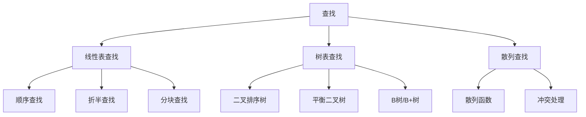

# 第 06 章｜查找

> 408 · 数据结构。查找算法不仅考查比较次数，还考查查找结构、成功/失败概率、平均查找长度（ASL）以及动态维护代价。

## 01. 知识地图

## 02. 平均查找长度 ASL

平均查找长度是查找过程中关键字比较次数的期望值。

若查找 $n$ 个记录，成功查找概率为 $p_i$，对应比较次数为 $c_i$，则：

$$
ASL_{成功}=\sum_{i=1}^{n}p_ic_i
$$

失败查找也需按各失败区间的概率加权：

$$
ASL_{失败}=\sum_j q_jc_j
$$

题目未给概率时，通常按等概率假设计算，但必须明确假设。查找长度的计数口径以题目定义为准。

## 03. 顺序查找

从表的一端开始逐个比较，直到找到目标或查找结束。

- 适用于顺序存储或链式存储。
- 不要求表有序。
- 成功查找在等概率条件下平均比较次数为 $(n+1)/2$。
- 查找失败通常需要比较 $n$ 次。

顺序查找适合数据规模较小、数据无序或需要频繁插入删除的场景。

## 04. 折半查找

折半查找要求查找表按关键字有序，并且支持随机访问，典型对象是有序顺序表。

每次比较中间元素，根据大小关系将查找区间缩小一半。时间复杂度为 $O(\log n)$，迭代实现额外空间可为 $O(1)$。

对长度为 $n$ 的有序表，判定树高度为 $O(\log n)$。成功与失败 ASL 应根据具体判定树和概率计算，不能把最坏比较次数直接当作平均查找长度。

## 05. 分块查找

将查找表分成若干块，块内可无序，但块间需满足索引所依据的有序关系。先查索引确定块，再在块内顺序查找。

平均代价由索引查找与块内查找两部分组成。若索引使用顺序查找，块数为 $m$、每块约 $n/m$ 个元素，等概率下粗略比较代价可写为：

$$
\frac{m+1}{2}+\frac{n/m+1}{2}
$$

该近似依赖块大小均匀、概率均匀等假设。

## 06. 二叉排序树 BST

二叉排序树满足：左子树所有关键字小于根，右子树所有关键字大于根（重复关键字处理需另行约定），左右子树也分别是二叉排序树。

- 查找、插入、删除的时间与树高 $h$ 成正比。
- 平均情况下可接近 $O(\log n)$，退化成单支树时最坏为 $O(n)$。
- 中序遍历得到递增序列。

删除结点：

1. 叶结点：直接删除。
2. 只有一个孩子：用孩子替代该结点。
3. 有两个孩子：用其中序前驱或中序后继替代，再删除被替代结点。

## 07. 平衡二叉树 AVL

AVL 树是高度平衡的二叉排序树。任意结点左右子树高度差的绝对值不超过 1。

插入导致失衡时，按失衡位置与插入方向分为 LL、RR、LR、RL 四种情况，通过单旋或双旋恢复平衡。AVL 树高度为 $O(\log n)$，查找、插入、删除均为对数级复杂度。

删除操作可能使多个祖先结点继续失衡，需要向上检查并调整。

## 08. B 树与 B+ 树

B 树是多路平衡查找树，适合外存索引：

- 结点可包含多个关键字和多个孩子。
- 所有叶结点处于同一层。
- 插入时结点溢出可能分裂；删除时可能借关键字或合并结点。

B+ 树的典型特征：

- 数据记录或记录指针集中在叶结点。
- 内部结点主要保存索引关键字。
- 叶结点通常按关键字顺序链接，便于范围查询。
- 内部结点关键字可能在叶结点再次出现。

具体阶数、最少关键字数和分裂规则需按教材采用的定义及题目约定判断。

## 09. 散列查找

散列函数将关键字映射为地址：

$$
H(key)\in[0,m-1]
$$

不同关键字映射到同一地址称为冲突。常见冲突处理：

- 开放定址：线性探测、平方探测、再散列。
- 拉链法：同一散列地址的记录组织成链表或桶。

装填因子：

$$
\alpha=\frac{\text{表中记录数}}{\text{散列表长度}}
$$

装填因子越大，冲突通常越多。散列查找平均性能还取决于散列函数、冲突处理方式和关键字分布；不能只由 $\alpha$ 单独精确确定。

## 10. 方法比较

| 方法     | 前提/结构      | 平均性能概述          | 最坏时间    |
| :------- | :------------- | :-------------------- | :---------- |
| 顺序查找 | 无序也可       | $O(n)$                | $O(n)$      |
| 折半查找 | 有序且随机访问 | $O(\log n)$           | $O(\log n)$ |
| BST      | 二叉排序树     | 依赖树形              | $O(n)$      |
| AVL      | 平衡二叉排序树 | $O(\log n)$           | $O(\log n)$ |
| 散列查找 | 散列表         | 适当条件下接近 $O(1)$ | $O(n)$      |

## 11. 常见失分点

1. 忘记折半查找要求有序表与随机访问。
2. 将 BST 的平均复杂度当作最坏复杂度。
3. AVL 插入时混淆 LL/RR 单旋与 LR/RL 双旋。
4. B 树与 B+ 树的记录存放位置、叶结点链接特征混淆。
5. 散列冲突处理时探测序列计算错误。
6. 将装填因子直接等同于平均查找长度。

## 12. 章节自测

1. 折半查找能否直接用于无序单链表？为什么？
2. 长度为 9 的表，顺序查找成功且等概率时 ASL 是多少？
3. BST 的最坏查找时间复杂度是多少？什么情况下发生？
4. AVL 树通过哪四类调整处理插入失衡？
5. B+ 树叶结点链接对范围查询有什么帮助？
6. 散列表长度为 20、已有 15 个记录，装填因子是多少？
7. 散列查找是否保证最坏 $O(1)$？

## 13. 自测参考答案

1. 不能直接使用。折半查找要求有序且能高效随机访问中间元素，单链表不满足随机访问条件。
2. $(9+1)/2=5$ 次。
3. $O(n)$；当插入序列使 BST 退化为单支树时。
4. LL、RR、LR、RL。
5. 可沿叶结点链顺序扫描连续关键字，减少范围查询时反复从根查找。
6. $\alpha=15/20=0.75$。
7. 不保证；冲突严重时最坏可退化为 $O(n)$。

## 14. 复习清单

- [ ] 能计算顺序查找与折半查找的查找长度
- [ ] 能构造 BST 并执行插入、删除
- [ ] 能识别 AVL 四种失衡并完成旋转
- [ ] 能比较 B 树与 B+ 树
- [ ] 能构造散列表并处理冲突
- [ ] 能按题目概率计算成功/失败 ASL
