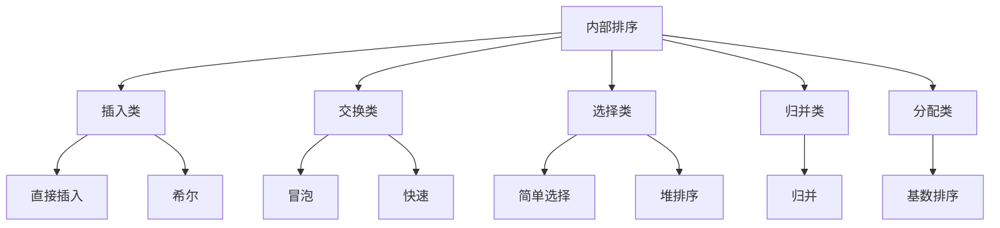

# 第 07 章｜排序

> 408 · 数据结构。排序题重点掌握每趟排序后的序列变化、比较/移动次数、稳定性、空间复杂度与适用场景。分析复杂度时区分最好、平均和最坏情况。

## 01. 知识地图

~~~mermaid
flowchart TD
 A[排序] --> B[插入排序]
 A --> C[交换排序]
 A --> D[选择排序]
 A --> E[归并排序]
 A --> F[基数排序]
 B --> B1[直接插入]
 B --> B2[希尔]
 C --> C1[冒泡]
 C --> C2[快速]
 D --> D1[简单选择]
 D --> D2[堆排序]
~~~

## 02. 基本概念

- 稳定排序：相同关键字记录排序后相对次序不变。
- 原地排序：辅助空间为 $O(1)$（通常不计少量变量）。
- 内部排序：待排序记录主要在内存中完成排序。
- 外部排序：数据规模超出内存，需要外存参与。

比较排序的性能受关键字比较次数、记录移动次数和数据初始状态影响。

## 03. 插入排序

### 直接插入排序

将当前记录插入前面已经有序的子序列中，向后移动大于当前关键字的记录。

- 最好：$O(n)$，输入已基本有序且实现可检测有序。
- 平均/最坏：$O(n^2)$。
- 辅助空间：$O(1)$。
- 稳定。

### 希尔排序

按递减增量分组，对各组进行直接插入排序，最后增量为 1。

希尔排序通常不稳定；时间复杂度依赖增量序列，不能脱离增量方案给出唯一复杂度结论。

## 04. 交换排序

### 冒泡排序

重复比较相邻元素，将较大（或较小）元素逐步移动到目标端。若一趟没有发生交换，可提前结束。

- 最好：$O(n)$（带提前结束标志）。
- 平均/最坏：$O(n^2)$。
- 辅助空间：$O(1)$。
- 稳定。

### 快速排序

选择枢轴，将序列划分为小于枢轴与大于枢轴的两部分，再递归排序子区间。

- 平均：$O(n\log n)$。
- 最坏：$O(n^2)$，例如枢轴持续选到极端元素。
- 递归栈平均 $O(\log n)$，最坏 $O(n)$。
- 通常不稳定。

快速排序性能与枢轴策略和输入分布有关；随机枢轴或三数取中可降低退化概率，但不改变经典最坏复杂度上界。

## 05. 选择排序

### 简单选择排序

每趟从未排序区间选出最小元素，与未排序区间首元素交换。

- 最好/平均/最坏：$O(n^2)$ 次比较。
- 辅助空间：$O(1)$。
- 通常不稳定（交换可能改变相同关键字次序）。

### 堆排序

利用大根堆或小根堆反复选取最大/最小关键字，并调整剩余元素保持堆性质。

- 建堆：$O(n)$。
- 总时间：$O(n\log n)$。
- 辅助空间：$O(1)$（原地堆排序）。
- 不稳定。

## 06. 归并排序

将序列分成两半，分别排序后合并两个有序序列。

- 最好/平均/最坏：$O(n\log n)$。
- 数组实现通常需要 $O(n)$ 辅助空间。
- 稳定（合并时相等元素优先取左侧记录）。

递归式：

$$
T(n)=2T(n/2)+O(n)
$$

因此：

$$
T(n)=O(n\log n)
$$

## 07. 基数排序

按关键字的各位（或各个字符位置）进行多趟分配与收集，通常要求每一趟使用稳定的子排序。

若记录数为 $n$、位数为 $d$、每位取值范围为 $r$，典型时间复杂度为 $O(d(n+r))$，空间复杂度通常为 $O(n+r)$。具体复杂度依赖关键字表示与实现。

基数排序不依赖关键字比较，适合位数有限、可按位分解的关键字。

## 08. 复杂度与稳定性总表

| 算法 | 最好时间 | 平均时间 | 最坏时间 | 辅助空间 | 稳定性 |
|:---|:---:|:---:|:---:|:---:|:---:|
| 直接插入 | $O(n)$ | $O(n^2)$ | $O(n^2)$ | $O(1)$ | 稳定 |
| 希尔 | 依增量序列 | 依增量序列 | 依增量序列 | $O(1)$ | 不稳定 |
| 冒泡 | $O(n)$ | $O(n^2)$ | $O(n^2)$ | $O(1)$ | 稳定 |
| 快速 | $O(n\log n)$ | $O(n\log n)$ | $O(n^2)$ | 平均 $O(\log n)$ 递归栈 | 不稳定 |
| 简单选择 | $O(n^2)$ | $O(n^2)$ | $O(n^2)$ | $O(1)$ | 不稳定 |
| 堆排序 | $O(n\log n)$ | $O(n\log n)$ | $O(n\log n)$ | $O(1)$ | 不稳定 |
| 归并 | $O(n\log n)$ | $O(n\log n)$ | $O(n\log n)$ | $O(n)$ | 稳定 |
| 基数 | $O(d(n+r))$ | $O(d(n+r))$ | $O(d(n+r))$ | $O(n+r)$ | 稳定（稳定分配收集） |

## 09. 典型题目分析方法

对给定序列手算排序过程时：
1. 写出初始序列并标记每趟边界。
2. 插入排序记录每次插入后的有序前缀。
3. 快速排序明确枢轴与划分策略；不同实现每趟序列可能不同。
4. 堆排序画出完全二叉树，区分建堆与每次交换后的筛选。
5. 归并排序按子序列长度逐轮合并。
6. 稳定性题用相同关键字但不同原始次序的记录构造反例。

## 10. 常见失分点

1. 把希尔排序复杂度写成不依赖增量序列的固定值。
2. 忘记快速排序最坏可达 $O(n^2)$。
3. 将简单选择排序误判为稳定。
4. 混淆堆排序建堆 $O(n)$ 与总排序 $O(n\log n)$。
5. 归并排序遗漏数组辅助空间。
6. 快速排序空间复杂度未说明递归栈与最坏情况。
7. 基数排序每一趟子排序不稳定，可能破坏前面位次序。

## 11. 章节自测

1. 哪些常见排序算法是稳定的：直接插入、希尔、冒泡、快速、简单选择、堆、归并？
2. 快速排序最坏时间复杂度是多少？
3. 堆排序建堆的时间复杂度是多少？
4. 归并排序通常需要多少辅助空间？
5. 为什么基数排序要求每趟分配/收集稳定？
6. 若输入序列已基本有序，直接插入排序通常表现如何？
7. 简单选择排序为什么通常不稳定？

## 12. 自测参考答案

1. 直接插入、冒泡、归并稳定；希尔、快速、简单选择、堆通常不稳定。
2. $O(n^2)$。
3. $O(n)$。
4. $O(n)$。
5. 为保留前一趟已经建立的低优先级位次序；若后续趟不稳定，先前排序信息可能被破坏。
6. 通常接近最好情况，时间可达 $O(n)$。
7. 选择最小元素后进行远距离交换，可能跨越相同关键字记录而改变相对次序。

## 13. 复习清单

- [ ] 能手算各类排序每一趟的序列变化
- [ ] 能区分最好、平均、最坏时间复杂度
- [ ] 能准确判断稳定性并构造反例
- [ ] 能解释堆排序建堆与调整过程
- [ ] 能分析快速排序枢轴选择与退化情况
- [ ] 能说明归并与基数排序的辅助空间和适用条件

---

## 14. 本章五大经典学习法｜排序算法与复杂度比较

### 14.1 费曼学习法：解释“每趟排序到底做了什么”

- **直接插入排序**：像整理手中的扑克牌，把新牌插入已经排好序的部分；数据越接近有序，移动越少。
- **冒泡排序**：反复比较相邻元素，把较大元素逐步推向一端；若某一趟没有交换，可以提前结束。
- **快速排序**：选定枢轴，把序列分成两侧递归处理；枢轴持续极端时会退化。
- **简单选择排序**：每趟从未排序区间挑最小元素放到前面；比较次数稳定，但交换可能破坏稳定性。
- **堆排序**：利用堆顶快速选出最大/最小值，调整堆后继续选择。
- **归并排序**：先分解成小序列，再把有序子序列合并。
- **基数排序**：按关键字各位稳定地分配和收集，不依赖直接比较关键字。

**费曼复述练习：**

1. 用一组 5 个数演示直接插入排序的每一趟变化。
2. 为什么冒泡排序带提前结束标志时最好情况可以是 O(n)？
3. 为什么快速排序平均 O(n log n)，但最坏 O(n²)？
4. 为什么堆排序建堆是 O(n)，而完整排序是 O(n log n)？
5. 为什么归并排序需要额外数组空间？
6. 为什么基数排序每一趟必须保持稳定？

**必须讲清的概念：** 稳定性关注相同关键字记录的相对次序；原地性关注辅助空间；时间复杂度要区分最好、平均、最坏情形。三者不能互相替代。

### 14.2 西蒙学习法：按排序策略拆分知识块

| 知识块 | 算法 | 重点 | 达标练习 |
|---|---|---|---|
| A. 插入类 | 直接插入、希尔 | 有序子序列、增量分组 | 手算每趟插入，说明增量 |
| B. 交换类 | 冒泡、快速 | 相邻交换、枢轴划分 | 手算每趟序列与递归区间 |
| C. 选择类 | 简单选择、堆排序 | 选择最小/最大、堆调整 | 画堆并完成筛选 |
| D. 归并类 | 归并排序 | 分治、合并、递归式 | 画分解树与合并过程 |
| E. 非比较类 | 基数排序 | 位数、分配收集、稳定性 | 逐趟分配并收集 |

**刻意练习顺序：**

1. 先写初始序列和每趟边界。
2. 每趟只执行一个明确操作，写出结果。
3. 用带标记的相同关键字记录检查稳定性。
4. 统计比较次数、移动次数或关键操作次数。
5. 最后填写最好/平均/最坏时间、辅助空间和稳定性。

错误归类：趟次边界错误、枢轴策略未说明、堆性质破坏、归并区间遗漏、稳定性判断没有反例、复杂度未注明适用条件。

### 14.3 SQ3R 阅读法：带着算法问题精读

- **Survey 浏览：** 先看排序算法分类、复杂度与稳定性总表，再浏览每种算法的一轮操作示意。
- **Question 提问：** 哪些排序稳定？快速排序何时退化？堆为何能快速取极值？归并为何需要 O(n) 辅助空间？希尔复杂度为何依赖增量序列？
- **Read 精读：** 对每种算法记录核心操作、循环/递归边界、最好/平均/最坏条件。
- **Recite 复述：** 合上资料，对同一组数据手算插入、冒泡、快速、堆和归并的过程。
- **Review 复习：** 当天重做趟次题，第 1 天复盘稳定性，第 3 天重做堆/快排，第 7 天完成复杂度对照表。

**自问清单：**

1. 直接插入排序的最好情况依赖什么输入状态？
2. 希尔排序为什么通常不稳定？
3. 快速排序的递归划分为何在极端枢轴下失衡？
4. 简单选择排序为何可能改变相同关键字记录次序？
5. 建堆为什么不是简单地对每个结点都做 log n 次完整调整？
6. 归并排序的递归式如何得到 O(n log n)？
7. 基数排序的时间复杂度中 d、n、r 分别代表什么？

### 14.4 番茄工作法：五个番茄完成排序

| 番茄 | 25 分钟任务 | 可验收产出 |
|---|---|---|
| 1 | 直接插入、希尔 | 手算每趟序列，解释增量 |
| 2 | 冒泡、快速 | 完成两组排序过程并分析退化 |
| 3 | 简单选择、堆排序 | 手画堆、完成建堆和调整 |
| 4 | 归并排序 | 画递归分解树并写合并过程 |
| 5 | 基数排序与总表复盘 | 逐趟分配收集，独立填写算法比较表 |

每轮休息 5 分钟。手算排序时不要跳过中间状态；复杂度分析时不要只背表格，要从循环次数、递归层数和每层工作量推导。

### 14.5 康奈尔笔记法：排序方法比较卡

| 左侧线索 / 问题 | 右侧主体笔记 |
|---|---|
| 稳定排序有哪些？ | 典型稳定算法：直接插入、冒泡、归并、基数（各趟稳定时）。 |
| 直接插入最好情况？ | 输入已有序或接近有序，带合理实现时可达到 O(n)。 |
| 希尔排序复杂度？ | 依赖增量序列，不能脱离增量方案给出唯一复杂度。通常不稳定。 |
| 快速排序最坏情况？ | 枢轴持续落在极端位置，划分严重不平衡，时间 O(n²)，递归栈可 O(n)。 |
| 简单选择排序？ | 比较次数通常 Θ(n²)，辅助空间 O(1)，通常不稳定。 |
| 堆排序建堆？ | 自底向上建堆为 O(n)，完整排序为 O(n log n)，原地实现辅助空间 O(1)。 |
| 归并排序？ | 各层合并总工作量 O(n)，层数 O(log n)，总时间 O(n log n)，数组辅助空间 O(n)。 |
| 基数排序？ | 按 d 位/关键字位置稳定分配收集，典型时间 O(d(n+r))，空间 O(n+r)。 |

**页底总结：** 排序题必须同时看每趟结果、比较/移动次数、稳定性、辅助空间和输入状态。不要只记“快排快、堆排序省空间”，而要解释复杂度结论成立的条件。

### 14.6 五法融合自测

1. 直接插入排序在已基本有序序列上通常表现如何？
2. 快速排序最坏时间复杂度是多少？对应的典型退化原因是什么？
3. 堆排序建堆与完整排序的时间复杂度分别是多少？
4. 归并排序数组实现通常需要多少辅助空间？
5. 简单选择排序为什么通常不稳定？
6. 为什么基数排序要求每一趟分配/收集稳定？
7. 对长度为 n、位数为 d、每位取值范围为 r 的关键字，基数排序典型时间复杂度是什么？
8. 列举四种典型稳定排序算法。

**答案要点：** 1. 接近 O(n)；2. O(n²)，枢轴持续选到极端值；3. O(n) 与 O(n log n)；4. O(n)；5. 远距离交换可能改变相同关键字相对次序；6. 避免破坏前面位次建立的顺序；7. O(d(n+r))；8. 直接插入、冒泡、归并、稳定实现的基数排序。

**本章通关条件：**

- [ ] 能手算主要排序算法每一趟的结果
- [ ] 能解释快速排序的平均与最坏情况
- [ ] 能区分堆排序建堆与完整排序的复杂度
- [ ] 能构造稳定性反例
- [ ] 能比较各算法的辅助空间和适用场景
- [ ] 能推导归并排序与基数排序的复杂度

## 我的笔记记录

> 概念卡

<table>
<tr>
<td width="50%" valign="top">

### 🃏 直接插入与希尔排序
插入类排序维护有序子序列；希尔排序先按增量分组预排序。

- 直接插入最好 O(n)，平均/最坏 O(n²)
- 直接插入稳定；希尔通常不稳定
- 希尔复杂度依赖增量序列

[打开概念卡 33｜直接插入与希尔排序](./概念卡/33-直接插入与希尔排序.md)

</td>
<td width="50%" valign="top">

### 🫧 冒泡与快速排序
冒泡交换相邻元素；快排按枢轴划分并递归。

- 冒泡带提前结束最好 O(n)
- 快排平均 O(n log n)，最坏 O(n²)
- 快排通常不稳定

[打开概念卡 34｜冒泡与快速排序](./概念卡/34-冒泡排序与快速排序.md)

</td>
</tr>
<tr>
<td width="50%" valign="top">

### 🏆 简单选择与堆排序
选择排序每趟选最小值；堆排序利用堆顶选取极值。

- 建堆 O(n)，堆排序整体 O(n log n)
- 两者通常不稳定
- 堆排序原地实现辅助空间 O(1)

[打开概念卡 35｜简单选择与堆排序](./概念卡/35-简单选择与堆排序.md)

</td>
<td width="50%" valign="top">

### 🧩 归并排序与分治
先递归拆分，再合并有序子序列。

- T(n)=2T(n/2)+O(n)
- 时间 O(n log n)，数组辅助空间 O(n)
- 稳定合并可保持相等记录次序

[打开概念卡 36｜归并排序与分治思想](./概念卡/36-归并排序与分治思想.md)

</td>
</tr>
<tr>
<td width="50%" valign="top">

### 🔢 基数排序与稳定性
按关键字位次序稳定分配与收集。

- 时间 O(d(n+r))
- 空间 O(n+r)
- 每一趟都必须稳定

[打开概念卡 37｜基数排序与稳定性](./概念卡/37-基数排序稳定性与复杂度.md)

</td>
<td width="50%" valign="top">

### 🧠 排序算法评价框架
不要只背复杂度表；必须同时检查输入状态、趟次过程、稳定性、辅助空间和最坏边界。

- 比较排序 vs 非比较排序
- 原地性 ≠ 稳定性
- 最好/平均/最坏必须分别判断

</td>
</tr>
</table>

> 知识卡

### 01. 排序算法知识地图

### 02. 排序算法双栏比较

<table>
<tr><td width="50%" valign="top">

**时间复杂度与空间**

| 算法 | 平均时间 | 最坏时间 | 辅助空间 |
|---|---:|---:|---:|
| 直接插入 | O(n²) | O(n²) | O(1) |
| 冒泡 | O(n²) | O(n²) | O(1) |
| 快速 | O(n log n) | O(n²) | 平均 O(log n) 栈 |
| 堆 | O(n log n) | O(n log n) | O(1) |
| 归并 | O(n log n) | O(n log n) | O(n) |
| 基数 | O(d(n+r)) | O(d(n+r)) | O(n+r) |

希尔排序复杂度依赖增量序列，不给出脱离条件的固定值。

</td><td width="50%" valign="top">

**稳定性与算法特征**

| 算法 | 稳定性 | 关键提醒 |
|---|---|---|
| 直接插入 | 稳定 | 近乎有序时高效 |
| 冒泡 | 稳定 | 可提前结束 |
| 快速 | 不稳定 | 枢轴划分 |
| 简单选择 | 不稳定 | 远距离交换 |
| 希尔 | 不稳定 | 分组插入 |
| 堆 | 不稳定 | 堆顶筛选 |
| 归并 | 稳定 | 合并时左侧优先 |
| 基数 | 稳定 | 每趟分配收集稳定 |

</td></tr>
<tr><td width="50%" valign="top">

**复杂度推导抓手**

- 快速：划分平衡时递归深度约 log n；极端划分时深度可达 n。
- 堆：建堆 O(n)，每次调整 O(log n)，共约 n 次。
- 归并：每层 O(n)，共 O(log n) 层。
- 基数：处理 d 位，每位分配/收集 O(n+r)。

</td><td width="50%" valign="top">

**排序题答题模板**

1. 写清初始序列和算法策略
2. 展示每一趟或每次划分的中间状态
3. 标注比较、交换、移动或合并
4. 判断稳定性并给出相同关键字反例
5. 分别写最好、平均、最坏时间与辅助空间
6. 说明复杂度成立的前提

</td></tr>
</table>

### 03. 本章五法复习闭环

- **费曼**：用同一组数据讲清插入、冒泡、快排、堆、归并各自“每趟做了什么”。
- **西蒙**：按插入、交换、选择、归并、分配五类拆解，逐类手算。
- **SQ3R**：带着“稳定吗、最坏是什么、额外空间在哪里”阅读。
- **番茄**：五轮 25 分钟分别完成插入、交换、堆、归并、基数排序。
- **康奈尔**：左栏写算法名称和判断题，右栏记录中间状态、复杂度推导与反例。

**本章通关标准：** 能手算主要排序算法每趟过程；解释快排退化；推导建堆 O(n) 与归并 O(n log n)；用反例判断稳定性；完整比较时间、空间和适用条件。

## 15. C 语言实现实验｜从概念卡到可运行算法

本节把排序知识点落实为可复写的 C 语言实现。每段代码均以对应概念卡为准，先读算法边界，再手算一组输入，最后自行编译测试。

| 实验 | 核心实现 | 重点验证 | 概念卡 |
|---|---|---|---|
| 插入与希尔 | key 暂存、分组插入 | 严格大于条件、gap 最终为 1 | [33](./概念卡/33-直接插入与希尔排序.md) |
| 冒泡与快速 | 交换标志、Lomuto partition | 提前结束、枢轴归位、退化输入 | [34](./概念卡/34-冒泡排序与快速排序.md) |
| 选择与堆 | min_idx、sift_down | 建堆 O(n)、有效堆区间 | [35](./概念卡/35-简单选择与堆排序.md) |
| 归并 | merge、递归分解 | 剩余元素回写、稳定合并、O(n) 缓冲区 | [36](./概念卡/36-归并排序与分治思想.md) |
| 基数 | 计数、前缀和、稳定放置 | LSD 稳定性、位数与取值范围 | [37](./概念卡/37-基数排序稳定性与复杂度.md) |

### 统一测试用例

至少对每个算法测试以下输入：

1. 空序列与单元素序列；
2. 已升序、严格降序；
3. 含重复关键字的序列；
4. 含负数的序列（基数排序当前示例明确只支持非负整数）；
5. 大量相同元素与极端规模输入。

### 统一验收标准

- [ ] 能脱离资料写出函数主体和循环/递归边界
- [ ] 能展示至少一组逐趟或逐轮状态表
- [ ] 能解释稳定性来自哪一条比较/放置规则
- [ ] 能区分辅助数组、递归栈和原地空间
- [ ] 能说明最好、平均、最坏复杂度成立的条件
- [ ] 能识别代码实现的输入约束，不把局部实现误认为通用算法

### 五法实验闭环

- **费曼**：不看代码讲清楚每个函数的输入、输出、循环不变量和终止条件。
- **西蒙**：按算法策略分块实现，每次只解决一个核心操作，再组合完整算法。
- **SQ3R**：先浏览函数结构，提出边界问题，精读关键循环，合上资料复写，隔日复测。
- **番茄**：每个算法安排一个 25 分钟编码番茄和一个 25 分钟手算/测试番茄，中间休息 5 分钟。
- **康奈尔**：左栏记算法不变量与易错边界，右栏记代码、测试输入和运行结果，底部写复杂度与稳定性结论。
