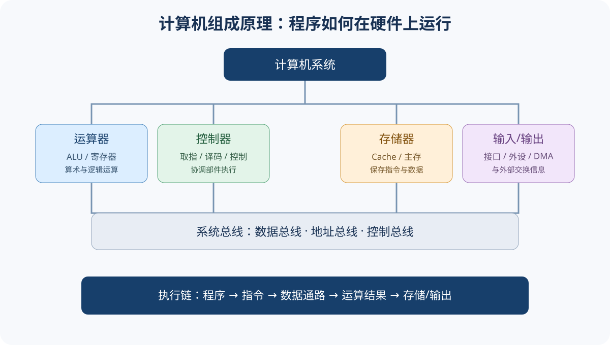

# 408｜计算机组成原理

## 基础概念入口
- [基础概念与核心术语](./基础概念与核心术语.md)｜从系统组成、指令执行、数据表示、存储层次到 I/O 建立整体框架
- 

## 学习主线
从“程序如何转成指令”出发，理解数据表示、运算器、存储器、指令系统、CPU、总线和 I/O 的协同。

~~~mermaid
flowchart LR
 P[高级语言程序] --> I[指令系统]
 I --> CPU[CPU：控制器+运算器]
 CPU <--> M[主存/Cache/外存]
 CPU <--> IO[I/O接口与设备]
 CPU <--> BUS[总线]
~~~

## 章节清单
1. 计算机系统概述：层次结构、存储程序、性能指标、CPU 时间。
2. 数据的表示与运算：进制转换、定点数、补码、溢出、移位、整数运算、IEEE 754 浮点数。
3. 存储器层次结构：SRAM/DRAM、主存芯片与扩展、多模块存储、Cache 映射与替换、虚拟存储基础。
4. 指令系统：指令格式、寻址方式、指令类型、CISC/RISC、机器级程序理解。
5. CPU：数据通路、控制器、指令周期、微程序/硬布线控制、异常与中断、流水线冒险。
6. 总线与 I/O：总线组成和定时、I/O 接口、程序查询、中断、DMA。

## 已编写章节

- [第 01 章｜计算机系统概述](./第01章-计算机系统概述.md)
- [第 02 章｜数据的表示与运算：进制、补码、溢出、移位与 IEEE 754](./第02章-数据的表示与运算.md)
- [第 03 章｜存储器层次结构：主存、Cache 映射、替换策略与平均访问时间](./第03章-存储器层次结构.md)
- [第 04 章｜指令系统：指令格式、寻址方式、指令类型与 CISC/RISC](./第04章-指令系统.md)
- [第 05 章｜CPU：数据通路、指令周期、中断与流水线](./第05章-CPU.md)
- [第 06 章｜总线与 I/O：总线性能、接口、查询、中断与 DMA](./第06章-总线与I-O.md)

(./第01章-计算机系统概述.md)

(./第01章-计算机系统概述.md)

(./第01章-计算机系统概述.md)

## 计算题清单
- CPU 执行时间：$T=IC\times CPI\times T_{cycle}$。
- 存储容量、地址线/数据线、芯片数量与地址范围。
- Cache 命中率、平均访问时间、映射方式与地址拆分。
- 补码加减、溢出判断、浮点数规格化与 IEEE 754 编码。
- 指令寻址与有效地址计算。
- 流水线吞吐率、加速比、时钟周期与冒险处理。

## 易错点
- 区分存储字长、机器字长、指令字长。
- 区分字节编址与字编址，地址范围和容量单位。
- Cache 地址划分结合容量、块大小、相联度和主存地址位数。
- 流水线理想加速比不等于实际加速比；冒险会引入停顿。
- DMA 与中断方式的 CPU 参与程度不同。
- 浮点数阶码偏置、隐藏位、规格化和舍入不可混为一谈。

## 自测
- [ ] 完成补码、溢出与浮点数计算
- [ ] 设计存储芯片扩展方案
- [ ] 分析 Cache 地址结构与命中过程
- [ ] 解释一条指令的取指、译码、执行过程
- [ ] 画出基本数据通路并说明控制信号
- [ ] 计算流水线性能并识别冒险
- [ ] 比较程序查询、中断和 DMA
