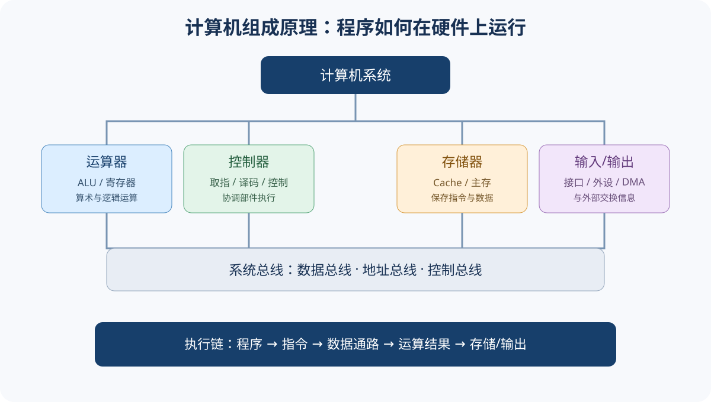

# 计算机组成原理｜基础概念与核心术语

## 1. 计算机系统的层次

计算机系统由硬件和软件共同构成。应用程序经过编译、汇编、链接和装载，最终以机器指令形式由处理器执行。**指令集体系结构（ISA）**是软件与硬件之间的重要接口，规定指令、寄存器、数据类型、寻址等程序员可见属性。

- **计算机组成**：研究各功能部件如何连接、如何实现指令功能。
- **计算机实现**：研究具体电路、工艺和微结构实现。
- **存储程序**：指令和数据以编码形式存放在存储器中，处理器按程序控制执行。

## 2. 五大功能部件

| 部件 | 基本职责 | 关键概念 |
|---|---|---|
| 运算器 | 完成算术与逻辑运算 | ALU、累加器、通用寄存器、标志位 |
| 控制器 | 产生控制信号并协调执行 | PC、IR、指令译码、控制单元 |
| 存储器 | 保存程序和数据 | Cache、主存、辅存、地址 |
| 输入设备 | 将外部信息转换为机器可处理形式 | 键盘、传感器 |
| 输出设备 | 将处理结果呈现给外部 | 显示器、打印机 |

CPU 通常由运算器和控制器构成；寄存器为 CPU 内部高速存储单元。

## 3. 指令执行基本过程

典型指令周期可概括为取指、译码、执行、访存（若需要）、写回（若需要）。不同指令不一定经历所有阶段。

- PC（程序计数器）：保存下一条待取指令的地址（具体更新规则由体系结构决定）。
- IR（指令寄存器）：保存当前指令。
- 控制信号：控制寄存器读写、ALU 运算、总线传送等微操作。

## 4. 数据表示与运算

计算机内部以二进制编码表示数值和字符。需掌握进制转换、定点数、原码/反码/补码、移位、溢出和 IEEE 754 浮点数。

- $n$ 位无符号整数范围：$0\sim 2^n-1$。
- $n$ 位补码整数范围：$-2^{n-1}\sim 2^{n-1}-1$。
- 补码加减通常统一为加法器实现；溢出判断要结合操作数和结果符号，不能把进位标志与溢出标志混为一谈。
- 浮点数通常由符号位、阶码和尾数组成；规格化、偏置、隐藏位和舍入规则要结合题目格式。

## 5. 存储层次

寄存器、Cache、主存、辅存形成容量、速度和成本不同的存储层次。层次结构利用时间局部性和空间局部性提高平均访问效率。

- 时间局部性：近期访问过的数据/指令可能很快再次访问。
- 空间局部性：访问某地址后，附近地址可能很快被访问。
- Cache 命中：所需块在 Cache 中；未命中：需从下一级取块。
- 虚拟地址与物理地址不是同一概念；地址转换由存储管理机制完成。

## 6. 总线与 I/O

总线是多个部件之间传输信息的公共通路，常区分数据总线、地址总线和控制总线。I/O 控制方式常比较程序查询、中断和 DMA：

| 方式 | CPU参与方式 | 典型特征 |
|---|---|---|
| 程序查询 | CPU反复查询设备状态 | 实现简单，等待期间占用CPU |
| 中断方式 | 设备就绪后请求CPU服务 | CPU可执行其他工作，需处理中断 |
| DMA | DMA控制器在设备与主存间成块传送 | 减少CPU逐字/逐字节搬运参与 |

## 7. 性能指标与常用关系

CPU 执行时间：

$$T_{CPU}=IC\times CPI\times T_{cycle}$$

其中 $IC$ 为指令条数，$CPI$ 为平均每条指令时钟周期数，$T_{cycle}$ 为时钟周期。若给出时钟频率 $f$，则 $T_{cycle}=1/f$。

吞吐率、响应时间、时钟频率、CPI 衡量角度不同；不能仅凭主频判断整机性能。

## 8. 易混点

1. 指令字长、机器字长、存储字长是不同概念。
2. 地址总线宽度主要决定可寻址空间规模，数据总线宽度影响一次传送的数据位数。
3. Cache 命中率高不代表每次访问耗时都相同。
4. 中断是CPU响应事件的机制，异常通常由当前指令执行引发；具体分类按教材体系理解。
5. DMA 并非完全不占用总线，也不是完全不需要CPU初始化与收尾。

## 9. 基础自测

1. ISA 为什么是软硬件接口？
2. PC 和 IR 的作用分别是什么？
3. $n$ 位补码能表示的最大正数是多少？
4. 时间局部性和空间局部性有什么区别？
5. DMA 相比程序查询减少了哪类CPU工作？

参考答案

1. 它定义软件可见的指令、寄存器、数据类型和寻址规则。
2. PC 保存下一条待取指令地址；IR 保存当前指令。
3. $2^{n-1}-1$。
4. 时间局部性强调近期访问再次发生；空间局部性强调邻近地址被访问。
5. 减少CPU直接参与设备与主存之间逐项数据搬运的工作。

## 10. 与章节的关系

本页建立整体框架。数据表示见[第02章](./第02章-数据的表示与运算.md)，存储器见[第03章](./第03章-存储器层次结构.md)，指令系统、CPU、总线与I/O见第04—06章。
