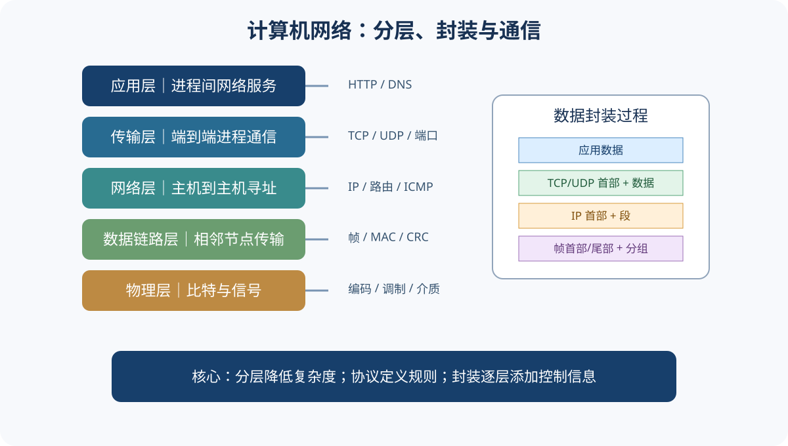

# 计算机网络｜基础概念与核心术语

## 1. 网络与协议

计算机网络通过通信链路和交换设备互连自治计算机，实现资源共享和信息交换。协议是通信双方对数据格式、含义和处理规则的约定，通常包含语法、语义和同步（时序）三个要素。

- **实体**：能够发送或接收信息的软硬件主体。
- **协议**：对等实体通信时遵守的规则。
- **服务**：下层向上层提供的功能。
- **接口**：相邻层之间交换信息的边界。

协议是“如何通信”的规则，服务是“提供什么能力”，接口是“如何使用该能力”。

## 2. 分层体系结构

分层将复杂通信任务拆成相对独立的层次。每层向上提供服务，利用下层服务实现自身功能；同层实体通过协议进行逻辑通信。

| TCP/IP常见五层模型 | 主要功能 | 典型协议/技术 |
|---|---|---|
| 应用层 | 面向应用进程提供网络服务 | HTTP、DNS、FTP、SMTP |
| 传输层 | 进程到进程通信、复用分用 | TCP、UDP |
| 网络层 | 主机到主机寻址与路由 | IP、ICMP |
| 数据链路层 | 相邻节点间帧传输 | Ethernet、PPP、MAC |
| 物理层 | 在介质上传输比特 | 编码、调制、接口与介质 |

OSI 七层模型还将应用相关功能细分为应用、表示、会话三层。学习时要按题目指定模型作答，不能将两套模型机械等同。

## 3. 封装与解封装

发送端数据从应用层向下传递，每层可能添加本层控制信息，形成协议数据单元（PDU）；接收端逐层解析并去除相应首部。

- 应用层：报文（message）
- 传输层：报文段（TCP segment）或用户数据报（UDP datagram）
- 网络层：分组/数据报（packet/datagram）
- 数据链路层：帧（frame）
- 物理层：比特（bit）

## 4. 地址与标识

| 标识 | 所在层/用途 | 解决的问题 |
|---|---|---|
| MAC地址 | 数据链路层 | 局域网链路上的接口标识 |
| IP地址 | 网络层 | 标识网络接口并支持跨网络寻址 |
| 端口号 | 传输层 | 区分主机上的应用进程/服务端点 |
| 域名 | 应用层命名体系 | 便于人类记忆，通过DNS解析 |

MAC、IP、端口、域名不是同一种地址。交换机主要依据链路层地址转发帧；路由器依据网络层地址选择转发路径。

## 5. 可靠传输与性能

- 差错检测用于发现传输错误，不等于自动纠错。
- 确认、序号、超时重传等机制可构建可靠传输。
- 流量控制协调发送方与接收方处理能力。
- 拥塞控制关注网络整体负载，避免过多数据注入网络。
- 带宽、时延、时延带宽积、吞吐量、丢包率是常见性能指标。

时延带宽积：

$$BDP=带宽\times 单向传播时延$$

注意单位统一；带宽通常以 bit/s 计，时延以秒计，结果单位为 bit。

## 6. TCP 与 UDP 的基本定位

| TCP | UDP |
|---|---|
| 面向连接 | 无连接 |
| 提供可靠、有序的字节流服务 | 尽最大努力交付数据报 |
| 有确认、重传、流量控制和拥塞控制 | 协议机制较简单，不保证可靠交付 |
| 不保留应用消息边界 | 保留数据报边界 |

TCP 的可靠性由协议机制实现，不意味着底层网络不会丢包；UDP 也可由应用层自行实现可靠机制。

## 7. 易混点

1. 服务与协议不同：服务描述层间能力，协议约束对等实体。
2. 传输层端到端通信的“端”通常指主机上的进程/套接字端点。
3. IP负责逻辑寻址与路由，MAC负责链路内帧交付。
4. 流量控制面向接收方能力，拥塞控制面向网络承载能力。
5. CRC用于差错检测，不能把它当作纠错编码。
6. 路由选择决定路径，分组转发根据转发表处理到达分组。

## 8. 基础自测

1. 协议的语法、语义、同步分别描述什么？
2. 为什么网络要采用分层结构？
3. 数据从应用层发送到物理层时发生什么？
4. IP地址和端口号分别标识什么？
5. TCP流量控制与拥塞控制的目标有何不同？

参考答案

1. 语法规定格式，语义规定含义，时序/同步规定事件顺序与速度匹配。
2. 降低复杂度、明确层间接口、便于独立设计和替换。
3. 逐层封装控制信息，最终转换为比特信号发送。
4. IP标识网络层接口/主机位置；端口用于区分主机上的进程服务端点。
5. 流量控制防止接收方缓存溢出；拥塞控制避免网络过载。

## 9. 与章节的关系

体系结构见[第01章](./第01章-计算机网络体系结构.md)，物理层至应用层见[第02章](./第02章-物理层.md)至[第06章](./第06章-应用层.md)。
