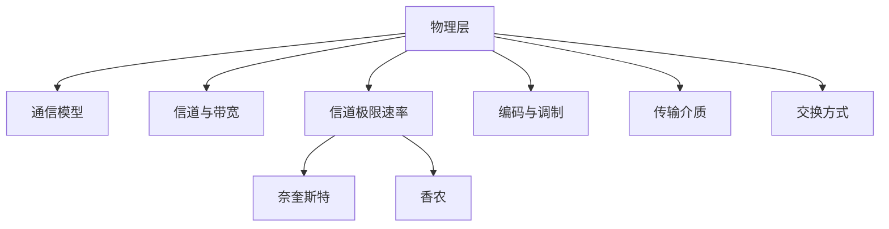

# 第 02 章｜物理层

> 408 · 计算机网络。物理层关注如何在传输介质上传送比特流。重点掌握信道模型、码元与比特率、奈奎斯特/香农定理、编码调制和传输介质。

## 01. 知识地图

## 02. 数据通信基础

通信系统基本组成：信源、发送设备、信道、接收设备和信宿。常用术语：

- 消息：信息的表达；
- 数据：消息的数字化表示；
- 信号：数据在传输介质上的电/光/电磁表现；
- 码元：信号调制中的基本波形单位。

信道可分为单向、半双工和全双工通信。带宽在不同语境下可表示频率范围或数据传输能力，做题时注意单位。

## 03. 码元速率与比特率

若一个码元可表示 $M$ 种离散状态，则理想情况下每个码元可携带：

$$
\log_2M
$$

比特信息。若码元速率为 $R_B$，则比特率为：

$$
R_b=R_B\log_2M
$$

实际系统还受到编码开销、噪声和同步等因素影响。

## 04. 奈奎斯特定理

无噪声、带宽为 $B$ Hz 的理想低通信道，若采用 $V$ 电平信号，最大码元传输速率对应的理想极限为：

$$
R_{\max}=2B\log_2V
$$

单位为 bit/s。使用时确认题目讨论的是无噪声信道和信号离散电平数。

## 05. 香农定理

有噪声信道容量：

$$
C=B\log_2(1+S/N)
$$

其中 $B$ 为带宽，$S/N$ 为信噪功率比（线性值，不是 dB 数值）。若题目给信噪比为 $x$ dB，应先转换：

$$
(S/N)_{\text{线性}}=10^{x/10}
$$

香农容量是理论上限，不表示任意系统都能达到该速率。

## 06. 编码与调制

- 编码：将比特映射为适于传输的信号序列。
- 调制：改变载波的幅度、频率或相位以承载数据。
- 常见调制：ASK、FSK、PSK、QAM。
- 基带传输：数字信号直接形成适合信道的基带波形。
- 频带传输：通过调制将信号搬移到适合的频段。

线路编码还要考虑同步能力、直流分量、带宽效率和抗干扰能力。

## 07. 传输介质

- 双绞线：成本低，常用于局域网接入。
- 同轴电缆：屏蔽能力较强。
- 光纤：带宽高、损耗低、抗电磁干扰。
- 无线介质：无线电、微波、红外等，传播特性受频率、障碍物和环境影响。

## 08. 数据交换方式

- 电路交换：通信前建立专用电路，资源预留，适合持续稳定通信。
- 报文交换：以完整报文为单位存储转发。
- 分组交换：将报文拆分为分组，采用存储转发，资源共享效率高。

分组交换需区分数据报方式与虚电路方式：数据报逐分组独立转发；虚电路在传输前建立逻辑路径。

## 09. 典型计算

带宽为 3 kHz、无噪声、采用 4 电平信号，奈奎斯特理想极限：

$$
R_{\max}=2\times3000\times\log_2 4=12000\text{ bit/s}
$$

若带宽为 3 kHz，信噪比为 30 dB，则线性信噪比为 $10^3$，香农容量：

$$
C=3000\log_2(1+1000)
$$

计算时保留单位并区分理论极限与实际吞吐量。

## 10. 常见失分点

1. 把码元速率直接当成比特率，忘记乘 $\log_2M$。
2. 奈奎斯特公式中的 $V$ 与香农公式中的 $S/N$ 混淆。
3. 将 dB 数值直接代入香农公式，未转成线性信噪比。
4. 将信道容量当作实际一定达到的传输速率。
5. 混淆电路交换、报文交换和分组交换。
6. 忘记光纤抗电磁干扰、带宽高等特征。

## 11. 章节自测

1. 一个码元有 8 种状态，可携带多少 bit？
2. 码元速率为 1000 Baud，采用 16 种状态，理想比特率是多少？
3. 写出奈奎斯特定理的理想最大速率公式。
4. 写出香农公式；信噪比 20 dB 对应的线性比值是多少？
5. 奈奎斯特与香农定理分别针对何种信道假设？
6. 分组交换与电路交换的主要区别是什么？

## 12. 自测参考答案

1. $\log_2 8=3$ bit。
2. $1000\times\log_2 16=4000$ bit/s。
3. $R_{\max}=2B\log_2V$。
4. $C=B\log_2(1+S/N)$；20 dB 对应 $10^{20/10}=100$。
5. 奈奎斯特针对无噪声带宽受限信道；香农针对有噪声信道容量。
6. 电路交换预先建立专用连接并预留资源；分组交换将数据分组后共享链路、存储转发。

## 13. 复习清单

- [ ] 能区分数据、信号、码元和比特率
- [ ] 能正确使用奈奎斯特公式
- [ ] 能将 dB 信噪比转换为线性值并使用香农公式
- [ ] 能比较编码与调制
- [ ] 能比较传输介质特点
- [ ] 能比较电路、报文和分组交换

---

## 14. 本章五大经典学习法｜物理层

### 14.1 费曼学习法：解释比特如何变成信号

应用产生的是比特，物理层负责把比特映射为适合传输介质的电、光或电磁信号。一个码元是信号的基本波形单位；若一个码元有 M 种可区分状态，理想情况下每个码元携带 log₂M bit。

- **码元速率**：每秒发送多少个码元，单位 Baud。
- **比特率**：每秒传送多少 bit。
- **奈奎斯特定理**：无噪声带宽受限信道的理想极限，考虑带宽和信号电平数。
- **香农定理**：有噪声信道的理论容量上限，考虑带宽和线性信噪比。
- **编码**：将比特映射为适于传输的信号序列；**调制**：改变载波幅度、频率或相位承载信息。

**费曼复述练习：**

1. 为什么码元速率不一定等于比特率？
2. 为什么奈奎斯特公式中有 log₂V？
3. 为什么香农公式中的信噪比必须是线性值？
4. 为什么实际传输速率不能超过信道容量上限？
5. 编码与调制分别改变什么？

**边界提醒：** dB 是对数单位，代入香农公式前需转换为线性 S/N；奈奎斯特和香农针对不同信道假设，不能混用。

### 14.2 西蒙学习法：拆分物理层知识块

| 模块 | 内容 | 前置关系 | 达标练习 |
|---|---|---|---|
| A. 通信基础 | 信源、发送/接收设备、信道、信宿、单工/半双工/全双工 | 网络概述 | 画通信模型 |
| B. 码元与比特率 | M 种状态、Baud、bit/s | A | 码元速率和比特率换算 |
| C. 信道极限 | 奈奎斯特、香农、dB 转换 | B | 分别计算无噪声/有噪声上限 |
| D. 编码与调制 | 基带、频带、ASK/FSK/PSK/QAM | B、C | 比较调制方式和线路编码 |
| E. 介质与交换 | 双绞线、同轴、光纤、无线；电路/报文/分组交换 | A—D | 按场景选择并解释原因 |

**刻意练习路径：** 先判断题目给出的是码元速率还是比特率；再确认信道是否有噪声；若给 dB，先转换线性值；最后才代入公式并写单位。

### 14.3 SQ3R 阅读法：围绕公式适用条件提问

- **Survey 浏览：** 先看通信模型、码元速率公式、奈奎斯特和香农公式、编码调制与介质对照表。
- **Question 提问：** M 种码元状态为什么携带 log₂M bit？奈奎斯特和香农的假设差异是什么？dB 如何换算？光纤为什么抗电磁干扰？
- **Read 精读：** 每个公式旁标注信道假设、变量单位和限制条件；对编码/调制写出输入与输出。
- **Recite 复述：** 合上资料，独立推导一题码元速率换算、一题奈奎斯特和一题香农容量。
- **Review 复习：** 当天重算公式题，第 1 天复习 dB 换算，第 3 天复习编码调制，第 7 天做介质与交换比较。

**自问清单：**

1. 16 种信号状态每个码元携带多少 bit？
2. Baud 与 bit/s 的单位区别是什么？
3. 30 dB 的线性信噪比是多少？
4. 奈奎斯特公式中的 V 表示什么？
5. 香农容量公式中的 B 和 S/N 分别表示什么？
6. 为什么香农容量是理论上限？
7. 电路交换、报文交换、分组交换的资源使用方式有何差异？

### 14.4 番茄工作法：四个番茄完成物理层

| 番茄 | 25 分钟任务 | 可验收产出 |
|---|---|---|
| 1 | 通信模型、信道与码元 | 画通信模型并完成 4 道术语判断 |
| 2 | 码元速率与比特率 | 完成 5 道 M、Baud、bit/s 换算 |
| 3 | 奈奎斯特与香农 | 完成 3 道极限速率计算，包含 dB 换算 |
| 4 | 编码调制、介质和交换 | 完成对照表和场景判断 |

每轮休息 5 分钟。公式题先判断假设，再代数；单位题必须将 kHz、MHz、dB 和 bit/s 统一处理。

### 14.5 康奈尔笔记法：物理层线索卡

| 左侧线索 / 问题 | 右侧主体笔记 |
|---|---|
| 码元？ | 信号调制中的基本波形单位。 |
| M 种状态每码元信息量？ | log₂M bit。 |
| 比特率？ | Rb=RB×log₂M。 |
| 奈奎斯特？ | 无噪声带宽受限信道：Rmax=2B×log₂V。 |
| 香农？ | 有噪声信道容量：C=B×log₂(1+S/N)，S/N 为线性值。 |
| dB 转线性？ | S/N=10^(dB/10)。 |
| 编码/调制？ | 编码将比特映射为信号序列；调制改变载波参数承载数据。 |
| 光纤？ | 带宽高、损耗低、抗电磁干扰。 |
| 交换方式？ | 电路交换预留专用资源；报文/分组交换采用存储转发，分组更适合统计复用。 |

**页底总结：** 物理层计算题的第一步是识别信道模型。码元/比特率题看状态数；奈奎斯特看无噪声与电平数；香农看噪声与线性信噪比。公式相似但适用前提不同。

### 14.6 五法融合自测

1. 64 种信号状态下，每个码元携带多少 bit？
2. 码元速率 2400 Baud，采用 8 种状态，理想比特率是多少？
3. 带宽 4 kHz、无噪声、8 电平，奈奎斯特极限是多少？
4. 信噪比 30 dB 对应多少线性 S/N？
5. 带宽 3 kHz、S/N=1000，香农容量是多少？
6. 编码与调制的区别是什么？
7. 为什么光纤适合高带宽、强电磁干扰环境？

**答案要点：** 1. 6 bit；2. 2400×3=7200 bit/s；3. 2×4000×3=24000 bit/s；4. 10³=1000；5. 3000×log₂(1001) bit/s；6. 编码改变比特到信号序列的映射，调制改变载波参数；7. 光纤损耗低、带宽高且不受电磁干扰。

**本章通关条件：**

- [ ] 能区分消息、数据、信号、码元
- [ ] 能换算码元速率和比特率
- [ ] 能正确使用奈奎斯特与香农公式
- [ ] 能完成 dB 与线性信噪比换算
- [ ] 能区分编码、调制和基带/频带传输
- [ ] 能比较传输介质与交换方式
