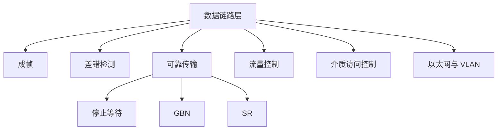

# 第 03 章｜数据链路层

> 408 · 计算机网络。重点包括成帧、差错检测、可靠传输、流量控制、介质访问控制与以太网。

## 01. 知识地图

## 02. 数据链路层服务与成帧

数据链路层将网络层数据报封装成帧，在相邻结点间传输。帧通常由首部、载荷和尾部组成。

成帧方法：

- 字符计数法：首部字段记录帧长度，计数字段出错可能导致同步失效。
- 字节填充：用特殊字节标记帧边界，数据中出现特殊字节时转义。
- 比特填充：连续出现 5 个 1 后插入 0，接收端按规则删除填充位。
- 物理层编码违例：利用特殊信号模式标记边界。

## 03. 差错检测

奇偶校验增加校验位，使 1 的个数满足奇校验或偶校验；可检测奇数个位错误，但不能保证检测所有偶数位错误。

CRC 将比特串视为二进制多项式，使用生成多项式进行模 2 除法。模 2 运算等价于按位异或，不进位、不借位。若生成多项式最高次数为 $r$，发送端在数据后补 $r$ 个 0，再除以生成多项式，余数作为 CRC 字段。

接收端余数为 0 表示未检测到错误，不代表绝对无错。

## 04. 可靠传输与 ARQ

### 停止等待

发送一个帧后等待确认，收到正确确认后再发送下一帧。超时或收到错误反馈则重传。序号通常交替使用 0/1，以区分新帧和重传帧。

### 后退 N 帧 GBN

发送窗口允许多个未确认帧。若某帧出错，接收方通常丢弃该帧及后续失序帧，发送方从出错帧开始重传窗口内后续帧。

若序号空间大小为 $2^k$：

$$
W_s\le 2^k-1
$$

### 选择重传 SR

接收方可缓存失序帧，只重传出错或丢失帧。若序号空间为 $2^k$，为避免新旧窗口序号重叠：

$$
W_s\le 2^{k-1},\qquad W_r\le 2^{k-1}
$$

## 05. 流量控制

流量控制协调发送方与接收方处理能力，防止接收方缓存溢出。停止等待和滑动窗口均可实现流量控制。

流量控制主要保护接收方；拥塞控制主要避免网络整体过载。

## 06. 介质访问控制

共享信道需要协调多个结点使用介质：

- 信道划分：频分、时分、码分；
- 随机访问：ALOHA、CSMA、CSMA/CD、CSMA/CA；
- 轮询/令牌传递：按规则轮流访问。

传统共享式以太网使用 CSMA/CD；无线局域网常用 CSMA/CA。现代全双工交换式以太网不使用 CSMA/CD 进行冲突检测。

## 07. 以太网与交换机

以太网帧包含目的 MAC、源 MAC、类型/长度、数据与帧校验序列等字段。

交换机依据 MAC 地址表进行二层转发：

- 根据源 MAC 学习端口映射；
- 根据目的 MAC 查表转发；
- 未知目的 MAC 通常泛洪到除入端口外的其他端口；
- 广播帧在同一广播域内泛洪。

路由器依据网络层地址进行跨网段转发。

## 08. VLAN 与 PPP

VLAN 将物理局域网划分为多个逻辑广播域。不同 VLAN 通信通常需要三层设备或三层交换功能。802.1Q 在以太网帧中加入 VLAN 标签。

PPP 是点到点链路的数据链路层协议，提供封装、链路控制与网络层协议协商；PPP 不提供逐帧确认重传意义上的可靠传输。

## 09. 常见失分点

1. CRC 模 2 除法误做普通二进制除法。
2. 混淆 GBN 与 SR 的接收缓存和重传策略。
3. 窗口序号空间约束记错。
4. 将流量控制和拥塞控制混为一谈。
5. 认为交换机按 IP 地址转发普通二层帧。
6. 将 CSMA/CD 用于现代全双工交换式以太网。
7. 误认为 CRC 余数为 0 就能保证帧绝对正确。

## 10. 章节自测

1. 比特填充常见规则是什么？
2. CRC 模 2 除法使用什么运算？
3. 若序号字段为 3 bit，GBN 发送窗口最大为多少？
4. 同样 3 bit 序号，SR 对称窗口最大为多少？
5. 流量控制与拥塞控制分别保护什么？
6. 交换机根据什么信息学习和转发？

## 11. 自测参考答案

1. 连续出现 5 个 1 后插入 0，接收端按规则删除填充位。
2. 按位异或，不进位、不借位。
3. $2^3-1=7$。
4. $2^{3-1}=4$。
5. 流量控制保护接收方；拥塞控制避免网络过载。
6. 根据源 MAC 学习端口映射，根据目的 MAC 查表转发。

## 12. 复习清单

- [ ] 能解释成帧与透明传输
- [ ] 能手算 CRC 模 2 除法
- [ ] 能比较停止等待、GBN 与 SR
- [ ] 能计算序号空间和窗口大小约束
- [ ] 能区分流量控制与拥塞控制
- [ ] 能说明交换机学习转发与 VLAN
