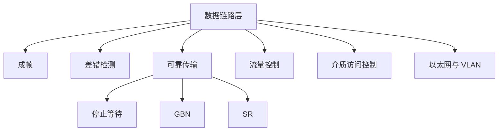

# 第 03 章｜数据链路层

> 408 · 计算机网络。重点包括成帧、差错检测、可靠传输、流量控制、介质访问控制与以太网。

## 01. 知识地图

## 02. 数据链路层服务与成帧

数据链路层将网络层数据报封装成帧，在相邻结点间传输。帧通常由首部、载荷和尾部组成。

成帧方法：

- 字符计数法：首部字段记录帧长度，计数字段出错可能导致同步失效。
- 字节填充：用特殊字节标记帧边界，数据中出现特殊字节时转义。
- 比特填充：连续出现 5 个 1 后插入 0，接收端按规则删除填充位。
- 物理层编码违例：利用特殊信号模式标记边界。

## 03. 差错检测

奇偶校验增加校验位，使 1 的个数满足奇校验或偶校验；可检测奇数个位错误，但不能保证检测所有偶数位错误。

CRC 将比特串视为二进制多项式，使用生成多项式进行模 2 除法。模 2 运算等价于按位异或，不进位、不借位。若生成多项式最高次数为 $r$，发送端在数据后补 $r$ 个 0，再除以生成多项式，余数作为 CRC 字段。

接收端余数为 0 表示未检测到错误，不代表绝对无错。

## 04. 可靠传输与 ARQ

### 停止等待

发送一个帧后等待确认，收到正确确认后再发送下一帧。超时或收到错误反馈则重传。序号通常交替使用 0/1，以区分新帧和重传帧。

### 后退 N 帧 GBN

发送窗口允许多个未确认帧。若某帧出错，接收方通常丢弃该帧及后续失序帧，发送方从出错帧开始重传窗口内后续帧。

若序号空间大小为 $2^k$：

$$
W_s\le 2^k-1
$$

### 选择重传 SR

接收方可缓存失序帧，只重传出错或丢失帧。若序号空间为 $2^k$，为避免新旧窗口序号重叠：

$$
W_s\le 2^{k-1},\qquad W_r\le 2^{k-1}
$$

## 05. 流量控制

流量控制协调发送方与接收方处理能力，防止接收方缓存溢出。停止等待和滑动窗口均可实现流量控制。

流量控制主要保护接收方；拥塞控制主要避免网络整体过载。

## 06. 介质访问控制

共享信道需要协调多个结点使用介质：

- 信道划分：频分、时分、码分；
- 随机访问：ALOHA、CSMA、CSMA/CD、CSMA/CA；
- 轮询/令牌传递：按规则轮流访问。

传统共享式以太网使用 CSMA/CD；无线局域网常用 CSMA/CA。现代全双工交换式以太网不使用 CSMA/CD 进行冲突检测。

## 07. 以太网与交换机

以太网帧包含目的 MAC、源 MAC、类型/长度、数据与帧校验序列等字段。

交换机依据 MAC 地址表进行二层转发：

- 根据源 MAC 学习端口映射；
- 根据目的 MAC 查表转发；
- 未知目的 MAC 通常泛洪到除入端口外的其他端口；
- 广播帧在同一广播域内泛洪。

路由器依据网络层地址进行跨网段转发。

## 08. VLAN 与 PPP

VLAN 将物理局域网划分为多个逻辑广播域。不同 VLAN 通信通常需要三层设备或三层交换功能。802.1Q 在以太网帧中加入 VLAN 标签。

PPP 是点到点链路的数据链路层协议，提供封装、链路控制与网络层协议协商；PPP 不提供逐帧确认重传意义上的可靠传输。

## 09. 常见失分点

1. CRC 模 2 除法误做普通二进制除法。
2. 混淆 GBN 与 SR 的接收缓存和重传策略。
3. 窗口序号空间约束记错。
4. 将流量控制和拥塞控制混为一谈。
5. 认为交换机按 IP 地址转发普通二层帧。
6. 将 CSMA/CD 用于现代全双工交换式以太网。
7. 误认为 CRC 余数为 0 就能保证帧绝对正确。

## 10. 章节自测

1. 比特填充常见规则是什么？
2. CRC 模 2 除法使用什么运算？
3. 若序号字段为 3 bit，GBN 发送窗口最大为多少？
4. 同样 3 bit 序号，SR 对称窗口最大为多少？
5. 流量控制与拥塞控制分别保护什么？
6. 交换机根据什么信息学习和转发？

## 11. 自测参考答案

1. 连续出现 5 个 1 后插入 0，接收端按规则删除填充位。
2. 按位异或，不进位、不借位。
3. $2^3-1=7$。
4. $2^{3-1}=4$。
5. 流量控制保护接收方；拥塞控制避免网络过载。
6. 根据源 MAC 学习端口映射，根据目的 MAC 查表转发。

## 12. 复习清单

- [ ] 能解释成帧与透明传输
- [ ] 能手算 CRC 模 2 除法
- [ ] 能比较停止等待、GBN 与 SR
- [ ] 能计算序号空间和窗口大小约束
- [ ] 能区分流量控制与拥塞控制
- [ ] 能说明交换机学习转发与 VLAN

---

## 13. 本章五大经典学习法｜数据链路层

### 13.1 费曼学习法：解释一跳传输如何变得可靠

数据链路层负责在相邻结点之间传输帧。网络层数据报被封装成帧，帧首部和尾部提供寻址、控制和差错检测信息。为了在可能出错的链路上传输，数据链路层可使用确认、超时重传、序号和滑动窗口。

- **成帧**：划分帧边界；字节填充/比特填充用于保证数据透明传输。
- **CRC**：把比特串视为多项式，用模 2 除法计算校验余数。
- **停止等待**：发一帧等确认，简单但链路利用率可能低。
- **GBN**：接收方通常只接收按序帧，出错后发送方从出错帧开始重传。
- **SR**：接收方可缓存失序帧，只重传丢失/出错帧，但需要更复杂的缓存和序号管理。
- **流量控制**保护接收方，**拥塞控制**保护网络整体。

**费曼复述练习：**

1. 为什么需要成帧和透明传输？
2. CRC 为什么是异或运算而不是普通减法？
3. GBN 为什么会重传出错帧之后的一批帧？
4. SR 为什么需要限制窗口大小不超过序号空间的一半？
5. 为什么流量控制和拥塞控制不是一回事？

**边界提醒：** CRC 余数为 0 表示未检测到错误，不代表绝对无错；GBN/SR 的窗口约束依序号空间和窗口定义；CSMA/CD 适用于传统共享式半双工以太网，不用于现代全双工交换式链路。

### 13.2 西蒙学习法：拆分链路层知识块

| 模块 | 内容 | 前置关系 | 达标练习 |
|---|---|---|---|
| A. 成帧 | 字符计数、字节填充、比特填充、编码违例 | 物理层 | 对数据流标出帧边界 |
| B. 差错检测 | 奇偶校验、CRC | 二进制运算 | 手算模 2 除法 |
| C. 可靠传输 | 停止等待、GBN、SR、序号与窗口 | A、B | 模拟丢帧/ACK 丢失/超时 |
| D. 介质访问 | 信道划分、ALOHA、CSMA/CD、CSMA/CA、令牌 | A | 对场景判断接入方式 |
| E. 以太网与 VLAN | MAC、交换机学习转发、802.1Q、PPP | C、D | 追踪交换机转发表和 VLAN 广播域 |

**刻意练习路径：** CRC 题按位写出异或过程；ARQ 题画发送/接收窗口随时间变化；交换机题分别记录源 MAC 学习、目的 MAC 查表和未知单播泛洪。

### 13.3 SQ3R 阅读法：围绕帧、确认和窗口提问

- **Survey 浏览：** 先看成帧方法、CRC 步骤、ARQ 三种协议、介质访问和交换机转发图。
- **Question 提问：** 字节/比特填充如何保证透明传输？CRC 生成多项式次数如何决定补零位数？GBN 与 SR 接收策略有什么区别？窗口大小为什么受序号空间限制？
- **Read 精读：** 对每种 ARQ 协议标记发送窗口、接收窗口、确认方式和重传范围；对以太网题追踪 MAC 地址表变化。
- **Recite 复述：** 合上资料，完成一次 CRC 模 2 除法、一次 GBN/SR 窗口模拟和一次交换机转发过程。
- **Review 复习：** 当天重做 CRC，第 1 天复习窗口约束，第 3 天复习 MAC/VLAN，第 7 天做综合题。

**自问清单：**

1. 连续 5 个 1 后为什么要插入 0？
2. 生成多项式最高次数为 r，数据后应补多少个 0？
3. 停止等待序号为什么常用 0/1 交替？
4. GBN 中接收方遇到失序帧通常怎么处理？
5. SR 中接收方为什么可以缓存失序帧？
6. 交换机如何学习 MAC 地址表？
7. VLAN 如何划分广播域？

### 13.4 番茄工作法：五个番茄完成数据链路层

| 番茄 | 25 分钟任务 | 可验收产出 |
|---|---|---|
| 1 | 成帧与透明传输 | 完成字节填充和比特填充练习 |
| 2 | CRC | 手算 3 道模 2 除法 |
| 3 | 停止等待、GBN、SR | 画 3 种协议的发送/接收窗口 |
| 4 | 介质访问控制 | 比较 CSMA/CD、CSMA/CA 和信道划分 |
| 5 | 以太网、交换机、VLAN、PPP | 手动更新 MAC 表并判断广播范围 |

每轮休息 5 分钟。CRC 不要跳步；窗口题要写出序号空间和最大窗口；交换机题要区分未知单播、已知单播和广播帧。

### 13.5 康奈尔笔记法：数据链路层线索卡

| 左侧线索 / 问题 | 右侧主体笔记 |
|---|---|
| 数据链路层职责？ | 将网络层数据报封装成帧，在相邻结点间传输。 |
| 比特填充？ | 连续出现 5 个 1 后插入 0，接收端删除填充位。 |
| CRC？ | 模 2 除法按位异或，不进位、不借位；余数用于差错检测。 |
| 停止等待？ | 一帧一确认，超时或差错后重传。 |
| GBN？ | 接收方通常按序接收，出错后发送方重传出错帧及后续窗口帧。 |
| SR？ | 接收方缓存失序帧，发送方只重传出错/丢失帧。 |
| GBN 窗口？ | k 位序号空间时，Ws≤2^k−1。 |
| SR 窗口？ | 对称窗口常要求 Ws、Wr≤2^(k−1)。 |
| 流量/拥塞控制？ | 流量控制保护接收方；拥塞控制保护网络整体。 |
| 交换机？ | 根据源 MAC 学习端口映射，根据目的 MAC 查表转发。 |
| VLAN？ | 将物理 LAN 划分为多个逻辑广播域，跨 VLAN 通常需三层转发。 |
| PPP？ | 点到点链路封装与协商协议，不提供逐帧确认重传的可靠传输。 |

**页底总结：** 数据链路层题目围绕“如何划帧、如何检错、如何重传、如何共享介质、如何逐跳转发”。计算题关注 CRC 和窗口边界；机制题要明确发送方、接收方和交换设备各自的动作。

### 13.6 五法融合自测

1. 比特填充的典型规则是什么？
2. 生成多项式最高次数为 4，数据后补几个 0？
3. 3 位序号字段下，GBN 发送窗口最大是多少？
4. 3 位序号字段下，SR 对称窗口最大是多少？
5. 流量控制和拥塞控制分别解决什么问题？
6. 交换机如何学习 MAC 地址表？
7. 为什么现代全双工交换式以太网不使用 CSMA/CD？
8. VLAN 的主要作用是什么？

**答案要点：** 1. 连续 5 个 1 后插入 0；2. 4 个；3. 7；4. 4；5. 接收方缓存溢出与网络过载；6. 根据收到帧的源 MAC 和入端口建立映射；7. 全双工点到点链路没有共享介质冲突；8. 划分逻辑广播域。

**本章通关条件：**

- [ ] 能解释成帧与透明传输
- [ ] 能手算 CRC 模 2 除法
- [ ] 能比较停止等待、GBN 和 SR
- [ ] 能推导序号空间与窗口大小限制
- [ ] 能区分流量控制与拥塞控制
- [ ] 能追踪交换机学习转发并解释 VLAN
