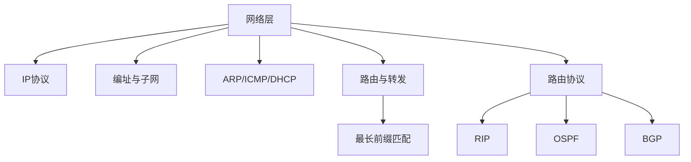

# 第 04 章｜网络层

> 408 · 计算机网络。网络层负责跨网络传输分组。重点掌握 IP 编址、子网划分、CIDR、路由与转发、ARP、ICMP、NAT 和路由协议。

## 01. 知识地图

## 02. 网络层核心功能

- 转发：路由器根据转发表将分组从输入端口送到输出端口。
- 路由选择：通过路由算法决定分组经过的路径。
- 异构网络互联：屏蔽底层链路差异，提供统一网络层服务。
- 拥塞控制：在网络资源紧张时采取相应控制机制。

## 03. IPv4 数据报

IPv4 首部包含版本、首部长度、服务类型/区分服务、总长度、标识、标志、片偏移、TTL、协议、首部校验和、源/目的 IP 地址等字段。

TTL 每经过一个路由器通常减 1，为 0 时丢弃并可能返回 ICMP 超时报文。协议字段标识上层协议，例如 TCP 或 UDP。

## 04. IPv4 地址与子网划分

IPv4 地址长度为 32 bit。子网掩码中网络位为 1、主机位为 0。网络地址：

$$
\text{网络地址}=\text{IP地址}\ \text{AND}\ \text{子网掩码}
$$

主机位数为 $h$ 时，一个传统子网的地址总数为 $2^h$；传统可用主机地址数通常为 $2^h-2$（需注意 /31 点到点链路、/32 主机路由等特殊场景）。

子网划分步骤：根据前缀长度确定网络位和主机位；写出掩码；计算网络地址与广播地址；写出可用主机范围；检查地址是否落在子网范围内。

## 05. CIDR 与最长前缀匹配

CIDR 使用斜线表示网络前缀长度，例如 192.168.1.0/24。路由器可能同时存在多个匹配路由，转发时采用最长前缀匹配，即选择匹配位数最多的路由项。

地址聚合通过较短前缀表示多个连续网络，减少路由表项。聚合要求网络地址范围满足对齐和连续性条件。

## 06. ARP、DHCP 与 ICMP

- ARP：在本地链路上根据 IPv4 地址解析目标 MAC 地址；跨网段通信时，主机通常解析默认网关的 MAC。
- DHCP：动态分配 IP 地址及掩码、网关、DNS 等配置，典型交互为 Discover、Offer、Request、ACK。
- ICMP：报告网络层差错与诊断信息，如目的不可达、超时、回显请求/应答。
- NAT：在私有网络与外部网络之间转换 IP 地址/端口，常见 NAPT 通过端口区分多个内部连接。

ARP 不负责跨网段路由；DNS 与 DHCP 也不是网络层协议。

## 07. 路由与转发

路由表通常包含目的网络前缀、下一跳、出接口和度量等信息。路由选择决定路径，分组转发根据已形成的转发表执行逐跳转发。

静态路由由管理员配置；动态路由通过路由协议交换路由信息。路由器收到分组后需查表、处理 TTL/首部校验和，并在必要时进行分片或返回差错。

## 08. 路由协议

- RIP：距离向量协议，以跳数作为度量，最大有效跳数为 15，16 表示不可达；存在慢收敛等问题。
- OSPF：链路状态协议，使用 Dijkstra 最短路径算法，支持区域划分。
- BGP：自治系统间的路径向量协议，主要考虑策略与路径属性，而非单纯最短跳数。

内部网关协议用于自治系统内部，外部网关协议用于自治系统之间。

## 09. IPv6 基础

IPv6 地址为 128 bit，首部固定长度且取消 IPv4 首部校验和，路由器不对普通 IPv6 分组进行中途分片。IPv6 使用邻居发现协议替代传统 ARP 机制，支持自动配置等特性。

## 10. 常见失分点

1. 子网网络地址、广播地址和可用主机范围计算错误。
2. 忘记前缀长度表示网络位数量。
3. 最长前缀匹配选择了较短而非较长的匹配项。
4. 把 ARP 当成跨网段路由协议。
5. 混淆路由选择与分组转发。
6. RIP、OSPF、BGP 的协议类型与适用范围混淆。
7. 忘记 TTL 每跳递减。

## 11. 章节自测

1. IPv4 地址长度是多少位？
2. /26 前缀的主机位数是多少？传统可用主机地址数是多少？
3. 网络地址如何计算？
4. 路由表中同时匹配 /16 和 /24 时，通常选择哪一个？
5. ARP 在跨网段通信时通常解析哪个设备的 MAC 地址？
6. RIP、OSPF、BGP 分别属于什么路由协议类别？
7. TTL 的作用是什么？

## 12. 自测参考答案

1. 32 bit。
2. 主机位 6 位；传统可用主机地址数 $2^6-2=62$。
3. IP 地址与子网掩码按位 AND。
4. /24，因为前缀更长、匹配更具体。
5. 默认网关的 MAC 地址。
6. RIP 距离向量；OSPF 链路状态；BGP 路径向量。
7. 限制分组在网络中的生存跳数，防止无限循环。

## 13. 复习清单

- [ ] 能完成 IPv4 子网划分与 CIDR 聚合
- [ ] 能进行最长前缀匹配
- [ ] 能解释 ARP、DHCP、ICMP、NAT
- [ ] 能区分路由与转发
- [ ] 能比较 RIP、OSPF、BGP
- [ ] 能说明 IPv6 相对 IPv4 的主要变化

---

## 14. 本章五大经典学习法｜网络层

### 14.1 费曼学习法：解释 IP 分组如何跨越多个网络

网络层提供跨网络的分组传输。主机根据目标 IP 判断目的地是否在本地子网；若不在本地网段，通常把分组交给默认网关。路由器依据转发表和最长前缀匹配选择下一跳，逐跳把分组送向目的网络。

- **IP 地址**标识网络层接口位置；**MAC 地址**用于本地链路帧交付。
- **ARP**在本地链路上解析 IPv4 地址对应的 MAC；跨网段时通常解析默认网关的 MAC。
- **路由选择**决定路径；**分组转发**依据转发表执行当前一跳。
- **CIDR**用前缀长度表示网络部分；最长前缀匹配选择最具体的匹配路由。
- **RIP/OSPF/BGP**分别采用距离向量、链路状态和路径向量思路。
- **TTL**限制分组在网络中的生存跳数，避免路由环路导致无限转发。

**费曼复述练习：**

1. 为什么跨网段通信时，主机不直接 ARP 查询远端主机的 MAC？
2. 为什么路由器需要最长前缀匹配？
3. 路由选择与分组转发有什么区别？
4. RIP、OSPF、BGP 分别解决什么范围内的路由问题？
5. 为什么 TTL 每经过一个路由器都要递减？

**边界提醒：** 子网可用地址数常用 2^h−2，但 /31、/32 有特殊用途；ARP 只在本地链路解析；IPv6 使用邻居发现机制，不使用传统 IPv4 ARP。

### 14.2 西蒙学习法：拆分网络层知识块

| 模块 | 内容 | 前置关系 | 达标练习 |
|---|---|---|---|
| A. IP 与数据报 | IPv4 首部、TTL、分片、IPv6 | 网络体系结构 | 解释字段并追踪 TTL |
| B. 编址与子网 | IPv4、掩码、子网划分、CIDR、聚合 | 二进制与位运算 | 写网络/广播/可用范围 |
| C. 地址解析与控制 | ARP、DHCP、ICMP、NAT | A、B | 画报文交互流程 |
| D. 路由与转发 | 路由表、下一跳、最长前缀匹配 | A、B | 按路由表选下一跳 |
| E. 路由协议 | RIP、OSPF、BGP | D | 比较协议类型、度量和范围 |

**刻意练习路径：** 子网题先写前缀长度和主机位数，再计算网络地址/广播地址；路由题先列出所有匹配项，再按前缀长度从大到小选择；协议题同时写出类别、算法思想和应用范围。

### 14.3 SQ3R 阅读法：围绕地址与下一跳提问

- **Survey 浏览：** 先看 IPv4 首部、子网计算步骤、ARP/DHCP/ICMP 流程、最长前缀匹配和路由协议比较。
- **Question 提问：** 主机如何判断目标是否本地？ARP 请求发给谁？路由器如何选下一跳？为什么最长前缀优先？RIP 的 16 跳代表什么？
- **Read 精读：** 每道子网题标出网络位、主机位、掩码、网络地址、广播地址；每道路由题列出匹配前缀。
- **Recite 复述：** 合上资料，独立完成一次 /26 子网划分、一张路由表匹配和一次 DHCP DORA 流程。
- **Review 复习：** 当天重做子网题，第 1 天复习 ARP/DHCP，第 3 天复习路由协议，第 7 天完成综合转发题。

**自问清单：**

1. /27 有多少主机位和传统可用主机地址？
2. 网络地址如何通过 AND 运算得到？
3. 广播地址如何根据主机位构造？
4. 默认网关为什么需要在本地链路上可达？
5. 路由表中 /20 和 /24 同时匹配时选哪个？
6. RIP 为什么把 16 定义为不可达？
7. OSPF 为什么属于链路状态协议？
8. BGP 为什么还要考虑策略而不只是最短路径？

### 14.4 番茄工作法：五个番茄完成网络层

| 番茄 | 25 分钟任务 | 可验收产出 |
|---|---|---|
| 1 | IPv4/IPv6 首部与 TTL | 标注首部字段并解释 TTL 变化 |
| 2 | 子网划分与 CIDR | 完成 5 道不同前缀的地址题 |
| 3 | ARP、DHCP、ICMP、NAT | 画出四种机制的交互/转换流程 |
| 4 | 路由与最长前缀匹配 | 完成 4 道路由表查找题 |
| 5 | RIP、OSPF、BGP | 制作协议类别与适用范围对照表 |

每轮休息 5 分钟。子网题写出二进制边界或块大小；路由题列出全部匹配项，避免凭直觉选择。

### 14.5 康奈尔笔记法：网络层线索卡

| 左侧线索 / 问题 | 右侧主体笔记 |
|---|---|
| IPv4 地址？ | 32 bit。 |
| 网络地址？ | IP 地址与子网掩码按位 AND。 |
| 主机位 h？ | 地址总数 2^h；传统可用主机数通常 2^h−2，注意特殊前缀。 |
| CIDR？ | 用 /n 表示前 n 位为网络前缀。 |
| 最长前缀匹配？ | 多个路由项匹配时，选择前缀长度最大的最具体路由。 |
| ARP？ | 在本地链路将 IPv4 地址解析为 MAC；跨网段通常解析默认网关。 |
| DHCP DORA？ | Discover、Offer、Request、ACK。 |
| ICMP？ | 网络层差错报告和诊断，如不可达、超时、回显。 |
| NAT/NAPT？ | 转换地址；NAPT 还使用端口区分多个内部连接。 |
| 路由/转发？ | 路由选择路径；转发按转发表把分组送到下一跳。 |
| RIP/OSPF/BGP？ | 距离向量、链路状态、路径向量；内部路由与自治系统间路由范围不同。 |
| IPv6？ | 128 bit，固定基本首部，使用邻居发现机制，不采用传统 IPv4 ARP。 |

**页底总结：** 网络层题先判断目的地址是否本地，再确定下一跳；子网题通过前缀划分网络/主机位；路由题使用最长前缀匹配；控制协议题要区分地址解析、自动配置、差错诊断和地址转换。

### 14.6 五法融合自测

1. IPv4 地址长度是多少位？
2. /27 子网有多少个主机位？传统可用主机地址数是多少？
3. IP 地址 192.168.10.77/26 的网络地址和广播地址分别是什么？
4. 路由表中同时匹配 10.0.0.0/8 与 10.2.0.0/16，应选择哪个？
5. 跨网段通信时，主机通常 ARP 查询谁的 MAC？
6. DHCP 的典型四步交互是什么？
7. RIP、OSPF、BGP 分别是什么路由协议类别？
8. TTL 的作用是什么？

**答案要点：** 1. 32 bit；2. 5 位，传统可用 30 个；3. 网络地址 192.168.10.64，广播地址 192.168.10.127；4. /16；5. 默认网关；6. Discover、Offer、Request、ACK；7. 距离向量、链路状态、路径向量；8. 限制分组生存跳数，防止无限循环。

**本章通关条件：**

- [ ] 能解释 IPv4/IPv6 基本首部和 TTL
- [ ] 能独立完成子网划分、CIDR 聚合
- [ ] 能执行最长前缀匹配
- [ ] 能解释 ARP、DHCP、ICMP、NAT
- [ ] 能区分路由选择与分组转发
- [ ] 能比较 RIP、OSPF、BGP 的类别和适用范围
