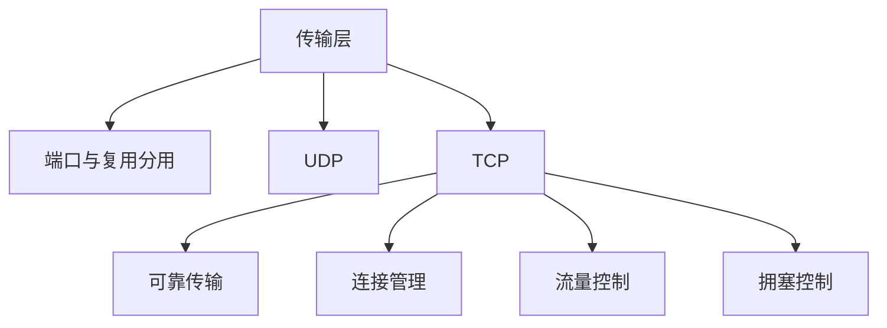

# 第 05 章｜传输层

> 408 · 计算机网络。传输层提供进程到进程的通信。重点掌握端口、UDP、TCP 可靠传输、连接管理、流量控制与拥塞控制。

## 01. 知识地图

## 02. 端口与复用分用

端口号用于标识主机中的应用进程。传输层通过端口实现复用与分用。TCP 连接通常由源 IP、源端口、目的 IP、目的端口四元组唯一标识。端口号本身不等同于进程 ID。

## 03. UDP

UDP 是无连接、尽最大努力交付的传输层协议，首部开销小，不保证可靠交付、顺序和流量控制。

UDP 首部包括源端口、目的端口、长度和校验和。适合实时性要求较高、应用可自行处理丢包或需要简单传输的场景。

## 04. TCP 特点与报文段

TCP 面向连接、可靠、全双工、面向字节流。TCP 不保留应用层写入消息的边界。

TCP 首部重要字段：

- 序号：本报文段数据首字节的序号；
- 确认号：期望收到的下一个字节序号；
- 数据偏移：首部长度；
- 窗口：接收方通告的接收窗口；
- 标志位：SYN、ACK、FIN、RST、PSH、URG 等。

SYN 与 FIN 各消耗一个序号；纯 ACK 通常不消耗序号。

## 05. 可靠传输机制

TCP 通过序号、确认、校验和、超时重传、快速重传等机制提供可靠字节流。

- 累积确认：确认号表示此前连续收到的数据之后，期望接收的下一个字节。
- 超时重传：计时器到期仍未收到确认时重传。
- 快速重传：收到多个重复 ACK 后提前重传可能丢失的报文段。
- 乱序处理：接收方可缓存失序数据，按实现策略处理并反馈 ACK。

计算序号时以字节为单位，不是以报文段为单位。

## 06. TCP 三次握手

典型过程：

1. 客户端发送 SYN，进入 SYN-SENT；
2. 服务端返回 SYN+ACK，进入 SYN-RECEIVED；
3. 客户端返回 ACK，双方连接建立。

三次握手用于确认双方收发能力与初始序号，并避免历史连接请求造成错误连接建立。

## 07. TCP 四次挥手

典型过程：

1. 主动关闭方发送 FIN；
2. 被动方返回 ACK；
3. 被动方处理完剩余数据后发送 FIN；
4. 主动方返回 ACK，并进入 TIME-WAIT 等状态。

TCP 是全双工连接，两个方向可以分别关闭，因此通常需要四次挥手。TIME-WAIT 有助于确保最后 ACK 可重传并让旧报文在网络中过期。

## 08. 流量控制

接收方通过通告窗口 rwnd 告知发送方可接收的数据量。发送方未确认数据量应受接收窗口约束。零窗口时发送方暂停常规数据发送，并可通过窗口探测机制了解接收方窗口是否恢复。

## 09. 拥塞控制

经典 TCP 机制包括：

- 慢开始：拥塞窗口 cwnd 按轮次指数增长（典型每 RTT 近似翻倍）；
- 拥塞避免：达到阈值后线性增长；
- 快重传：收到多个重复 ACK 后重传；
- 快恢复：快速重传后调整 cwnd 与阈值，避免完全回到慢开始（具体版本算法有差异）。

发送窗口受接收窗口与拥塞窗口共同限制：

$$
W=\min(rwnd,cwnd)
$$

## 10. 典型序号计算

若某 TCP 报文段序号为 1000，数据长度为 500 Byte，且无 SYN/FIN，则接收方确认号为：

$$
ACK=1000+500=1500
$$

若该段还携带 SYN 或 FIN，则相应控制标志还会额外消耗一个序号。

## 11. 常见失分点

1. 把 TCP 序号按报文段计数，而不是按字节计数。
2. 确认号误认为已收到的最后一个字节。
3. 忘记 SYN/FIN 各消耗一个序号。
4. 混淆流量控制 rwnd 与拥塞控制 cwnd。
5. 认为 TCP 保留应用消息边界；TCP 是字节流。
6. 三次握手与四次挥手状态方向混淆。
7. 将 UDP 误认为完全没有校验和（IPv4/IPv6 规则需区分，IPv6 UDP 校验和通常必须使用）。

## 12. 章节自测

1. UDP 与 TCP 的主要区别是什么？
2. TCP 确认号表示什么？
3. TCP 序号按什么单位计数？
4. SYN 与 FIN 是否消耗序号？
5. TCP 为什么需要三次握手？
6. rwnd 与 cwnd 分别解决什么问题？
7. 若序号为 2000、数据长度为 300 Byte，无 SYN/FIN，确认号是多少？

## 13. 自测参考答案

1. UDP 无连接、开销小、不保证可靠顺序；TCP 面向连接并提供可靠字节流。
2. 期望收到的下一个字节序号。
3. 字节。
4. 各消耗一个序号。
5. 确认双方收发能力和初始序号，避免旧连接请求导致错误建立。
6. rwnd 是接收方流量控制；cwnd 是网络拥塞控制。
7. $2000+300=2300$。

## 14. 复习清单

- [ ] 能解释端口复用与分用
- [ ] 能比较 UDP 与 TCP
- [ ] 能计算序号、确认号与窗口
- [ ] 能描述三次握手与四次挥手
- [ ] 能解释可靠传输机制
- [ ] 能区分流量控制与拥塞控制
