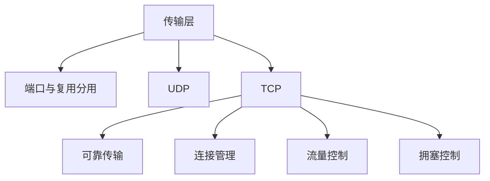

# 第 05 章｜传输层

> 408 · 计算机网络。传输层提供进程到进程的通信。重点掌握端口、UDP、TCP 可靠传输、连接管理、流量控制与拥塞控制。

## 01. 知识地图

## 02. 端口与复用分用

端口号用于标识主机中的应用进程。传输层通过端口实现复用与分用。TCP 连接通常由源 IP、源端口、目的 IP、目的端口四元组唯一标识。端口号本身不等同于进程 ID。

## 03. UDP

UDP 是无连接、尽最大努力交付的传输层协议，首部开销小，不保证可靠交付、顺序和流量控制。

UDP 首部包括源端口、目的端口、长度和校验和。适合实时性要求较高、应用可自行处理丢包或需要简单传输的场景。

## 04. TCP 特点与报文段

TCP 面向连接、可靠、全双工、面向字节流。TCP 不保留应用层写入消息的边界。

TCP 首部重要字段：

- 序号：本报文段数据首字节的序号；
- 确认号：期望收到的下一个字节序号；
- 数据偏移：首部长度；
- 窗口：接收方通告的接收窗口；
- 标志位：SYN、ACK、FIN、RST、PSH、URG 等。

SYN 与 FIN 各消耗一个序号；纯 ACK 通常不消耗序号。

## 05. 可靠传输机制

TCP 通过序号、确认、校验和、超时重传、快速重传等机制提供可靠字节流。

- 累积确认：确认号表示此前连续收到的数据之后，期望接收的下一个字节。
- 超时重传：计时器到期仍未收到确认时重传。
- 快速重传：收到多个重复 ACK 后提前重传可能丢失的报文段。
- 乱序处理：接收方可缓存失序数据，按实现策略处理并反馈 ACK。

计算序号时以字节为单位，不是以报文段为单位。

## 06. TCP 三次握手

典型过程：

1. 客户端发送 SYN，进入 SYN-SENT；
2. 服务端返回 SYN+ACK，进入 SYN-RECEIVED；
3. 客户端返回 ACK，双方连接建立。

三次握手用于确认双方收发能力与初始序号，并避免历史连接请求造成错误连接建立。

## 07. TCP 四次挥手

典型过程：

1. 主动关闭方发送 FIN；
2. 被动方返回 ACK；
3. 被动方处理完剩余数据后发送 FIN；
4. 主动方返回 ACK，并进入 TIME-WAIT 等状态。

TCP 是全双工连接，两个方向可以分别关闭，因此通常需要四次挥手。TIME-WAIT 有助于确保最后 ACK 可重传并让旧报文在网络中过期。

## 08. 流量控制

接收方通过通告窗口 rwnd 告知发送方可接收的数据量。发送方未确认数据量应受接收窗口约束。零窗口时发送方暂停常规数据发送，并可通过窗口探测机制了解接收方窗口是否恢复。

## 09. 拥塞控制

经典 TCP 机制包括：

- 慢开始：拥塞窗口 cwnd 按轮次指数增长（典型每 RTT 近似翻倍）；
- 拥塞避免：达到阈值后线性增长；
- 快重传：收到多个重复 ACK 后重传；
- 快恢复：快速重传后调整 cwnd 与阈值，避免完全回到慢开始（具体版本算法有差异）。

发送窗口受接收窗口与拥塞窗口共同限制：

$$
W=\min(rwnd,cwnd)
$$

## 10. 典型序号计算

若某 TCP 报文段序号为 1000，数据长度为 500 Byte，且无 SYN/FIN，则接收方确认号为：

$$
ACK=1000+500=1500
$$

若该段还携带 SYN 或 FIN，则相应控制标志还会额外消耗一个序号。

## 11. 常见失分点

1. 把 TCP 序号按报文段计数，而不是按字节计数。
2. 确认号误认为已收到的最后一个字节。
3. 忘记 SYN/FIN 各消耗一个序号。
4. 混淆流量控制 rwnd 与拥塞控制 cwnd。
5. 认为 TCP 保留应用消息边界；TCP 是字节流。
6. 三次握手与四次挥手状态方向混淆。
7. 将 UDP 误认为完全没有校验和（IPv4/IPv6 规则需区分，IPv6 UDP 校验和通常必须使用）。

## 12. 章节自测

1. UDP 与 TCP 的主要区别是什么？
2. TCP 确认号表示什么？
3. TCP 序号按什么单位计数？
4. SYN 与 FIN 是否消耗序号？
5. TCP 为什么需要三次握手？
6. rwnd 与 cwnd 分别解决什么问题？
7. 若序号为 2000、数据长度为 300 Byte，无 SYN/FIN，确认号是多少？

## 13. 自测参考答案

1. UDP 无连接、开销小、不保证可靠顺序；TCP 面向连接并提供可靠字节流。
2. 期望收到的下一个字节序号。
3. 字节。
4. 各消耗一个序号。
5. 确认双方收发能力和初始序号，避免旧连接请求导致错误建立。
6. rwnd 是接收方流量控制；cwnd 是网络拥塞控制。
7. $2000+300=2300$。

## 14. 复习清单

- [ ] 能解释端口复用与分用
- [ ] 能比较 UDP 与 TCP
- [ ] 能计算序号、确认号与窗口
- [ ] 能描述三次握手与四次挥手
- [ ] 能解释可靠传输机制
- [ ] 能区分流量控制与拥塞控制

---

## 15. 本章五大经典学习法｜传输层

### 15.1 费曼学习法：解释 TCP 如何让字节可靠到达

传输层把主机间通信细化为进程间通信。端口号用于区分主机上的应用进程。UDP 提供轻量、无连接的数据报服务；TCP 则建立连接，以字节流形式提供可靠、有序的传输。

- **TCP 序号**：标识本报文段数据首字节的序号，按字节计数。
- **确认号**：接收方期望收到的下一个字节序号，通常体现累积确认。
- **SYN/FIN**：各消耗一个序号；纯 ACK 通常不消耗。
- **流量控制 rwnd**：接收方告诉发送方还能接收多少数据。
- **拥塞控制 cwnd**：发送方根据网络拥塞情况限制在途数据。
- **发送窗口**：通常受 min(rwnd,cwnd) 约束。

**费曼复述练习：**

1. 为什么 TCP 是字节流而不是消息边界协议？
2. 确认号为什么表示“下一个期望收到的字节”？
3. 为什么 SYN 和 FIN 都会消耗序号？
4. 为什么 TCP 需要三次握手？
5. rwnd 与 cwnd 分别保护谁？

**边界提醒：** TCP 序号按字节计数；ACK 不等于“最后收到的字节”；流量控制和拥塞控制不可混用；不同 TCP 拥塞控制版本在阈值调整细节上可能不同。

### 15.2 西蒙学习法：拆分传输层知识块

| 模块 | 内容 | 前置关系 | 达标练习 |
|---|---|---|---|
| A. 端口与复用 | 端口、套接字、四元组 | 应用层基础 | 判断连接标识 |
| B. UDP/TCP | 无连接数据报、可靠字节流、首部字段 | A | 比较协议并识别字段 |
| C. 可靠传输 | 序号、确认、重传、累积确认、快速重传 | B | 计算序号/确认号 |
| D. 连接管理 | 三次握手、四次挥手、状态与 TIME-WAIT | C | 画状态时序图 |
| E. 流量/拥塞控制 | rwnd、cwnd、慢开始、拥塞避免、快恢复 | C、D | 计算窗口变化和发送上限 |

**刻意练习路径：** 每道 TCP 序号题先标出数据长度、SYN/FIN 标志，再计算下一个序号；握手/挥手题逐段写方向、标志位和状态；窗口题分别计算 rwnd 与 cwnd，最后取较小值。

### 15.3 SQ3R 阅读法：围绕确认号和窗口提问

- **Survey 浏览：** 先看 TCP 首部字段、三次握手/四次挥手、可靠传输、流量控制和拥塞控制图。
- **Question 提问：** 序号按字节还是报文段？ACK 表示什么？为什么建立连接需要三次而关闭通常四次？零窗口时如何处理？慢开始与拥塞避免的增长方式有什么不同？
- **Read 精读：** 对每个报文段记录序号、数据长度、SYN/FIN、确认号和窗口；对拥塞控制题标注 RTT 轮次、cwnd、ssthresh。
- **Recite 复述：** 合上资料，画出握手/挥手时序，完成两道序号确认号计算和一题窗口变化。
- **Review 复习：** 当天重做序号题，第 1 天重画连接时序，第 3 天复习窗口控制，第 7 天完成综合题。

**自问清单：**

1. 一个 TCP 段携带 800 Byte 数据，序号 5000，下一确认号是多少？
2. 如果该段还携带 FIN，确认号如何变化？
3. 为什么接收方可以用一个 ACK 确认连续收到的一段字节？
4. 三次握手每个方向分别发送什么标志？
5. 主动关闭方为什么会进入 TIME-WAIT？
6. 零窗口意味着什么？发送方如何探测窗口恢复？
7. 慢开始、拥塞避免、快重传、快恢复分别如何影响 cwnd？

### 15.4 番茄工作法：五个番茄完成传输层

| 番茄 | 25 分钟任务 | 可验收产出 |
|---|---|---|
| 1 | 端口、UDP/TCP | 完成协议比较和端口复用题 |
| 2 | TCP 首部、序号与确认号 | 完成 6 道序号/确认号计算 |
| 3 | 三次握手、四次挥手 | 画出完整时序图并标注状态 |
| 4 | 可靠传输与流量控制 | 解释重传、累积确认、rwnd 和零窗口 |
| 5 | 拥塞控制 | 画 cwnd 随 RTT 变化并计算 min(rwnd,cwnd) |

每轮休息 5 分钟。序号题每一步都要写明数据字节数与控制位消耗；拥塞控制题明确题目采用的算法版本和触发条件。

### 15.5 康奈尔笔记法：传输层线索卡

| 左侧线索 / 问题 | 右侧主体笔记 |
|---|---|
| 端口？ | 标识主机中的应用进程，端口号不等同于进程 ID。 |
| TCP 四元组？ | 源 IP、源端口、目的 IP、目的端口。 |
| UDP？ | 无连接、开销小、尽最大努力交付，不保证可靠顺序。 |
| TCP？ | 面向连接、可靠、全双工、面向字节流。 |
| 序号？ | 本报文段首字节的序号，按字节计数。 |
| 确认号？ | 期望收到的下一个字节序号。 |
| SYN/FIN？ | 各消耗一个序号；纯 ACK 通常不消耗。 |
| 三次握手？ | SYN → SYN+ACK → ACK，确认双方收发能力和初始序号。 |
| 四次挥手？ | FIN → ACK → FIN → ACK，两个方向可独立关闭。 |
| rwnd？ | 接收方通告窗口，用于流量控制。 |
| cwnd？ | 拥塞窗口，由发送方根据网络拥塞调整。 |
| 发送窗口？ | 通常受 min(rwnd,cwnd) 限制。 |
| 慢开始/拥塞避免？ | 慢开始按 RTT 轮次指数增长；拥塞避免线性增长。 |
| 快重传/快恢复？ | 多个重复 ACK 触发提前重传，并按算法调整拥塞窗口。 |

**页底总结：** TCP 题先按字节追踪序号和确认号，再按状态追踪连接建立/释放，最后区分接收方流量控制和网络拥塞控制。所有窗口题都要分别计算 rwnd 与 cwnd。

### 15.6 五法融合自测

1. TCP 段序号为 3000，数据长度 700 Byte，无 SYN/FIN，确认号是多少？
2. TCP 段序号为 4000，数据长度 500 Byte，并携带 FIN，下一序号是多少？
3. TCP 确认号表示已收到的最后一个字节，还是期望收到的下一个字节？
4. 三次握手的标志位顺序是什么？
5. 为什么 TCP 连接关闭通常需要四次挥手？
6. rwnd=12000 Byte，cwnd=8000 Byte，发送窗口上限是多少？
7. 流量控制和拥塞控制分别面向什么对象？
8. TIME-WAIT 的两个主要作用是什么？

**答案要点：** 1. 3700；2. 4000+500+1=4501；3. 期望收到的下一个字节；4. SYN、SYN+ACK、ACK；5. TCP 全双工，两个方向分别关闭；6. 8000 Byte；7. 接收方缓存与网络整体负载；8. 确保最后 ACK 可重传，并让旧连接报文在网络中过期。

**本章通关条件：**

- [ ] 能比较 UDP 与 TCP
- [ ] 能解释端口复用/分用与 TCP 四元组
- [ ] 能按字节计算 TCP 序号和确认号
- [ ] 能画三次握手、四次挥手并解释 TIME-WAIT
- [ ] 能解释可靠传输与累积确认
- [ ] 能区分 rwnd/cwnd 并计算发送窗口
- [ ] 能说明 TCP 拥塞控制阶段与触发条件
