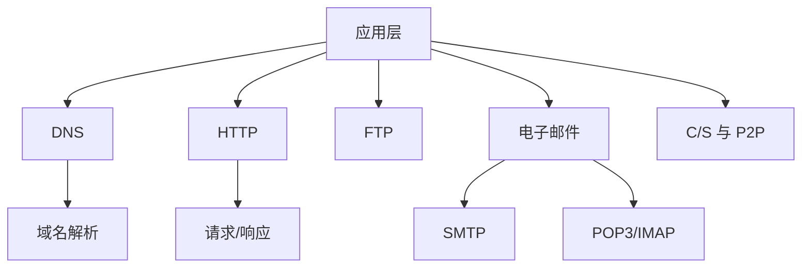

# 第 06 章｜应用层

> 408 · 计算机网络。应用层协议定义应用进程之间交换的报文格式、语义与交互规则。重点掌握 DNS、HTTP、FTP、电子邮件及 C/S、P2P 模型。

## 01. 知识地图

## 02. 客户/服务器与 P2P

C/S 模型由服务器提供服务，客户端发起请求；服务器通常持续运行并具有稳定地址。P2P 模型中主机既可请求服务，也可向其他主机提供服务，资源与负载分布在多个结点。

实际应用可采用混合架构，例如中心服务器负责索引或协调，数据由对等结点传输。

## 03. DNS 域名系统

DNS 将域名解析为 IP 地址，也可提供反向解析和其他资源记录。域名系统采用分层命名结构，常见层次包括根域、顶级域、二级域等。

查询方式：

- 递归查询：服务器代表客户端继续查询，并返回最终结果或错误；
- 迭代查询：被查询服务器返回下一步应访问的服务器线索。

常见资源记录包括 A（IPv4 地址）、AAAA（IPv6 地址）、CNAME（别名）、MX（邮件交换）和 NS（名称服务器）。DNS 缓存受 TTL 控制。

## 04. HTTP

HTTP 是应用层请求—响应协议。典型请求包含请求行、首部字段、空行和可选消息体；响应包含状态行、首部字段、空行和可选消息体。

常见方法：GET、POST、PUT、DELETE、HEAD。常见状态码类别：

- 1xx：信息性；
- 2xx：成功；
- 3xx：重定向；
- 4xx：客户端错误；
- 5xx：服务器错误。

HTTP/1.1 常见持久连接；HTTP/2 支持二进制分帧和多路复用；HTTP/3 基于 QUIC。HTTPS 是 HTTP 与 TLS 安全机制结合。

## 05. Cookie 与缓存

Cookie 可在客户端保存状态标识，服务器据此关联会话；Session 常在服务器侧维护会话状态。

Web 缓存可减少重复传输和访问延迟。条件请求常使用 ETag/If-None-Match 或 Last-Modified/If-Modified-Since 验证资源是否变化。

## 06. FTP 文件传输

FTP 使用控制连接与数据连接分离的结构。传统 FTP 控制连接常使用 TCP 21 端口；主动/被动模式的数据连接建立方向不同。

主动模式由服务器发起数据连接；被动模式由客户端发起数据连接，更容易适应客户端位于 NAT/防火墙之后的场景。

## 07. 电子邮件

电子邮件系统主要组成：用户代理、邮件服务器、SMTP 发送协议、POP3 或 IMAP 收取协议。

SMTP 用于邮件传输/提交；POP3 常用于下载邮件；IMAP 支持在服务器端管理邮箱与同步状态。MIME 扩展邮件格式以支持附件和多媒体内容。

## 08. 应用层与传输层

应用层协议定义报文与业务交互；传输层提供进程间数据传输。HTTP、SMTP、FTP、DNS 常使用 TCP 或 UDP，具体端口与传输协议按协议版本和题目场景判断。

DNS 普通查询常用 UDP，但也可能使用 TCP，例如区域传送、响应截断或其他场景，不能绝对化为 DNS 只用 UDP。

## 09. 常见失分点

1. 把 DNS 递归查询与迭代查询的角色混淆。
2. 认为 DNS 永远只使用 UDP。
3. 混淆 SMTP 与 POP3/IMAP 的作用。
4. 认为 HTTP 自身提供可靠传输；可靠性由传输层机制提供。
5. FTP 主动与被动模式连接方向弄反。
6. Cookie 与 Session 混淆。
7. 忽略 HTTPS 中 TLS 的作用。

## 10. 章节自测

1. DNS 的主要作用是什么？
2. A 与 AAAA 记录分别对应什么地址？
3. 递归查询与迭代查询的主要区别是什么？
4. HTTP 请求与响应的基本结构是什么？
5. SMTP、POP3、IMAP 分别承担什么任务？
6. FTP 主动与被动模式的数据连接由谁发起？
7. DNS 是否只使用 UDP？

## 11. 自测参考答案

1. 将域名解析为 IP 地址等资源信息。
2. A 对应 IPv4，AAAA 对应 IPv6。
3. 递归由服务器代客户端继续查找并返回结果；迭代返回下一步查询线索。
4. 请求行/状态行、首部、空行、可选消息体。
5. SMTP 负责发送/传输；POP3 与 IMAP 负责收取/访问邮件。
6. 主动模式由服务器发起；被动模式由客户端发起。
7. 否，DNS 普通查询常用 UDP，但某些场景使用 TCP。

## 12. 复习清单

- [ ] 能画 DNS 层次结构并解释查询流程
- [ ] 能识别常见 DNS 资源记录
- [ ] 能解释 HTTP 请求响应与状态码
- [ ] 能比较 FTP 主动/被动模式
- [ ] 能区分 SMTP、POP3、IMAP
- [ ] 能比较 C/S 与 P2P

---

## 13. 本章五大经典学习法｜应用层

### 13.1 费曼学习法：解释浏览器输入网址后发生了什么

应用层协议定义应用进程之间交换的报文格式和交互规则。用户输入域名后，客户端可能先查询 DNS 获取服务器 IP，再通过传输层建立通信，发送 HTTP 请求并解析响应。邮件和文件传输则由 SMTP、POP3/IMAP、FTP 等协议完成。

- **DNS**：把域名映射为 IP 等资源记录；递归查询由服务器代客户端继续查询，迭代查询返回下一步服务器线索。
- **HTTP**：请求—响应协议；请求和响应都由起始行、首部、空行和可选消息体组成。
- **HTTPS**：HTTP 与 TLS 安全机制结合，提供加密、完整性和身份认证等安全能力。
- **FTP**：控制连接与数据连接分离；主动/被动模式的数据连接发起方不同。
- **电子邮件**：SMTP 负责发送/传输，POP3/IMAP 负责收取/访问；MIME 支持附件和多媒体。
- **C/S 与 P2P**：前者由服务器集中提供服务，后者结点既可请求也可提供服务。

**费曼复述练习：**

1. 为什么 DNS 不只是“把域名翻译成 IP”，还需要缓存和资源记录？
2. 递归查询与迭代查询中，谁负责继续寻找下一台 DNS 服务器？
3. 为什么 HTTP 自身不等于可靠传输？
4. 为什么 FTP 要区分控制连接和数据连接？
5. SMTP 与 POP3/IMAP 的方向和职责有什么区别？

**边界提醒：** DNS 常用 UDP，但并非只用 UDP；HTTP/1.1、HTTP/2、HTTP/3 的底层传输机制不同；Cookie 和 Session 是状态管理机制，不是 HTTP 可靠传输机制。

### 13.2 西蒙学习法：拆分应用层知识块

| 模块 | 内容 | 前置关系 | 达标练习 |
|---|---|---|---|
| A. 应用模型 | C/S、P2P、混合架构 | 网络体系结构 | 判断应用架构 |
| B. DNS | 层次命名、递归/迭代、A/AAAA/MX/CNAME/NS、缓存 TTL | UDP/TCP、IP | 画域名解析流程 |
| C. HTTP/HTTPS | 请求响应、方法、状态码、持久连接、缓存、TLS | TCP/QUIC | 分析请求报文与状态码 |
| D. FTP | 控制/数据连接、主动/被动模式 | TCP 端口 | 画连接方向 |
| E. 邮件系统 | 用户代理、邮件服务器、SMTP、POP3、IMAP、MIME | TCP | 画发送与收取路径 |

**刻意练习路径：** 每个协议按“使用场景→通信双方→传输层协议/端口→报文结构→交互顺序→缓存/状态”六项整理。协议比较题不能只背端口，要能解释双方角色和数据流向。

### 13.3 SQ3R 阅读法：围绕请求交互顺序提问

- **Survey 浏览：** 先看 DNS 查询树、HTTP 请求响应格式、FTP 双连接、邮件系统流程。
- **Question 提问：** DNS 什么时候使用 TCP？HTTP 状态码如何分类？HTTPS 的 TLS 做什么？FTP 被动模式为什么更适合客户端位于 NAT 后？SMTP 与 IMAP 如何分工？
- **Read 精读：** 对 DNS 记录标注用途；对 HTTP 报文逐段识别；对 FTP/邮件流程标出每个连接的发起方和方向。
- **Recite 复述：** 合上资料，画出浏览器访问网站的 DNS→连接→HTTP 流程，再画邮件发送和收取流程。
- **Review 复习：** 当天重画 DNS 查询，第 1 天复习 HTTP 报文，第 3 天重画 FTP/邮件，第 7 天完成综合题。

**自问清单：**

1. A、AAAA、MX、CNAME、NS 记录分别表示什么？
2. TTL 如何影响 DNS 缓存？
3. HTTP 请求行包含哪些信息？
4. 2xx、3xx、4xx、5xx 分别表示什么类别？
5. ETag/If-None-Match 如何减少重复传输？
6. FTP 主动模式与被动模式的数据连接由谁发起？
7. IMAP 与 POP3 在服务器端状态管理方面有何典型差别？

### 13.4 番茄工作法：五个番茄完成应用层

| 番茄 | 25 分钟任务 | 可验收产出 |
|---|---|---|
| 1 | C/S、P2P 与 DNS | 画 DNS 层次和递归/迭代查询流程 |
| 2 | HTTP/HTTPS 报文 | 拆解 2 个请求/响应，识别方法和状态码 |
| 3 | Cookie、缓存与 TLS | 解释会话状态、条件请求和 HTTPS |
| 4 | FTP 主动/被动模式 | 画两种数据连接建立方向 |
| 5 | 电子邮件与 MIME | 画 SMTP 发送和 POP3/IMAP 收取流程 |

每轮休息 5 分钟。流程题要写出客户端、服务器、DNS 服务器和邮件服务器各自的角色；协议题不要只记端口号。

### 13.5 康奈尔笔记法：应用层线索卡

| 左侧线索 / 问题 | 右侧主体笔记 |
|---|---|
| DNS？ | 域名系统，将域名解析为 IP 等资源记录。 |
| A/AAAA？ | A 对应 IPv4；AAAA 对应 IPv6。 |
| MX/NS/CNAME？ | 邮件交换、名称服务器、别名记录。 |
| 递归/迭代？ | 递归服务器代客户端继续查询并返回结果；迭代返回下一步查询线索。 |
| HTTP？ | 应用层请求—响应协议，报文含起始行、首部、空行和可选消息体。 |
| HTTP 状态码？ | 1xx 信息、2xx 成功、3xx 重定向、4xx 客户端错误、5xx 服务器错误。 |
| HTTPS？ | HTTP 与 TLS 结合，提供加密、完整性和身份认证等安全能力。 |
| Cookie/Session？ | Cookie 在客户端保存标识；Session 常在服务器侧保存会话状态。 |
| FTP？ | 控制连接与数据连接分离；主动模式服务器发起数据连接，被动模式客户端发起。 |
| SMTP？ | 邮件发送/传输协议。 |
| POP3/IMAP？ | 邮件收取/访问协议；IMAP 通常支持服务器端邮箱管理和多端同步。 |
| MIME？ | 扩展邮件格式以支持附件和多媒体。 |
| C/S 与 P2P？ | C/S 由服务器集中提供服务；P2P 结点可同时请求和提供资源。 |

**页底总结：** 应用层学习要从应用场景出发，识别通信双方、报文结构和交互顺序。DNS 负责名称解析，HTTP 负责 Web 请求响应，FTP 管理文件传输，SMTP/POP3/IMAP 完成邮件发送与访问。

### 13.6 五法融合自测

1. DNS 的主要作用是什么？列举三种资源记录及用途。
2. 递归查询和迭代查询的核心区别是什么？
3. HTTP 请求和响应的基本结构分别是什么？
4. 404 属于哪类状态码？503 属于哪类？
5. HTTPS 相比 HTTP 增加了什么安全机制？
6. FTP 主动模式和被动模式的数据连接分别由谁发起？
7. SMTP、POP3、IMAP 分别承担什么任务？
8. DNS 是否只使用 UDP？举出可能使用 TCP 的场景。

**答案要点：** 1. 域名解析；A/AAAA 地址记录、MX 邮件交换、CNAME 别名等；2. 递归由服务器代查到底，迭代返回下一步线索；3. 请求行/状态行、首部、空行、可选消息体；4. 404 是 4xx 客户端错误，503 是 5xx 服务器错误；5. TLS 加密、完整性与身份认证；6. 主动服务器发起、被动客户端发起；7. SMTP 发送/传输，POP3/IMAP 收取/访问；8. 否，区域传送、响应截断等场景可能使用 TCP。

**本章通关条件：**

- [ ] 能解释 C/S、P2P 和混合架构
- [ ] 能画 DNS 递归/迭代查询并识别常见记录
- [ ] 能分析 HTTP 请求/响应、状态码和缓存
- [ ] 能解释 HTTPS/TLS 的作用
- [ ] 能区分 FTP 主动/被动模式
- [ ] 能说明 SMTP、POP3、IMAP 和 MIME 的职责
