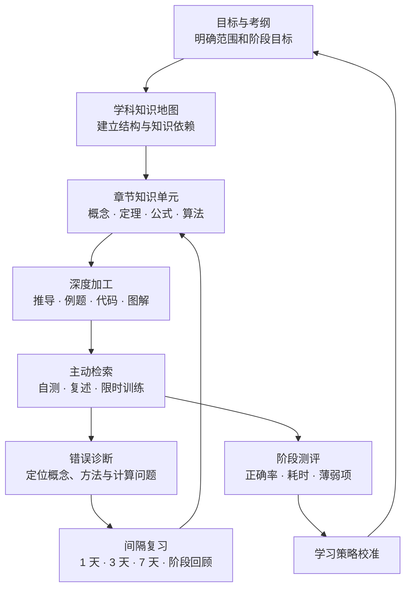

# CS · Knowledge Engineering

### 计算机科学知识体系与 2028 研究生入学考试学习中枢

**以知识结构为骨架，以深度理解为核心，以刻意练习为路径。**

  
  
  
  

  <a href="#学科导航">学科导航</a> ·
  <a href="#408-核心知识域">408 知识域</a> ·
  <a href="#学习系统">学习系统</a> ·
  <a href="#知识单元规范">知识规范</a> ·
  <a href="#建设路线">建设路线</a>

---

## 项目定位

**CS Knowledge Engineering** 不只是考研资料目录，而是一套面向长期积累的计算机科学知识工程。

围绕 2028 研究生入学考试目标，将分散的课程、教材、笔记与练习组织成可持续迭代的知识系统：

- **结构化**：从学科地图到章节单元，建立清晰的知识层级与依赖关系。
- **可验证**：每个重要结论尽可能配套推导、例题、代码或反例。
- **可训练**：通过章节自测、综合练习与错题归因，把理解转化为稳定能力。
- **可演进**：按基础、强化、真题、冲刺阶段持续更新，并依据正式考试大纲校准范围。

## 学科导航

| 学科领域 | 学习入口 | 核心能力 |
|:---|:---|:---|
| **数学二 · 高等数学** | [进入知识地图 →](./Project/Artificial%20Intelligence/01_数学二/高等数学/ReadMe.md) | 极限、微分、积分、多元函数与应用建模 |
| **数学二 · 线性代数** | [进入知识地图 →](./Project/Artificial%20Intelligence/01_数学二/线性代数/ReadMe.md) | 行列式、矩阵、向量、线性方程组与特征值 |
| **408 · 计算机学科基础** | [进入学科总纲 →](./Project/Artificial%20Intelligence/02_408/CS408.md) | 数据结构、组成原理、操作系统、计算机网络 |
| **英语二** | [进入学习导航 →](./Project/Artificial%20Intelligence/03_英语二/ReadMe.md) | 词汇、语法、长难句、阅读、翻译与写作 |
| **思想政治** | [进入学习导航 →](./Project/Artificial%20Intelligence/04_思想政治/ReadMe.md) | 理论框架、重点辨析、时政与主观题表达 |

## 408 核心知识域

<table>
<tr>
<td width="50%" valign="top">

### 01 · 数据结构

抽象数据类型、逻辑结构与存储结构、算法设计及复杂度分析。

**[打开数据结构知识库 →](./Project/Artificial%20Intelligence/02_408/数据结构/ReadMe.md)**

</td>
<td width="50%" valign="top">

### 02 · 计算机组成原理

数据表示、运算器、指令系统、CPU、存储层次、总线与 I/O。

**[打开组成原理知识库 →](./Project/Artificial%20Intelligence/02_408/计算机组成原理/ReadMe.md)**

</td>
</tr>
<tr>
<td width="50%" valign="top">

### 03 · 操作系统

进程与线程、同步互斥、内存管理、文件系统及设备管理。

**[打开操作系统知识库 →](./Project/Artificial%20Intelligence/02_408/操作系统/ReadMe.md)**

</td>
<td width="50%" valign="top">

### 04 · 计算机网络

体系结构、协议机制、网络性能、数据链路、网络层与传输层。

**[打开计算机网络知识库 →](./Project/Artificial%20Intelligence/02_408/计算机网络/ReadMe.md)**

</td>
</tr>
</table>

补充入口：[408 学科总纲](./Project/Artificial%20Intelligence/02_408/CS408.md) · [B 站课程索引](./Project/Artificial%20Intelligence/02_408/Bilibili课程索引.md)

## 学习系统

### 从知识输入到能力内化

### 备考管理入口

| 模块 | 用途 |
|:---|:---|
| [2028 备考总计划](./Project/Artificial%20Intelligence/00_考研计划/备考总计划/ReadMe.md) | 阶段目标、时间规划、周计划与复盘机制 |
| [模拟考试与复盘](./Project/Artificial%20Intelligence/05_模拟考试与复盘/) | 限时训练、成绩分析、薄弱知识点追踪 |
| [在线学习计划](https://read.likui.space/learn/) | 学习计划与进度入口 |
| [备考资源参考](https://ipoger.github.io/kaoyan-daily/#today) | 辅助了解备考资讯与学习资源 |

## 知识单元规范

每个章节尽量遵循统一的信息架构，避免只堆砌结论或摘录资料。

| 层级 | 内容标准 | 目标 |
|:---|:---|:---|
| **01 · 定位** | 知识地图、前置知识、考查边界 | 知道学什么、为什么学 |
| **02 · 理解** | 定义、定理、公式、原理与适用条件 | 建立准确的概念模型 |
| **03 · 推演** | 关键推导、证明过程、算法思想 | 理解结论如何得出 |
| **04 · 应用** | 典型例题、变式训练、代码实现 | 将知识迁移到问题求解 |
| **05 · 诊断** | 易错点、反例、边界条件、复杂度分析 | 识别理解盲区 |
| **06 · 巩固** | 章节自测、参考答案、复习清单 | 检验掌握并形成长期记忆 |

### 数学公式与 GitHub 渲染

本仓库数学笔记统一使用 GitHub 支持的 LaTeX 数学表达式：

- 行内公式使用单美元符号，例如 $f'(x)=2x$。
- 独立公式使用单独成行的双美元符号，公式前后留空行。
- 分段函数、矩阵和多行推导使用独立公式块；每一行单独书写，换行处使用 LaTeX 的 `\\`。
- 不使用 `\(...\)` 或 `\[...\]` 作为正文公式定界符。
- 代码块中的公式只展示源码，不会作为数学表达式渲染。

详细规范见[数学公式与 GitHub 渲染规范](./docs/数学公式与GitHub渲染规范.md)。

## 内容质量原则

- 数学公式使用 LaTeX；算法与数据结构示例优先提供清晰、可读的 C/C++ 代码。
- 重要定理注明前提条件，重要算法说明边界情况与复杂度。
- 例题展示完整思路，不以只给答案代替推导。
- 章节练习配套答案或解题要点；错题记录错误原因与改进策略。
- Mermaid 用于表达知识关系、流程和算法结构，图示服务于理解而非装饰。

## 建设路线

| 阶段 | 建设重点 | 阶段产出 |
|:---|:---|:---|
| **基础阶段** | 概念、公式、基本算法与典型题型 | 完整章节笔记与基础自测 |
| **强化阶段** | 知识联系、综合模型、方法归纳 | 专题总结与综合训练 |
| **真题阶段** | 历年题型、命题规律、限时解题 | 真题解析与错题专题 |
| **冲刺阶段** | 高频考点、薄弱项回补、模拟测评 | 知识清单与考前复盘 |

## 范围、来源与维护

1. 当前建设方向为 **2028 研究生入学考试**；正式考试范围以当年考试大纲及目标院校要求为准。
2. 数学二与数学一的内容边界需要明确区分，不将超出数学二范围的模块默认列为必学内容。
3. 408 的具体范围以当年官方考试大纲为准；教材、课程和个人笔记作为辅助学习材料。
4. 未经核验的年份、题号、数据、课程时间戳和外部链接不作为确定事实发布。
5. 新增内容前先检查现有目录，优先补全知识链条，避免重复建设。
6. 尊重教材、课程与原始资料版权；以独立理解、推导、总结和原创练习为主要沉淀形式。

---

**BUILD · UNDERSTAND · PRACTICE · REFLECT**

持续积累知识，建立系统认知，让每一次练习都产生复利。

CS Knowledge Engineering · 2028 Examination Preparation

