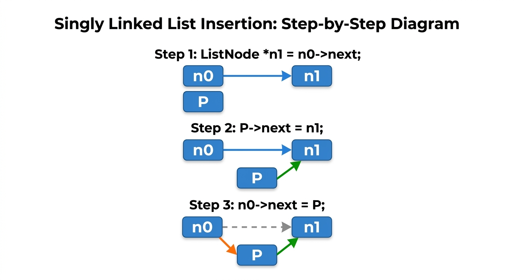
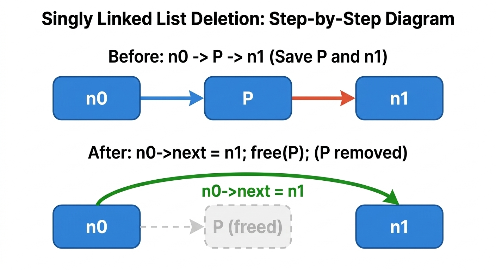

> 1. 链表的解释说明

如何理解下面一段代码

```c
void inseet(ListNode *n0 ,ListNode *p)
{
    ListNode *n1 = n0->next;
    p->next = n1;
    n0->next = p;
}
```

- `ListNode *n1 = n0->next;`
  创建一个临时指针 n1，用来保存 n0 原先指向的下一个节点。这样做是为了防止后续修改 n0->next 时，原本跟在 n0 后面的链表部分丢失。
- `P->next = n1;`
  让新节点 P 的 next 指针指向刚才保存的 n1。此时，新节点 P 已经成功接上了链表的后半部分。
- `n0->next = P;`
  让节点 n0 的 next 指针改指向新节点 P。至此，n0、P、n1 三个节点按顺序串联起来，插入完成。



---

费曼学习法的核心是用最简单、直观的日常类比来解释复杂概念。我们可以把单向链表想象成一群闭着眼睛玩“老鹰捉小鸡”或“排队搭肩膀”的小朋友。

核心场景设定

- 节点（Node）：每个小朋友就是一个节点。
- next 指针：每个小朋友伸出的右手。大家闭着眼睛，全靠右手搭着前面人的肩膀来认路，松手就找不到队伍了。
- 初始状态：小朋友 n0 的右手正搭在 n1 的肩膀上（n0 -> n1）。现在新来了一个小朋友 P，想要插队站在 n0 后面、n1 前面。

为什么不能直接插队？（常见错误）

如果 `n0` 一听有人要插队，直接松开搭着 `n1` 的右手，转而去搭 P 的肩膀（即先写 n0->next = P）：

- 后果：因为大家都闭着眼睛，n0 一松手，队伍瞬间断开。谁也不知道 n1 以及 n1 身后的一长串小朋友走到哪里去了，整个后半截队伍彻底走丢<mark>（内存泄漏）</mark>。

<u>正确的三步<mark>“搭肩膀”法</mark></u>

为了保证队伍不断开，必须按以下三步操作：

1. 记住后面的人是谁（ListNode \*n1 = n0->next;）
   在 n0 松手之前，先大喊一声确认一下：n0 右手现在搭着的是 n1。我们在心里把 n1 的位置牢牢记住，防止等会儿找不到他。
2. 新人先抓住后半截队伍（P->next = n1;）
   让新来的小朋友 P 走过来，先把他的右手搭在 n1 的肩膀上。此时，n0 和 P 两只手同时搭着 n1，队伍非常稳固，绝对不会走丢。
3. 前面的人改抓新人（n0->next = P;）
   确认 P 已经稳稳抓住了 n1 之后，n0 这才放心地松开搭在 n1 肩膀上的右手，转而搭在新人 P 的肩膀上。

总结口诀

<mark>“先记后人，新人接后，旧人接新。”</mark>
只要记住“在松开旧手之前，必须先用新把手接住后面”，你就彻底掌握了单向链表插入的精髓。


> 2. 链表删除

```c
/* 删除节点 n0 之后的第一个节点 P */
void removeNode(ListNode *n0) {
    // 如果 n0 后面已经没有节点了，直接结束
    if (n0 == NULL || n0->next == NULL) {
        return;
    }
    ListNode *P = n0->next;   // 1. 记住要删除的节点 P 为了后面释放内存
    ListNode *n1 = P->next;   // 2. 记住 P 后面的节点 n1
    n0->next = n1;            // 3. 让 n0 直接指向 n1
    free(P);                  // 4. 释放 P 的内存（C语言规范操作）
}
```



为了让队伍在 P 离开后不断开，必须按以下顺序操作：
1. 确认要离开的人是谁（`ListNode *P = n0->next;`）
先标记出 n0 身后正准备离开的节点 P。如果不提前记下 P，等会儿 n0 一松手，就再也找不到 P 来清理它的位置了。
2. 问清 P 后面站着谁（`ListNode *n1 = P->next;`）
在 P 退出之前，先看一眼 P 的右手正搭在谁的肩膀上，记住这个人是 n1。
3. n0 直接改搭 n1 的肩膀（n0->next = n1;）
n0 松开 P 的肩膀，直接把右手越过 P，搭在 n1 的肩膀上。此时队伍变成了 n0 -> n1，后半截队伍已经安全接好。
4. 让 P 彻底离开（free(P);）
前后已经重新连通，P 可以放心退出队伍，把占用的位置（内存）腾出来。
